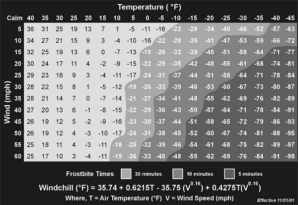
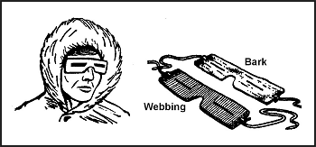
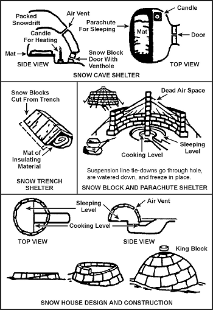
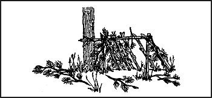
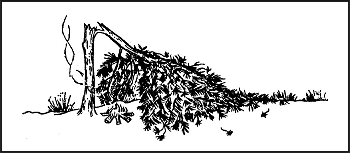
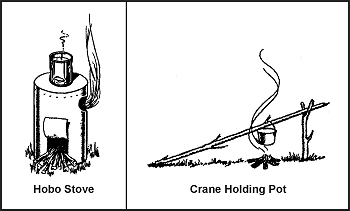

> Одна з найскладніших ситуацій виживання — це сценарій холодної погоди. Кожного разу, коли ви вирушаєте на холод, ви кидаєте виклик стихії. Маючи трохи знань про навколишнє середовище, належні плани та відповідне спорядження, ви можете подолати стихію. Коли ви усуваєте один або кілька з цих факторів, виживання стає все складнішим. Пам'ятайте, зимова погода надзвичайно мінлива. Готуйтеся адаптуватися до умов хуртовини навіть під час сонячної та ясної погоди.
> 
> Холод є набагато більшою загрозою для виживання, ніж здається. Він зменшує вашу здатність мислити і послаблює волю робити щось, окрім як зігрітися. Холод — підступний ворог; оскільки він притупляє розум і тіло, він підкорює волю до виживання.
> 
> Холод дуже легко змушує забути вашу кінцеву мету — вижити.

### ХОЛОДНІ РЕГІОНИ ТА ЛОКАЦІЇ

Холодні регіони включають арктичні та субарктичні райони та райони, що безпосередньо прилягають до них. Близько 48 відсотків загальної сухопутної маси Північної півкулі можна класифікувати як холодний регіон через вплив і ступінь поширення температур повітря. Океанічні течії впливають на холодну погоду і спричиняють те, що великі площі, які зазвичай входять до помірної зони, потрапляють у холодні регіони в зимові періоди. Висота над рівнем моря також має помітний вплив на визначення холодних регіонів.

У межах регіонів з холодною погодою ви можете зіткнутися з двома типами середовищ з холодною погодою — вологим або сухим. Знання того, до якого середовища належить ваш район операцій, вплине на планування та виконання операції в холодну погоду.

**СЕРЕДОВИЩА ВОЛОГОГО ХОЛОДУ**

Умови вологого холоду існують, коли середня температура за 24-годинний період становить -10 градусів Цельсія (14 градусів Фаренгейта) або нижче. Характеристиками цього стану є замерзання під час холодніших нічних годин і відтавання вдень. Хоча температури в цей період тепліші, рельєф зазвичай дуже брудний через сльоту та болото. Ви повинні зосередитися на захисті себе від вологого ґрунту та від замерзаючого дощу або мокрого снігу.

**СЕРЕДОВИЩА СУХОГО ХОЛОДУ**

Умови сухого холоду існують, коли середня температура за 24-годинний період залишається нижче -10 градусів Цельсія (14 градусів Фаренгейта). Навіть незважаючи на те, що температури в цьому стані набагато нижчі за норму, вам не доводиться боротися із замерзанням і відтаванням. У цих умовах вам потрібно більше шарів внутрішнього одягу для захисту від температур до -60 градусів Цельсія (-76 градусів Фаренгейта). Надзвичайно небезпечні умови існують, коли вітер і низька температура поєднуються.

### ВІТРОХОЛОД (WINDCHILL)

Вітрохолод збільшує небезпеку в холодних регіонах. Вітрохолод — це ефект рухомого повітря на відкриту плоть. Наприклад, при вітрі 27,8 км/год (15 вузлів) і температурі -10 градусів Цельсія (14 градусів Фаренгейта) еквівалентна температура вітрохолоду становить -23 градуси Цельсія (-9 градусів Фаренгейта). [Фігура 15-1](#fig15-1) дає фактори вітрохолоду для різних температур і швидкостей вітру.

**Фігура 15-1. Таблиця вітрохолоду**

Пам'ятайте, навіть коли немає вітру, ви створюєте еквівалентний вітер, катаючись на лижах, бігаючи, бувши буксированими на лижах за транспортним засобом або працюючи навколо літаків, що створюють повітряні потоки.

### БАЗОВІ ПРИНЦИПИ ВИЖИВАННЯ В ХОЛОДНУ ПОГОДУ

Для вас складніше задовольнити свої базові потреби у воді, їжі та укритті в холодному середовищі, ніж у теплому. Навіть якщо у вас є базові потреби, ви також повинні мати адекватний захисний одяг і волю до виживання. Воля до виживання так само важлива, як і базові потреби. Були випадки, коли треновані та добре оснащені особи не виживали в ситуаціях холодної погоди, оскільки їм бракувало волі до життя. І навпаки, ця воля підтримувала осіб, менш добре навчених та оснащених.

Сьогодні армія США випускає багато різних предметів одягу та спорядження для холодної погоди. Спеціалізовані підрозділи можуть мати доступ до новішого, легкого спорядження, такого як поліпропіленова білизна, верхній одяг та черевики Gore-Tex, а також інше спеціальне спорядження. Проте старе спорядження триматиме вас у теплі, якщо ви дотримуєтеся кількох принципів холодної погоди. Якщо нові типи одягу доступні, використовуйте їх. Якщо ні, то ваш одяг має бути повністю вовняним, за можливим винятком вітровки.

Ви повинні не лише мати достатньо одягу для захисту від холоду, але й знати, як максимізувати тепло, яке ви від нього отримуєте. Наприклад, завжди тримайте голову вкриттиою. Ви можете втратити 40–45 відсотків тепла тіла через незахищену голову і ще більше через незахищену шию, зап'ястя та щиколотки. Ці частини тіла є хорошими радіаторами тепла і мають дуже мало ізолюючого жиру. Мозок дуже чутливий до холоду і витримує найменшу кількість охолодження. Оскільки в голові багато циркуляції крові, більша частина якої знаходиться на поверхні, ви можете швидко втратити тепло, якщо не вкриєте голову.

Існує чотири основні принципи, яких слід дотримуватися, щоб залишатися в теплі. Простий спосіб запам'ятати ці базові принципи — використати слово **COLDER** (ХОЛОДНІШЕ):

* **C** – Keep clothing clean (Тримайте одяг чистим). Цей принцип завжди важливий для гігієни та комфорту. Взимку це також важливо з погляду тепла. Одяг, забитий брудом і жиром, втрачає більшу частину своїх ізоляційних властивостей. Тепло може легше виходити з організму через розчавлені або заповнені повітряні кишені одягу.
* **O** – Avoid overheating (Уникайте перегріву). Коли вам стає занадто спекотно, ви пітнієте, і ваш одяг вбирає вологу. Це впливає на ваше тепло двома способами: вологість знижує ізоляційні якості одягу, а в міру випаровування поту ваше тіло охолоджується. Регулюйте свій одяг так, щоб не пітніти. Зробіть це, частково розстебнувши парку чи куртку, знявши внутрішній шар одягу, знявши важкі зовнішні рукавиці або відкинувши капюшон парки чи змінивши його на легший головний убір. Голова та руки діють як ефективні розсіювачі тепла при перегріві.
* **L** – Wear your clothing loose and in layers (Носіть одяг вільним і шарами). Носіння тісного одягу та взуття обмежує кровообіг і закликає до холодної травми. Це також зменшує об'єм повітря, застряглого між шарами, зменшуючи його ізоляційне значення. Кілька шарів легкого одягу краще, ніж один однакової товщини шар одягу, оскільки шари мають мертвий повітряний простір між ними. Мертвий повітряний простір забезпечує додаткову ізоляцію. Крім того, шари одягу дозволяють знімати або додавати шари одягу для запобігання надмірному потовиділенню або збільшення тепла.
* **D** – Keep clothing dry (Тримайте одяг сухим). За низьких температур ваші внутрішні шари одягу можуть стати вологими від поту, а зовнішній шар, якщо він не водовідштовхувальний, може стати вологим від снігу та інею, розтопленого теплом тіла. Носіть водовідштовхувальний верхній одяг, якщо він доступний. Він відштовхуватиме більшу частину води, зібраної від танення снігу та інею. Перед входженням у нагріте укриття струсіть сніг та іней. Незважаючи на вжиті запобіжні заходи, буватимуть часи, коли ви не зможете уникнути намокання. У такі часи сушіння одягу може стати серйозною проблемою. На марші вішайте вологі рукавиці та шкарпетки на рюкзак. Іноді при мінусових температурах вітер і сонце висушать цей одяг. Ви також можете покласти вологі шкарпетки або рукавиці в розгорненому вигляді біля свого тіла, щоб тепло вашого тіла висушило їх. У таборі вішайте вологий одяг всередині укриття біля верху, використовуючи сушильні лінії або імпровізовані стійки. Ви навіть можете висушити кожен предмет, тримаючи його перед відкритим вогнищем. Сушіть шкіряні вироби повільно. Якщо немає інших засобів для сушіння черевиків, покладіть їх між корпусом спального мішка та вкладишем. Тепло вашого тіла допоможе висушити шкіру.
* **E** – Examine your uniform for worn areas, tears, and cleanliness (Оглядайте свою форму на предмет зношених місць, розривів та чистоти).
* **R** – Repair your uniform early before tears and holes become too large to patch (Ремонтуйте свою форму вчасно, до того як розриви та дірки стануть занадто великими для латання). Імпровізовані набори для шиття можна зробити з кісток, рослинних волокон, шнура 550 та великих колючок.

Важкий спальний мішок на пуху є цінним предметом спорядження для виживання в холодну погоду. Переконайтеся, що пух залишається сухим. У вологому стані він втрачає багато своїх ізоляційних властивостей. Якщо у вас немає спального мішка, ви можете зробити його з парашутної тканини або подібного матеріалу та природного сухого матеріалу, такого як листя, соснова хвоя чи мох. Покладіть сухий матеріал між двома шарами матеріалу.

Іншими важливими предметами для виживання є ніж; водонепроникні сірники у водонепроникному контейнері, бажано з прикріпленим кремнієм; міцний компас; карта; годинник; водонепроникний брезент та покриття; ліхтарик; бінокль; темні окуляри; жирні аварійні харчі; спорядження для збору їжі та сигнальні предмети.

Пам'ятайте, середовище з холодною погодою може бути дуже суворим. Добре подумайте про вибір правильного спорядження для виживання на холоді. Якщо ви не впевнені щодо предмета, яким ніколи не користувалися, випробуйте його в середовищі «ночівлі на задньому дворі», перш ніж вирушати далі. Вибравши предмети, які є важливими для вашого виживання, не втрачайте їх після входу в середовище з холодною погодою.

### ГІГІЄНА

Хоча миття може бути непрактичним і некомфортним у холодному середовищі, ви повинні це робити. Миття допомагає запобігти висипанням на шкірі, які можуть перерости в серйозніші проблеми.

У деяких ситуаціях ви зможете прийняти снігову ванну. Візьміть жменьку снігу і вимийте своє тіло там, де накопичуються піт і волога, наприклад під пахвами та між ногами, а потім витріть насухо. По можливості мийте ноги щодня і одягайте чисті, сухі шкарпетки. Змінюйте білизну принаймні двічі на тиждень. Якщо ви не можете вимити білизну, зніміть її, витрусіть і дайте їй провітритися протягом години-двох.

Якщо ви голитеся, намагайтеся робити це перед сном. Це дасть вашій шкірі час на відновлення перед тим, як піддавати її впливу стихії.

### МЕДИЧНІ АСПЕКТИ

Коли ви здорові, температура вашого внутрішнього ядра (температура тулуба) залишається майже постійною на рівні 37 градусів Цельсія (98,6 градусів Фаренгейта). Оскільки ваші кінцівки та голова мають менше захисної тканини тіла, ніж тулуб, їхня температура змінюється і може не досягати температури ядра.

Ваше тіло має систему контролю, яка дозволяє йому реагувати на екстремальні температури для підтримки температурного балансу. Існує три основні фактори, що впливають на цей температурний баланс — вироблення тепла, втрата тепла та випаровування. Різниця між внутрішньою температурою тіла та температурою навколишнього середовища керує швидкістю вироблення тепла. Ваше тіло може позбутися тепла краще, ніж виробити його. Потовиділення допомагає контролювати тепловий баланс. Максимальне потовиділення позбавить від тепла приблизно так само швидко, як максимальне навантаження виробляє його.

Тремтіння змушує організм виробляти тепло. Воно також викликає втому, яка, у свою чергу, призводить до падіння температури тіла. Рух повітря навколо вашого тіла впливає на втрату тепла. Зазначалося, що гола людина, яка піддається впливу нерухомого повітря при температурі близько 0 градусів Цельсія (32 градуси Фаренгейта) або нижче, може підтримувати тепловий баланс, якщо вона тремтить щосили. Проте вона не може тремтіти вічно.

Також зазначалося, що людина в стані спокою, одягнена в максимальний арктичний одяг в холодному середовищі, може підтримувати внутрішній тепловий баланс при температурах нижче нуля. Проте, щоб витримати справді холодні умови протягом будь-якого тривалого часу, їй доведеться стати активною або тремтіти.

### ХОЛОДНІ ТРАВМИ

Найкращий спосіб боротьби з травмами та хворобами — вжити заходів для запобігання їх виникненню в першу чергу. Лікуйте будь-яку травму чи хворобу, що виникає, якомога швидше, щоб запобігти її погіршенню.

Знання ознак і симптомів та використання системи товаришів мають вирішальне значення для підтримки здоров'я. Наступні абзаци пояснюють деякі холодні травми, які можуть статися.

**ГІПОТЕРМІЯ (HYPOTHERMIA)**

Гіпотермія — це зниження температури тіла зі швидкістю, що перевищує здатність організму виробляти тепло. Причинами гіпотермії можуть бути загальне охолодження або раптове намокання тіла через падіння в озеро чи обприскування паливом або іншими рідинами.

Початковим симптомом є тремтіння. Це тремтіння може прогресувати до того ступеня, що воно стає неконтрольованим і заважає здатності індивіда піклуватися про себе. Це починається, коли внутрішня температура тіла падає приблизно до 35,5 градусів Цельсія (96 градусів Фаренгейта). Коли температура ядра досягає 35–32 градусів Цельсія (95–90 градусів Фаренгейта), може виникнути мляве мислення, ірраціональне міркування та хибне відчуття тепла. Температура ядра 32–30 градусів Цельсія (90–86 градусів Фаренгейта) і нижче призводить до м'язової ригідності, втрати свідомості та ледве помітних ознак життя. Якщо внутрішня температура жертви падає нижче 25 градусів Цельсія (77 градусів Фаренгейта), смерть майже напевно неминуча.

Для лікування гіпотермії зігрійте все тіло. Якщо є доступні засоби, зігрійте людину, спочатку зануривши лише область тулуба в теплу воду температурою від 37,7 до 43,3 градусів Цельсія (100–110 градусів Фаренгейта).

> **УВАГА**
> 
> Зігрівання всього тіла у ванні з теплою водою слід робити лише в лікарняному середовищі через підвищений ризик зупинки серця та шоку від зігрівання.

Один із найшвидших способів доставити тепло до внутрішнього ядра — дати теплі водні клізми. Проте така дія може бути неможливою в ситуації виживання. Інший метод — загонути потертого в нагрітий спальний мішок з іншою людиною, яка вже тепла; обидва повинні бути голими.

<table cellspacing="0" cellpadding="7" border="1" width="400">

<tbody>

<tr>

<td valign="top">

**УВАГА**

Особа, поміщена в спальний мішок з постраждалим, також може стати жертвою гіпотермії, якщо залишити її в мішку занадто довго.

</td>

</tr>

</tbody>

</table>

Якщо людина при свідомості, дайте їй гарячі, підсолоджені рідини. Найкраще мед або декстроза, але якщо вони недоступні, можна використовувати цукор, какао або подібний розчинний підсолоджувач.

> **УВАГА**
> 
> Не примушуйте людину без свідомості пити.

Існує дві небезпеки при лікуванні гіпотермії — занадто швидке зігрівання та «післяпадіння» (after-drop). Занадто швидке зігрівання може спричинити у постраждалого проблеми з кровообігом, що призведе до серцевої недостатності. Післяпадіння — це різке падіння внутрішньої температури тіла, яке виникає при виведенні постраждалого з теплої води. Ймовірна причина — повернення раніше застояної крові з кінцівок в область ядра (внутрішнього тулуба) при відновленні кровообігу. Зосередження уваги на зігріванні області ядра та стимулюванні периферичного кровообігу зменшить наслідки післяпадіння. Занурення тулуба в теплу ванну, якщо це можливо, є найкращим лікуванням.

**ОМОРОЖЕННЯ / ОБМОРОЖЕННЯ (FROSTBITE)**

Ця травма є результатом заморожування тканин. Легке обмороження охоплює лише шкіру, яка набуває тьмяного білуватого кольору. Глибоке обмороження простягається нижче шкіри. Тканини стають твердими та нерухомими. Ваші ноги, руки та відкриті ділянки обличчя особливо вразливі до обмороження.

Найкраща профілактика обмороження, коли ви з іншими, — використання системи товаришів. Часто перевіряйте обличчя свого товариша і переконайтеся, що він перевіряє ваше. Якщо ви один, періодично закривайте ніс і нижню частину обличчя рукавицею.

Наступні поради допоможуть вам залишатися в теплі та запобігати обмороженню, коли надзвичайно холодно або коли у вас менше ніж адекватний одяг:

* _Обличчя._ Підтримуйте кровообіг, «корчачи обличчя» (making faces). Зігрівайте руками.
* _Вуха._ Ворушіть і рухайте вухами. Зігрівайте руками.
* _Руки._ Рухайте руками всередині рукавиць. Зігрівайте, тримаючи руки близько до тіла.
* _Стопи._ Рухайте стопами та ворушіть пальцями ніг усередині черевиків.

Втрата чутливості в руках і ногах є ознакою обмороження. Якщо ви втратили чутливість лише на короткий час, обмороження, мабуть, легке. В іншому випадку вважайте, що обмороження глибоке. Для зігрівання легкого обмороження використовуйте свої руки або рукавиці, щоб зігріти обличчя та вуха. Покладіть руки під пахви. Покладіть свої ноги біля живота товариша. Глибока травма обмороження, якщо її розморозити та знову заморозити, заподіє більше шкоди, ніж немедична людина може витримати. [Фігура 15-2](#fig15-2) перелічує деякі «робіть і не робіть» щодо обмороження.

|Робіть (Do)|Не робіть (Don't)|
|-----------|-----------------|
|Періодично перевіряйте на обмороження.|Розтирайте травму снігом.|
|Зігрівайте легке обмороження.|Пийте алкогольні напої.|
|Запобігайте повторному замерзанню травмованих ділянок.|Куріть.|
| |Намагайтеся розморозити глибоке обмороження, якщо ви знаходитесь далеко від остаточної медичної допомоги.|

**Фігура 15-2. Що робити і чого не робити при обмороженні**

**ТРАНШЕЙНА СТОПА ТА СТОПА ВІД ЗАНУРЕННЯ (TRENCH FOOT AND IMMERSION FOOT)**

Ці умови є результатом багатьох годин або днів впливу вологих або сирих умов при температурі трохи вище нуля. Симптомами є відчуття шпильок і голок, поколювання, оніміння, а потім біль. Спочатку шкіра здаватиметься вологою, розм'якшеною, білою та зморшкуватою. У міру прогресування і появи пошкоджень шкіра набуде червоного, а потім синюватого або чорного забарвлення. Стопи стають холодними, опухлими і мають восковий вигляд. Ходьба стає важкою, а стопи здаються важкими та онімілими. Нерви та м'язи зазнають основних пошкоджень, але може виникнути гангрена. У крайніх випадках плоть відмирає, і може виникнути необхідність ампутації стопи або ноги. Найкраща профілактика — тримати стопи сухими. Носіть із собою додаткові шкарпетки у водонепроникному пакеті. Ви можете сушити вологі шкарпетки біля тулуба (спини чи грудей). Мийте стопи та вдягайте сухі шкарпетки щодня.

**ЗНЕВОДНЕННЯ (DEHYDRATION)**

Закутавшись у багато шарів одягу в холодну погоду, ви можете не усвідомлювати, що втрачаєте вологу тіла. Ваш важкий одяг вбирає вологу, яка випаровується в повітря. Ви повинні пити воду, щоб замінити цю втрату рідини. Ваша потреба у воді в холодному середовищі така ж велика, як і в теплому ([див. Пустеля](Desert)). Один із способів визначити, чи ви зневоднюєтеся — перевірити колір сечі на снігу. Якщо ваша сеча робить сніг темно-жовтим, ви зневоднюєтеся і повинні поповнити рідину в організмі. Якщо це робить сніг світло-жовтим або безбарвним, ваші рідини в організмі мають більш нормальний баланс.

**ХОЛОДНИЙ ДІУРЕЗ (COLD DIURESIS)**

Вплив холоду збільшує виділення сечі. Він також зменшує кількість рідини в організмі, яку ви повинні замінити.

**СОНЯЧНИЙ ОПІК (SUNBURN)**

Відкрита шкіра може отримати сонячний опік навіть тоді, коли температура повітря нижче нуля. Сонячні промені відбиваються під усіма кутами від снігу, льоду та води, вдаряючи в чутливі ділянки шкіри — губи, ніздрі та повіки. Вплив сонця призводить до сонячних опіків швидше на великих висотах, ніж на низьких. Наносьте крем від засмаги або бальзам для губ на обличчя, перебуваючи на сонці.

**СНІГОВА СЛІПОТА (SNOW BLINDNESS)**

Відбиття ультрафіолетових променів сонця від засніженої території викликає цей стан. Симптомами снігової сліпоти є відчуття піску в очах, біль в очах і над ними, який посилюється при русі очних яблук, червоні і сльозяться очі, а також головний біль, що посилюється при тривалому впливі світла. Тривалий вплив цих променів може призвести до постійного пошкодження очей. Для лікування снігової сліпоти забинтуйте очі, доки симптоми не зникнуть.

Ви можете запобігти сніговій сліпоті, носячи сонцезахисні окуляри. Якщо у вас немає сонцезахисних окулярів, імпровізуйте. Виріжте щілини в шматку картону, тонкого дерева, деревної корі або іншого доступного матеріалу ([Фігура 15-3](#fig15-3)). Нанесення сажі під очі допоможе зменшити блиск і відблиски.

**Фігура 15-3. Імпровізовані сонцезахисні окуляри**

**ЗАКРЕПИ (CONSTIPATION)**

Дуже важливо справляти нужду, коли це необхідно. Не зволікайте через холодні умови. Затримка спорожнення через холод, вживання дегідратованої їжі, пиття занадто малої кількості рідини та нерегулярний режим харчування можуть спричинити запор. Хоча це не робить людину недієздатною, закреп може викликати певний дискомфорт. Зведіть споживання рідини до щонайменше 2 літрів понад ваші нормальні 2–3 літри щоденного споживання і, якщо можливо, їжте фрукти та інші продукти, які послаблюють стілець.

**УКУСИ КОМАХ**

Укуси комах можуть інфікуватися через постійне розчісування. Мухи можуть переносити різні хвороботворні мікроби. Щоб запобігти укусам комах, використовуйте репеленти від комах та сітки, а також носіть належний одяг. Дивіться [Розділ Тварини](Animals) щодо інформації про укуси комах та [Медицина](Medicine) для лікування.

### УКРИТТЯ (SHELTERS)

Ваше середовище та обладнання, яке ви носите з собою, визначатимуть тип укриття, яке ви можете побудувати. Ви можете будувати укриття в лісистих районах, відкритій місцевості та безплідних районах. Лісисті райони зазвичай забезпечують найкраще місце розташування, тоді як безплідні райони мають лише сніг як будівельний матеріал. Лісисті райони забезпечують деревиною для будівництва укриття, деревиною для вогню, маскуванням від спостереження та захистом від вітру.

**ПРИМІТКА:** В екстремальних умовах холоду не використовуйте метал, такий як фюзеляж літака, для укриття. Метал проводитиме від укриття те, невелике тепло, яке ви можете згенерувати.

Укриття з льоду або снігу зазвичай вимагають таких інструментів, як льодоруби чи пилки. Ви також повинні витратити багато часу та енергії на будівництво такого укриття. Обов'язково вентилюйте закрите укриття, особливо якщо ви збираєтеся розводити в ньому вогонь. Завжди блокуйте вхід укриття, якщо це можливо, щоб утримати тепло і зупинити вітер. Використовуйте рюкзак або сніговий блок. Будуйте укриття не більше ніж потрібно. Це зменшить простір для обігріву. Фатальною помилкою при будівництві укриття в холодну погоду є створення такого великого укриття, яке краде тепло тіла, а не допомагає його зберегти.

Ніколи не спіть безпосередньо на землі. Покладіть трохи соснових гілок, трави або іншого ізолюючого матеріалу, щоб земля не поглинала тепло вашого тіла.

Ніколи не засинайте, не погасивши піч чи лампаду. Отруєння чадним газом може стати результатом горіння вогню в невентильованому укритті. Чадний газ — велика небезпека. Він безбарвний і без запаху. Будь-який відкритий вогонь може генерувати чадний газ. Завжди перевіряйте вентиляцію. Навіть у вентильованому укритті неповне згоряння може спричинити отруєння чадним газом. Зазвичай немає ніяких симптомів. Втрата свідомості та смерть можуть статися без попередження. Іноді, однак, може виникати тиск у скронях, печіння в очах, головний біль, стукіт у пульсі, сонливість або нудота. Одна характерна, видима ознака отруєння чадним газом — вишнево-червоний колір тканин губ, рота та внутрішньої сторони повік. Негайно вийдіть на свіже повітря, якщо у вас є будь-який із цих симптомів.

Існує кілька типів польових укриттів, які ви можете швидко побудувати або використовувати. Багато з них використовують сніг для ізоляції.

**УКРИТТЯ «СНІГОВА ПЕЧЕРА» (SNOW CAVE SHELTER)**

Укриття «снігова печера» ([Фігура 15-4](#fig15-4)) є найефективнішим житлом завдяки ізоляційним властивостям снігу. Пам'ятайте, що його будівництво вимагає часу та енергії, і ви намокнете під час його будівництва. По-перше, вам потрібно знайти замет глибиною близько 3 метрів (10 футів), в який можна копати. Під час будівництва цього укриття тримайте дах у формі арки для міцності та дозволу талому снігу стікати по стінах. Побудуйте спальну платформу вище входу. Відокремте спальну платформу від стін снігової печери або викопайте невелику траншею між платформою та стіною. Ця платформа запобіжить намоканню вас і вашого спорядження від талого снігу. Ця конструкція особливо важлива, якщо у вас є хороше джерело тепла в сніговій печері. Переконайтеся, що дах достатньо високий, щоб ви могли сидіти на спальній платформі. Заблокуйте вхід сніговим блоком або іншим матеріалом і використовуйте нижню зону входу для приготування їжі. Стіни та стеля повинні мати товщину принаймні 30 сантиметрів (1 фут). Встановіть вентиляційну шахту. Якщо у вас немає замету, достатньо великого для будівництва снігової печери, ви можете зробити її варіацію, склавши сніг у пагорб, достатньо великий для викопування.

**Фігура 15-4. Снігові житла**

**СНІГОВЕ ТРАНШЕЙНЕ УКРИТТЯ (SNOW TRENCH SHELTER)**

Ідея цього укриття ([Фігура 15-4](#fig15-4)) полягає в тому, щоб опуститися нижче рівня снігу та вітру і використовувати ізоляційні властивості снігу. Якщо ви перебуваєте в районі з ущільненим снігом, наріжте снігові блоки і використовуйте їх як верхнє покриття. Якщо ні, ви можете використати пончо чи інший матеріал. Побудуйте лише один вхід і використовуйте сніговий блок або рюкзак як двері.

**СНІГОБЛОКОВЕ ТА ПАРАШУТНЕ УКРИТТЯ**

Використовуйте снігові блоки для стін та парашутний матеріал для верхнього покриття ([Фігура 15-4](#fig15-4)). Якщо снігопад рясний, вам доведеться регулярно очищати сніг з верху, щоб запобігти обвалу парашутного матеріалу.

**СНІГОВИЙ БУДИНОК АБО ІГЛУ (SNOW HOUSE OR IGLOO)**

У певних районах місцеві жителі часто використовують цей тип укриття ([Фігура 15-4](#fig15-4)) як мисливські та рибальські укриття. Вони є ефективними укриттями, але вимагають певної практики для їх правильного виготовлення. Також ви повинні перебувати в районі, придатному для нарізання снігових блоків, і мати обладнання для їх нарізання (снігова пилка або ніж).

**УКРИТТЯ-НАВІС (LEAN-TO SHELTER)**

Сконструюйте це укриття так само, як і для інших середовищ. Проте накидайте сніг навколо стін для ізоляції ([Фігура 15-5](#fig15-5)).

**Фігура 15-5. Навіс з природного укриття**

**УКРИТТЯ ПІД ПОВАЛЕНИМ ДЕРЕВОМ (FALLEN TREE SHELTER)**

Щоб побудувати це укриття, знайдіть повалене дерево і викопайте сніг під ним ([Фігура 15-6](#fig15-6)). Сніг під деревом не буде глибоким. Якщо вам потрібно видалити гілки зсередини, використовуйте їх для вистилання підлоги.

**Фігура 15-6. Повалене дерево як укриття**

**УКРИТТЯ В ЛУНЦІ ДЕРЕВА (TREE-PIT SHELTER)**

Викопайте сніг з-під підходящого великого дерева. Біля основи дерева він буде не таким глибоким. Використайте зрізані гілки для вистилання укриття. Використовуйте брезент як верхнє покриття, щоб запобігти падінню снігу з дерева в укриття. Якщо воно побудоване правильно, ви можете мати видимість на 360 градусів ([Укриття, Фігура 5-12](Shelter)).

**20-МІСНИЙ РЯТУВАЛЬНИЙ ПЛІТ**

Цей пліт є стандартним надводним плотом на літаках ВПС США. Ви можете використовувати його як укриття. Не дозволяйте великій кількості снігу накопичуватися на захисті зверху. Якщо він розміщений на відкритій ділянці, він також служить гарним сигналом для літаків над головою.

### ВОГОНЬ (FIRE)

Вогонь особливо важливий у холодну погоду. Він не лише забезпечує засобом приготування їжі, а й зігрівання та розтоплення снігу чи льоду для отримання води. Він також забезпечує вас значним психологічним поштовхом, змушуючи почуватися трохи безпечніше у вашій ситуації.

Використовуйте техніки, описані в [Розділі Вогонь](Fire), щоб побудувати і запалити свій вогонь. Якщо ви перебуваєте у ворожій території, пам'ятайте, що дим, запах і світло від вашого вогню можуть викрити ваше місцезнаходження. Світло відбивається від навколишніх дерев або каміння, роблячи навіть непряме світло джерелом небезпеки. Дим має тенденцію підніматися прямо вгору в холодну, безвітряну погоду, роблячи його маяком вдень, але допомагаючи приховати запах вночі. У теплу погоду, особливо в лісистій місцевості, дим має тенденцію притискатися до землі, роблячи його менш помітним вдень, але змушуючи його запах поширюватися.

Якщо ви перебуваєте у ворожій території, зрізайте низькі гілки дерев, а не ціле дерево для дров. Впалі дерева легко помітити з повітря.

Уся деревина горітиме, але деякі типи деревини створюють більше диму, ніж інші. Наприклад, хвойні дерева, що містять смолу та деготь, створюють більше і темніший дим, ніж листяні дерева.

У високогірних регіонах арктики мало матеріалів для палива. Ви можете знайти трохи трав і моху, але дуже мало. Чим нижча висота, тим більше палива доступно. Ви можете знайти трохи чагарникової верби та невеликі, карликові ялини вище лінії дерев. На морському льоду паливо здається неіснуючим. Плавник (driftwood) або жири можуть бути єдиним паливом, доступним виживальнику на безплідних берегових лініях в арктичних і субарктичних регіонах.

Достатнє паливо в межах лінії дерев таке:

* Ялини поширені у внутрішніх регіонах. Як хвойне дерево, ялина робить багато диму при горінні навесні та влітку. Проте вона горить майже без диму пізньої осені та взимку.
* Дерево тамарак (tamarack) також є хвойним. Це єдине дерево родини соснових, яке восени втрачає голки. Без іголок воно виглядає як мертва ялина, але має багато вузлуватих бруньок і шишок на голих гілках. При горінні деревина тамараку дає багато диму і чудово підходить для сигнальних цілей.
* Берези є листяними, і їх деревина горить гаряче і швидко, ніби просочена маслом або гасом. Більшість берез росте біля струмків і озер, але іноді ви знайдете кілька на вищій висоті і подалі від води.
* Верба і вільха ростуть в арктичних регіонах, зазвичай у болотистих районах або поблизу озер і струмків. Ця деревина горить гаряче і швидко без великої кількості диму.

Висушений мох, трава та чагарникова верба — інші матеріали, які ви можете використовувати як паливо. Вони зазвичай рясні біля струмків у тундрах (відкритих, бездеревних відкритих рівнинах). Зв'язуючи або скручуючи трави чи іншу чагарникову рослинність у велику, суцільну масу, ви отримаєте повільніше горюче, більш продуктивне паливо.

Якщо паливо або масло доступні з розбитого транспортного засобу чи збитого літака, використовуйте їх як паливо. Залишайте паливо в баку для зберігання, використовуючи запас лише за потреби. Масло згущується за екстремально низьких температур; тому зливайте його з транспортного засобу чи літака, поки воно ще тепле, якщо немає небезпеки вибуху чи пожежі. Якщо у вас немає контейнера, злийте масло на сніг або лід. Зачерпуйте паливо за потреби.

> **УВАГА**
> 
> Не піддавайте плоть впливу нафтопродуктів, масел та мастил за екстремально низьких температур. Рідкий стан цих продуктів оманливий у тому, що він може спричинити обмороження.

Деякі пластикові вироби, такі як ложки MRE, козирки шоломів, корпуси козирки та поролон (foam rubber), спалахують швидко від палаючого сірника. Вони також горять достатньо довго, щоб допомогти розпалити вогонь. Наприклад, пластикова ложка горить близько 10 хвилин.

У регіонах з холодною погодою існують певні небезпеки при використанні вогню, будь то для зігрівання чи приготування їжі. Наприклад:
* Відомі випадки, коли вогонь горів під землею, виринаючи на поверхню неподалік. Тому не розводьте вогонь занадто близько до укриття.
* У снігових укриттях надмірне тепло розтопить ізоляційний шар снігу, який також може бути вашим маскуванням.
* Вогонь всередині укриття з неадекватною вентиляцією може призвести до отруєння чадним газом.
* Людина, яка намагається зігрітися або висушити одяг, може стати недбалою і спалити або опалити свій одяг та спорядження.
* Танення снігу зверху може замочити вас, поховати вас і ваше спорядження та, можливо, згасити ваш вогонь.

Загалом, невелике вогнище і якийсь тип примуса (stove) є найкращою комбінацією для приготування їжі. Піч-буржуйка або похідна піч (hobo stove, [Фігура 15-7](#fig15-7)) особливо підходить для арктики. Її легко зробити з бляшанки, і вона економить паливо. Постіль з гарячого вугілля забезпечує найкраще тепло для приготування їжі. Вугілля від перехресного вогню осідатиме рівномірно. Зробіть цей тип вогню, перехрещуючи дрова. Простий кран (crane), підпертий на рогату палицю, утримуватиме контейнер для приготування їжі над вогнем.

**Фігура 15-7. Піч для приготування їжі та вогонь**

Для опалення одна свічка забезпечує достатньо тепла для обігріву закритого укриття. Невелике вогнище розміром з чоловічу руку ідеально підходить для використання у ворожій території. Воно вимагає дуже мало палива, проте генерує значне тепло і досить гаряче для підігріву рідин.

### ВОДА (WATER)

У арктиці та субарктиці є багато джерел води. Ваше місце розташування та пори року визначатимуть, де і як ви отримуєте воду.
