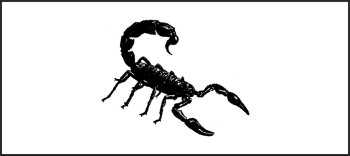
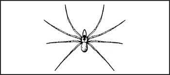
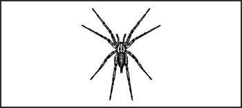
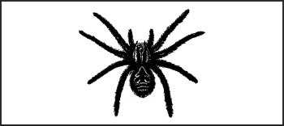
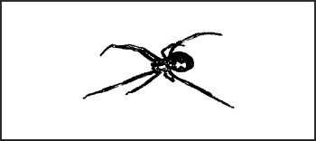
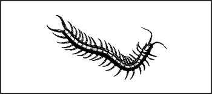
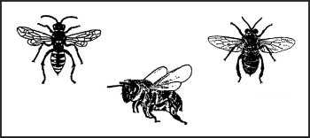
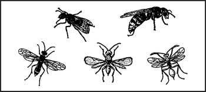
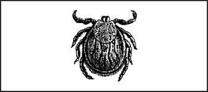

> Комах часто недооцінюють як небезпеку для виживальника. Щороку у Сполучених Штатах від бджолиних укусів та спричиненого ними анафілактичного шоку гине більше людей, ніж від укусів змій. Кілька інших комах достатньо отруйні, щоб вбити, але часто найбільшою небезпекою є передача хвороб.
** *

**Скорпіон (Scorpion)**  
Ряд _Scorpionidae_  

**Опис:** Тьмяно-коричневий, жовтий або чорний. Має омарів подібні клішні довжиною 7,5–20 см (3–8 дюймів) і суглобистий хвіст, який зазвичай тримається над спиною. Існує 800 видів скорпіонів.

**Середовище існування:** Рештки, що гниють, під сміттям, колодами та камінням. Живиться вночі. Іноді ховається у черевиках.

**Поширення:** По всьому світу в помірних, аридних та тропічних регіонах.

> **УВАГА**
>
> Скорпіони жалять своїми хвостами, спричиняючи місцевий біль, набряк, можливу втрату дієздатності та смерть.
** *

**Коричневий домашній павук або коричневий павук-відлюдник (Brown house spider or brown recluse spider)**  
_Laxosceles reclusa_  

**Description (Опис):** Коричневий до чорного з очевидною «скрипкою» на спині голови та грудей. Корренасте тіло з довгими тонкими ногами довжиною 2,5–4 см (1–1 1/2 дюйма).

**Середовище існування:** Під сміттям, камінням та колодами. У печерах та темних місцях.

**Поширення:** Північна Америка.

** *

**Воронковий павук (Funnelweb spider)**  
Види _Atrax_ (_A. robustus, A. formidablis_)  

**Опис:** Великі, коричневі, масивні павуки. Агресивні при турбуванні.

**Середовище існування:** Ліси, джунглі та чагарникові райони. Павутина має лійкоподібний отвір.

**Поширення:** Австралія. (Інші неотруйні види по всьому світу.)
** *

**Тарантул (Tarantula)**  
Види _Theraphosidae_ та _Lycosa_  

**Опис:** Дуже великі, коричневі, чорні, червонуваті, волохаті павуки. Великі ікла завдають болючого укусу.

**Середовище існування:** Пустельні райони, тропіки.

**Поширення:** Америка, південна Європа.

** *

**Павук-вдова (Widow spider)**  
Види _Latrodectus_  

**Опис:** Темні павуки зі світло-червоними або оранжевими мітками на черевці самки.

**Середовище існування:** Під колодами, камінням та сміттям. У затінених місцях.

**Поширення:** Різні види по всьому світу. Чорна вдова в США, червона вдова на Близькому Сході та коричнева вдова в Австралії.

**ПРИМІТКА:** Самки є отруйною статтю. Червона вдова на Близькому Сході — єдиний відомий павук, який є смертельним для людини.
** *

**Багатоніжка (Centipede)**  

**Опис:** Багатосуглобове тіло довжиною до 30 сантиметрів (12 дюймів). Тьмяно-оранжевого до коричневого кольору, з чорними точковими очима біля основи вусиків. У світі існує 2800 видів.

**Середовище існування:** Під корою та камінням вдень. Активні вночі.

**Поширення:** По всьому світу.
** *

**Бджола (Bee)**  

**Опис:** Комаха з коричневим або чорним волохатим тілом. Зазвичай зустрічається колоніями. Багато хто будує воскові стільники.

**Середовище існування:** Порожнисті дерева, печери, житла. Поблизу води в пустельних районах.

**Поширення:** По всьому світу.

**ПРИМІТКА:** Бджоли мають зазублені жала і гинуть після жаління, оскільки їхній отруйний мішечок та внутрішні органи витягуються під час атаки.

** *

**Оси та шершні (Wasps and hornets)**  

**Description (Опис):** Зазвичай гладкотілі, стрункі жалючі комахи. Багато хто гніздиться індивідуально в земляних гніздах або колоніях у паперових гніздах. Гладеньке жало дозволяє здійснювати множинні атаки. У світі є кілька сотень видів.

**Середовище існування:** Можуть зустрічатися де завгодно у різних видах.

**Поширення:** По всьому світу.

**ПРИМІТКА:** Винятком із загального вигляду є оксамитовий мураха південних Сполучених Штатів. Це безкрила оса з червоними та чорними оксамитовими смугами, що чергуються.
** *

**Кліщ (Tick)**  

**Опис:** Кругле тіло розміром від головки шпильки до 2,5 сантиметрів. Має 8 ніг та смоктальні ротові частини. У світі налічується 850 видів.

**Середовище існування:** Переважно в лісах та луках. Також в міських районах та на сільськогосподарських угіддях.

**Поширення:** По всьому світу.
