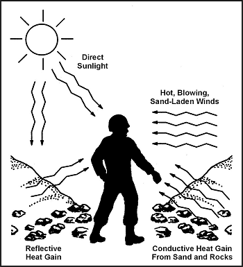
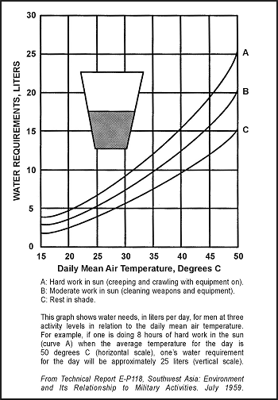

> Щоб вижити та ухилитися від супротивника в аридних або пустельних районах, ви повинні розуміти середовище, з яким зіткнетеся, і підготуватися до нього. Ви повинні визначити свої потреби в спорядженні, тактику, яку використовуватимете, і те, як середовище вплине на вас та вашу тактику. Ваше виживання залежатиме від ваших знань про рельєф, базові кліматичні елементи, вашої здатності справлятися з цими елементами та вашої волі до виживання.

### РЕЛЬЄФ (TERRAIN)

Більшість аридних (посушливих) районів мають кілька типів рельєфу. П'ять основних типів пустельного рельєфу — це:

* Гріднистий / Гірський (високогірний).
* Скелясте плато.
* Піщані дюни.
* Солончаки (солоні болота).
* Розсічений, порізаний рельєф («гебель» або «ваді»).

Пустельний рельєф робить пересування важким і вимогливим. Орієнтування на місцевості буде надзвичайно складним, оскільки орієнтирів може бути дуже мало. Укриття та маскування можуть бути дуже обмеженими; тому загроза впливу противника залишається постійною.

**ГІРСЬКІ ПУСТЕЛІ**

Гірські пустелі характеризуються розсіяними хребтами або областями голих пагорбів чи гір, розділеними сухими, плоскими басейнами. Висота може підніматися поступово або різко від плоских ділянок до кількох тисяч метрів над рівнем моря. Більшість нечастих опадів випадає на висотах і швидко стікає у вигляді раптових повеней. Ці паводкові води розмивають глибокі яри та виїмки і відкладають пісок і гравій навколо країв басейнів. Вода швидко випаровується, залишаючи землю такою ж голою, як і раніше, хоча там може бути недовговічна рослинність. Якщо в басейн потрапляє достатньо води, щоб компенсувати швидкість випаровування, можуть утворюватися неглибокі озера, такі як Велике Солоне озеро в Юті або Мертвое море. Більшість цих озер мають високий вміст солі.

**ПУСТЕЛЬНІ СКЕЛЯСТІ ПЛАТО**

Пустельні скелясті плато мають відносно невеликий рельєф, що чергується з великими плоскими ділянками з великою кількістю твердої або битої породи на поверхні або поблизу неї. Можуть бути крутостінні розмиті долини, відомі як ваді на Близькому Сході та арройо або каньйони в США та Мексиці. Хоча їхнє плоске дно може здаватися привабливим як зони збору, вужчі долини можуть бути надзвичайно небезпечними для людей та майна через раптові повені після дощів. Голанські висоти є прикладом скелястого плато-пустелі.

**ПІСЧАНІ АБО ДУННІ ПУСТЕЛІ**

Піщані або дюнні пустелі — це великі плоскі ділянки, покриті піском або гравієм. «Плоский» є відносним терміном, оскільки деякі райони можуть містити піщані дюни висотою понад 300 метрів (1000 футів) і довжиною від 16 до 24 кілометрів (10–15 миль). Прохідність у такому рельєфі залежатиме від навітряного або підвітряного схилу дюн та текстури піску. Проте інші ділянки можуть бути плоскими на 3000 метрів (10 000 футів) і більше. Рослинність може варіюватися від відсутності до чагарників висотою понад 2 метри (7 футів). Приклади цього типу пустелі включають краї Сахари, порожній квартал Аравійської пустелі, райони Каліфорнії та Нью-Мексико, а також Калахарі в Південній Африці.

**СОЛОНІ БОЛОТА (SALT MARSHES)**

Солоні болота — це плоскі, похмурі ділянки, іноді всіяні купинами трави, але позбавлені іншої рослинності. Вони виникають в аридних районах, де дощова вода збиралася, випаровувалася і залишила великі відкладення лужних солей та воду з високою концентрацією солі. Вода настільки солона, що її неможливо пити. Над солоною водою утворюється кірка товщиною від 2,5 до 30 сантиметрів (1–12 дюймів).

В аридних районах існують солончаки площею сотні квадратних кілометрів. Ці райони зазвичай підтримують багато комах, більшість з яких кусають. Уникайте солончаків. Цей тип рельєфу є висококорозійним для черевиків, одягу та шкіри. Хорошим прикладом є водний шлях Шатт-ель-Араб уздовж ірано-іракського кордону.

**ПОРАЗКОВИЙ / РОЗСІЧЕНИЙ РЕЛЬЄФ (BROKEN TERRAIN)**

Усі аридні райони містять порізаний або сильно розсічений рельєф. Зливи, які розмивають м'який пісок і висікають каньйони, формують цей рельєф. Ваді може коливатися від 3 метрів (10 футів) завширшки і 2 метрів (7 футів) завглибшки до кількох сотень метрів завширшки та завглибшки. Напрямок, якого він набуває, змінюється так само, як його ширина і глибина. Він кружляє і повертає, утворюючи лабіринтоподібний візерунок. Ваді забезпечить вас гарним укриттям та маскуванням, але не намагайтеся рухатися через нього, оскільки це дуже важкий для подолання рельєф.

### ЕКОЛОГІЧНІ ФАКТОРИ

Виживання та ухилення від супротивника в аридному районі залежить від того, що ви знаєте і наскільки ви готові до екологічних умов, з якими зіткнетеся. Визначте, яке спорядження вам знадобиться, яку тактику ви використовуватимете, а також вплив середовища на них та на вас.

У пустельному районі є сім екологічних факторів, які ви повинні враховувати:

* Низька кількість опадів.
* Інтенсивне сонячне світло та спека.
* Широкий діапазон температур.
* Рідкісна рослинність.
* Високий мінеральний вміст біля поверхні ґрунту.
* Піщані бурі.
* Міражі.

**НИЗЬКА КІЛЬКІСТЬ ОПАДІВ**

Низька кількість опадів є найбільш очевидним екологічним фактором в аридному районі. Деякі пустельні райони отримують менше 10 сантиметрів (4 дюймів) дощу щорічно, і цей дощ випадає у вигляді коротких потоків, які швидко стікають з поверхні землі. Ви не зможете довго вижити без води за високих температур пустелі. У ситуації виживання в пустелі ви повинні спочатку розглянути кількість води, яку ви маєте, та інші джерела води.

**ІНТЕНСИВНЕ СОНЯЧНЕ СВІТЛО ТА СПЕКА**

Інтенсивне сонячне світло та спека присутні в усіх аридних районах. Температура повітря вдень може підніматися до 60 градусів Цельсія (140 градусів Фаренгейта). Нагрівання тіла відбувається від прямих сонячних променів, гарячих вітрів, що несуть пісок, відбитого тепла (промені сонця відскакують від піску) та кондуктивного тепла від прямого контакту з піском та скелями пустелі ([Фігура 13-1](#fig13-1)).

**Фігура 13-1. Типи нагрівання телом**

Температура пустельного піску та скель зазвичай на 16–22 градуси Цельсія (30–40 градусів Фаренгейта) вище за температуру повітря. Наприклад, коли температура повітря становить 43 градуси Цельсія (110 градусів Фаренгейта), температура піску може бути 60 градусів Цельсія (140 градусів Фаренгейта).

Інтенсивне сонячне світло та спека збільшують потребу організму у воді. Щоб зберегти рідину та енергію тіла, вам знадобиться укриття для зменшення впливу денної спеки. Подорожуйте вночі, щоб зменшити витрату води.

Радіостанції та чутливі предмети спорядження, що піддаються впливу прямого інтенсивного сонячного світла, даватимуть збої.

**ШИРОКИЙ ДІАПАЗОН ТЕМПЕРАТУР**

Температури в аридних районах можуть досягати 55 градусів Цельсія (130 градусів Фаренгейта) вдень і падати до 10 градусів Цельсія (50 градусів Фаренгейта) вночі. Падіння температури вночі відбувається швидко і охолодить людину, якій бракує теплого одягу і яка не може пересуватися. Прохолодні вечори та ночі є найкращим часом для роботи чи подорожей. Якщо ваш план — відпочивати вночі, вам надзвичайно допоможуть вовняний светр, довга білизна та вовняна шапка.

**РІДКІСНА РОСЛИННІСТЬ**

Рослинність в аридних районах рідкісна. Через це у вас виникнуть проблеми з пошуком укриття та маскуванням ваших переміщень. Протягом світлового дня великі площі рельєфу добре видно і легко контролюються невеликою протилежною силою.

Якщо ви пересуваєтеся у ворожій території, дотримуйтесь принципів пустельного маскування:

* Ховайтеся або шукайте укриття в сухих руслах (ваді) з густішими заростями рослинності та прикриттям від косого спостереження.
* Використовуйте тіні, що відкидаються кущами, камінням або виступами. Температура в затінених місцях буде на 11–17 градусів Цельсія (52–63 градуси Фаренгейта) прохолоднішою за температуру повітря.
* Накривайте предмети, які відбивають сонячне світло.

Перед пересуванням огляньте місцевість на наявність ділянок, що забезпечують укриття та маскування. У вас виникнуть труднощі з оцінкою відстані. Порожнеча пустельного рельєфу змушує більшість людей недооцінювати відстань у три рази: те, що здається на відстані 1 кілометра (1/2 милі), насправді є на відстані 3 кілометрів (1 3/4 милі).

**ВИСОКИЙ МІНЕРАЛЬНИЙ ВМІСТ**

Усі аридні регіони мають райони, де поверхневий ґрунт має високий вміст мінералів (бура, сіль, луг та вапно). Матеріали в контакті з цим ґрунтом швидко зношуються, а вода в цих районах надзвичайно жорстка і непридатна для пиття. Змочування вашої форми в такій воді для охолодження може спричинити висипання на шкірі. Район Великого Солоного озера в Юті є прикладом такої наповненої мінералами води та ґрунту. Рослинність там мало або відсутня зовсім; тому укриття важко знайти. Уникайте цих районів, якщо це можливо.

**ПІЩАНІ БУРІ (SANDSTORMS)**

Піщані бурі (віттри, насичені піском) часто трапляються в більшості пустель. Пустельний вітер _Сеістан_ в Ірані та Афганістані дме постійно до 120 днів. У Саудівській Аравії вітри зазвичай коливаються від 3,2 до 4,8 кілометрів на годину (км/год) (2–3 милі на годину [mph]) і можуть досягати 112–128 км/год (67–77 mph) на початку пополудня. Очікуйте великих піщаних та пилових бурь принаймні раз на тиждень.

Найбільша небезпека — заблукати у вихровій стіні піску. Носіть окуляри і закрийте рот і ніс тканиною. Якщо природне укриття недоступне, позначте напрямок руху, ляжте і перечекайте бурю.

Пил і вітровий пісок заважають радіопередачам. Тому будьте готові використовувати інші засоби для подачі сигналів, такі як піротехніка, сигнальні дзеркала або панелі-маркери, якщо вони доступні.

**МІРАЖІ**

Міражі — це оптичні явища, спричинені заломленням світла через гаряче повітря, що піднімається від піщаної чи кам'янистої поверхні. Вони виникають у внутрішній частині пустелі приблизно за 10 кілометрів (6 миль) від узбережжя. Вони роблять предмети, які знаходяться на відстані 1,5 кілометра (1 милі) або більше, видимими так, ніби вони рухаються.

Цей ефект міражу ускладнює ідентифікацію об'єкта на відстані. Він також розмиває далекі контури висот настільки, що ви почуваєтеся оточеними аркушем води, з якого височини виділяються як «острови».

Ефект міражу ускладнює людині ідентифікацію цілей, оцінку дальності та чітке бачення об'єктів. Проте, якщо ви зможете дістатися до високого місця (3 метри [10 футів] або більше над поверхнею пустелі), ви зможете піднятися вище супернагрітого повітря поблизу землі і подолати ефект міражу. Міражі ускладнюють орієнтування на місцевості, оскільки вони затьмарюють природні особливості. Ви можете оглянути місцевість на світанку, в сутінках або при місячному світлі, коли ймовірність міражу невелика.

Рівні освітленості в пустельних районах інтенсивніші, ніж в інших географічних районах. Ночі при місячному світлі зазвичай кристально чисті, вітри вщухають, серпанок і сліпуче світло зникають, а видимість відмінна. Ви можете бачити вогні, червоні ліхтарики та затемнені вогні на великих відстанях. Звук переноситься дуже далеко.

І навпаки, в ночі з невеликим місячним світлом видимість надзвичайно погана. Пересування надзвичайно небезпечне. Ви повинні уникати заблукання, падіння в яри або випадкового заходження на позиції супротивника. Рух у таку ніч доцільний лише тоді, коли ви маєте компас, провели день у відпочинку, спостереженні та запам'ятовуванні рельєфу, а також виборі свого маршруту.

### ПОТРЕБА В ВОДІ

Тема людини та води в пустелі викликала значний інтерес і плутанину з перших днів Другої світової війни, коли армія США готувалася воювати в Північній Африці. У якийсь момент армія США думала, що зможе натренувати людей обходитися меншою кількістю води шляхом поступового зменшення запасів води під час тренувань. Вони назвали це водною дисципліною. Це спричинило сотні теплових уражень (heat casualties).

Ключовим фактором виживання в пустелі є розуміння взаємозв'язку між фізичною активністю, температурою повітря та споживанням води. Організм вимагає певної кількості води для певного рівня активності за певної температури. Наприклад, людина, що виконує важку роботу на сонці при температурі 43 градуси Цельсія (109 градусів Фаренгейта), вимагає 19 літрів (5 галонів) води щодня. нестача необхідної кількості води викликає швидке зниження здатності індивіда приймати рішення та ефективно виконувати завдання.

Нормальна температура вашого тіла становить 36,9 градусів Цельсія (98,6 градусів Фаренгейта). Ваше тіло позбавляється зайвого тепла (охолоджується) шляхом потовиділення. Чим теплішим стає ваше тіло — чи то через роботу, вправи, чи через температуру повітря — тим більше ви пітнієте. Чим більше ви пітнієте, тим більше вологи ви втрачаєте. Потовиділення є головною причиною втрати води. Якщо ви перестаєте пітніти під час періодів високої температури повітря та важкої роботи чи вправ, ви швидко розвинете тепловий удар. Це надзвичайна ситуація, що вимагає негайної медичної допомоги.

[Фігура 13-2](#fig13-2) показує добові потреби у воді для різних рівнів роботи. Розуміння того, як температура повітря та ваша фізична активність впливають на потреби у воді, дозволяє вжити заходів для максимального отримання води з вашого запасу. Ці заходи:

* Знайдіть тінь! Зайдіть з сонця!
* Покладіть щось між собою та гарячим ґрунтом.
* Обмежте свої рухи!
* Зберігайте піт. Одягніть повний комплект форми, включаючи футболку. Закатайте рукави вниз, покрийте голову та захистіть шию шарфом або подібним предметом. Ці кроки захистять ваше тіло від гарячих вітрів та прямих сонячних променів. Ваш одяг вбере ваш піт, утримуючи його біля шкіри, щоб ви отримали повний охолоджувальний ефект. Залишаючись у тіні тихо, повністю одягненим, не розмовляючи, тримаючи рот закритим і дихаючи через ніс, ваша потреба у воді для виживання різко падає.
* Якщо води мало, не їжте. Їжа вимагає води для перетравлення; тому вживання їжі витрачатиме воду, яка вам потрібна для охолодження.

**Фігура 13-2. Добові потреби у воді для трьох рівнів активності**

Спрага не є надійним орієнтиром вашої потреби у воді. Людина, яка використовує спрагу як орієнтир, вип'є лише дві третини своєї добової потреби у воді. Щоб запобігти цьому «добровільному» зневодненню, використовуйте такі рекомендації:

* При температурах нижче 38 градусів Цельсія (100 градусів Фаренгейта) випивайте 0,5 літра води щогодини.
* При температурах вище 38 градусів Цельсія (100 градусів Фаренгейта) випивайте 1 літр води щогодини.

Питво води через регулярні проміжки часу допомагає вашому організму залишатися прохолодним і зменшує потовиділення. Навіть коли ваш запас води низький, постійне потягування води триматиме ваше тіло прохолоднішим і зменшить втрату води через потовиділення. Зберігайте рідину, зменшуючи активність у спеку дня. **Не нормуйте** свою воду! Якщо ви спробуєте нормувати воду, у вас є високі шанси стати тепловою жертвою.

### ТЕПЛОВІ УРАЖЕННЯ (HEAT CASUALTIES)

Ваші шанси стати тепловою жертвою як виживальника великі через травму, стрес та відсутність критичних елементів спорядження. Нижче наведено основні типи теплових уражень та їх лікування, коли є **мало** води та **немає** медичної допомоги.

**ТЕПЛОВІ СУДОМИ (HEAT CRAMPS)**

Втрата солі через надмірне потовиділення викликає теплові судороги. Симптомами є від помірних до сильних м'язових судом у ногах, руках або животі. Ці симптоми можуть починатися як легкий м'язовий дискомфорт. Тепер ви повинні зупинити всю активність, зайти в тінь і випити води. Якщо ви не розпізнаєте ранні симптоми і продовжуєте фізичну активність, у вас виникнуть сильні м'язові судоми та біль. Лікуйте так само, як і теплове виснаження (див. нижче).

**ТЕПЛОВЕ ВИСНАЖЕННЯ (HEAT EXHAUSTION)**

Велика втрата води та солі організмом викликає теплове виснаження. Симптомами є головний біль, психічна заплутаність, дратівливість, надмірне потовиділення, слабкість, запаморочення, судоми та бліда, волога, холодна (липка) шкіра. Негайно помістіть пацієнта в тінь. Змусьте його лягти на ноші або подібний предмет приблизно на 45 сантиметрів (18 дюймів) над землею. Послабте його одяг. Збризніть його водою і обмахніть віялом. Дайте йому випити невелику кількість води кожні 3 хвилини. Переконайтеся, що він залишається тихим і відпочиває.

**ТЕПЛОВИЙ УДАР (HEAT STROKE)**

Екстремальна втрата води та солі та нездатність організму охолоджуватися можуть спричинити тепловий удар. Пацієнт може померти, якщо його негайно не охолодити. Симптомами є відсутність потів, гаряча і суха шкіра, головний біль, запаморочення, швидкий пульс, нудота і блювота, а також психічна заплутаність, що призводить до втрати свідомості. Негайно перенесіть людину в тінь. Покладіть її на ноші або подібний предмет приблизно на 45 сантиметрів (18 дюймів) над землею. Послабте її одяг. Полийли воду на неї (неважливо, чи вода забруднена, чи солонувата) і обмахніть віялом. Помасажуйте її руки, ноги та тіло. Якщо вона приходить до тями, давайте їй пити невелику кількість води кожні 3 хвилини.

### ЗАПОБІЖНІ ЗАХОДИ

У ситуації виживання та ухилення в пустелі навряд чи з вами буде медик або медичні засоби для лікування теплових травм. Тому будьте особливо обережні, щоб уникнути теплових травм. Відпочивайте вдень. Працюйте прохолодними вечорами та ночами. Використовуйте систему товаришів (buddy system), щоб стежити за тепловою травмою. Дотримуйтесь наступних рекомендацій:

* Обов'язково скажіть комусь, куди ви йдете і коли повернетеся.
* Слідкуйте за ознаками теплової травми. Якщо хтось скаржиться на втому або блукає від групи, він може бути тепловою жертвою.
* Пийте воду принаймні раз на годину.
* Заходьте в тінь під час відпочинку; не лягайте прямо на землю.
* Не знімайте рубашку і не працюйте вдень.
* Перевіряйте колір сечі. Світлий колір означає, що ви п'єте достатньо води, темний колір означає, що вам потрібно пити більше.

### ПУСТЕЛЬНІ НЕБЕЗПЕКИ

Існує кілька небезпек, унікальних для виживання в пустелі. До них належать комахи, змії, рослини з шипами та кактуси, забруднена вода, сонячні опіки, подразнення очей та кліматичний стрес.

Комахи майже кожного типу рясні в пустелі. Людина як джерело води та їжі приваблює вошей, кліщів, ос та мух. Вони надзвичайно неприємні і можуть переносити хвороби. Старі будівлі, руїни та печери є улюбленими місцями проживання павуків, скорпіонів, багатоніжок, вошей та кліщів. Ці райони забезпечують захист від негоди, а також приваблюють іншу дику природу. Тому будьте особливо обережні, залишаючись у цих районах. Носіть рукавички весь час у пустелі. Не кладіть руки нікуди, попередньо не подивившись, що там є. Візуально огляньте ділянку перед тим, як сідати чи лягати. Коли ви встаєте, витрусіть та огляньте свої черевики та одяг. Усі пустельні райони мають змій. Вони заселяють руїни, рідні села, смітники, печери та природні скельні виходи, що пропонують тінь. Ніколи не ходіть босоніж і не гуляйте цими районами без ретельного огляду на наявність змій. Звертайте увагу на те, куди ви ставите ноги та руки. Більшість укусів змій є результатом наступання на змій або їх чіпання. Уникайте їх. Щойно ви побачите змію, дайте їй широкий прохід.
