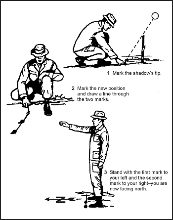
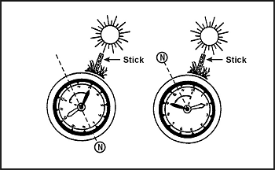
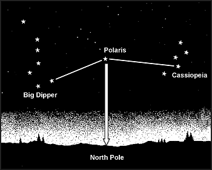
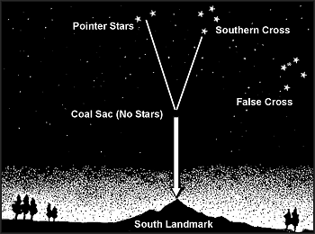

> У ситуації виживання ви будете надзвичайно щасливі, якщо у вас випадково виявляться карта та компас. Якщо у вас є ці два предмети спорядження, ви, швидше за все, зможете рухатися до допомоги. Якщо ви не володієте навичками використання карти та компаса, ви повинні зробити кроки для набуття цього навички.
> 
> Існують кілька методів, за допомогою яких ви можете визначити напрямок за допомогою сонця та зірок. Ці методи, однак, дадуть вам лише загальний напрямок. Ви можете отримати більш наближений до істинного напрямок, якщо знаєте рельєф території чи країни.
> 
> Ви повинні вивчити все можливе про рельєф країни чи території, куди ви або ваш підрозділ можете бути відправлені, особливо будь-які помітні особливості чи орієнтири. Це знання рельєфу разом із використанням методів, описаних нижче, дозволить вам отримати досить істинні напрямки, які допоможуть вам орієнтуватися.

### ВИКОРИСТАННЯ СОНЦЯ ТА ТІНЕЙ

18-1. Відносини Землі до сонця можуть допомогти вам визначити напрямок на землі. Сонце завжди сходить на сході і сідає на заході, але не точно на сході чи заході. Також існують певні сезонні варіації. Тіні рухатимуться в напрямку, протилежному до сонця. У Північній півкулі вони рухатимуться із заходу на схід і вказуватимуть на північ опівдні. У Південній півкулі тіні вказуватимуть на південь опівдні. З практикою ви можете використовувати тіні для визначення як напрямку, так і часу доби. Методи використання тіней для визначення напрямку — це метод кінчика тіні та метод годинника.

**МЕТОДИ КІНЧИКА ТІНІ (SHADOW-TIP METHODS)**

18-2. У першому методі кінчика тіні знайдіть пряму палицю довжиною 1 метр (3 фути) та рівне місце без чагарників, на якому палиця відкидатиме чітку тінь. Цей метод простий і точний і складається з чотирьох кроків:
* _Крок 1._ Встроміть палицю або гілку в землю на рівному місці, де вона відкидатиме виразну тінь. Позначте кінчик тіні каменем, гілочкою або іншим засобом. Ця перша позначка тіні завжди є заходом — **скрізь** на землі.
* _Крок 2._ Зачекайте 10–15 хвилин, поки кінчик тіні переміститься на кілька сантиметрів. Позначте нове положення кінчика тіні так само, як і перше. Ця позначка представлятиме Схід.
* _Крок 3._ Проведіть пряму лінію через дві позначки, щоб отримати приблизну лінію «схід-захід».
* _Крок 4._ Станьте так, щоб перша позначка (захід) була ліворуч від вас, а друга (схід) — праворуч — тепер ви обличчям на північ. Цей факт є істинним **скрізь** на землі.

18-3. Альтернативний метод є більш точним, але вимагає більше часу. Встановіть свою тіньову палицю і позначте першу тінь вранці. Використовуйте шматок мотузки, щоб намалювати чисту дугу через цю позначку навколо палички. Опівдні тінь зменшиться і зникне. У другій половині дня вона знову видовжиться, і в точці, де вона торкається дуги, зробіть другу позначку. Проведіть лінію через дві позначки, щоб отримати точну лінію «схід-захід» ([Фігура 18-1](#fig18-1)).

**Фігура 18-1. Метод кінчика тіні**

**МЕТОД ГОДИННИКА (THE WATCH METHOD)**

18-4. Ви також можете визначити напрямок за допомогою звичайного або аналогового годинника — такого, що має стрілки. Напрямок буде точним, якщо ви використовуєте істинний місцевий час, без будь-яких змін на літній час. Пам'ятайте, чим далі ви від екватора, тим точнішим буде цей метод. Якщо у вас лише цифровий годинник, намалюйте циферблат годинника на колірці паперу з правильним часом на ньому і використовуйте його для визначення напрямку в цей час. Ви також можете намалювати циферблат на землі або покласти годинник на землю для більш точного читання.

18-5. У Північній півкулі тримайте годинник горизонтально і спрямуйте годинникову стрілку на сонце. Поділіть кут між годинниковою стрілкою і позначкою 12 годин навпіл, щоб отримати лінію «північ-південь» ([Фігура 18-2](#fig18-2)). Якщо є будь-який сумнів щодо того, який кінець лінії є північним, пам'ятайте, що сонце сходить на сході, сідає на заході і перебуває точно на півдні опівдні. Сонце на сході до опівдня і на заході після опівдня.

**Фігура 18-2. Метод годинника**

**ПРИМІТКА:** Якщо ваш годинник встановлений на літній час, використовуйте середню точку між годинниковою стрілкою та 1 годиною для визначення лінії «північ-південь».

18-6. У Південній півкулі спрямуйте позначку 12 годин годинника на сонце; середня точка на півдорозі між 12 та годинниковою стрілкою дасть вам лінію «північ-південь» ([Фігура 18-2](#fig18-2)).

18-7. Інший метод називається методом 24-годинного годинника. Візьміть місцевий військовий час і розділіть його на два. Уявіть, що цей результат тепер представляє годинникову стрілку. У Північній півкулі спрямуйте цю отриману годинникову стрілку на сонце, і 12 вказуватиме на північ. Наприклад, зараз 1400 годин. Розділіть 1400 на два, і відповідь буде 700, що представлятиме годину. Тримаючи годинник горизонтально, спрямуйте 7 на сонце, і 12 вказуватиме на північ. У Південній півкулі спрямуйте 12 на сонце, і отримана «година» від ділення вказуватиме на південь.

### ВИКОРИСТАННЯ МІСЯЦЯ

18-8. Оскільки Місяць не має власного світла, ми можемо бачити його лише тоді, коли він відбиває світло сонця. Обертаючись навколо Землі за своїм 28-денним циклом, форма відбитого світла змінюється залежно від його положення. Ми говоримо про новий місяць або відсутність місяця, коли він знаходиться приблизно на тому ж боці Землі, що й сонце, тому його освітлений бік не видно, оскільки він спрямований у протилежний від Землі бік. Потім, рухаючись по орбіті навколо Землі, він починає показувати освітлені частини зі свого правого боку і росте, стаючи повним місяцем, перш ніж зменшуватися (убувати), втрачаючи форму, щоб з'явитися у вигляді тонкого серпа з лівого боку. Ви можете використати цю інформацію для визначення напрямку.

18-9. Якщо Місяць сходить до заходу сонця, освітлений бік буде заходом. Якщо Місяць сходить після півночі, освітлений бік буде сходом. Це очевидне відкриття забезпечує нас приблизним орієнтиром «схід-захід» протягом ночі.

### ВИКОРИСТАННЯ ЗІРОК

18-10. Ваше розташування в Північній чи Південній півкулі визначає, яке сузір'я ви використовуєте для визначення північного чи південного напрямку. Кожне нічне небо пояснено нижче.

**ПІВНІЧНЕ НЕБО**

18-11. Основні сузір'я для вивчення — це Велика Ведмедиця (Ursa Major), також відома як Великий Ківш (Big Dipper) або Плуг, і Кассіопея (Cassiopeia), також відома як Лінива W ([Фігура 18-3](#fig18-3)). Використовуйте їх, щоб знайти Полярну зірку (Polaris), також відому як Полярна зірка або Північна зірка. Полярна зірка вважається нерухомою, оскільки вона обертається лише на 1,08 градуса навколо північного небесного полюса. Північна зірка є останньою зіркою ручки Малого Ківша і може бути переплутана з Великим Ковшем. Проте Малий Ківш складається з семи доволі тьмяних зірок і його погано видно, якщо ви знаходитесь далеко від будь-яких міських вогнів. Запобігайте плутанині, намагаючись використовувати Великий Ківш та Кассіопею разом. Великий Ківш і Кассіопея зазвичай протилежні одне одному і обертаються проти годинникової стрілки навколо Полярної зірки, з Полярною зіркою в центрі. Великий Ківш — це семизіркове сузір'я у формі ковша. Дві зірки, що утворюють зовнішню губу цього ковша, є «вказівними зірками» (pointer stars), оскільки вони вказують на Північну зірку. Ментально проведіть лінію від зовнішньої нижньої зірки до зовнішньої верхньої зірки відра Великого Ковша. Продовжіть цю лінію приблизно в п'ять разів більше відстані між вказівними зірками. Ви знайдете Північну зірку вздовж цієї лінії. Ви також можете помітити, що Північну зірку завжди можна знайти на тому ж приблизному вертикальному куті над горизонтом, що й північна лінія широти, на якій ви знаходитесь. Наприклад, якщо ви знаходитесь на 35 градусі північної широти, Полярну зірку буде легше знайти, якщо ви скануєте небо на 35 градусів від горизонту. Це допоможе зменшити площу неба для локалізації Великого Ковша, Кассіопеї та Північної зірки.

**Фігура 18-3. Великий Ківш та Кассіопея**

18-12. Кассіопея або Лінива W має п'ять зірок, які утворюють форму, схожу на «W». Один бік «W» виглядає сплющеним або «лінивим». Північну зірку можна знайти, поділивши навпіл кут, утворений на лінивому боці. Продовжіть цю лінію приблизно в п'ять разів більше відстані між низом «W» і верхом. Північна зірка розташована між Кассіопеєю та Великою Ведмедицею (Великий Ківш).

18-13. Знайшовши Північну зірку, знайдіть Північний полюс або істинний північ, провівши уявно лінію безпосередньо до землі.

**ПІВДЕННЕ НЕБО**

18-14a. Оскільки немає жодної зірки, достатньо яскравої, щоб її можна було легко впізнати поблизу південного небесного полюса, ви можете використовувати сузір'я, відоме як Південний Хрест. Ви можете використовувати його як вказівник на Південь ([Фігура 18-4](#fig18-4)). Південний Хрест або Crux має п'ять зірок. Його чотири найяскравіші зірки утворюють хрест. Дві зірки, що складають довгу вісь Хреста, використовуються як орієнтир. Щоб визначити південь, уявіть відстань у чотири з половиною — п'ять разів більшу за відстань між цими зірками та горизонтом. Зірки-вказівники зліва від Південного Хреста служать двом цілям. По-перше, вони забезпечують додатковий орієнтир на південь, уявляючи лінію від зірок до землі. По-друге, зірки-вказівники допомагають точно ідентифікувати істинний Південний Хрест від хибного хреста. Перетин Південного Хреста та двох зірок-вказівників є дуже темним і позбавленим зірок. Ця зона називається вугільним мішком (coal sac). Подивіться вниз на горизонт від цієї уявної точки і виберіть орієнтир, за яким керуватися. У статичній ситуації виживання ви можете зафіксувати це положення вдень, якщо вночі вб'єте в землю кілочки, щоб вказати шлях.

**Фігура 18-4а. Південний Хрест**

**Метод Оріона (The Orion Method)**

18-14b. У тропіках ідентифікація небесних полюсів може бути неможливою через низьку широту. Сузір'я Оріона сходить точно на сході і сідає точно на заході. Лінія, що з'єднує дві північні зірки Оріона, проходить у напрямку схід-захід ([Фігура 18-4b](#fig18-4b)).

**Фігура 18-4b. Метод Оріона**

### ВИГОТОВЛЕННЯ ІМПРОВІЗОВАНИХ КОМПАСІВ

18-15. Ви можете сконструювати імпровізовані компаси, використовуючи шматок чорного металу, який може мати форму голки, або пласке двостороннє лезо бритви та шматок нитки чи довгого волосся, на якому його підвісити. Ви можете намагнітити або поляризувати метал, повільно проводячи ним в одному напрямку по шматочку шовку або обережно через ваше волосся навмисними рухами. Ви також можете поляризувати метал, проводячи ним неодноразово з одного кінця за допомогою магніта. Завжди проводьте лише в одному напрямку. Якщо у вас є батарея та електричний дріт, ви можете поляризувати метал електрично. Дріт має бути ізольованим. Якщо він не ізольований, загорніть металевий об'єкт в один тонкий смужок паперу або листок, щоб запобігти контакту. Батарея повинна мати мінімум 2 вольти. Сформуйте котушку з електричного дроту і доторкніться його кінцями до терміналів батареї. Неодноразово вставляйте і витягайте один кінець металевого об'єкта в котушку і з неї. Голка стане електромагнітом. При підвішуванні на шматку неметалевої нитки або плаванні на невеликому шматочку дерева, корку чи листку у воді він вирівняється уздовж лінії «північ-південь».

18-16. Ви можете сконструювати більш складний імпровізований компас, використовуючи швейну голку або тонкий металевий об'єкт, неметалевий контейнер (наприклад, зрізане дно пластикового контейнера або пляшки з-під газованки) та сріблястий кінчик від ручки. Щоб сконструювати цей компас, візьміть звичайну швейну голку і зламайте її навпіл. Одна половина утворить ваш покажчик напрямку, а інша діятиме як точка опори (pivot point). Проштовхніть частину, що використовується як точка опори, через нижній центр вашого контейнера; ця частина має бути врівень на дні і не заважати кришці. Прикріпіть центр іншої частини (покажчика) голки на сріблястий кінчик ручки за допомогою клею, соку дерева або розплавленого пластику. Намагніть один кінець покажчика і покладіть його на точку опори.

### ІНШІ ЗАСОБИ ВИЗНАЧЕННЯ НАПРЯМКУ

18-17. Старе прислів'я про використання моху на дереві для вказівки на північ не вважається точним, оскільки мох росте повністю навколо деяких дерев. Насправді ріст є більш пишним на боці дерева, що звернений на південь у Північній півкулі, і навпаки в південній півкулі. Якщо для порівняння є кілька звалених дерев, подивіться на пеньки. Ріст більш енергійний на боці до екватора, і кільця росту дерев будуть розташовані ширше. З іншого боку, кільця росту дерев будуть ближчими одне до одного на боці до полюсів.

18-18. Напрямок вітру може бути корисним у деяких випадках, коли є панівні напрямки і ви знаєте, які вони.

18-19. Розпізнавання відмінностей між рослинністю та вологістю на схилах, звернених на північ і південь, може допомогти у визначенні напрямку. У Північній півкулі схили, звернені на північ, отримують менше сонця, ніж схили, звернені на південь, і тому є прохолоднішими та вологішими. Влітку схили, звернені на північ, зберігають плями снігу. Взимку дерева та відкриті ділянки на схилах, звернених на південь, а також південна сторона валунів та великих скель першими втрачають сніг. Сніговий покрив на землі також мілкіший через зігріваючий ефект сонця. У Південній півкулі всі ці ефекти будуть протилежними.
