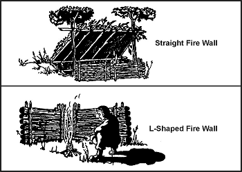
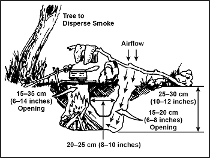
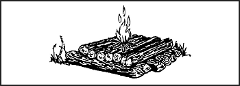
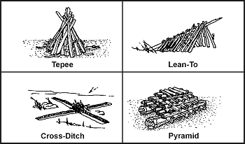
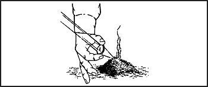
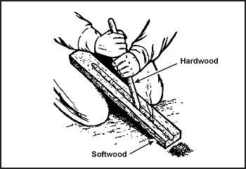
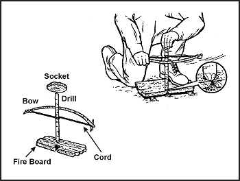

> У багатьох ситуаціях виживання здатність розпалити вогонь може стати різницею між життям і смертю. Вогонь може задовольнити багато потреб. Він може забезпечити теплом і затишком. Він не лише готує та зберігає їжу, а й забезпечує теплом у вигляді гарячої їжі, що економить калорії, які наш організм зазвичай використовує для вироблення тепла. Ви можете використовувати вогонь для очищення води, стерилізації пов'язок, подачі сигналів про порятунок та захисту від тварин. Він може стати психологічним поштовхом, забезпечуючи душевний спокій та компанійство. Ви також можете використовувати вогонь для створення інструментів та зброї.
> 
> Вогонь може спричинити й проблеми. Ворог може виявити дим і світло, які він виробляє. Він може спричинити лісові пожежі або знищити необхідне обладнання. Вогонь також може призвести до опіків та отруєння чадним газом при використанні в укриттях.
> 
> Зважуйте свою потребу у вогні проти потреби уникнути виявлення противником.

### БАЗОВІ ПРИНЦИПИ ВОГНЮ

Щоб розпалити вогонь, корисно розуміти базові принципи вогню.
Паливо (у негазоподібному стані) не горить безпосередньо. Коли ви застосовуєте тепло до палива, воно виробляє газ. Цей газ у поєднанні з киснем у повітрі горить.

Розуміння концепції трикутника вогню є дуже важливим для правильного створення та підтримки вогню.
Три сторони трикутника представляють **повітря, тепло** та **паливо**.
Якщо видалити будь-який із цих компонентів, вогонь згасне.
Правильне співвідношення цих компонентів дуже важливе для того, щоб вогонь горів на повну потужність.
Єдиний спосіб вивчити це співвідношення — практика.

### ВИБІР МІСЦЯ ТА ПІДГОТОВКА

Вам доведеться вирішити, яке місце та компонування вибрати. Перед розпалюванням вогню врахуйте:

* Місцевість (рельєф та клімат), у якій ви дієте.
* Доступні матеріали та інструменти.
* Час; скільки у вас часу?
* Потребу; навіщо вам потрібен вогонь?
* Безпеку; чи потрібно нам приховувати його, щоб уникнути привернення проблем?

Шукайте сухе місце, яке:

* Захищене від вітру.
* Зручно розташоване відносно вашого укриття (якщо таке є).
* Концентруватиме тепло в потрібному вам напрямку.
* Має запас дров або іншого доступного палива. ([Фігура 7-4](#fig7-4) перелічує типи матеріалів, які можна використовувати).

Якщо ви перебуваєте в лісистій або зарослій чагарником місцевості, розчистіть кущі та зніміть поверхневий шар ґрунту з вибраного місця. Очистіть круг діаметром принаймні 1 метр (3 фути), щоб мінімізувати ймовірність поширення вогню.

Якщо дозволяє час, спорудіть вогневу стіну, використовуючи колоди або каміння. Ця стіна допоможе відобразити або спрямувати тепло туди, куди ви хочете ([Фігура 7-1](#fig7-1)). Вона також зменшить кількість літаючих іскор і зменшить пориви вітру, що дмуть у вогонь. Проте вам знадобиться достатньо вітру, щоб вогонь продовжував горіти.

> **УВАГА**
> 
> Не використовуйте вологі або пористі камені, оскільки вони можуть вибухнути при нагріванні.

**Фігура 7-1. Типи вогневих стін**

У деяких ситуаціях ви можете виявити, що підземне вогнище найкраще задовольнить ваші потреби.
Воно приховує вогонь і добре підходить для приготування їжі.
Щоб зробити підземне вогнище або вогневу яму Дакота ([Фігура 7-2](#fig7-2)):

* Викопайте яму в землі.
* З навітряного боку цієї ями проткніть або викопайте великий з'єднувальний отвір для вентиляції.
* Розпаліть вогонь у ямі, як показано на малюнку.

**Фігура 7-2. Вогнева яма Дакота**

Якщо ви перебуваєте в засніженій місцевості, використовуйте зелені колоди для створення сухої основи для вогню ([Фігура 7-3](#fig7-3)). Дерева зі стовбурами завтовшки з зап'ястя легко ламаються в екстремальних умовах холоду. Зріжте або зламайте кілька зелених колод і покладіть їх пліч-о-пліч поверх снігу. Додайте ще один або два шари. Покладіть верхній шар колод перпендикулярно до тих, що лежать нижче.

**Фігура 7-3. Основа для вогню в засніженій місцевості**

### ВИБІР МАТЕРІАЛІВ ДЛЯ ВОГНЮ

Вам потрібні три типи матеріалів ([Фігура 7-4](#fig7-4)), щоб побудувати вогонь.

<table>
  <tbody>
    <tr>
      <th align="center">Трут (Tinder)</th>
      <th align="center">Розпалювання (Kindling)</th>
      <th align="center">Паливо (Fuel)</th>
    </tr>
    <tr>
      <td>
        <ul>
          <li>Березова кора</li>
          <li>Подрібнена внутрішня кора кедра, каштана, червоного в'яза</li>
          <li>Дрібна деревна стружка</li>
          <li>Суха трава, папороть, мох, гриби</li>
          <li>Солома</li>
          <li>Тирса</li>
          <li>Дуже дрібна смолиста стружка (pitchwood)</li>
          <li>Суха хвоя вічнозелених дерев</li>
        </ul>
      </td>
      <td>
        <ul>
          <li>Дрібні гілочки</li>
          <li>Невеликі смужки дерева</li>
          <li>Смолистий вузол з пнів сосни з високою концентрацією живиці</li>
          <li>Щільний картон</li>
          <li>Шматочки деревини, витягнуті зсередини більших шматків</li>
          <li>Деревина, облита легкозаймистими матеріалами, такими як бензин, масло або віск</li>
        </ul>
      </td>
      <td>
        <ul>
          <li>Суха стояча деревина та сухі повалені гілки</li>
          <li>Суха серединка (серцевина) впалих стовбурів дерев та великих гілок</li>
          <li>Зелена деревина, дрібно розколота</li>
          <li>Сухі трави, скручені в пучки</li>
        </ul>
      </td>
    </tr>
  </tbody>
</table>

**Фігура 7-4. Матеріали для розпалювання вогню**

<table>
  <tbody>
    <tr>
      <th align="center">Трут (Tinder)</th>
      <th align="center">Паливо (Fuel)</th>
    </tr>
    <tr>
      <td>
        <ul>
          <li>Панк (повністю згнилі частини мертвих колод або дерев)</li>
          <li>Вузли хвойних дерев</li>
          <li>Пташиний пух (тонке пір'я)</li>
          <li>Пухові головки насіння (молочай, сухий очерет, рогіз або будяк)</li>
          <li>Тонкі висушені рослинні волокна</li>
          <li>Губчасті нитки мертвого дощовика</li>
          <li>Сухе листя пальми</li>
          <li>Подібна до шкіри мембрана, що вистилає бамбук</li>
          <li>Ворс з кишень та швів</li>
          <li>Обвуглена тканина</li>
          <li>Вощений папір</li>
          <li>Інша бамбукова стружка</li>
          <li>Порох</li>
          <li>Вата</li>
        </ul>
      </td>
      <td>
        <ul>
          <li>Торф, достатньо сухий для горіння (може знайтися на верхівках підмитих берегів)</li>
          <li>Висушений послід тварин</li>
          <li>Тваринні жири</li>
          <li>Вугілля, горючі сланці або нафта на поверхні</li>
        </ul>
      </td>
    </tr>
  </tbody>
</table>

**Фігура 7-4. Матеріали для розпалювання вогню (продовження)**

Трут — це сухий матеріал, який займається від невеликого тепла — іскра запалює вогонь. Трут має бути абсолютно сухим, щоб іскра точно його запалила. Якщо у вас є пристрій, що виробляє лише іскри, майже обов'язково знадобиться обвуглена тканина. Вона утримує іскру протягом тривалого часу, дозволяючи покласти трут на гарячу ділянку для створення невеликого полум'я. Ви можете зробити обвуглену тканину, нагріваючи бавовняну тканину, доки вона не почорніє, але не згорить. Після почорніння її слід тримати в герметичному контейнері, щоб вона залишалася сухою. Підготуйте цю тканину заздалегідь до будь-якої ситуації виживання. Додайте її до свого індивідуального набору для виживання. Іншими несподіваними речами можуть бути спиртові серветки або марля з вазеліном.

Розпалювання — це легко займистий матеріал, який ви додаєте до палаючого труту. Знову ж таки, цей матеріал має бути абсолютно сухим для швидкого горіння. Розпалювання підвищує температуру вогню, щоб він міг запалити менш горючий матеріал.

Паливо — це менш горючий матеріал, який горить повільно і стабільно після займання.

### ЯК РОЗПАЛИТИ ВОГОНЬ

Існує кілька методів укладання вогню, і кожен має свої переваги.
Ситуація, в якій ви перебуваєте, визначить, який із наступних видів вогню використати.

**ТІПІ**

Щоб зробити вогонь тіпі ([Фігура 7-5](#fig7-5)), розташуйте трут і кілька паличок розпалювання у формі тіпі або конуса. Запаліть центр. У міру горіння тіпі зовнішні колоди падатимуть всередину, живлячи вогонь. Цей тип вогню добре горить навіть з вологим деревом.

**НАВІС (ЛЕЙН-ТО)**

Щоб скласти вогонь у вигляді навісу ([Фігура 7-5](#fig7-5)), встромокніть зелену паличку в землю під кутом 30 градусів.
Спрямуйте кінець палички в напрямку вітру. Покладіть трохи труту глибоко під цю паличку-навіс.
Притуліть шматочки розпалювання до палички-навісу.
Запаліть трут. Коли розпалювання спалахне від труту, додайте більше розпалювання.

**ХРЕСТ-КАНАВКА (CROSS-DITCH)**

Щоб використати метод хрест-канавки ([Фігура 7-5](#fig7-5)), вицарапайте на землі хрест розміром близько 30 сантиметрів (12 дюймів). Викопайте хрест глибиною 7,5 сантиметрів (близько 3 дюймів). Покладіть велику грудку труту в центр хреста. Побудуйте піраміду з розпалювання над трутом. Неглибока канавка дозволяє повітрю проноситися під трутом для забезпечення тяги.

**ПІРАМІДА**

Щоб скласти пірамідальний вогонь ([Фігура 7-5](#fig7-5)), покладіть на землю дві паралельні невеликі колоди або гілки. Покладіть суцільний шар невеликих колод поперек паралельних колод. Додайте ще три-чотири шари колод, причому кожен шар менший за попередній і розташований під прямим кутом до нижнього шару. Зробіть стартовий вогонь на верхівці піраміди. Коли стартовий вогонь прогорить, він запалить колоди під ним. Це дає вам вогонь, який горить зверху вниз, не вимагаючи уваги протягом ночі.

**Фігура 7-5. Методи укладання вогню**

Існує кілька інших способів складання вогню, які є досить ефективними. Ваша ситуація та матеріали, доступні в цьому районі, можуть зробити інший метод більш придатним.

### ЯК ЗАПАЛИТИ ВОГОНЬ

Завжди запалюйте вогонь з навітряного боку.
Переконайтеся, що ви поклали трут, розпалювання та паливо так, щоб вогонь горів стільки, скільки вам потрібно.
Розпалювачі забезпечують початкове тепло, необхідне для займання труту.
Вони поділяються на дві категорії: сучасні методи та примітивні методи.

**СУЧАСНІ МЕТОДИ**

Сучасні розпалювачі використовують сучасні пристрої. Це речі, про які ми зазвичай думаємо для розпалювання вогню.

**Сірники**

Переконайтеся, що ці сірники водонепроникні. Також зберігайте їх у водонепроникному контейнері разом із надійною чиркалкою.

**Опукла лінза**

Використовуйте цей метод ([Фігура 7-6](#fig7-6)) лише в ясні сонячні дні.
Лінза може бути з бінокля, камери, телескопічних прицілів або збільшувального скла.
Нахиліть лінзу, щоб сконцентрувати сонячні промені на труті.
Тримайте лінзу над тим самим місцем, поки трут не почне тліти.
Обережно подуйте або помахайте на трут, щоб він перетворився на полум'я, і застосуйте його до конструкції вогню.

**Фігура 7-6. Метод лінзи**

**Металева сірника (Кресало)**

Покладіть пласке сухе листя під трут з однією виступаючою частиною. Покладіть кінчик кресала на сухе листок, тримаючи кресало в одній руці, а ніж в іншій. Поскребіть ножем об кресало, щоб отримати іскри. Іскри впадуть на трут. Коли трут почне тліти, дійте як описано вище.

**Батарея**

Використовуйте батарею для генерації іскри. Використання цього методу залежить від типу доступної батареї.
Приєднайте дріт до кожного термінала.
Доторчніться кінцями оголених проводів разом біля труту, щоб іскри запалили його. Сталева вата спалахне, якщо торкнеться обох проводів або терміналів.
Якщо вам потрібно спершу зарядити батарею — зазирніть у [розділ Живлення](Power) — там ви також побачите варіант генерації енергії за допомогою тепла вогню.

**Порох**

Часто ви матимете боєприпаси разом зі спорядженням. Якщо так, обережно витягніть кулю з гільзи, рухаючи кулю туди-сюди. Використовуйте порох як трут. Викиньте гільзу та капсулі. Іскра запалить порох.

**ПРИМІТКА:** Будьте надзвичайно обережні під час цієї операції, оскільки капсулі все ще чутливі, і навіть невелика купа пороху може дати дивовижні результати.

**ПРИМІТИВНІ МЕТОДИ**

Примітивні розпалювачі — це ті, якими користувалися наші пращури.
Вони можуть забирати багато часу, що вимагає від вас терпіння та наполегливості.

**Кресало і кремінь (Flint and Steel)**

Метод прямої іскри є найпростішим серед примітивних методів.
Метод кременя та сталі є найбільш надійним із методів прямої іскри.
Вдарте об кремінь або іншу тверду гірську породу з гострими краями шматочком вуглецевої сталі (нержавіюча сталь не дасть гарної іскри). Цей метод вимагає гнучкого зап'ястка та практики.
Коли трут зловить іскру, подуйте на неї.
Іскра пошириться і спалахне полум'ям.

**Вогневий плуг (Fire-Plow)**

Вогневий плуг ([Фігура 7-7](#fig7-7)) — це фрикційний метод запалювання. Щоб використати цей метод, виріжте пряму канавку в м'якій деревинній основі і проводьте тупим кінцем твердого дерев'яного стрижня вгору-вниз по канавці. Плугова дія стрижня виштовхує дрібні частинки деревних волокон. Потім, коли ви прикладаєте більше тиску на кожному русі, тертя запалює частинки деревини.

**Фігура 7-7. Вогневий плуг**

**Лук і свердло (Bow and Drill)**

Техніка розпалювання вогню за допомогою лука і свердла ([Фігура 7-8](#fig7-8)) проста, але ви повинні докласти багато зусиль і бути наполегливими, щоб отримати вогонь.
 Вам знадобляться такі предмети:

* _Гніздо (Socket)._ Гніздо — це легко утримуваний камінь або шматочок твердої деревини з невеликим заглибленням з одного боку. Використовуйте його для утримання свердла на місці та прикладання зусилля вниз.
* _Свердло (Drill)._ Свердлом має бути прямий, витриманий твердолистяний стрижень діаметром близько 2,5 сантиметра (3/4 дюйма) і довжиною 25 сантиметрів (10 дюймів). Верхній кінець круглий, а нижній — тупий (для створення більшого тертя).
* _Вогнева дошка (Fire board)._ Хоча можна використовувати будь-яку дошку, перевагу віддають витриманій м'якодеревинній дошці товщиною близько 2,5 сантиметра (1 дюйм) і шириною 10 сантиметрів (4 дюйми). Виріжте заглиблення приблизно на 2 сантиметри (3/4 дюйма) від краю з одного боку дошки. З нижнього боку зробіть V-подібний виріз від краю дошки до заглиблення.
* _Лук (Bow)._ Лук — це пружна зелена гілка діаметром близько 2,5 сантиметра (3/4 дюйма) з тятивою. Тип деревини не має значення. Тятива може бути будь-яким видом мотузки. Прив'яжіть тятиву від одного кінця лука до іншого без провисання.

**Фігура 7-8. Лук і свердло**

Для використання лука і свердла спершу підготуйте вогневу конструкцію.
Потім покладіть пучок труту під V-подібний виріз у вогневій дошці.
Поставте одну стопу на вогневу дошку.
Закиньте тятиву лука на свердло і встановіть свердло в попередньо вирізане заглиблення на вогневій дошці.
Покладіть гніздо, утримуване в одній руці, на верхню частину свердла, щоб утримувати його в положенні.
Натисніть на свердло і рухайте луком туди-сюди, щоб крутити свердло ([Фігура 7-8](#fig7-8)).
Щойно ви встановите плавний рух, прикладіть більше тиску вниз і працюйте луком швидше.
Ця дія змеле гарячий чорний порошок у трут, спричинивши займання іскри.
Подуйте на трут, поки він не спалахне.

Примітивні методи розпалювання вогню виснажливі і вимагають практики для забезпечення успіху. Якщо ваша ситуація виживання вимагає використання примітивних методів, пам'ятайте про такі поради, які допоможуть вам побудувати і підтримувати вогонь:

* По можливості використовуйте неароматичну витриману тверду деревину для палива.
* Збирайте розпалювання та трут уздовж стежки.
* Додайте репелент від комах до труту.
* Зберігайте дрова сухими.
* Висушуйте вологі дрова біля вогню.
* Засипайте вогонь попелом (bank the fire), щоб зберегти вугілля живим на ніч.
* Переносьте палаючий панк (тліючий матеріал), коли це можливо.
* Переконайтеся, що вогонь згасне перед виходом з табору.
* Не вибирайте дерево, що валяється на землі. Воно може здаватися сухим, але зазвичай не дає достатньо тертя.
