> Риба та молюски можуть бути одним із ваших основних джерел їжі. Тому доцільно знати, які з них небезпечні, які небезпеки таять різні риби, які запобіжні заходи слід вжити і що робити, якщо ви постраждали від однієї з таких риb.
> 
> Риба та молюски становлять небезпеку одним із трьох способів — атакуючи та кусаючи вас, вводячи токсичну отруту через отруйні шипи чи щупальця, а також через вживання риби чи молюсків, чия плоть є токсичною.
> 
> Небезпека реальної зустрічі з такою небезпечною рибою відносно мала, але вона все ж значна. Будь-яка з цих риб може вбити вас. Уникайте їх за будь-якої можливості.

### РИБА, ЩО НАПАДАЄ НА ЛЮДИДИНУ

Акула зазвичай є першою рибою, яка спадає на думку при розгляді риб, що нападають на людину. Інші риби також потрапляють до цієї категорії, такі як баракуда, мурена та піранЬя.

**АКУЛИ**

Акули є потенційно найнебезпечнішою рибою, що нападає на людей. Очевидна небезпека акул полягає в тому, що вони здатні серйозно покалічити або вбити вас своїм укусом. З багатьох видів акул лише відносно небагато є небезпечними. Більшість випадків нападу акул на людей здійснюють біла, тигрова, молотоглав та блакитна акули. Існують також записи про напади піщаних, сірих неагресивних та мако акул. [Фігура F-1](#figf-1) показує різних акул та їхні розміри.

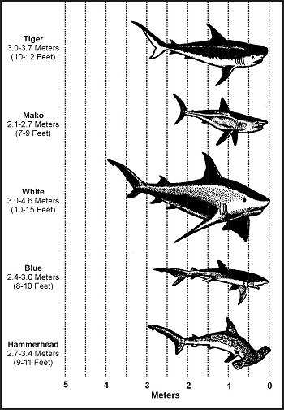

**Фігура F-1. Акули**

Уникайте акул за будь-якої можливості. Дотримуйтесь процедур, описаних у [Розділі Море](Sea), щоб захиститися від нападу акули.

Акули відрізняються за розміром, але немає жодного зв'язку між розміром акулы та ймовірністю нападу. Навіть менші акули можуть бути небезпечними, особливо коли вони подорожують зграями.

Якщо вас вкусила акула, найважливішим заходом для вас є швидке зупинення кровотечі. Кров у воді приведе більше акул. Доберіться самі або доведіть постраждалого до плота чи берега якомога швидше. Якщо ви у воді, утворіть коло навколо постраждалого (якщо ви не наодинці) і зупиніть кровотечу джгутом.

**ІНШІ ЛЮТІ РИБИ**

У солоній воді інші люті риби включають баракуду, морського окуня та мурену ([Фігура F-2](#figf-2)). Морський окунь зазвичай є рибою відкритих вод. Він небезпечний через свій великий розмір. Він може вирвати великі шматки м'яса з людини. Баракуди та мурени відомі тим, що нападають на людину і завдають лютих укусів. Будьте обережні з цими двома видами поблизу рифів та на мілководді. Мурени дуже агресивні, коли їх турбують.

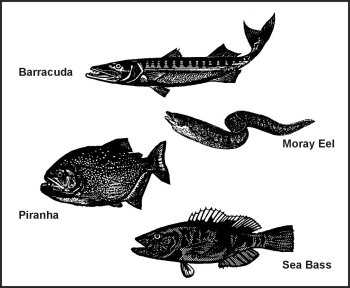

**Фігура F-2. Люті риби**

У прісній воді піраньї є єдиною значно небезпечною рибою. Вони є мешканцями тропіків і обмежені північною частиною Південної Америки. Ці риби досить маленькі, близько 25–60 сантиметрів (10–24 дюйми), але мають дуже великі зуби і подорожують великими зграями. Вони можуть знищити дорослого кабана за лічені хвилини.

### ОТРУЙНІ РИБИ ТА БЕЗХРЕБЕТНІ

Існує кілька видів отруйних риб і безхребетних, усі вони живуть у солоній воді. Усі вони здатні вводити отруйну отруту через шипи, розташовані в їхніх плавцях, щупальцях або укусах. Їхні отрути викликають сильний біль і потенційно смертельні. Якщо ви постраждали від однієї з наступних риб чи безхребетних, обробіть траву так само, як при укусі змії.

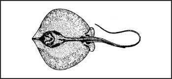

**Схит / Скаіт / Скаллі (Stingray)**  
Види _Dasyatidae_  

Скати живуть на мілководді, особливо в тропіках, але також і в помірних регіонах. Усі вони мають характерну форму ската, але забарвлення може зробити їх важкими для помічання, якщо вони не пливуть. Отруйні зазублені шипи в їхніх хвостах можуть викликати серйозні або смертельні травми.
** *

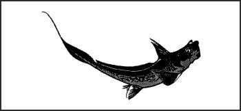

**Риба-кролик (Rabbitfish)**  
Види _Siganidae_  

Риби-кролики зустрічаються переважно на рифах в Тихому та Індійському океанах. Вони мають довжину в середньому близько 30 сантиметрів (12 дюймів) і дуже гострі шипи у плавцях. Шипи отруйні і можуть завдати інтенсивного болю.
** *

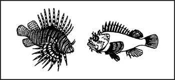

**Скорпенові риби або риба-зебра (Scorpion fish or zebra fish)**  
Види _Scorpaenidae_  

Скорпенові риби живуть переважно на рифах в Тихому та Індійському океанах. Вони мають довжину від 30 до 90 сантиметрів (12–35 дюймів), зазвичай червонуватого забарвлення, мають довгі хвилясті плавці та шипи. Вони завдають інтенсивно болючого жала.
** *

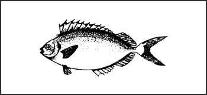

**Риба-сиганус (Siganus fish)**  

Риба-сиганус невелика, довжиною близько 10–15 сантиметрів (4–6 дюймів), і дуже схожа на маленького тунця. Вона має отруйні шипи в спинному та черевному плавцях. Ці шипи можуть завдати болючих опіків-жалів.
** *

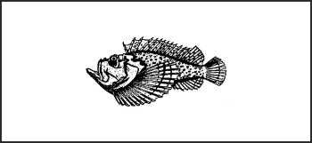

**Риба-камінь (Stonefish)**  
Види _Synanceja_  

Риби-камені знаходяться в тропічних водах Тихого та Індійського океанів. Маючи довжину в середньому близько 30 сантиметрів (12 дюймів), їхні приглушені кольори та бугриста форма забезпечують їм виняткове маскування. При наступі плавці у спинному шипі завдають надзвичайно болючої і іноді смертельної рани.
** *

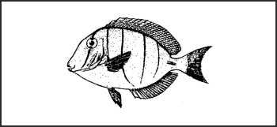

**Танг або риба-хірург (Tang or surgeonfish)**  
Види _Acanthuridae_  

Танг або риби-хірурги мають довжину в середньому від 20 до 25 сантиметрів (8–10 дюймів), з глибоким тілом, маленьким ротом та яскравим забарвленням. Вони мають голчасті шипи на боці хвостика, які завдають надзвичайно болючих ран. Ця риба зустрічається у всіх тропічних водах.
** *

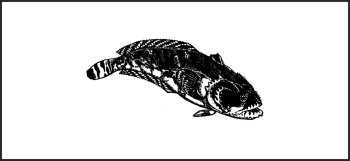

**Риба-жаба (Toadfish)**  
Види _Batrachoididae_  

Риби-жаби зустрічаються в тропічних водах біля узбережжя Південної та Центральної Америки. Вони мають довжину від 17,5 до 25 сантиметрів (7–10 дюймів), тьмяний колір і великі роти. Вони зариваються в пісок і на них легко наступити. Вони мають дуже гострі, надзвичайно отруйні шипи на спинному плавці (спині).
** *

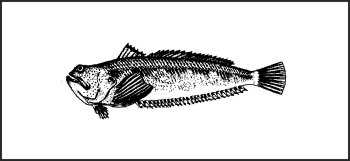

**Риба-звіробій / Вівер (Weever fish)**  
Види _Trachinidae_  

Риба-звіробій — це тропічна риба, яка є доволі стрункою і має довжину близько 30 сантиметрів (12 дюймів). Усі її плавці мають отруйні шипи, які викликають болючу рану.
** *

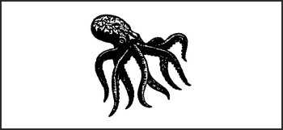

**Блакитнокільчастий восьминіг (Blue-ringed octopus)**  
Види _Hapalochlaena_  

Цей маленький восьминіг зазвичай зустрічається на Великому Бар'єрному рифі біля східної Австралії. Він сірувато-білий з іридесцентними синіми кільцеподібними мітками. Цей восьминіг зазвичай не кусає, якщо на нього не наступити або не взяти в руки. Його укус надзвичайно отруйний і часто смертельний.
** *

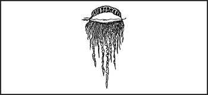

**Португальський кораблик (Portuguese man-of-war)**  
Види _Physalis_  

Хоча він нагадує медузу, португальський кораблик насправді є колонією морських тварин. Переважно зустрічається в тропічних регіонах; проте течія Гольфстрім може переносити його аж до Європи. Він також зустрічається на півдні до Австралії. Плаваюча частина кораблика може бути розміром до 15 сантиметрів (6 дюймів), але щупальця можуть досягати 12 метрів (40 футів) у довжину. Ці щупальця завдають болючого і недієздатного жала, але це рідко буває смертельно.
** *

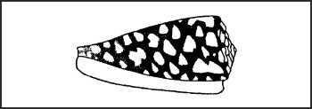

**Конусні черепашки (Cone shells)**  
Види _Conidae_  

Ці конусоподібні черепашки мають гладке, барвисте забарвлення та довгі, вузькі отвори в основі черепашки. Вони живуть під камінням, у тріщинах і кораллових рифах, а також уздовж скелястих берегів і захищених заток у тропічних районах. Усі вони мають крихітні зуби, схожі на підшкірні голки. Вони можуть вводити надзвичайно отруйну отруту, яка діє дуже швидко, викликаючи гострий біль, набряк, параліч, сліпоту та можливу смерть протягом годин. Уникайте торкання всіх конусних черепашок.
** *

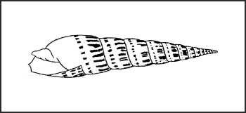

**Теребрових черепашок (Terebra shells)**  
Види _Terebridae_  

Ці черепашки знаходяться як у помірних, так і в тропічних водах. Вони подібні до конусних черепашок, але набагато тонші та довші. Вони отруюють так само, як конусні черепашки, але їхня отрута не така токсична.

### РИБА З ТОКСИЧНОЮ ПЛОТТЮ

Немає простих правил, щоб відрізнити їстівну рибу від такої з токсичною плоттю. [Фігура 8-2](Food) показує найпоширеніших токсичних риб. Усі ці риби містять різні типи отруйних речовин або токсинів у своїй плоті і небезпечні для їжі. Вони мають такі спільні характеристики:
* Більшість живе на мілководді навколо рифів або лагун.
* Багато хто має квадратні або круглі тіла з твердою панцироподібною шкірою, покриті кістяними пластинами або шипами. Вони мають маленькі подібні до папуг роти, маленькі зябра і маленькі або відсутні черевні плавці. Їхні назви нагадують їхню форму.

На додаток до вищезазначених риб та їхніх характеристик, баракуда та червоний луціан можуть переносити сігуатеру, токсин, який накопичується в системах риб, що живляться на тропічних морських рифах.

Без конкретної місцевої інформації вживайте таких запобіжних заходів:
* Будьте дуже обережні з рибою, узятою з зазвичай мілких лагун з піщаним або битим коралловим дном. Переважають рифові види, і деякі з них можуть бути отруйними.
* Уникайте отруйних риб на підвітряному боці острова. Ця зона мілководдя складається з плям живих коралів, змішаних з відкритими просторами, і може простягатися в море на деяку відстань. Багато різних типів риб, деякі з яких отруйні, населяють ці мілководдя.
* Не їжте рибу, спійману в будь-якому районі, де вода неприродно знебарвлена. Знебарвлення може свідчити про планктон, який викликає різні типи токсичності у риб, що живляться планктоном.
* Спробуйте рибалити на навітряному боці або в глибоких проходах, що ведуть з відкритого моря до лагуни, але остерігайтеся течій та хвиль. Живі кораллові рифи різко обриваються в глибоку воду і утворюють лінію поділу між _підозрілою рибою мілководдя_ та _бажаними глибоководними видами_. Глибоководна риба зазвичай не отруйна. Ви можете зловити різноманітних токсичних риб навіть на глибині. _Викидайте всю підозрілу рибу з рифів,_ незалежно від того, чи спіймана вона на океанському чи рифовому боці.
