> Однією з найгостріших потреб людини є їжа. Розмірковуючи практично про будь-яку гіпотетичну ситуацію виживання, розум одразу перемикається на думки про їжу. Якщо ситуація не виникає в аридному (посушливому) середовищі, навіть вода, яка є більш важливою для підтримки функцій організму, зазвичай слідує за їжею в наших початкових думках. Виживальник повинен пам'ятати, що три основи виживання — вода, їжа та укриття — пріоритезуються відповідно до оцінки фактичної ситуації. Ця оцінка має бути не лише своєчасною, а й точною. Ми можемо жити тижнями без їжі, але можуть знадобитися дні чи тижні, щоб визначити, що безпечно їсти, і зловити тварин у цьому районі. Тому вам потрібно починати збір їжі на найраніших етапах виживання, оскільки ваша витривалість зменшуватиметься щодня. Деякі ситуації можуть цілком диктувати, що укриття передує і їжі, і воді.

### ТВАРИНИ ДЛЯ ЇЖІ

Якщо у вас немає шансу добути велику дичину, зосередьте свої зусилля на менших тваринах. Вони більш численні та легші в приготуванні. Вам не потрібно знати всі види тварин, які підходять як їжа; відносно небагато з них є отруйними, і їх легше запам'ятати. Проте важливо вивчити звички та поведінкові моделі класів тварин. Наприклад, тварини, які є чудовим вибором для пасток, ті, що населяють певний ареал і займають ніру чи гніздо, ті, що мають дещо фіксовані кормові площі, і ті, що мають стежки, які ведуть з однієї зони в іншу. Більші стадні тварини, такі як лосі чи карибу, бродять по величезних територіях і їх дещо складніше зловити в пастку. Також ви повинні розуміти харчові вподобання конкретного виду, щоб вибрати правильну приманку.

Ви можете, за відносно невеликими винятками, їсти все, що повзає, плаває, ходить або літає. Ви повинні спочатку подолати свою природну огиду до певного джерела їжі. Історично люди в ситуаціях голоду вдавалися до вживання всього немислимого для харчування. Людина, яка ігнорує інакше здорове джерело їжі через особисті упередження або через те, що вважає його неапетитним, ризикує власним виживанням. Хоча спочатку це може здатися важким, ви повинні їсти те, що доступно, щоб підтримувати своє здоров'я. Деякі класи тварин та комах можна їсти сирими в разі потреби, але по можливості ретельно готуйте всі джерела їжі, щоб уникнути хвороби.

**КОМАХИ**

Найбільш численною і найлегше спійманою формою життя на землі є комахи. Багато комах забезпечують 65–80 відсотків білка порівняно з 20 відсотками для яловичини. Цей факт робить комах важливим, хоча й не надто апетитним джерелом їжі. Комахи, яких слід уникати: усі дорослі особини, що жалять або кусають, волохаті чи яскраво забарвлені комахи, а також гусениці та комахи з різким запахом. Також уникайте павуків та поширених переносників хвороб, таких як кліщі, мухи та комарі.

Гнилиі колоди, що валяються на землі, є чудовими місцями для пошуку різноманітних комах, включаючи мурах, термітів, жуків та личинок (грабів). Не пропустіть гнізда комах на землі або в землі. Трав'янисті ділянки, такі як поля, є хорошими місцями для пошуку, оскільки комах легко помітити. Камені, дошки чи інші матеріали, що лежать на землі, забезпечують комах хорошими місцями для гніздування. Перевірте ці місця. Личинки комах також їстівні. Комахи з твердим панциром, такі як жуки та коники, мають паразити. Приготуйте їх перед їжею. Також видаліть крила та колючі лапки. Ви можете їсти більшість м'якопанцирних комах сирими. Смак різниться залежно від виду. Деревні личинки прісні, але деякі види мурах зберігають мед у своїх тілах, що надає їм солодкого смаку. Ви можете змолоти колекцію комах у пасту. Ви можете змішати їх з їстівною рослинністю. Ви можете приготувати їх, щоб покращити смак.

**ЧЕРВ'ЯКИ**

Черв'яки (_Annelidea_) є чудовим джерелом білка. Копайте їх у вологому перегнійному ґрунті та в кореневих грудках трав'яних купин, або стежте за ними на землі після дощу. Зловивши їх, опустіть їх у чисту, придатну для пиття воду приблизно на 15 хвилин. Черви природним чином очистяться або вимиються, після чого їх можна їсти сирими.

**РАКОПОДІБНІ**

Прісноводні креветки мають розмір від 0,25 см (1/16 дюйма) до 2,5 см (1 дюйм). Вони можуть утворювати досить великі колонії в матах плаваючих водоростей або в мулистих днах ставків і озер.

Рак подібний до морських омарів та крабів. Ви можете відрізнити їх за твердим екзоскелетом та п'ятьма парами ніг, причому передня пара має завеликі клешні. Раки активні вночі, але ви можете знайти їх вдень, зазирнувши під камені та навколо них у струмках. Їх також можна знайти в м'якому мулі поблизу димоподібних дихальних отворів їхніх нір. Ви можете зловити раків, прив'язавши шматочки тельбухів або внутрішніх органів до нитки. Коли рак хапає приманку, витягніть її на берег, перш ніж він встигне випустити приманку.

Ви можете знайти морських омарів, крабів та креветок від краю прибою до води глибиною 10 метрів (33 фути). Креветки можуть підпливати до світла вночі, де їх можна вичерпати сіткою. Ви можете зловити омарів і крабів за допомогою приманки в пастці або на гачку. Краби припливають на приманку, розміщену на краю прибою, де їх можна зловити в пастку або сітку. Омари та краби нічні і найкраще ловляться вночі.

**ПРИМІТКА:** Ви повинні готувати всі прісноводні ракоподібні, молюски та рибу. Прісна вода має тенденцію містити багато небезпечних організмів, тваринних та людських забруднень, а також можливо сільськогосподарські та промислові забруднювачі.

**МОЛЮСКИ**

Цей клас включає восьминогів, а також прісноводних та морських молюсків, таких як равлики, молюски, мідії, двостулкові, морські жолуді (барнакли), періwinkle (морські равлики), хітони та морські їжаки ([Фігура 8-1](#fig8-1)). Ви знайдете двостулкових, подібних до наших прісноводних мідій, а також наземних та водних равликів по всьому світу за будь-яких умов води.

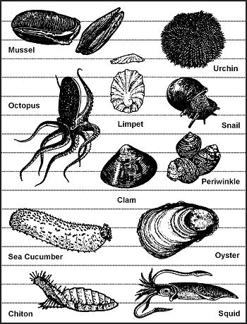

**Фігура 8-1. Їстівні молюски**

Річкові равлики або прісноводні періwinkle рясні в річках, струмках та озерах північних хвойних лісів. Ці равлики можуть мати олівцеподібну або кулясту форму.

У прісній воді шукайте молюсків на мілководді, особливо у воді з піщаним чи мулистим дном. Шукайте вузькі стежки, які вони залишають у мулі, або темну еліптичну щілину їхніх відкритих стулок.

Поблизу моря шукайте в приливних басейнах та вологому піску. Камені вздовж пляжів або рифи, що заглиблюються в глибшу воду, часто мають прикріплені молюски. Равлики та блюдечки (limpets) чіпляються за камені та водорості від позначки низького прибою вгору. Великі равлики, звані хітонами, міцно прилягають до каменів вище лінії прибою.

Мідії зазвичай утворюють густі колонії в кам'яних басейнах, на колодах або біля основи валунів.

> **УВАГА**
> 
> Мідії можуть бути отруйними в тропічних зонах влітку! Якщо протягом 72 годин стався помітний червоний приплив (red tide), не їжте жодної риби чи молюсків з того джерела води.

Тушкуйте, кип'ятіть або запікайте молюсків у стулках. З них виходять чудові рагу в поєднанні із зеленню та коренеплодами.

> **УВАГА**
> 
> Не їжте молюсків, які не покриті водою під час високого приливу!

**РИБА**

Риба є хорошим джерелом білка та жирів. Вона пропонує певні явні переваги для виживальника або втікача. Вона зазвичай більш рясна, ніж дикі ссавці, а способи її видобутку — тихі. Щоб бути успішним у лові риби, ви повинні знати її звички. Наприклад, риба схильна активно живитися перед бурею. Риба навряд чи живитиметься після бурі, коли вода каламутна і піднята. Світло часто приваблює рибу вночі. При сильній течії риба відпочиватиме в місцях із водоверттю (завихренням), наприклад біля каміння. Риба також збирається там, де є глибокі плеса, під гілками, що нависають, а також у та навколо зануреного листя, колод чи інших об'єктів, які пропонують їй укриття.

Немає отруйних прісноводних риб. Проте звичайна вусань (_Barbus barbus_) має сильно отруйну ікру. Види сомиків мають гострі, схожі на голки виступи на спинних плавцях та вусах. Вони можуть нанести болючі колоті рани, які швидко інфікуються.

Готуйте всю прісноводну рибу, щоб знищити паразитів. Як запобіжний захід також готуйте морську рибу, спійману в межах рифу або під впливом джерела прісної води. Будь-яке морське життя, здобуте далі у відкритому морі, не міститиме паразитів через солоне середовище. Ви можете їсти їх сирими.

Більшість зустрічних риб їстівні. Органи деяких видів завжди отруйні для людини; інші риби можуть стати токсичними через елементи у своєму раціоні. Сігуатера — це форма отруєння людини, викликана вживанням субтропічних та тропічних морських риб, які накопичили природні токсини через свій раціон. Ці токсини накопичуються в тканинах риби. Відомо, що токсини походять від кількох видів водоростей, які є поширеними в ендемічних до сігуатери регіонах низьких широт. Термічна обробка не усуває токсини; цього не роблять ані сушіння, ані копчення, ані маринування. Морські риби, які найчастіше причетні до отруєння сігуатерою, включають баракуд, каранксів (jacks), макрель, спинорогів (triggerfish), луціанів (snappers) та груперів. Багато інших видів тепловодних риб містять токсини сігуатери. Поява токсичної риби є спорадичною, і не вся риба певного виду чи з певної місцевості буде токсичною. Це пояснює, чому червоний луціан та групер є бажаною рибою біля берегів Флориди та Східного узбережжя. Хоча вони є улюбленими в ресторанах та рибалок, а також частим вибором на рибному ринку, вони також можуть бути пов'язані зі 100 випадками харчових отруєнь у травні 1988 року в окрузі Палм-Біч, штат Флорида. Отруєння призвели до загальноштатного попередження проти вживання спиронога (hogfish), групера, червоного луціана, амберджека та баракуди, спійманих на банку Драй-Тортуга. Великий спалах сігуатери стався в Пуерто-Рико в період з квітня по червень 1981 року, що спричинило заборону на продаж баракуди, амберджека та блекджека. Іншими прикладами отруйних морських риб є риба-їжак, риба-корова, риба-шип, масляна риба та фугу ([Фігура 8-2](#fig8-2)).

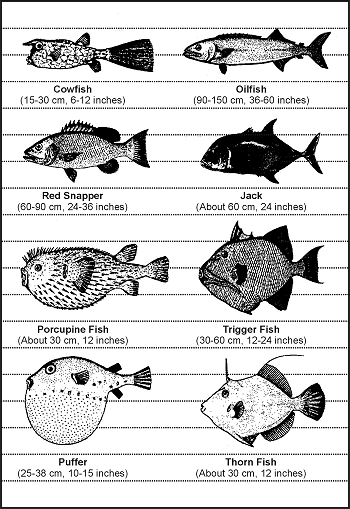

**Фігура 8-2. Риба з отруйною плоттю**

**АМФІБІЇ**

Жаб легко знайти навколо водойм із прісною водою. Жаби рідко віддаляються від безпеки краю води. При першій ознаці небезпеки вони кидаються у воду і зариваються в мул та сміття. Жаби характеризуються гладкою вологою шкірою. Існує небагато отруйних видів жаб. Уникайте будь-яких яскраво забарвлених жаб або тих, які мають чітку позначку «X» на спині, а також усіх деревних жаб. Не плутайте ропух з жабами. Ропух можна впізнати за сухою «бородавчастою» або горбистою шкірою. Вони зазвичай зустрічаються на суходолі в сухіших середовищах. Кілька видів ропух виділяють отруйну речовину через шкіру як захист від нападу. Тому, щоб уникнути отруєння, не чіпайте і не їжте ропух.

Не їжте саламандр; лише близько 25 відсотків усіх саламандр їстівні, тому не варто ризикувати, вибираючи отруйний різновид. Саламандри зустрічаються біля води. Вони характеризуються гладкою вологою шкірою і мають лише по чотири пальці на кожній нозі.

**ПЛАЗУНИ (РЕПТИЛІЇ)**

Рептилії є хорошим джерелом білка і відносно легкі в здобутті. Ретельна термічна обробка та миття рук є обов'язковими при роботі з рептиліями. Усі рептилії вважаються переносниками сальмонели, яка природним чином існує на їхній шкірі. Черепахи та змії особливо відомі зараженням людини. Якщо ви перебуваєте в виснаженому стані, а ваша імунна система ослаблена, сальмонела може бути смертельною. Ретельно готуйте їжу та ретельно мийте руки після поводження з будь-якою рептилією. Ящірки рясні в більшості частин світу. Їх можна впізнати за сухою лускатою шкірою. Вони мають по п'ять пальців на кожній нозі. Єдині отруйні — це монстр Гіла (ядозуб) та мексиканський ядозуб. Слід бути обережними при поводженні та приготуванні ігуани та варана, оскільки вони зазвичай носять вірус сальмонели у своєму роті та зубах. М'ясо хвоста є найкращим на смак і найпростішим у приготуванні.

Черепахи є дуже хорошим джерелом м'яса. Насправді в кожній каймановій черепахи є сім різних смаків м'яса. Більша частина м'яса надходитиме з області передніх та задніх плечей, хоча велика черепаха може мати його й на шиї. Коробочна черепаха ([Фігура 8-3](#fig8-3)) — це черепаха, що часто зустрічається, яку не слід їсти. Вона живиться отруйними грибами і може накопичувати високу токсичну отруту в своїй плоті. Термічна обробка не руйнує цей токсин. Також уникайте біссусової (або біссі) черепахи ([Фігура 8-3](#fig8-3)), що зустрічається в Атлантичному океані, через її отруйну грудну залозу. Отруйні змії, алігатори, крокодили та великі морські черепахи становлять очевидну небезпеку для виживальника.

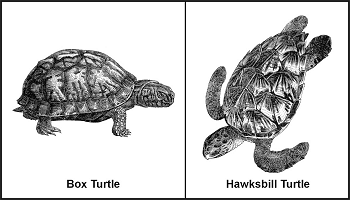

**Фігура 8-3. Черепахи з отруйною плоттю**

**ПТАХИ**

Усі види птахів їстівні, хоча смак суттєво відрізнятиметься. Єдиний отруйний птах — Пітохуї (Pitohui), родом лише з Нової Гвінеї. Ви можете знімати шкіру з рибоїдних птахів, щоб покращити їхній смак. Як і з будь-якою дикою твариною, ви повинні розуміти звичайні звички птахів, щоб мати реалістичні шанси на їхнє упіймання. Ви можете брати голубів, а також деякі інші види, з їхніх сідал вночі вручну. Під час сезону гніздування деякі види не покидають гніздо навіть при наближенні. Знання того, де і коли птахи гніздяться, полегшує їхнє упіймання ([Фігура 8-4](#fig8-4)). Птахи мають тенденцію літати регулярними маршрутами від сідала до місця годування, до води тощо. Уважне спостереження покаже, де проходять ці маршрути, і вкаже хороші місця для ловлі птахів у сітки, натягнуті впоперек маршрутів ([Фігура 8-5](#fig8-5)). Місця сідала та водопої є одними з найбільш перспективних місць для пасток чи синглів.

|Типи птахів|Часті місця гніздування|Періоди гніздування|
|-----------|----------------------|------------------|
|Внутрішні птахи|Дерева, ліси або поля|Весна та раннє літо в помірних і арктичних регіонах; цілий рік у тропіках|
|Журавлі та чаплі|Мангрові болота або високі дерева біля води|Весна та раннє літо|
|Деякі види сов|Високі дерева|Кінець грудня по березень|
|Качки, гуси та лебеді|Тундрові райони біля ставків, річок чи озер|Весна та раннє літо в арктичних регіонах|
|Деякі морські птахи|Півови або низькі піщані острови|Весна та раннє літо в помірних і арктичних регіонах|
|Чайки, аки (auks), кайри (murres) та баклани|Стрімкі скелясті узбережжя|Весна та раннє літо в арктичних регіонах|

**Фігура 8-4. Місця гніздування птахів**

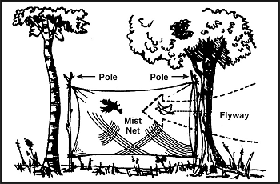

**Фігура 8-5. Ловля птахів у сітку**

Гніздові птахи надають ще одне джерело їжі — яйця. Видаліть усі яйця з кладки, окрім двох чи трьох, позначивши ті, що ви залишаєте. Птах продовжуватиме відкладати нові яйця, щоб заповнити кладку. Продовжуйте видаляти свіжі яйця, залишаючи ті, що ви позначили.

**ССАВЦІ**

Ссавці є чудовим джерелом білка і найсмачнішим джерелом їжі. Є деякі недоліки в отриманні ссавців. У ворожому середовищі ворог може виявити будь-які пастки чи петлі, встановлені на землі. Рівень травми, яку може завдати тварина, прямо пропорційний її розміру. Усі ссавці мають зуби, і майже всі кусатимуть у цілях самооборони. Навіть білка може нанести серйозну рану, і будь-який укус становить серйозний ризик інфекції. Також будь-яка мати може бути надзвичайно агресивною на захист свого дитинчати. Будь-яка тварина без шляху до відступу битиметься, коли її загнали в кут.

Усі ссавці їстівні; однак білий ведмідь та бородатий тюлень мають токсичні рівні вітаміну А у своїй печінці. Качконіс, що походить з Австралії та Тасманії, є яйцекладним напівводним ссавцем, який має отруйні пазурі на задніх лапах. Ссавці-падальники, такі як опосум, можуть переносити хвороби.

### ПАСТКИ ТА ПЕТЛІ

Для озброєного виживальника чи втікача, або коли звук пострілу гвинтівки може стати проблемою, виловлювання або вставлення петель для дичини є хорошою альтернативою. Кілька добре встановлених пасток здатні зловити набагато більше дичини, ніж людина з гвинтівкою ймовірно вб'є. Щоб бути успішним з будь-яким типом пастки чи петлі, ви повинні:
* Бути знайомими з видом тварини, яку ви маєте намір зловити.
* Бути здатними побудувати належну пастку і належним чином замаскувати свій запах.
* Не тривожити здобич залишенням ознак вашої присутності.

Не існує універсальних пасток, які можна встановити для всіх тварин. Ви повинні визначити, які види є в цьому районі, і встановити свої пастки спеціально з урахуванням цих тварин. Шукайте наступне:
* Стежки та пробіги.
* Сліди.
* Послід.
* Пережована або потерта рослинність.
* Місця гніздування або сідала.
* Кормові та водопоїні зони.

Розміщуйте свої пастки та петлі там, де є докази того, що тварини проходять через них. Ви повинні визначити, чи це «пробіг» (run), чи «стежка» (trail). Стежка показуватиме ознаки використання кількома видами і буде доволі чіткою. Пробіг зазвичай менш чіткий і міститиме лише ознаки одного виду. Ви можете сконструювати ідеальну петлю, але вона нічого не зловить, якщо її невдало розмістити в лісі. Тварини мають зони відпочинку, водопої та кормові зони зі стежками, що ведуть від однієї до іншої. Ви повинні розміщувати петлі та пастки навколо цих зон, щоб вони були ефективними.

Якщо ви перебуваєте у ворожому середовищі, маскування пасток і петель є важливим. Проте не менш важливо не створювати порушень, які стривожать тварину і змусять її уникати пастки. Тому, якщо вам потрібно копати, приберіть увесь свіжий бруд з цього місця. Більшість тварин інстинктивно уникатимуть пастки ямного типу. Підготуйте різні частини пастки чи петлі подалі від місця, принесіть їх і встановіть. Такі дії полегшують уникнення порушення місцевої рослинності, що інакше застерегло б здобич. Не використовуйте свіжозрізану живу рослинність для побудови пастки чи петлі. Свіжозрізана рослинність «кровоточитиме» соком, який має запах, який здобич зможе відчути. Це сигнал тривоги для тварини.

Ви повинні видалити або замаскувати людський запах на пастці та навколо неї. Хоча птахи не мають розвиненого нюху, майже всі ссавці покладаються на запах навіть більше, ніж на зір. Навіть найменший людський запах на пастці стривожить здобич і змусить її уникати цього місця. Насправді видалити запах з пастки важко, але замаскувати його відносно легко. Використовуйте рідину з жовчних та сечових міхурів попередніх здобичей. Не використовуйте людську сечу. Бруд, особливо з місця з великою кількістю гниючої рослинності, також є хорошим. Використовуйте його, щоб змастити руки при поводженні з пасткою та покрити пастку при її встановленні. Майже в усіх частинах світу тварини знають запах спаленої рослинності та диму. Лише тоді, коли вогонь фактично палає, вони стають тривожними. Тому копчення деталей пастки є ефективним засобом маскування вашого запаху. Якщо жоден із наведених вище методів не є практичним, і якщо дозволяє час, дайте пастці вивітритися кілька днів, а потім встановіть її. Не чіпайте пастку, поки вона вивітрюється. Коли ви встановлюєте пастку, замаскуйте її якомога природніше, щоб запобігти виявленню противником і уникнути занепокоєння здобичі.

Пастки або петлі, розміщені на стежці чи пробігу, повинні використовувати звуження або каналізацію. Щоб побудувати канал, збудуйте воронкоподібний бар'єр, що простягається від боків стежки до пастки, причому найвужча частина знаходиться найближче до пастки. Каналізація повинна бути непомітною, щоб уникнути занепокоєння здобичі. Коли тварина дістається до пастки, вона не може повернути ліворуч чи праворуч і продовжує рух у пастку. Мало хто з диких тварин здатен здавати назад, вважаючи за краще рухатися в напрямку руху. Каналізація не повинна бути непрохідним бар'єром. Вам потрібно лише зробити незручним для тварини перехід через бар'єр чи обхід його. Для найкращого ефекту каналізація повинна зменшити ширину стежки трохи ширше за тіло цільової тварини. Підтримуйте це звуження принаймні настільки ж далеко назад від пастки, як довжина тіла тварини, а потім починайте розширення до горловини воронки.

**ВИКОРИСТАННЯ ПРИМАНКИ**

Принада для пастки чи петлі збільшує ваші шанси зловити тварину. Під час лову риби ви повинні приманювати майже всі пристрої. Успіх з неприманєною пасткою залежить від її розміщення в хорошому місці. Приманєна пастка може фактично залучити тварин до неї. Приманка має бути чимось, що тварина знає. Проте ця приманка не повинна бути настільки легко доступною в безпосередній близькості, щоб тварина могла отримати її поруч. Наприклад, приманювання пастки кукурудзою посеред кукурудзяного поля навряд чи спрацює. Подібним чином, якщо кукурудза не вирощується в регіоні, приманєна кукурудзою пастка може викликати цікавість тварини і тримати її на сторожі, поки вона роздумує над дивною їжею. За таких обставин вона може не піти на приманку. Одна приманка, яка добре працює на дрібних ссавцях, — це арахісове масло з пайки MRE (Meal, Ready-to-Eat). Сіль також є хорошою приманкою. Використовуючи такі приманки, розсипте шматочки навколо пастки, щоб дати здобичі можливість скуштувати її і розвинути тягу до неї. Тоді тварина подолає частину своєї обережності, перш ніж дістанеться до пастки.

Якщо ви встановили та приманили пастку для одного виду, але інший вид з'їв приманку, не бувши спійманим, спробуйте визначити, що це була за тварина. Потім встановіть відповідну пастку для цієї тварини, використовуючи ту саму приманку.

**ПРИМІТКА:** Успішно зловивши тварину, ви не лише набудете впевненості у власних силах, але й поповните запас приманки для ще кількох пасток.

**КОНСТРУКЦІЯ**

Пастки та петлі _здавлюють, душать, вішають_ або _заплутують_ здобич. Одна пастка чи петля зазвичай поєднує два або більше цих принципів. Механізми, які забезпечують енергію для пастки, зазвичай дуже прості. Жертва, що бореться, сила тяжіння або натягнуте зігнуте деревце забезпечують енергію.

Серцем будь-якої пастки чи петлі є тригер (спусковий механізм). Плануючи пастку чи петлю, запитайте себе, як вона має вплинути на здобич, що є джерелом енергії та що буде найефективнішим тригером. Ваші відповіді допоможуть вам розробити конкретну пастку для конкретного виду. Пастки розроблені для того, щоб зловити і утримати або зловити і вбити. Петлі — це пастки, які містять зашморг для виконання будь-якої з цих функцій.

**Проста петля (Simple Snare)**

Проста петля ([Фігура 8-6](#fig8-6)) складається із зашморгу, розміщеного на стежці або в отворі нори та прикріпленого до міцно вбитого кілочка. Якщо зашморг є певною мотузкою, встановленою вертикально на стежці дичини, використовуйте невеликі гілочки або стебла трави, щоб утримувати його. Нитки павутини чудово підходять для утримання зашморгів відкритими. Переконайтеся, що зашморг достатньо великий, щоб вільно проходити через голову тварини. Коли тварина продовжує рухатися, зашморг затягується навколо її шиї. Чим більше тварина бореться, тим тугішим стає зашморг. Цей тип петлі зазвичай не вбиває тварину. Якщо ви використовуєте мотузку, вона може послабитися настільки, щоб зісковзнути з шиї тварини. Тому дріт є найкращим вибором для простої петлі.

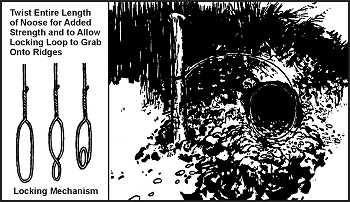

**Фігура 8-6. Проста петля**

**Петля з волокушею (Drag Noose)**

Використовуйте петлю з волокушею на звіриній стежці ([Фігура 8-7](#fig8-7)). Покладіть рогаті палички з обох боків стежки і покладіть міцну поперечину поперек них. Прив'яжіть петлю до поперечини і підвісьте її на висоті вище голови тварини. (Петлі, призначені для ловлі за голову, ніколи не повинні бути настільки низькими, щоб здобич могла наступити в них ногою). Коли зашморг затягується навколо шиї тварини, вона стягує поперечину з рогатих паличок і тягне її за собою. Навколишня рослинність швидко зачіпляє поперечину, і тварина заплутується.

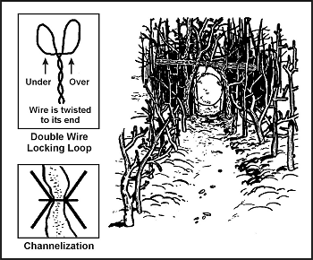

**Фігура 8-7. Петля з волокушею**

**Стрибаючий тригер (Twitch-Up)**

Стрибаючий тригер — це гнучкий молодий саджанець, який, будучи зігнутим і закріпленим за допомогою спускового механізму, забезпечить енергію для різноманітних петель. Виберіть гікорі або інше твердолистяне дерево вздовж стежки. Тригер працюватиме набагато швидше та з більшою силою, якщо ви видалите всі гілки та листя.

**Петля зі стрибаючим тригером (Twitch-Up Snare)**

Проста петля зі стрибаючим тригером використовує дві рогаті палички, кожна з довгими і короткими ногами ([Фігура 8-8](#fig8-8)). Зігніть тригер і позначте стежку під ним. Вбийте довгу ногу однієї рогатої палички міцно в землю в цій точці. Переконайтеся, що зріз на короткій нозі цієї палички паралельний землі. Прив'яжіть довгу ногу решти рогатої палички до шматка мотузки, закріпленого на тригері. Обріжте коротку ногу так, щоб вона чіплялася за коротку ногу іншої рогатої палички. Протягніть петлю над стежкою. Встановіть пастку, зігнувши тригер і зачепивши короткі ноги рогатих паличок. Коли тварина чіпляється головою за петлю, вона роз'єднує рогаті палички, дозволяючи тригеру вистрілити вгору і підвісити здобич.

**ПРИМІТКА:** Не використовуйте зелені палички для тригера. Сік, що виділяється, може склеїти їх разом.

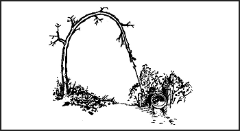

**Фігура 8-8. Петля зі стрибаючим тригером**

**Біляча жердина (Squirrel Pole)**

Біляча жердина — це довга жердина, поставлена до дерева в зоні з високою активністю білок ([Фігура 8-9](#fig8-9)). Розмістіть кілька дротяних петель уздовж верху і боків жердини так, щоб білка, намагаючись піднятися або спуститися по жердині, мусила пройти крізь одну чи кілька з них. Розмістіть петлі (діаметром 5–6 см [2–2 1/4 дюйма]) на відстані приблизно 2,5 см (1 дюйм) від жердини. Розмістіть верхню та нижню дротяні петлі на відстані 45 сантиметрів (18 дюймів) від верху та низу жердини, щоб запобігти тому, щоб білка ставала лапами на тверду поверхню. Якщо це станеться, білка перегризе дріт. Білки від природи цікаві. Після початкового періоду обережності вони спробують піднятися або спуститися по жердині і потраплять у петлю. Тварина, що бореться, незабаром впаде з жердини і задушиться. Інші білки незабаром притягнуться до шуму. Таким чином ви можете зловити кількох білок. Ви можете встановити кілька жердин, щоб збільшити улов.

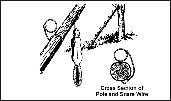

**Фігура 8-9. Біляча жердина**

**Пташина жердина Оджібва (Ojibwa Bird Pole)**

Пташина жердина Оджібва — це петля, яку корінні американці використовували століттями ([Фігура 8-10](#fig8-10)). Щоб вона була ефективною, її слід розміщувати у відносно відкритому місці подалі від високих дерев. Для найкращих результатів виберіть місце поблизу кормових зон, зон купання в пилу або водопоїв. Зріжте жердину довжиною 1,8–2,1 метра (6–7 футів) і очистіть усі гілки та листя. Не використовуйте смолисту деревину, таку як сосна. Загостріть верхній кінець до вістря, потім просвердліть невеликий отвір на відстані 5–7,5 сантиметрів (2–3 дюйми) зверху. Виріжте маленьку паличку довжиною 10–15 сантиметрів (4–6 дюймів) і сформуйте один кінець так, щоб він майже підходив до отвору. Це жердинка для сідання (perch). Посадіть довгу жердину в землю загостреним кінцем вгору. Прив'яжіть невеликий вантаж, приблизно рівний масі цільового виду, до довжини мотузки. Пропустіть вільний кінець мотузки через отвір і зав'яжіть ковзну петлю, яка покриває жердинку. Зав'яжіть єдиний вузол на мотузці і притуліть жердинку до отвору. Дозвольте мотузці ковзати крізь отвір, поки вузол не впреться в жердину і верх жердинки. Натяг вузла проти жердини та жердинки утримуватиме останню в положенні. Розправте петлю над жердинкою, переконавшись, що вона покриває жердинку і звисає з обох боків. Більшість птахів вважають за краще відпочивати на чомусь над землею і сідатимуть на жердинку. Щойно птах сідає, жердинка падає, вивільняючи вузол і дозволяючи вантажу впасти. Петля затягнеться навколо лап птаха, спіймавши його. Якщо вантаж занадто важкий, він відріже птаху лапи, дозволяючи йому втекти. Іншою варіацією було б використання пружинного натягу, наприклад гілки дерева, замість вантажу.

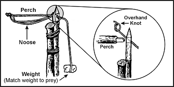

**Фігура 8-10. Пташина жердина Оджібва**

**Паличка для ловлі петлею (Noosing Wand)**

Паличка для ловлі петлею або «петльовий жезл» корисна для захоплення птахів на сідалах або дрібних ссавців ([Фігура 8-11](#fig8-11)). Вона вимагає терплячого оператора. Цей жезл є скоріше зброєю, ніж пасткою. Він складається з жердини (такої довжини, якою ви можете ефективно керувати) з ковзним зашморгом з дроту або жорсткої мотузки на малому кінці. Щоб зловити тварину, ви накидаєте петлю на шию птаха на сідалі і затягуєте її. Ви також можете помістити її над отвором нори і сховатися в сусідній засідці. Коли тварина з'являється з нори, ви різко смикаєте жердину, щоб затягнути петлю і таким чином зловити тварину. Носіть із собою міцну палицю, щоб убити здобич.

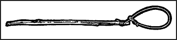

**Фігура 8-11. Паличка для ловлі петлею**

**Пружинна петля з педаллю (Treadle Spring Snare)**

Використовуйте петлю з педаллю проти дрібної дичини на стежці ([Фігура 8-12](#fig8-12)). Викопайте невелику яму в стежці. Потім вбийте рогату палицю (вилкою вниз) у землю з кожного боку ями на одному боці стежки. Виберіть дві досить прямі палички, що охоплюють дві розвилки. Розташуйте ці дві палички так, щоб їхні кінці зачіплялися за розвилки. Покладіть кілька паличок над ямою в стежці, розмістивши один кінець над нижньою горизонтальною паличкою, а інший на землі з іншого боку ями. Покрийте яму достатньою кількістю паличок, щоб здобич наступила принаймні на одну з них, щоб спрацювала петля. Прив'яжіть один кінець шматка мотузки до тригера або до вантажу, підвішеного над гілкою дерева. Зігніть тригер або підніміть підвішений вантаж, щоб визначити, де ви прив'яжете тригер. Тригер має бути довжиною близько 5 сантиметрів (2 дюйми). Сформуйте зашморг іншим кінцем мотузки. Проведіть і розправте петлю поверх паличок над ямою. Покладіть тригерну паличку проти горизонтальних паличок і проведіть мотузку за паличками так, щоб натяг джерела енергії утримував її на місці. Відрегульовуйте нижню горизонтальну паличку так, щоб вона ледь трималася проти тригера. Коли тварина стає ногою на паличку поперек ями, нижня горизонтальна паличка опускається вниз, звільняючи тригер і дозволяючи петлі зловити тварину за ногу. Через тривогу на стежці тварина буде обережною. Тому ви повинні використовувати каналізацію. Щоб підвищити ефективність цієї пастки, на дні ями можна викопати невелику принадову лунку. Покладіть трохи приманки на дно ями, щоб заманити тварину в петлю.

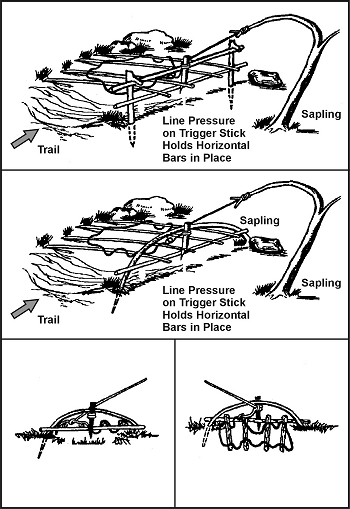

**Фігура 8-12. Пружинна петля з педаллю**

**Пастка-давилка «Фігура 4» (Figure 4 Deadfall)**

Давилка «Фігура 4» — це тригер, який використовується для скидання вантажу на здобич і розчавлювання її ([Фігура 8-13](#fig8-13)). Тип використовуваного вантажу може змінюватися, але він має бути достатньо важким, щоб одразу вбити або вивести з ладу здобич. Сконструюйте фігуру 4, використовуючи три палички з насічками. Ці насічки утримують палички разом у візерунку фігури 4 під натягом. Потренуйтеся виготовляти цей тригер заздалегідь; він вимагає малих допусків і точних кутів у будівництві.

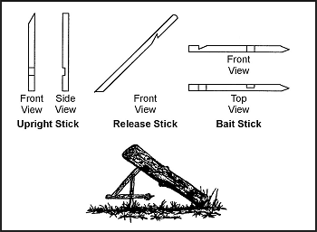

**Фігура 8-13. Пастка-давилка «Фігура 4»**

**Пастка-давилка Паюте (Paiute Deadfall)**

Давилка Паюте подібна до фігури 4, але використовує шматок мотузки та паличку-фіксатор ([Фігура 8-14](#fig8-14)). Вона має перевагу більшої легкості встановлення порівняно з фігурою 4. Прив'яжіть один кінець мотузки до нижнього кінця діагональної палички. Прив'яжіть інший кінець мотузки до іншої палички довжиною близько 5 сантиметрів (2 дюйми). Ця паличка є фіксатором. Проведіть мотузку наполовину навколо вертикальної палички з паличкою-фіксатором під кутом 90 градусів. Покладіть паличку з приманкою так, щоб один кінець впирався у вантаж, що падає, або в кілочок, вбитий у землю, а інший — у паличку-фіксатор. Коли здобич турбує паличку з приманкою, вона вільно падає, вивільняючи паличку-фіксатор. Коли діагональна паличка злітає вгору, вантаж падає, розчавлюючи здобич. Щоб підвищити ефективність цієї пастки, на дні ями можна викопати невелику принадову лунку. Покладіть трохи приманки на дно ями, щоб заманити тварин у петлю.

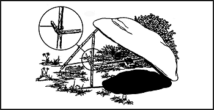
