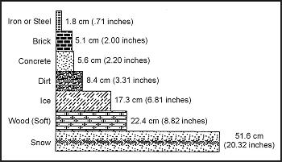

> Ядерна, хімічна та біологічна (ЯХБ) зброя стала потенційною реальністю на будь-якому сучасному полі бою. Нещодавній досвід в Афганістані, Камбоджі та інших районах конфліктів довів використання хімічної та біологічної зброї (такої як мікотоксини). Доктрина ведення бойових дій Організації Північноатлантичного договору та колишніх країн Варшавського договору розглядає застосування як ядерної, так і хімічної зброї. Потенційне використання цієї зброї посилює проблеми виживання через серйозні небезпеки, спричинені радіоактивними опадами або забрудненням, створеним стійкими біологічними чи хімічними агентами.
> 
> Ви повинні вживати спеціальних запобіжних заходів, якщо розраховуєте вижити в умовах цих техногенних небезпек. Якщо ви зазнаєте будь-якого впливу ядерної, хімічної чи біологічної війни, процедури виживання, рекомендовані в цьому розділі, можуть врятувати вам життя. Цей розділ містить певну довідкову інформацію про кожен тип небезпеки, щоб ви могли краще зрозуміти справжню природу небезпеки. Усвідомлення небезпек, знання цього розділу та застосування здорового глузду можуть зберегти вам життя.

### ЯДЕРНЕ СЕРЕДОВИЩЕ (THE NUCLEAR ENVIRONMENT)

Підготуйте себе до виживання в ядерному середовищі. Переконайтеся, що ви знаєте, чого очікувати і як реагувати на ядерну небезпеку.

**НАСЛІДКИ ЯДЕРНОЇ ЗБРОЇ (EFFECTS OF NUCLEAR WEAPONS)**

Наслідки застосування ядерної зброї класифікуються як початкові або залишкові. Початкові ефекти виникають у безпосередній зоні вибуху і є небезпечними протягом першої хвилини після вибуху. Залишкові ефекти можуть тривати днями чи роками і спричиняти смерть. Основними початковими ефектами є вибухова хвиля та радіація.

**Вибухова хвиля (Blast)**

Вибухова хвиля — це короткий і швидкий рух повітря від центру вибуху та тиск, що супроводжує цей рух. Сильні вітри супроводжують вибух. Вибухова хвиля кидає уламки та персонал, колапсує легені, розриває барабанні перетинки, руйнує структури та позиції, а також спричиняє негайну смерть або травму своєю руйнівною дією.

**Теплова радіація (Thermal Radiation)**

Цей ефект є тепловим та світловим випромінюванням, яке випромінює вогняна куля ядерного вибуху. Світлове випромінювання складається як з видимого світла, так і з ультрафіолетового та інфрачервоного світла. Теплова радіація викликає масштабні пожежі, опіки шкіри та сліпоту від спалаху.

**Ядерна радіація (Nuclear Radiation)**

Ядерна радіація поділяється на дві категорії. Ефекти можуть бути початковою радіацією та залишковою радіацією.

Початкова ядерна радіація складається з інтенсивних гамма-променів та нейтронів, що утворюються протягом першої хвилини після вибуху. Ця радіація завдає значної шкоди клітинам у всьому тілі. Радіаційне ушкодження може викликати головний біль, нудоту, блювоту, діарею і навіть смерть, залежно від отриманої дози радіації. Головною проблемою захисту від наслідків початкової радіації є те, що ви могли отримати смертельну або непрацездатну дозу до вжиття будь-яких захисних заходів. Персонал, що зазнав впливу смертельних кількостей початкової радіації, цілком міг бути вбитий або смертельно травмований вибуховою чи тепловою радіацією.

Залишкова радіація складається з усієї радіації, що утворюється через 1 хвилину після вибуху. Вона має більший вплив на вас, ніж початкова радіація. Обговорення залишкової радіації наводиться в наступному абзаці.

**ТИПИ ЯДЕРНИХ ВИБУХІВ (TYPES OF NUCLEAR BURSTS)**

Існує три типи ядерних вибухів: підземний/підводний вибух, повітряний вибух та наземний вибух. Тип вибуху безпосередньо впливає на ваші шанси на виживання. Підземний вибух відбувається повністю під землею або під водою. Його наслідки залишаються під поверхнею або в безпосередній зоні, де поверхня провалюється в кратер над місцем вибуху. Підземні вибухи створюють для вас невелику радіоактивну небезпеку або взагалі не створюють її, якщо ви не заходите в безпосередню зону кратера.

Повітряний вибух відбувається в повітрі над ціллю. Повітряний вибух забезпечує максимальний радіаційний ефект на ціль і тому є найнебезпечнішим для вас з точки зору **негайних** ядерних ефектів.

Наземний вибух відбувається на поверхні землі або води. У результаті утворюється велика кількість радіоактивних опадів із серйозними довгостроковими наслідками для вас. Цей тип вибуху є вашою **найбільшою** ядерною небезпекою.

**ЯДЕРНІ ТРАВМИ (NUCLEAR INJURIES)**

Більшість травм у ядерному середовищі є результатом початкових ядерних ефектів детонації. Ці травми класифікуються як вибухові, теплові чи радіаційні травми. Подальші радіаційні травми можуть виникнути, якщо ви не вживаєте належних запобіжних заходів проти радіоактивних опадів. Особи в районі поблизу ядерного вибуху, ймовірно, зазнають комбінації всіх трьох типів травм.

**Вибухові травми (Blast Injuries)**

Вибухові травми, спричинені ядерною зброєю, подібні до тих, що спричинені звичайною високоексплозивною зброєю. Надлишковий тиск вибуху може колапсувати легені та розірвати внутрішні органи. Осколкові поранення виникають, коли сила вибуху кидає уламки на вас. Великі уламки, що вдаряють вас, спричинять переломи кінцівок або масивні внутрішні травми. Надлишковий тиск вибуху може відкинути вас на великі відстані, і ви зазнаєте серйозних травм при зіткненні із землею чи іншими об'єктами. Суттєве укриття та відстань від вибуху є найкращим захистом від вибухових травм. Покрийте рани від вибухових травм якомога швидше, щоб запобігти потраплянню радіоактивних часток пилу.

**Теплові травми (Thermal Injuries)**

Тепло і світло, які випромінює ядерна вогняна куля, спричиняють теплові травми. Можуть виникати опіки першого, другого чи третього ступеня. Також виникає сліпота від спалаху. Ця сліпота може бути постійною або тимчасовою залежно від ступеня опромінення очей. Суттєве укриття та відстань від вибуху можуть запобігти тепловим травмам. Одяг забезпечить значний захист від теплових травм. Закрийте якомога більше відкритої шкіри перед ядерним вибухом. Перша допомога при теплових травмах така ж, як і перша допомога при опіках. Накрийте відкриті опіки (другого чи третього ступеня), щоб запобігти потраплянню радіоактивних часток. Вимийте всі опіки перед накриттям.

**Радіаційні травми (Radiation Injuries)**

Нейтрони, гамма-випромінювання, альфа-випромінювання та бета-випромінювання спричиняють радіаційні травми. Нейтрони — це високошвидкісні, надзвичайно проникаючі частки, які фактично руйнують клітини у вашому тілі. Гамма-випромінювання подібне до рентгенівських променів і також є високопроникаючим випромінюванням. Під час початкової стадії вогняної кулі ядерного вибуху початкове гамма-випромінювання та нейтрони становлять найсерйознішу загрозу. Бета- та альфа-випромінювання — це радіоактивні частки, які зазвичай асоціюються з радіоактивним пилом від опадів. Це частки малої дальності. Ви можете легко захистити себе від них, якщо вживаєте запобіжних заходів. Дивіться «Реакції організму на радіацію» нижче щодо симптомів радіаційних травм.

**ЗАЛИШКОВА РАДІАЦІЯ (RESIDUAL RADIATION)**

Залишкова радіація — це вся радіація, що випромінюється через 1 хвилину з моменту ядерного вибуху. Залишкова радіація складається з індукованої радіації та опадів.

**Індукована радіація (Induced Radiation)**

Цей термін описує відносно невелику, інтенсивно радіоактивну зону безпосередньо під вогняною кулею ядерної зброї. Опромінена земля в цій зоні залишатиметься високорадіоактивною протягом надзвичайно довгого часу. Ви не повинні подорожувати в зону індукованої радіації.

**Опади (Fallout)**

Опади складаються з радіоактивного ґрунту та водяних часток, а також фрагментів зброї. Під час поверхневого вибуху або якщо вогняна куля повітряного вибуху торкається землі, велика кількість ґрунту та води випаровується разом з фрагментами бомби та виштовхується вгору на висоту 25 000 метрів (82 000 футів) або більше. Коли цей випаруваний вміст охолоджується, він може утворювати понад 200 різних радіоактивних продуктів. Випаруваний вміст бомби конденсується в крихітні радіоактивні частки, які вітер переносить, доки вони не падають назад на землю як радіоактивний пил. Частки опадів випромінюють альфа-, бета- та гамма-випромінювання. Альфа- та бета-випромінювання відносно легко протидіяти, а залишкова гамма-радіація набагато менш інтенсивна, ніж гамма-випромінювання, що випромінюється протягом першої хвилини після вибуху. Опади є вашою найбільш значущою радіаційною небезпекою, за умови, що ви не отримали смертельної дози радіації від початкового випромінювання.

**РЕАКЦІЇ ОРГАНІЗМУ НА РАДІАЦІЮ (BODILY REACTIONS TO RADIATION)**

Наслідки радіації на людський організм можна широко класифікувати як хронічні або гострі. Хронічні наслідки — це ті, що виникають через кілька років після опромінення. Прикладами є рак та генетичні дефекти. Хронічні наслідки мають незначне значення, оскільки вони впливають на ваше неминуче виживання в радіоактивному середовищі. З іншого боку, гострі наслідки мають першочергове значення для вашого виживання. Деякі гострі ефекти виникають протягом годин після опромінення. Ці ефекти є результатом прямого фізичного пошкодження тканин радіацією. Променева хвороба та бета-опіки є прикладами гострих ефектів. Симптоми променевої хвороби включають нудоту, діарею, блювоту, втому, слабкість та втрату волосся. Проникаючі бета-промені спричиняють радіаційні опіки; рани подібні до опіків від вогню.

**Здатність до відновлення (Recovery Capability)**

Ступінь пошкодження організму залежить переважно від частини тіла, що піддалася опроміненню, та тривалості опромінення, а також від здатності до відновлення. Мозок і нирки мають невелику здатність до відновлення. Інші частини (шкіра та кістковий мозок) мають велику здатність до відновлення після пошкодження. Зазвичай доза в 600 сантигрей (cGy) на все тіло призведе до майже напевної смерті. Якщо лише ваші руки отримали ту ж дозу, загальний стан вашого здоров'я не постраждає сильно, хоча ваші руки зазнають серйозних пошкоджень.

**Зовнішні та внутрішні небезпеки (External and Internal Hazards)**

Зовнішня або внутрішня небезпека може спричинити пошкодження організму. Високопроникаюче гамма-випромінювання або менш проникаюче бета-випромінювання, що викликає опіки, можуть спричинити зовнішні пошкодження. Потрапляння часток, що випромінюють альфа- чи бета-випромінювання, в організм може спричинити внутрішні пошкодження. Зовнішня небезпека виробляє загальне опромінення та бета-опіки. Внутрішня небезпека призводить до опромінення критичних органів, таких як шлунково-кишковий тракт, щитоподібна залоза та кістки. Дуже невелика кількість радіоактивного матеріалу може завдати надзвичайної шкоди цим та іншим внутрішнім органам. Внутрішня небезпека може потрапити в організм або через споживання забрудненої води чи їжі, або шляхом абсорбції через порізи чи садна. Матеріал, що потрапляє в організм через дихання, становить лише незначну небезпеку. Ви можете значно зменшити внутрішню радіаційну небезпеку, використовуючи хорошу особисту гігієну та ретельно дезінфікуючи їжу і воду.

**Симптоми (Symptoms)**

Симптоми радіаційних травм включають нудоту, діарею та блювоту. Серйозність цих симптомів зумовлена надзвичайною чутливістю шлунково-кишкового тракту до радіації. Серйозність симптомів та швидкість їх появи після опромінення є хорошими індикаторами ступеня радіаційного пошкодження. Пошкодження шлунково-кишкового тракту може походити як від зовнішньої, так і від внутрішньої радіаційної небезпеки.

**ПРОТИДІЇ ПРОТИ ПРОНИКАЮЧОЇ ЗОВНІШНЬОЇ РАДІАЦІЇ (COUNTERMEASURES AGAINST PENETRATING EXTERNAL RADIATION)**

Знання радіаційних небезпек, обговорених раніше, є надзвичайно важливим для виживання в зоні радіоактивних опадів. Також критично важливо знати, як захистити себе від найнебезпечнішої форми залишкової радіації — проникаючої зовнішньої радіації.

Засоби, які ви можете використовувати для захисту від проникаючої зовнішньої радіації, це час, відстань та екранування (shielding). Ви можете зменшити рівень радіації та допомогти збільшити свої шанси на виживання, контролюючи тривалість опромінення. Ви також можете відійти якомога далі від джерела радіації. Нарешті, ви можете помістити якийсь матеріал, що поглинає радіацію або екранує її, між собою та радіацією.

**Час (Time)**

Час важливий у двох аспектах, коли ви перебуваєте в ситуації виживання. По-перше, дози радіації є кумулятивними. Чим довше ви зазнаєте впливу радіоактивного джерела, тим більшу дозу ви отримаєте. Очевидно, витрачайте якомога менше часу в радіоактивній зоні. По-друге, радіоактивність зменшується або розпадається з часом. Ця концепція відома як радіоактивний *період напіврозпаду* (half-life). Таким чином, радіоактивний елемент розпадається або втрачає половину своєї радіоактивності протягом певного часу. Емпіричне правило розпаду радіоактивності полягає в тому, що її інтенсивність зменшується в десять разів на кожне семикратне збільшення часу після пікового рівня радіації. Наприклад, якщо зона радіоактивних опадів мала максимальну швидкість радіації 200 cGy на годину, коли опади завершилися, ця швидкість впала б до 20 cGy на годину через 7 годин; вона впала б ще далі до 2 cGy на годину через 49 годин. Навіть непідготовлений спостерігач може бачити, що найбільша небезпека від опадів виникає одразу після детонації, і що небезпека швидко зменшується протягом відносно короткого часу. Ви повинні намагатися уникати зон опадів, доки радіоактивність не розпадеться до безпечних рівнів. Якщо ви можете уникнути зон опадів достатньо довго для розпаду більшої частини радіоактивності, ви підвищуєте свої шанси на виживання.

**Відстань (Distance)**

Відстань забезпечує дуже ефективний захист від проникаючого гамма-випромінювання, оскільки інтенсивність радіації зменшується обернено пропорційно квадрату відстані від джерела. Наприклад, якщо піддатися опроміненню в 1000 cGy, стоячи на відстані 30 сантиметрів (12 дюймів) від джерела, на відстані 60 сантиметрів (24 дюйми) ви отримали б лише 250 cGy. Таким чином, коли ви подвоюєте відстань, радіація зменшується до (0.5)2 або 0.25 від кількості. Хоча ця формула дійсна для концентрованих джерел радіації в невеликих зонах, вона стає більш складною для великих зон радіації, таких як зони опадів.

**Екранування / Захист екраном (Shielding)**

Екранування є найважливішим методом захисту від проникаючої радіації. З трьох контрзаходів проти проникаючої радіації екранування забезпечує найбільший захист і є найпростішим у використанні в умовах виживання. Тому це найбільш бажаний метод. Якщо екранування неможливе, використовуйте інші два методи максимально практично.

Екранування фактично працює шляхом поглинання або ослаблення проникаючої радіації, тим самим зменшуючи кількість радіації, що досягає вашого тіла. Чим щільніший матеріал, тим кращий ефект екранування. Свинець, залізо, бетон та вода є хорошими прикладами екрануючих матеріалів.

**Спеціальні медичні аспекти (Special Medical Aspects)**

Наявність матеріалу опадів у вашому районі вимагає невеликих змін у процедурах першої допомоги. Ви повинні закрити всі рани, щоб запобігти забрудненню та потраплянню радіоактивних часток. Ви повинні спочатку промити опіки від бета-радіації, а потім лікувати їх як звичайні опіки. Вживайте додаткових заходів для запобігання інфекціям. Ваше тіло буде надзвичайно чутливим до інфекцій через зміни в хімічному складі крові. Приділяйте пильну увагу профілактиці застуд чи респіраторних інфекцій. Суворо практикуйте особисту гігієну для запобігання інфекціям. Закрийте очі імпровізованими окулярами, щоб запобігти потраплянню часток.

### УКРИТТЯ (SHELTER)

Як зазначалося раніше, ефективність екрануючого матеріалу залежить від його товщини та щільності. Достатня товщина екрануючого матеріалу зменшить рівень радіації до зневажливо малих величин.

Основною причиною пошуку та будівництва укриття є якомога швидший захист від високих рівнів радіації ранніх гамма-опадів. П'ять хвилин на пошук укриття — хороший орієнтир. Швидкість у пошуку укриття є абсолютно необхідною. Без укриття доза, отримана в перші кілька годин, перевищить ту, що отримана протягом решти тижня в забрудненій зоні. Доза, отримана в цей перший тиждень, перевищить дозу, накопичену протягом решти життя, проведеного в тій самій забрудненій зоні.

**Екрануючі матеріали (Shielding Materials)**

Товщина, необхідна для послаблення гамма-випромінювання від опадів, є набагато меншою, ніж та, що необхідна для захисту від початкового гамма-випромінювання. Радіація від опадів має меншу енергію, ніж початкова радіація ядерного вибуху. Для радіації від опадів відносно невелика кількість екрануючого матеріалу може забезпечити адекватний захист. [Фігура 23-1](#fig23-1) показує товщину різних матеріалів, необхідну для зменшення передачі залишкового гамма-випромінювання на 50 відсотків.

**Фігура 23-1. Матеріали для зменшення гамма-випромінювання**

Принцип **товщини шару половинного послаблення** (half-value layer thickness) корисний для розуміння поглинання гамма-випромінювання різними матеріалами. Згідно з цим принципом, якщо 5 сантиметрів (2 дюйми) цегли зменшують рівень гамма-випромінювання вдвічі, додавання ще 5 сантиметрів (2 дюймів) цегли (ще один шар половинного послаблення) зменшить інтенсивність ще вдвічі, тобто до однієї чверті від початкової кількості. П'ятнадцять сантиметрів (6 дюймів) зменшать рівень радіації від опадів гамма до однієї восьмої від її початкової кількості, 20 сантиметрів (8 дюймів) до однієї шістнадцятої тощо. Таким чином, укриття, захищене 1 метром (3 футами) бруду, зменшило б інтенсивність радіації 1000 cGy на годину зовні приблизно до 0.5 cGy на годину всередині укриття.

**Природні укриття (Natural Shelters)**

Місцевість, яка забезпечує природне екранування та легке будівництво укриття, є ідеальним місцем для аварійного укриття. Хорошими прикладами є канави, яри, скельні виходи, пагорби та береги річок. На рівних ділянках без природного захисту викопайте бойову позицію або щілиноподібну траншею.

**Траншеї (Trenches)**

Копаючи траншею, працюйте зсередини траншеї, як тільки вона стане достатньо великою, щоб закрити частину вашого тіла, таким чином не виставляючи все ваше тіло під радіацію. У відкритій країні намагайтеся копати траншею з положення лежачи, акуратно і рівно складаючи бруд навколо траншеї. На рівній землі насипте бруд навколо свого тіла для додаткового екранування. Залежно від умов ґрунту, час будівництва укриття змінюватиметься від кількох хвилин до кількох годин. Якщо ви копаєте якомога швидше, ви зменшите дозу, яку отримуєте.

**Інші укриття (Other Shelters)**

Хоча підземне укриття, вкрите 1 метром (3 футами) або більше землі, забезпечує найкращий захист від радіації опадів, такі незайняті споруди (у порядку переліку) пропонують наступний найкращий захист:

* Печери та тунелі, вкриті більше ніж 1 метром (3 футами) землі.
* Штормові або складські льохи.
* Во водопропускні труби (Culverts).
* Підвали або льохи покинутих будівель.
* Покинуті будівлі з каменю чи глини.

**Дахи (Roofs)**

Не обов'язково будувати дах на своєму укритті. Будуйте його лише тоді, коли матеріали легко доступні з лише коротким впливом зовнішнього забруднення. Якщо будівництво даху вимагатиме тривалого впливу проникаючої радіації, розумніше було б залишити укриття без даху. Єдиною функцією даху є зменшення радіації від джерела опадів до вашого тіла. Якщо ви не використовуєте товстий дах, дах забезпечує дуже невелике екранування.

Ви можете побудувати простий дах з пончо, закріпленого брудом, камінням або іншим сміттям з вашого укриття. Ви можете видалити великі частки бруду та сміття з верхньої частини пончо, збиваючи їх зсередини через короткі проміжки часу. Це покриття не запропонує екранування від радіоактивних часток, осаджених на поверхні, але воно збільшить відстань від джерела опадів і збереже зону укриття від подальшого забруднення.

**Вибір місця та підготовка укриття (Shelter Site Selection and Preparation)**

Щоб зменшити час опромінення і тим самим зменшити отриману дозу, пам'ятайте про такі фактори при виборі та облаштуванні укриття:

* Де можливо, шукайте грубе, існуюче укриття, яке ви можете вдосконалити. Якщо жодного немає, викопайте траншею.
* Викопайте укриття достатньо глибоко для хорошого захисту, а потім розширте його за потреби для комфорту.
* Накрийте верх бойової позиції або траншеї будь-яким легкодоступним матеріалом і товстим шаром землі, якщо ви можете зробити це, не залишаючи укриття. Хоча дах і маскування є бажаними, ймовірно, безпечніше обійтися без них, ніж піддавати себе радіації за межами бойової позиції.
* Будуючи укриття, тримайте всі частини свого тіла покритими одягом для захисту від бета-опіків.
* Очистіть місце укриття від будь-яких поверхневих відкладень за допомогою гілки чи іншого предмета, який ви можете викинути. Зробіть це очищення, щоб видалити забруднені матеріали з зони, яку ви займатимете. Очищена зона повинна поширюватися щонайменше на 1,5 метра (5 футів) за межі зони вашого укриття.
* Дезінфікуйте будь-які матеріали, які ви приносите в укриття. Ці матеріали включають трави чи листя, які ви використовуєте як ізоляцію або підстилку, а також ваш верхній одяг (особливо взуття). Якщо погода дозволяє і у вас сильно забруднений верхній одяг, ви можете зняти його і закопати під футом землі в кінці вашого укриття. Ви можете повернути його пізніше (після розпаду радіоактивності) при виході з укриття. Якщо одяг сухий, ви можете знезаразити його, збиваючи або струшуючи його ззовні входу в укриття для видалення радіоактивного пилу. Ви можете використовувати будь-яку водойму, навіть якщо вона забруднена, щоб позбавити матеріали від надлишку часток опадів. Просто занурте матеріал у воду і струсіть його, щоб позбутися зайвої води. Не викручуйте його, ця дія затримає частки.
* По можливості і не залишаючи укриття, ретельно вимийте тіло з милом і водою, навіть якщо наявна вода може бути забрудненою. Це миття видалить більшість шкідливих радіоактивних часток, які можуть спричинити бета-опіки чи інші пошкодження. Якщо вода недоступна, витріть обличчя та будь-яку іншу відкриту поверхню шкіри для видалення забрудненого пилу та бруду. Ви можете витерти обличчя чистим шматочком тканини або жменею незабрудненого бруду. Ви отримуєте цей незабруднений бруд, зскрібаючи верхні кілька дюймів ґрунту і використовуючи «чистий» бруд.
* Після завершення укриття ляжте, тримайтеся в теплі, спіть і відпочивайте якомога більше, перебуваючи в укритті.
* Не відпочиваючи, займіться плануванням майбутніх дій, вивченням карт або підвищенням комфорту й ефективності укриття.
* Не панікуйте, якщо відчуваєте нудоту та симптоми променевої хвороби. Ваша головна небезпека від променевої хвороби — це інфекція. Першої допомоги при цій хворобі не існує. Відпочинок, пиття рідин, прийом ліків, що запобігають блювоті, підтримання споживання їжі та запобігання додатковому опроміненню допоможуть уникнути інфекції та сприятимуть одужанню. Навіть невеликі дози радіації можуть викликати ці симптоми, які можуть зникнути через короткий час.

**Графік опромінення (Exposure Timetable)**

Наступний розклад надає вам інформацію, необхідну для уникнення отримання серйозної дози і водночас дозволяє впоратися з проблемами виживання:

* Повна ізоляція від 4 до 6 днів після доставки останньої зброї.
* Дуже короткий вплив для отримання води на третій день є допустимим, але вплив не повинен перевищувати 30 хвилин.
* Один вплив не більше 30 хвилин на сьомий день.
* Один вплив не більше 1 години на восьмий день.
* Вплив від 2 до 4 годин з дев'ятого по дванадцятий день.
* Нормальна діяльність із подальшим відпочинком у захищеному укритті з тринадцятого дня і далі.
* У всіх випадках робіть свої виходи назовні якомога коротшими. Вважайте лише обов'язкові вимоги дійсними причинами для виходу. Дезінфікуйте на кожній зупинці.

Наведені вище часові рамки є консервативними. Якщо вас змусили пересуватися після першого чи другого дня, ви можете це зробити. Переконайтеся, що вплив триває не довше, ніж абсолютно необхідно.

**ЗАБЕЗПЕЧЕННЯ ВОДОЮ (WATER PROCUREMENT)**

У зоні, забрудненій опадами, доступні джерела води можуть бути забрудненими. Якщо ви зачекаєте принаймні 48 годин перед питтям будь-якої води, щоб відбувся радіоактивний розпад, і виберете найбільш безпечне джерело води, ви значно зменшите небезпеку вживання шкідливих кількостей радіоактивності.

Хоча багато факторів (напрямок вітру, опадів, осад) впливатимуть на ваш вибір у виборі джерел води, враховуйте такі рекомендації.

**Найбезпечніші джерела води (Safest Water Sources)**

Вода з джерел, колодязів або інших підземних джерел, що проходять природну фільтрацію, буде вашими найбезпечнішими джерелами. Будь-яка вода, знайдена в трубах або контейнерах покинутих будинків чи магазинів, також буде вільною від радіоактивних часток. Ця вода буде безпечною для пиття, хоча вам доведеться вжити запобіжних заходів проти бактерій у воді.

Сніг, взятий з глибини 15 сантиметрів (6 дюймів) або більше нижче поверхні під час опадів, також є безпечним джерелом води.

**Струмки та річки (Streams and Rivers)**

Вода зі струмків та річок буде відносно вільною від опадів протягом кількох днів після останнього ядерного вибуху через розведення. По можливості фільтруйте таку воду перед питтям, щоб позбутися радіоактивних часток. Найкращим методом фільтрації є викопування осадових ям або басейнів фільтрації вздовж берега джерела води. Вода просочуватиметься латерально в яму крізь проміжний ґрунт, який діє як фільтруючий агент і видаляє забруднені частки опадів, які осіли на початковому тілі води. Цей метод може видалити до 99 відсотків радіоактивності у воді. Ви повинні закрити яму якимось чином, щоб запобігти подальшому забрудненню. Дивіться [Фігура 6-9](Water) щодо прикладу водяного фільтра.

**Стояча вода (Standing Water)**

Вода з озер, басейнів, ставків та інших стоячих джерел, ймовірно, буде сильно забрудненою; хоча більшість важких, довгоживучих радіоактивних ізотопів осяде на дно. Використовуйте техніку відстоювання для очищення цієї води. По-перше, заповніть відро або інший глибокий контейнер на три чверті забрудненою водою. Потім візьміть бруд з глибини 10 сантиметрів (4 дюймів) або більше нижче поверхні ґрунту і розмішайте його у воді. Використовуйте приблизно 2,5 сантиметра (1 дюйм) бруду на кожні 10 сантиметрів (4 дюйми) води. Розмішуйте воду, доки не побачите більшість часток бруду, що зависли у воді. Дайте суміші відстоятися принаймні 6 годин. Осідаючі частки бруду перенесуть більшість зважених часток опадів на дно і покриють їх. Потім ви можете вичерпати чисту воду. Очистіть цю воду за допомогою фільтруючого пристрою.

**Додаткові запобіжні заходи (Additional Precautions)**

Як додатковий запобіжний захід проти хвороб, обробіть всю воду таблетками для очищення води з вашого комплекту виживання або пропріть її.

**ЗАБЕЗПЕЧЕННЯ ЇЖЕЮ (FOOD PROCUREMENT)**

Отримання їжі, придатної для їжі, в зоні, забрудненій радіацією, є серйозною, але не нездоланною проблемою. Вам потрібно дотримуватися кількох спеціальних процедур при виборі та приготуванні пайків і місцевих продуктів для використання. Оскільки безпечна упаковка захищає ваші бойові пайки, вони будуть абсолютно безпечними для використання. Доповнюйте свої пайки будь-якою їжею, яку ви можете знайти під час виходів за межі свого укриття.

Покинуті будівлі можуть мати запаси оброблених продуктів харчування. Вони безпечні для використання після їх дезінфекції. Консервовані та упаковані продукти повинні мати контейнери або обгортки, зняті або промиті від часток опадів. Ці оброблені продукти також включають їжу, що зберігається в будь-якому закритому контейнері та їжу, що зберігається в захищених районах (таких як льохи). Усі такі продукти необхідно вимити перед їжею або поводженням з ними.

Якщо в вашому районі доступно мало або взагалі немає обробленої їжі, вам, можливо, доведеться доповнити свій раціон місцевими джерелами харчування. Тварини та рослини є місцевими джерелами харчування.

**Тварини як джерело їжі (Animals: A Food Source)**

Припускайте, що всі тварини, незалежно від їхнього середовища існування чи умов життя, були піддані впливу радіації. Наслідки радіації на тварин подібні до наслідків на людей. Таким чином, більшість диких тварин, що живуть у зоні опадів, ймовірно, захворіють або загинуть від радіації протягом першого місяця після ядерного вибуху. Хоча тварини можуть не бути вільними від шкідливих радіоактивних матеріалів, ви можете і повинні використовувати їх в умовах виживання як джерело їжі, якщо інші продукти недоступні. За умови ретельної підготовки та дотримання кількох важливих принципів тварини можуть бути безпечними джерелами їжі.

По-перше, не їжте тварину, яка виглядає хворою. Вона могла захворіти на бактеріальну інфекцію через променеве отруєння. Забруднене м'ясо, навіть якщо воно ретельно проготоване, може викликати серйозне захворювання або смерть, якщо його з'їсти.

Ретельно зніміть шкіру з усіх тварин, щоб запобігти потраплянню будь-яких радіоактивних часток на шкірі чи хутрі в організм. Не їжте м'ясо поблизу кісток та суглобів, оскільки скелет тварини містить понад 90 відсотків радіоактивності. Проте решта м'язової тканини тварини буде безпечною для їжі. Перед приготуванням зріжте м'ясо з кістки, залишаючи принаймні 3-міліметрову (1/8 дюйма) товщину м'яса на кістці. Викиньте всі внутрішні органи (серце, печінку та нирки), оскільки вони мають тенденцію концентрувати бета- та гамма-радіоактивність.

Готуйте все м'ясо дуже добре. Щоб переконатися, що м'ясо добре проготоване, наріжте його шматочками товщиною менше 13 міліметрів (4 1/2 дюйма) перед приготуванням. Такі нарізки також зменшать час приготування та збережуть паливо.

Ступінь забруднення риби та водних тварин буде набагато більшим, ніж у наземних тварин. Це також стосується водяних рослин, особливо в прибережних районах. Використовуйте водні джерела їжі лише в умовах надзвичайної ситуації.

Усі яйця, навіть якщо вони були відкладені під час опадів, будуть безпечними для їжі. Повністю уникайте молока будь-яких тварин у зоні опадів, оскільки тварини поглинають велику кількість радіоактивності з рослин, які вони їдять.

**Рослини як джерело їжі (Plants — A Food Source)**

Забруднення рослин відбувається через накопичення опадів на їхніх зовнішніх поверхнях або шляхом поглинання радіоактивних елементів через їхнє коріння. Вашим першим вибором рослинної їжі повинні бути овочі, такі як картопля, ріпа, морква та інші рослини, чия їстівна частина росте під землею. Вони є найбезпечнішими для їжі після їх ретельного очищення та зняття шкірки.

Другими, в порядку переваги, є ті рослини з їстівними частинами, які ви можете знезаразити шляхом миття та очищення їхніх зовнішніх поверхонь. Прикладами є банани, яблука, помідори, опунції та інші подібні фрукти й овочі.

Будь-який овоч, фрукт або рослина з гладкою шкіркою, яку ви не можете легко почистити або ефективно знезаразити миттям, буде вашим третім вибором аварійної їжі.

Ефективність дезінфекції шляхом очищення обернено пропорційна шорсткості поверхні фрукта. Фрукти з гладкою поверхнею втратять 90 відсотків свого забруднення після миття, але рослини з шорсткою поверхнею втратять лише близько 50 відсотків.

Їжте рослини з шорсткою поверхнею (такі як салат) лише як останній засіб, оскільки ви не можете ефективно знезаразити їх шляхом очищення чи миття. Інші продукти, які важко знезаразити миттям водою, включають сухофрукти (інжир, чорнослив, персики, абрикоси, груші) та соєві боби.

Загалом, ви можете використовувати будь-яку рослинну їжу, готову до збору врожаю, якщо ви можете ефективно її знезаразити. Проте рослини, що ростуть, можуть поглинати деякі радіоактивні матеріали через листя, а також з ґрунту, особливо якщо під час або після періоду опадів були дощі. Уникайте використання цих рослин для їжі, за винятком надзвичайних ситуацій.

### БІОЛОГІЧНІ СЕРЕДОВИЩА (BIOLOGICAL ENVIRONMENTS)

Використання біологічних агентів є реальністю. Знайте, що робити для захисту себе від цих агентів.

**БІОЛОГІЧНІ АГЕНТИ ТА ЕФЕКТИ (BIOLOGICAL AGENTS AND EFFECTS)**

Біологічні агенти — це мікроорганізми, які можуть викликати захворювання серед персоналу, тварин чи рослин. Вони також можуть спричинити погіршення стану матеріалів. Ці агенти поділяються на дві широкі категорії — патогени (зазвичай звані мікробами) та токсини. Патогени — це живі мікроорганізми, які викликають смертельні або інвалідизуючі захворювання. Бактерії, рикетсії, грибки та віруси входять до складу патогенів. Токсини — це отрути, які рослини, тварини чи мікроорганізми виробляють природним шляхом. Можливі токсини біологічної зброї включають різноманітні нейротоксичні (що впливають на центральну нервову систему) та цитотоксичні (що викликають загибель клітин) сполуки.

**Мікроби (Germs)**

Мікроби є живими організмами. Деякі нації використовували їх у минулому як зброю. Лише кілька мікробів можуть почати інфекцію, особливо якщо вони вдихаються в легені. Оскільки мікроби такі маленькі і важать так мало, вітер може поширювати їх на великі відстані; вони також можуть проникати в нефільтровані або негерметичні місця. Будівлі та бункери можуть затримувати їх, викликаючи вищу концентрацію. Мікроби не впливають на організм негайно. Вони повинні розмножуватися всередині тіла і подолати захисні сили організму — процес, що називається інкубаційним періодом. Інкубаційні періоди варіюються від кількох годин до кількох місяців, залежно від мікроба. Більшість мікробів повинні жити в іншому живому організмі (господарі), такому як ваше тіло, щоб виживати і рости. Погодні умови, такі як вітер, дощ, холод і сонячне світло, швидко вбивають мікроби.
