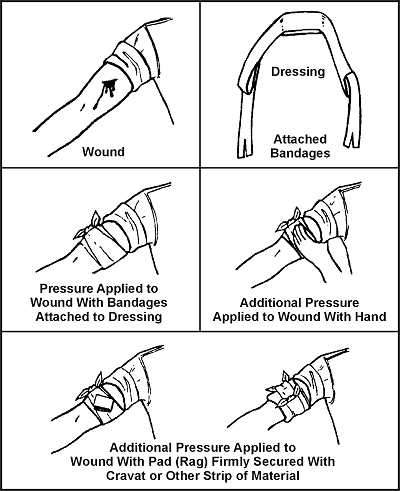
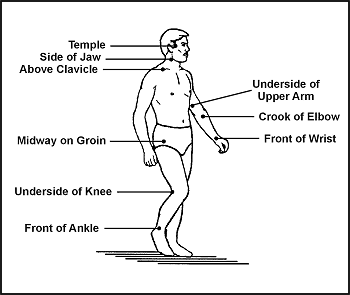
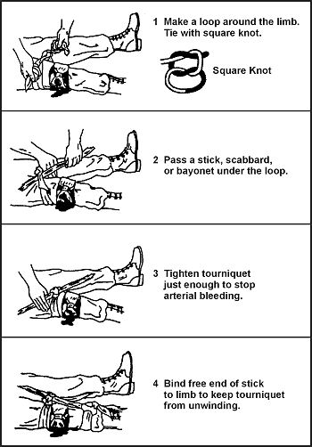
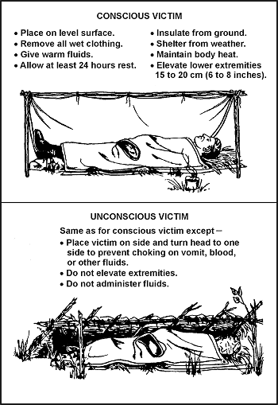
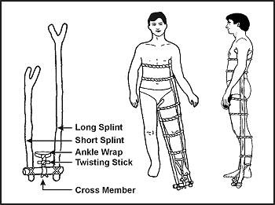
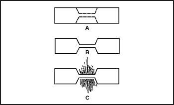

> Серед багатьох проблем, які можуть поставити під загрозу вашу здатність виживати, першочерговими є медичні проблеми, що виникають внаслідок незапланованих подій, таких як випадкові травми або екстремальні кліматичні умови.
> 
> Багато евадеантів та тих, хто вижив, повідомляли про труднощі в лікуванні травм та хвороб через брак підготовки та медичних запасів.
> 
> Ті, хто вижив, пов'язували почуття апатії та безпорадності з тим, що вони не могли лікувати себе у своєму середовищі. Здатність лікувати себе підвищує ваш моральний дух і допомагає у виживанні та остаточному поверненні до дружніх сил.
> 
> Одна людина з достатнім обсягом базових медичних знань може змінити життя багатьох. **За відсутності кваліфікованого медичного персоналу саме ви повинні знати, що робити, щоб залишитися в живих.**

### ВИМОГИ ЩОДО ПІДТРИМАННЯ ЗДОРОВ'Я (REQUIREMENTS FOR MAINTENANCE OF HEALTH)

Щоб вижити, вам потрібні вода та їжа. Ви також повинні мати та застосовувати високі стандарти особистої гігієни.

**ВОДА (WATER)**

Ваше тіло втрачає воду через нормальні процеси життєдіяльності (потовиділення, сечовипускання та дефекацію). Під час середнього щоденного навантаження, коли температура повітря становить 20 градусів Цельсія (C) (68 градусів Фаренгейта [F]), середньостатистичний дорослий втрачає від 2 до 3 літрів води. Інші фактори можуть спричинити втрату організмом більшої кількості води, наприклад, вплив спеки, вплив холоду, інтенсивна активність, висота над рівнем моря, опіки чи хвороба. Ви повинні поповнювати цю воду.

Зневоднення (dehydration) є результатом недостатнього поповнення втрачених рідин організму. Воно знижує вашу ефективність і, якщо ви травмовані, збільшує вразливість до серйозного шоку. Розгляньте наступні наслідки втрати рідини організмом:

* Втрата 5 відсотків призводить до спраги, дратівливості, нудоти та слабкості.
* Втрата 10 відсотків призводить до запаморочення, головного болю, нездатності ходити та поколювання в кінцівках.
* Втрата 15 відсотків призводить до погіршення зору, болючого сечовипускання, набряку язика, глухоти та відчуття оніміння шкіри.
* Втрата понад 15 відсотків може призвести до смерті.

Найпоширенішими ознаками та симптомами зневоднення є:

* Темна сеча з дуже сильним запахом (Загалом, чим темніша сеча, тим більшого зневоднення ви зазнали).
* Низький об'єм сечі.
* Темні, запалі очі.
* Втома.
* Емоційна нестабільність.
* Втрата еластичності шкіри.
* Уповільнено-поновлюване наповнення капілярів у нітьових ложах.
* Борозна по центру язика.
* Спрага (Остання в списку, оскільки ви вже на 2 відсотки зневоднені до того моменту, коли відчуваєте сильну потребу в рідині).

Ви повинні поповнювати воду в міру її втрати. Намагатися надолужити дефіцит у ситуації виживання важко, а спрага не є показником того, скільки води вам потрібно.

Більшість людей не можуть комфортно випити більше 1 літра води за раз. Тому, навіть коли ви не відчуваєте спраги, пийте невеликі кількості води через рівні проміжки часу щогодини, щоб запобігти зневодненню.

Якщо ви перебуваєте під фізичним і психічним стресом або піддаєтеся суворим умовам, збільште споживання води. Пийте достатньо рідини, щоб підтримувати виділення сечі щонайменше 0,5 літра кожні 24 години. Колір сечі є одним з індикаторів рівнів гідратації.

У будь-якій ситуації, коли споживання їжі низьке, випивайте від 6 до 8 літрів води на день. В екстремальних кліматичних умовах, особливо в посушливих, середньостатистична людина може втрачати від 2,5 до 3,5 літрів води **на годину**. У такому кліматі ви повинні випивати від 8 до 12 унцій води кожні 30 хвилин. Краще регулювати втрату води через цикли роботи або відпочинку, оскільки може виникнути гіпергідратація (overhydration), якщо споживання води перевищує 1,5 кварти на годину. Гіпергідратація може спричинити низький рівень натрію в сироватці крові, що призводить до набряку головного мозку та легень, що може призвести до смерті.

Разом із втратою води відбувається і втрата електролітів (солей організму). Звичайна дієта зазвичай може встигати за цими втратами, але в екстремальній ситуації чи хворобі необхідні додаткові джерела. Ви повинні підтримувати споживання вуглеводів та інших необхідних електролітів.

Ви можете приготувати питво з оральними регідратаційними солями (ORS) для заміщення втрачених солей після сильної діареї чи блювоти, змішавши 0,5 чайної ложки солі та 2 столові ложки цукру в 1 літрі води. Рекомендовані кількості для пиття відрізняються залежно від маси тіла:

* Немовлята (0–2 роки): 0,5 літра кожні 24 години
* Діти (2–9 років): 1 літр кожні 24 години
* Старші діти та дорослі: 3 літри кожні 24 години

З усіх фізичних проблем, що виникають у ситуації виживання, втрата води є найменш невідворотною. Нижче наведено базові інструкції щодо запобігання зневодненню:

* *Завжди пийте воду під час їжі.* Вода використовується як частина процесу травлення і може призвести до зневоднення.
* *Акліматизуйтеся.* Організм працює ефективніше в екстремальних умовах при акліматизації.
* *Зберігайте піт, а не воду.* Обмежуйте діяльність, що викликає пітливість, але пийте воду.
* *Нормуйте воду.* Поки ви не знайдете підходяще джерело, нормуйте свій піт, а не воду. Обмежуйте активність та нагрівання або охолодження.

Ви можете оцінити втрату рідини різними засобами. Польовий бандаж вміщує близько 0,25 літра (1/4 фляги) рідини. Просочена футболка утримує від 0,5 до 0,75 літра.

Ви також можете використовувати пульс і частоту дихання для оцінки втрати рідини. Використовуйте наступне як орієнтир:

* При втраті 0,75 літра пульс на зап'ясті буде менше 100 ударів на хвилину, а частота дихання — 12–20 вдихів на хвилину.
* При втраті від 0,75 до 1,5 літра пульс становитиме від 100 до 120 ударів на хвилину, а дихання — 20–30 вдихів на хвилину.
* При втраті від 1,5 до 2 літрів пульс становитиме 120–140 ударів на хвилину, а дихання — 30–40 вдихів на хвилину. Життєві показники вище цих значень вимагають розширеного догляду.

Переконайтеся, що вода, яку ви п'єте, не містить шкідливих домішок. В ідеалі носіть [LifeStraw](LifeStraw) як частину [свого набору](Kits) для фільтрації води. Прочитайте більше про це в [розділі про воду](Water).

**ЇЖА (FOOD)**

Хоча ви можете прожити кілька тижнів без їжі, вам потрібна достатня кількість, щоб залишатися здоровим. Без їжі ваші розумові та фізичні можливості швидко погіршуватимуться, і ви станете слабкими. Їжа забезпечує енергією та поповнює речовини, які спалює ваше тіло. Їжа забезпечує вітамінами, мінералами, солями та іншими елементами, необхідними для доброго здоров'я. І, що, можливо, важливіше, вона допомагає моральному духу.

Трьома основними джерелами їжі є рослини, тварини (включаючи рибу) та гриби. У різному ступені вони забезпечують калоріями, вуглеводами, жирами та білками, необхідними для нормальних щоденних функцій організму. Ви повинні використовувати пайки для доповнення рослинних та тваринних продуктів харчування, що розширить та допоможе підтримувати збалансовану дієту.

Калорії є мірою тепла та потенційної енергії. Середньостатистичній людині потрібно 2000 калорій на день для функціонування на мінімальному рівні. Достатня кількість вуглеводів, жирів та білків без адекватного споживання калорій призведе до голодування та самопоїдання власних тканин організму для отримання енергії. Можливо, буде корисно оцінити ваш TDEE (Total Daily Energy Expenditure, загальні щоденні витрати енергії), оскільки кожна людина вимагає різних калорійних мінімумів.

**Рослини (Plants)**

Рослинні продукти забезпечують вуглеводами — основним джерелом енергії. Багато рослин забезпечують достатньою кількістю білка для підтримання організму на нормальній ефективності. Хоча рослини можуть не забезпечувати збалансовану дієту, вони підтримають вас навіть в арктиці, де теплотворні якості м'яса зазвичай є суттєвими. Багато рослинних продуктів, таких як горіхи та насіння, дадуть вам достатньо білка та олій для нормальної ефективності. Коріння, зелені овочі та рослинні продукти, що містять натуральний цукор, забезпечать калоріями та вуглеводами, які дають організму природну енергію.

Харчова цінність рослин стає все більш важливою, якщо ви уникаєте ворогів або перебуваєте в районі, де диких тварин мало. Наприклад:

* Ви можете висушувати рослини вітром, повітрям, сонцем або вогнем. Це затримує псування, так що ви можете зберігати або носити рослинну їжу з собою для використання при необхідності.
* Ви часто можете отримати рослини легше, ніж м'ясо.

**Тварини (Animals)**

М'ясо є більш поживним, ніж рослинна їжа. Воно навіть може бути більш доступним у деяких місцях. Проте, щоб отримати м'ясо, вам потрібно знати звички (і способи захоплення) різноманітної дичини.

Для задоволення невідкладних потреб у їжі спочатку шукайте більш рясну та легкодоступну дитину. Це включає комах, ракоподібних, молюсків, рибу та рептилій. Вони можуть задовольнити голод, поки ви готуєте пастки та петлі для більшої дичини.

**ОСОБИСТА ГІГІЄНА (PERSONAL HYGIENE)**

Чистота завжди є важливим фактором у запобіганні інфекціям та хворобам. Це стає ще важливішим у ситуації виживання, оскільки погана гігієна може зменшити шанси на виживання.

Щоденний душ з гарячою водою та милом є ідеальним варіантом, але ви можете залишатися чистим і без цієї розкоші. Використовуйте тканину та мильну воду для миття. Зверніть особливу увагу на стопи, пахви, промежину, руки та волосся, оскільки це основні зони для зараження та інфекції. Якщо вода дефіцитна, приймайте «повітряну» ванну. Зніміть якомога більше практичного одягу та піддайте своє тіло дії сонця та повітря щонайменше на 1 годину. Будьте обережні, щоб не отримати сонячний опік.

Якщо у вас немає мила, використовуйте попіл або пісок, або зробіть мило з тваринного жиру та деревної золи, якщо ваша ситуація це дозволяє. Щоб зробити мило:

* Витопіть жир з тваринного жиру, нарізавши його на дрібні шматочки та готуючи в горщику.
* Додайте достатньо води в горщик, щоб жир не прилипав під час приготування.
* Готуйте жир повільно, часто помішуючи.
* Після витоплення жиру вилийте жир у контейнер для застигання.
* Помістіть попіл у контейнер з носиком біля дна.
* Налийте воду на попіл і зберіть рідину, що стікає з носика, в окремий контейнер. Ця рідина є поташем або лугом.

Інший спосіб отримати луг — пролити кашку (суміш попелу та води) крізь фільтрувальну тканину.

* У каструлі для приготування змішайте дві частини жиру на одну частину лугу.
* Помістіть цю суміш над вогнем і кип'ятіть її до загусання.

Після охолодження суміші (мисла) ви можете використовувати її в напіврідкому стані безпосередньо з каструлі. Ви також можете вилити її в пательню, дати їй застигнути і нарізати на брусочки для подальшого використання.

**Тримайте руки чистими (Keep Your Hands Clean)**

Мікроби на ваших руках можуть заразити їжу та рани. Мийте руки після поводження з будь-яким матеріалом, який може переносити мікроби, після сечовипускання чи дефекації, після догляду за хворими та перед будь-яким поводженням з їжею, кухонним посудом чи питною водою. Тримайте нігті коротко підстриженими та чистими, а пальці тримайте подалі від рота.

**Тримайте волосся чистим (Keep Your Hair Clean)**

Волосся може стати притулком для бактерій, бліх, вошей та інших паразитів. Утримання волосся в чистоті, зачісуванні та підстриганні допомагає уникнути цієї небезпеки.

**Тримайте свій одяг чистим (Keep Your Clothing Clean)**

Тримайте свій одяг та постільну білизну якомога чистішими, щоб зменшити шанси шкірної інфекції або паразитарної інвазії. Очищуйте верхній одяг щоразу, коли він брудниться. Носіть чисту спідню білизну та шкарпетки щодня. Якщо вода дефіцитна, «провітрюйте» одяг шляхом струшування, провітрювання та виставляння на сонце на 2 години. Якщо ви використовуєте спальний мішок, виверніть його навиворіт після кожного використання, збийте та провітріть.

**Тримайте зуби чистими (Keep Your Teeth Clean)**

Ретельно очищуйте рот і зуби зубною щіткою принаймні раз на день. Якщо у вас немає зубної щітки, зробіть жувальну паличку. Знайдіть гілочку довжиною близько 20 сантиметрів (8 дюймів) і шириною 1 сантиметр (1/3 дюйма). Розжуйте один кінець палички, щоб розділити волокна. Потім ретельно почистіть зуби. Інший спосіб — обернути чисту смужку тканини навколо пальців і потерти нею зуби, щоб витерти частинки їжі. Ви також можете чистити зуби невеликою кількістю піску, харчової соди, солі чи мила. Прополощіть рот водою, солоною водою або чаєм з кори верби. Чищення зубів ниткою або волокном також допомагає гігієні ротової порожнини.

Якщо у вас є порожнини (карієс), ви можете зробити тимчасові пломби, помістивши свічковий віск, тютюн, гострий перец, зубну пасту чи порошок, або частини імбиру в порожнину. Переконайтеся, що ви очистили порожнину, прополоскавши або вибравши частки з порожнини перед розміщенням пломби.

**Доглядайте за стопами (Take Care of Your Feet)**

Щоб запобігти серйозним проблемам зі стопами, розношуйте взуття перед носінням на будь-якому завданні. Мийте і масажуйте стопи щодня. Підстригайте нігті на ногах прямо. Носіть устілку та правильний розмір сухих шкарпеток. Присипайте та перевіряйте стопи щодня на наявність пухирів.

Якщо у вас з'явився невеликий пухир (блістер), не розкривайте його. Непошкоджений пухир захищений від інфекції. Нанесіть прокладковий матеріал навколо пухиря, щоб зняти тиск і зменшити тертя. Якщо пухир лопнув, лікуйте його як відкриту рану. Очищуйте та перев'язуйте його щодня та обкладайте навколо. Залишайте великі пухирі цілими. Щоб уникнути розриву пухиря або розриву під тиском і утворення болючої та відкритої виразки, виконайте наступне:

* Візьміть швейну голку та чисту чи стерилізовану нитку.
* Пропустіть голку та нитку крізь пухир після очищення пухиря.
* Від'єднайте голку і залиште обидва кінці нитки висіти з пухиря. Нитка вбере рідину всередині. Це зменшує розмір отвору і гарантує, що отвор не закриється.
* Обкладіть навколо пухиря.

**Отримуйте достатній відпочинок (Get Sufficient Rest)**

Вам потрібна певна кількість відпочинку, щоб продовжувати рух. Заплануйте регулярні періоди відпочинку щонайменше по 10 хвилин на годину під час щоденної діяльності. Навчіться почуватися комфортно в менш ніж ідеальних умовах. Зміна розумової діяльності на фізичну або навпаки може бути освіжаючою, коли час або ситуація не дозволяють повного розслаблення.

**Тримайте табір чистим (Keep Campsite Clean)**

Не забруднюйте землю в районі табору сечею чи фекаліями. Використовуйте латрини (вбиральні), якщо вони доступні. Коли латрини недоступні, викопуйте «котячі ямки» і закривайте відходи. Збирайте питну воду вище за течією від табору. Очищуйте всю воду.

### МЕДИЧНІ НАДВІЧНІ СИТУАЦІЇ (MEDICAL EMERGENCIES)

Медичні проблеми та надзвичайні ситуації, з якими ви можете зіткнутися, включають проблеми з диханням, сильну кровотечу та шок. Наступні абзаци пояснюють кожну з цих проблем і те, чого ви можете очікувати, якщо вони виникнуть.

**ПРОБЛЕМИ З ДИХАННЯМ (BREATHING PROBLEMS)**

Будь-яке з наступного може спричинити непрохідність дихальних шляхів, що призведе до припинення дихання:

* Сторонні предмети в роті або горлі, що перешкоджають відкриттю трахеї.
* Травми обличчя або шиї.
* Запалення та набряк рота і горла, спричинені вдиханням диму, полум'я, подразнюючих парів або алергічною реакцією.
* «Згин» у горлі (спричинений нахилом шиї вперед так, що підборіддя спирається на грудну клітку).
* Язик блокує проходження повітря до легень при непритомності. Коли людина непритомна, м'язи нижньої щелепи та язика розслабляються, оскільки шия падає вперед. Це призводить до опущення нижньої щелепи та відпадіння язика назад, що блокує проходження повітря.

**СИЛЬНА КРОВОТЕЧА (SEVERE BLEEDING)**

Сильна кровотеча з будь-якої великої кровоносної судини в організмі є вкрай небезпечною. Втрата 1 літра крові призведе до помірних симптомів шоку. Втрата 2 літрів призведе до серйозного стану шоку, який ставить організм у надзвичайну небезпеку. Втрата 3 літрів зазвичай є фатальною.

**ШОК (SHOCK)**

Шок (реакція на гострий стресс) не є хворобою сам по собі. Це клінічний стан, що характеризується симптомами, які виникають, коли серцевий викид є недостатнім для заповнення артерій кров'ю під достатнім тиском для забезпечення адекватного постачання крові до органів і тканин.

### РЯТІВНІ КРОКИ (LIFESAVING STEPS)

Контролюйте паніку — як власну, так і постраждалого. Заспокойте його і намагайтеся тримати його спокійним. Проведіть швидкий фізичний огляд. Шукайте причину травми та дотримуйтесь азів (ABC) першої допомоги. Почніть з дихальних шляхів та дихання, але будьте розсудливими. У деяких випадках людина може померти від артеріальної кровотечі швидше, ніж від непрохідності дихальних шляхів. Наступні абзаци описують, як лікувати надзвичайні ситуації з дихальними шляхами, кровотечею та шоком.

**ВІДКРИТТЯ ТА ПІДТРИМАННЯ ДИХАЛЬНИХ ШЛЯХІВ (OPEN AIRWAY AND MAINTAIN)**

Ви можете відкрити дихальні шляхи та підтримувати їх за допомогою таких кроків:

* *Крок 1.* Перевірте, чи немає у постраждалого часткової чи повної непрохідності дихальних шляхів. Якщо він може кашляти або говорити, дозвольте йому очистити обструкцію природним шляхом. Почекайте поруч, заспокойте постраждалого та будьте готові очистити його дихальні шляхи та провести штучне дихання «рот до рота», якщо він знепритомніє. Якщо його дихальні шляхи повністю заблоковані, застосовуйте абдомінальні поштовхи (поштовхи в живіт), доки обструкція не буде усунена.
* *Крок 2.* За допомогою пальця швидко очистіть рот постраждалого від будь-яких сторонніх предметів, зламаних зубів, зубних протезів та піску.
* *Крок 3.* Використовуючи метод висування щелепи (jaw thrust), візьміться за кути нижньої щелепи постраждалого та підійміть обома руками, по одній з кожного боку, рухаючи щелепу вперед. Для стабільності покладіть лікті на поверхню, на якій лежить постраждалий. Якщо його губи закриті, обережно відкрийте нижню губу великим пальцем.

**Фігура 4-1. Метод висування щелепи**

* *Крок 4.* З відкритими дихальними шляхами постраждалого затисніть його ніс великим і вказівним пальцями та вдмухніть два повні видихи в його легені. Дозвольте легеням здутися після другого вдування і виконайте наступне:
 * **Подивіться**, чи піднімається і опускається його грудна клітка.
 * **Послухайте**, чи виходить повітря під час видиху.
 * **Відчуйте** потік повітря на своїй щоці.
* *Крок 5.* Якщо примусові видихи не стимулюють спонтанне дихання, підтримуйте дихання постраждалого, виконуючи штучне дихання «рот до рота».
* *Крок 6.* Існує небезпека блювоти у постраждалого під час штучного дихання «рот до рота». Періодично перевіряйте рот постраждалого на наявність блювоти і очищайте за потреби.

**ПРИМІТКА:** Серцево-легенева реанімація (СЛР / CPR) може знадобитися після очищення дихальних шляхів, але лише після того, як контролюється масивна кровотеча. Дивіться FM 21-20, _Physical Fitness Training_, посібник Американської асоціації серця, посібник Червоного Хреста або більшість інших книг з першої допомоги для отримання детальних інструкцій щодо СЛР.

**КОНТРОЛЬ КРОВОТЕЧІ (CONTROL BLEEDING)**

У ситуації виживання ви повинні негайно зупинити серйозну кровотечу, оскільки зазвичай рідини для заміщення недоступні, і постраждалий може померти протягом кількох хвилин. Зовнішня кровотеча поділяється на такі категорії (відповідно до її джерела):

* *Артеріальна.* Кровоносні судини, звані артеріями, несуть кров від серця через тіло. Порізана артерія викидає *яскраво-червону* кров з рани *виразними пульсуючими струменями*, які відповідають ритму серцебиття. Оскільки кров в артеріях знаходиться під високим тиском, людина може втратити великий об'єм крові за короткий проміжок часу при пошкодженні артерії значного розміру. Тому артеріальна кровотеча є найсерйознішим типом кровотечі. Якщо її не зупинити вчасно, вона може бути фатальною.
* *Венозна.* Венозна кров — це кров, яка повертається до серця через кровоносні судини, звані венами. Постійний потік *темно-червоної, бордової або блакитнуватої крові* характеризує кровотечу з вени. Ви зазвичай можете контролювати венозну кровотечу легше, ніж артеріальну.
* *Капілярна.* Капіляри — це надзвичайно маленькі судини, що з'єднують артерії з венами. Капілярна кровотеча найчастіше виникає при незначних порізах і садинах. Цей тип кровотечі не є важким для контролю.

Ви можете зупинити зовнішню кровотечу шляхом прямого тиску, непрямого (точки тиску) тиску, підняття, цифрову лігацію або джгут. Кожен метод пояснено нижче.

**Прямий тиск (Direct Pressure)**

Найефективніший спосіб контролю зовнішньої кровотечі — застосування тиску безпосередньо на рану. Цей тиск повинен бути не лише достатньо твердим, щоб зупинити кровотечу, але він також повинен утримуватися досить довго, щоб «запечатати» пошкоджену поверхню.

Якщо кровотеча триває після застосування прямого тиску протягом 30 хвилин, застосуйте тиск-пов'язку. Ця пов'язка складається з товстої пов'язки з марлі або іншого підходящого матеріалу, накладеної безпосередньо на рану та закріпленої міцно обгорнутим бандажем ([Фігура 4-2](#fig4-2)). Вона повинна бути тугішою, ніж звичайна компресійна пов'язка, але не настільки тугою, щоб порушувати кровообіг решти кінцівки. Після накладення пов'язки **не знімайте її**, навіть коли пов'язка просочиться кров'ю.

**Фігура 4-2. Накладання компресійної пов'язки**

Залиште компресійну пов'язку на місці на 1 або 2 дні, після чого ви можете зняти її та замінити меншою пов'язкою. У довгостроковому середовищі виживання робіть свіжі щоденні зміни пов'язок та перевіряйте на наявність ознак інфекції.

**Підняття (Elevation)**

Підняття травмованої кінцівки якомога вище рівня серця сповільнює втрату крові, допомагаючи поверненню крові до серця та знижуючи артеріальний тиск у рані. Проте саме по собі підняття не зупинить кровотечу повністю; ви також повинні застосувати прямий тиск на рану. При лікуванні зміїного укусу обов'язково тримайте кінцівку **нижче** серця.

**Точки тиску (Pressure Points)**

Точка тиску — це місце, де головна артерія до рани лежить біля поверхні шкіри або де артерія проходить безпосередньо над кістковим виступом ([Фігура 4-3](#fig4-3)). Ви можете використовувати цифловий тиск у точці тиску, щоб сповільнити артеріальну кровотечу до накладення компресійної пов'язки. Контроль точок тиску не настільки ефективний для зупинки кровотечі, як прямий тиск на рану. Рідко буває так, щоб одна велика стислива артерія постачала пошкоджену судину.

**Фігура 4-3. Точки тиску**

Якщо ви не можете пам'ятати точне розташування точок тиску, дотримуйтеся цього правила: Застосовуйте тиск на кінці суглоба відразу над пошкодженою зоною. На руках, стопах і голові це будуть зап'ястя, щиколотка та шия відповідно.

> **ПОПЕРЕДЖЕННЯ**
>
> Будьте обережні при застосуванні тиску на шию. Занадто сильний тиск протягом занадто довгого часу може спричинити непритомність або смерть. Ніколи не накладайте джгут навколо шиї.

Підтримуйте точки тиску, помістивши круглу паличку в суглоб, зігнувши суглоб над паличкою, а потім утримуючи його міцно зігнутим шляхом зав'язування. Використовуючи цей метод для підтримання тиску, ви звільняєте руки для роботи в інших зонах.

**Цифрова лігація (Digital Ligation)**

Ви можете зупинити сильну кровотечу негайно або сповільнити її, застосувавши тиск пальцем або двома на кровоточивий кінець вени чи артерії. Підтримуйте тиск, доки кровотеча не зупиниться або не сповільниться достатньо для накладення компресійної пов'язки, підняття тощо.

**Джгут (Tourniquet)**

Використовуйте джгут лише тоді, коли прямий тиск на точку кровотечі та всі інші методи не зупинили кровотечу. Якщо ви залишите джгут на місці занадто довго, пошкодження тканин може перерости в гангрену з подальшою втратою кінцівки. Неправильно накладений джгут також може спричинити незворотні пошкодження нервів та інших тканин у місці стиснення. Якщо ви повинні використовувати джгут, помістіть його навколо кінцівки, між раною та серцем, на 5–10 сантиметрів (2–4 дюйми) вище місця рани. Ніколи не поміщайте його безпосередньо над раною або переломом. [Фігура 4-4](#fig4-4) пояснює, як накладати джгут.

**Фігура 4-4. Накладання джгута**

Після закріплення джгута очистіть і забинтуйте рану. Самотній виживальник **не знімає** і не відпускає накладений джгут. Проте в системі партнерів напарник може випускати тиск джгута кожні 10–15 хвилин на 1–2 хвилини, щоб кров текла до решти кінцівки для запобігання втрати кінцівки.

**ЗАПОБІГАННЯ ТА ЛІКУВАННЯ ШОКУ (PREVENT AND TREAT SHOCK)**

Очікуйте шоку у всього травмованого персоналу. Лікуйте всіх травмованих осіб наступним чином, незалежно від того, які симптоми з'являються ([Фігура 4-5](#fig4-5)):

* Якщо постраждалий притомний, покладіть його на рівну поверхню з нижніми кінцівками, піднятими на 15–20 сантиметрів (6–8 дюймів).
* Якщо постраждалий непритомний, покладіть його на бік або живіт з головою, поверненою в один бік, щоб запобігти задусі блювотою, кров'ю або іншими рідинами.
* Якщо ви не впевнені щодо найкращого положення, покладіть постраждалого абсолютно рівно. Щойно постраждалий опиниться в протишоковому положенні, не переміщуйте його.
* Підтримуйте тепло тіла, ізолюючи постраждалого від навколишнього середовища і, в деяких випадках, застосовуючи зовнішнє тепло.
* Якщо одяг вологий, зніміть увесь вологий одяг постраждалого якомога швидше і замініть його сухим одягом.
* Імпровізуйте укриття для ізоляції постраждалого від негоди.
* Зовнішнє тепло можна забезпечити теплими рідинами або їжею, попередньо зігрітим спальним мішком, іншою людиною, нагрітою водою у флягах, гарячим камінням, загорнутим в одяг, або вогнищами з обох боків постраждалого.
* Якщо постраждалий притомний, повільно вводьте невеликі дози теплого соляного або цукрового розчину, якщо він доступний.
* Якщо постраждалий непритомний або має рани черевної порожнини, не давайте рідини через рот.
* Дайте постраждалому відпочити принаймні 24 години.
* Якщо ви самотній виживальник, ляжте в заглиблення в землі, за деревом або в будь-якому іншому місці поза негодою, з головою нижче ніг.
* Якщо ви з напарником, постійно переоцінюйте свого пацієнта.

**Фігура 4-5. Лікування шоку**

### ТРАВМИ КІСТОК ТА СУГЛОБІВ (BONE AND JOINT INJURY)

Ви можете зіткнутися з травмами кісток і суглобів, що включають переломи, вивихи та розтягнення. Виконайте кроки, описані нижче для кожної травми.

**ПЕРЕЛОМИ (FRACTURES)**

Існує принципово два типи переломів: відкриті та закриті. При відкритому (або складному) переломі кістка виступає крізь шкіру і ускладнює фактичний перелом відкритою раною. Будь-яку кістку, що виступає з рани, слід очистити антисептиком і тримати вологою. Ви повинні зафіксувати травмовану зону шиною (splint) і постійно контролювати кровообіг за травмою. Повторно зміщуйте перелом лише за відсутності кровообігу.

Закритий перелом не має відкритих ран. Дотримуйтесь інструкцій щодо іммобілізації та накладання шини на перелом.

Ознаками та симптомами перелому є біль, болючість, зміна кольору, набряк, деформація, втрата функцій та крепітація (звук або відчуття, що виникає, коли зламані кінці кісток труться один об одного).

Небезпекою при переломі є розрізання або стискання нерва чи кровоносної судини в місці перелому. З цієї причини слід проводити мінімальні маніпуляції і лише дуже обережно. Якщо ви помітили, що зона нижче перелому стає онімілою, набряклою, холодною на дотик або блідне, а постраждалий виявляє ознаки шоку, магістральна судина могла бути перерізана. Ви повинні зупинити цю внутрішню кровотечу. Встановіть перелом на місце, лікуйте постраждалого від шоку та поповніть втрачені рідини.

Часто ви повинні підтримувати витягнення (traction) під час процесу накладання шини та загоєння. Ви можете ефективно тягнути менші кістки, такі як рука чи гомілка, вручну. Ви можете створити витягнення, заклинивши руку чи стопу у V-подібному вирізі дерева та тиснувши на дерево іншою кінцівкою. Потім ви можете накласти шину на перелом.

Сильні м'язи утримують зламану стегнову кістку (femur) на місці, що ускладнює підтримання витягнення під час загоєння. Ви можете зробити імпровізовану шину для витягнення, використовуючи природний матеріал ([Фігура 4-6](#fig4-6)), як пояснено нижче.

**Фігура 4-6. Імпровізована шина для витягнення**

* Візьміть дві роздвоєні гілки або пагони діаметром щонайменше 5 сантиметрів (2 дюйми). Виміряйте одну від пахви пацієнта до 20–30 сантиметрів (8–12 дюймів) за його зламану ногу. Виміряйте іншу від паху до 20–30 сантиметрів (8–12 дюймів) за його зламану ногу. Переконайтеся, що обидві виступають на однакову відстань за кінець ноги.
* Оберніть дві шини м'яким матеріалом. Зробіть виїмки на кінцях без розвилок і зав'яжіть між ними поперечину довжиною 20–30 сантиметрів (8–12 дюймів), виготовлену з гілки діаметром 5 сантиметрів (2 дюйми).
* Використовуючи наявний матеріал (ліани, тканину, сирицю), прив'яжіть шину навколо верхньої частини тулуба та вздовж довжини зламаної ноги. Дотримуйтесь інструкцій щодо накладання шин.
* За допомогою доступного матеріалу сформуйте обмотку, яка простягнеться навколо щиколотки, з двома вільними кінцями, прив'язаними до поперечини.
* Помістіть паличку довжиною 10 на 2,5 сантиметра (4 на 1 дюйм) посередині вільних кінців обмотки щиколотки між поперечиною та стопою. Використовуючи паличку, скрутіть матеріал, щоб полегшити витягнення.
* Продовжуйте скручувати, доки зламана нога не стане такої ж довжини або трохи довшою за неушкоджену ногу.
* Зав'яжіть паличку, щоб підтримувати витягнення.

**ПРИМІТКА:** З часом ви можете втратити витягнення, оскільки матеріал ослабне. Періодично перевіряйте витягнення. Якщо вам потрібно змінити або відремонтувати шину, підтримуйте витягнення вручну протягом короткого часу.

**ВИВИХИ (DISLOCATIONS)**

Вивихи — це розділення суглобів кісток, що призводить до виходу кісток з правильного вирівнювання. Ці зміщення можуть бути надзвичайно болючими та можуть спричинити порушення нервової або циркуляторної функції нижче ураженої зони. Ви повинні повернути ці суглоби в правильне положення якомога швидше.

Ознаками та симптомами вивихів є біль у суглобі, болючість, набряк, зміна кольору, обмежений діапазон рухів та деформація суглоба. Ви лікуєте вивихи шляхом редукції (вправлення), іммобілізації та реабілітації.

Редукція або «вправлення» — це встановлення кісток назад у їхнє правильне вирівнювання. Ви можете використовувати кілька методів, але ручне витягнення або використання вантажів для витягування кісток є найбезпечнішими та найпростішими. Після виконання редукція зменшує біль постраждалого та забезпечує нормальну функцію і кровообіг. Без рентгенограми ви можете судження про правильне вирівнювання за зовнішнім виглядом і відчуттям суглоба та порівнянням його з суглобом на протилежному боці.

Іммобілізація — це не що інше, як накладання шини на вивих після редукції. Ви можете використовувати будь-який імпровізований матеріал для шини або ви можете зафіксувати кінцівку до тіла. Базові інструкції щодо накладання шин такі:

* Накладайте шину вище та нижче місця перелому.
* Обертайте шини м'яким матеріалом для зменшення дискомфорту.
* Перевіряйте кровообіг нижче перелому після кожного зв'язування на шині.

Для реабілітації вивиху зніміть шини через 7–14 днів. Поступово використовуйте травмований суглоб до повного загоєння.

**РОЗТЯГНЕННЯ (SPRAINS)**

Випадкове перерозтягнення сухожилля чи зв'язки викликає розтягнення. Ознаками та симптомами є біль, набряк, болючість та зміна кольору (чорно-синє).

При лікуванні розтягнень ви повинні дотримуватися літер в абревіатурі **RICE**, як визначено нижче:

* **R**est (Відпочинок) травмованої зони.
* **I**ce (Лід) протягом 24–48 годин.
* **C**ompression (Компресія) — обмотати або накласти шину для допомоги в стабілізації. По можливості залишайте взуття на розтягнутій щиколотці, якщо не порушено кровообіг.
* **E**levate (Підняття) ураженої зони.

**ПРИМІТКА:** Лід є кращим для розтягнення, але холодна джерельна вода може бути більш доступною в ситуації виживання.

### УКІСИ ТА УЖАЛЕННЯ (BITES AND STINGS)

Комахи та пов'язані з ними шкідники є небезпеками в ситуації виживання. Вони не лише викликають роздратування, але й часто є переносниками хвороб, які викликають серйозні алергічні реакції у деяких людей. У багатьох частинах світу ви будете піддані впливу серйозних, навіть смертельних хвороб, які не зустрічаються в США.

* Кліщі можуть переносити та передавати хвороби, такі як плямиста лихоманка Скелястих гір, поширена в багатьох частинах США. Кліщі також передають хворобу Лайма.
* Комарі можуть переносити малярію, денге та багато інших хвороб.
* Мухи можуть поширювати хвороби від контакту з інфекційними джерелами. Вони є причиною сонної хвороби, черевного тифу, холери та дизентерії.
* Блохи можуть передавати чуму.
* Воші можуть передавати тиф і поворотну лихоманку.

Найкращий спосіб уникнути ускладнень від укусів та ужалень комах — тримати щеплення (включаючи бустерні дози) в актуальному стані, уникати заражених комахами районів, використовувати сітки та репеленти проти комах, а також правильно носити весь одяг.

Якщо вас вкусили або ужалили, не чухайте місце укусу чи ужалення, воно може інфікуватися. Оглядайте своє тіло принаймні раз на день, щоб переконатися, що до вас не прикріпилися комахи. Якщо ви знайшли кліщів, прикріплених до тіла, накрийте їх речовиною (такою як вазелін, важка олія або деревовижний сік), яка перекриє їм доступ повітря. Без повітря кліщ відпускає хватку, і ви можете видалити його. Подбайте про те, щоб видалити всього кліща. Використовуйте пінцет, якщо він є. Візьміться за кліща там, де його ротові частини прикріплені до шкіри. Не стискайте тіло кліща. Вимийте руки після дотику до кліща. Очищуйте рану від кліща щодня до загоєння.

### РАНИ (WOUNDS)

Порушення цілісності шкіри характеризує рани. Ці рани можуть бути відкритими ранами, шкірними захворюваннями, обмороженням, траншейною стопою або опіками.

**ВІДКРИТІ РАНИ (OPEN WOUNDS)**

Відкриті рани є серйозними в ситуації виживання не лише через пошкодження тканин та втрату крові, але й тому, що вони можуть інфікуватися. Бактерії на предметі, що завдав рани, на шкірі та одязі людини, або на іншому сторонньому матеріалі чи бруді, що торкається рани, можуть викликати інфекцію.

Вживаючи належного догляду за раною, ви можете зменшити подальше забруднення та сприяти загоєнню. Очистіть рану якомога швидше після її виникнення шляхом:

* Зняття або вирізання одягу навколо рани.
* Завжди пошуку вихідного отвору (exit wound), якщо гострий предмет, вогнепальне поранення чи снаряд завдали рани.
* Ретельного очищення шкіри навколо рани.
* Промивання (не тертя) рани великою кількістю води під тиском. Ви можете використовувати свіжу сечу, якщо вода недоступна.

Метод «відкритого лікування» є найбезпечнішим способом лікування ран у ситуаціях виживання. Не намагайтеся закрити будь-яку рану шляхом накладання швів або подібних процедур. Залиште рану відкритою для забезпечення дренажу будь-якого гною, що утворюється внаслідок інфекції. Поки рана може дренуватися, вона зазвичай не стає загрозливою для життя, незалежно від того, наскільки неприємно вона виглядає чи пахне.

Накрийте рану чистою пов'язкою. Накладіть бандаж на пов'язку, щоб утримувати її на місці. Змінюйте пов'язку щодня для перевірки на інфекцію.

Якщо рана роззявлена, ви можете звести її краї за допомогою липкої стрічки, нарізаної у формі «метелика» або «гантелі» ([Фігура 4-7](#fig4-7)). Використовуйте цей метод з надзвичайною обережністю за відсутності антибіотиків. Ви завжди повинні забезпечувати належний дренаж рани, щоб уникнути інфекції.

**Фігура 4-7. Закриття «метеликом»**

У ситуації виживання певний ступінь інфекції рани є майже неминучим. Біль, набряк і почервоніння навколо рани, підвищена температура та гній в рані або на пов'язці вказують на наявність інфекції.

Якщо рана інфікується, ви повинні лікувати її наступним чином:

* Покладіть теплий, вологий компрес безпосередньо на інфіковану рану. Змініть компрес, коли він охолоне, утримуючи теплий компрес на рані загалом протягом 30 хвилин. Застосовуйте компреси три-чотири рази на день.
* Дренуйте рану. Відкрийте та обережно дослідіть інфіковану рану стерильним інструментом.
* Забинтуйте та накладіть пов'язку на рану.
* Пийте багато води.
* У разі вогнепального чи іншого серйозного поранення краще енергійно промивати рану щодня найчистішою водою, що є в наявності. Якщо питна вода або методи очищення питної води обмежені, не використовуйте свою питну воду. Промивайте рану потужно щодня, доки рана не загоїться. Ваш шрам може бути більшим, але ваші шанси на інфекцію значно зменшаться.
* Продовжуйте це лікування щодня, доки всі ознаки інфекції не зникнуть.

Якщо у вас немає антибіотиків і рана стала сильно інфікованою, не загоюється, а звичайне видалення мертвих тканин (debridement) неможливе, розгляньте можливість терапії личинками (maggot therapy), як зазначено нижче, незважаючи на її небезпеку:

* Піддайте рану дії мух на один день, а потім накрийте її.
* Перевіряйте щодня на наявність личинок.
* Як тільки личинки розвинуться, тримайте рану вкритию, але перевіряйте щодня.
* Видаліть усіх личинок, коли вони очистять усі мертві тканини і до того, як вони почнуть їсти здорові тканини. Підвищений біль і яскраво-червона кров у рані вказують на те, що личинки досягли здорової тканини.
* Промивайте рану неодноразово стерильною водою або свіжою сечею, щоб видалити личинок.
* Перевіряйте рану кожні 4 години протягом кількох днів, щоб переконатися, що всі личинки видалені.
* Забинтуйте рану і лікуйте її як будь-яку іншу рану. Вона повинна загоїтися нормально.

**ШКІРНІ ЗАХВОРЮВАННЯ ТА АЙЛИНГИ (SKIN DISEASES AND AILMENTS)**

Фурункули, грибкові інфекції та висипання рідко переростають у серйозні проблеми зі здоров'ям. Вони викликають дискомфорт, і ви повинні лікувати їх наступним чином:

**Фурункули (Boils)**

Застосовуйте теплі компреси, щоб фурункул дозрів (вийшов на голівку). Інший метод, який можна використати для дозрівання фурункула — це метод пляшкового вакууму. Використовуйте порожню пляшку, яка була прокип'ятяна у воді. Помістіть отвір пляшки над фурункулом і запечатайте шкіру, утворюючи герметичне середовище, яке створить вакуум. Цей метод витягне гній до поверхні шкіри при правильному застосуванні. Потім відкрийте фурункул за допомогою стерильного ножа, дроту, голки чи подібного предмета. Ретельно очистіть гній за допомогою мила і води. Накрийте місце фурункула, періодично перевіряючи його, щоб переконатися у відсутності подальшої інфекції.

**Грибкові інфекції (Fungal Infections)**

Тримайте шкіру чистою і сухою та виставляйте інфіковану зону на якомога більшу кількість сонячного світла. **Не чухайте** уражену зону. Під час конфлікту в Південно-Східній Азії солдати використовували протигрибкові порошки, лужне мило, хлорний відбілювач, алкоголь, оцет, концентровану солону воду та йод для лікування грибкових інфекцій з різним ступенем успіху. Як і з будь-яким **«неортодоксальним»** методом лікування, використовуйте їх з **обережністю**.

**Висипання (Rashes)**

Для ефективного лікування шкірного висипу спочатку визначте його причину. Це визначення може бути важким навіть у найкращих ситуаціях. Дотримуйтесь таких правил для лікування висипань:

* Якщо вони вологі, тримайте їх сухими.
* Якщо вони сухі, тримайте їх вологими.
* Не чухайте їх.

Використовуйте компреси з оцту або дубильної кислоти (tannic acid), отриманої з чаю, кип'ятіння жолудів або кори листяного дерева, щоб висушити мокнучі висипання. Тримайте сухі висипання вологими, втираючи невелику кількість витопленого тваринного жиру або жиру на уражену зону.

Пам'ятайте, лікуйте висипання як відкриті рани; очищуйте та перев'язуйте їх щодня. Існує багато речовин, доступних виживальникам у дикій природи чи полоні для використання як антисептиків для лікування ран. Дотримуйтесь рекомендованих інструкцій нижче:

* *Йодні таблетки.* Використовуйте 5–15 таблеток на літр води для створення хорошого розчину для промивання ран під час загоєння.
* *Часник.* Натріть ним рану або прокип'ятіть, щоб витягти олії, і використовуйте воду для промивання ураженої зони.
* *Солона вода.* Використовуйте 2–3 столові ложки на літр води для знищення бактерій.
* *Бджолиний мед.* Використовуйте його в чистому вигляді або розчиненим у воді.
* *Сфагновий мох.* Знайдений у болотистих районах по всьому світу, він є природним джерелом йоду. Використовуйте як пов'язку.
* *Цукор.* Помістіть безпосередньо на рану і ретельно видаліть, коли він перетвориться на глазуровану і рідку речовину. Потім нанесіть знову.
* *Сироп.* За надзвичайних обставин деякі переваги меду та цукру можна отримати за допомогою будь-якого продукту з високим вмістом цукру.

**ПРИМІТКА:** Знову ж таки, використовуйте неготові комерційні матеріали з обережністю.

**ОПІКИ (BURNS)**

Наступне польове лікування опіків дещо полегшує біль, здається, сприяє прискоренню загоєння та пропонує певний захист від інфекції:

* По-перше, зупиніть процес горіння. Загасіть вогонь, знявши одяг, обливши водою чи піском або перекочуючись по землі. Охолодіть горілу шкіру льодом або водою. Для опіків, спричинених білим фосфором, витягніть білий фосфор пінцетом. Не заливайте водою.
* Замочіть пов'язки або чисті ганчірки на 10 хвилин у киплячому розчині дубильної кислоти (отриманій з чаю, внутрішньої кори листяних дерев або жолудів, зварених у воді).
* Охолодіть пов'язки або чисті ганчірки та накладіть на опіки. Цукор і мед також працюють при опіках, причому мед є особливо ефективним у стимулюванні росту нової шкіри та зупинці інфекцій. Використовуйте обидва так само, як і для відкритої рани вище.
* Лікуйте як відкриту рану.
* Поповніть втрати рідини. Поповнення рідини може бути досягнуто пероральним (бажаним) та внутрішньовенним шляхами (коли ресурси доступні). Один альтернативний метод досягнення регідратації — ректальний шлях. Рідини не повинні бути стерильними, лише очищеними. Людина може ефективно поглинати приблизно від 1 до 1,5 літрів на годину, використовуючи трубку для доставки рідин у пряму кишку.
* Підтримуйте відкриті дихальні шляхи.
* Лікуйте шок.
* Розгляньте можливість використання морфіну, якщо опіки не біля обличчя.

### ЕКОЛОГІЧНІ ТРАВМИ (ENVIRONMENTAL INJURIES)

Тепловий удар, гіпотермія, діарея та кишкові паразити є екологічними проблемами, з якими ви можете зіткнутися в ситуації виживання.

**ТЕПЛОВИЙ УДАР (HEATSTROKE)**

Порушення системи терморегуляції організму (температура тіла понад 40,5 градусів C [105 градусів F]) спричиняє тепловий удар. Інші теплові травми, такі як судоми або зневоднення, не завжди передують тепловому удару. Ознаками та симптомами теплового удару є:

* Набрякле, буряково-червоне обличчя.
* Почервонілі білки очей.
* Постраждалий не пітніє.
* Непритомність або делірій, які можуть спричинити блідість, блакитнуватий колір губ і нігтьових лож (ціаноз) та прохолодну шкіру.

**ПРИМІТКА:** До цього часу постраждалий перебуває в серйозному шоці. Охолодіть постраждалого якомога швидше. Охолодіть його, зануривши в прохолодний струмок. Якщо він недоступний, облийте постраждалого сечею, водою або принаймні накладіть прохолодні вологі компреси на всі суглоби, особливо шию, пахви та промежину. Обов'язково змочіть голову постраждалого. Втрата тепла через волосисту частину голови велика. Вводьте внутрішньовенно розчини та забезпечуйте питні рідини. Ви можете обмахувати людину віялом.

Ви можете очікувати на такі симптоми під час охолодження:

* Блювота.
* Діарея.
* Боротьба.
* Тремтіння.
* Крик.
* Тривала непритомність.
* Повторний тепловий удар протягом 48 годин.
* Зупинка серця; будьте готові проводити СЛР.

**ПРИМІТКА:** Лікуйте зневоднення слабосоленою водою.

**ОБМОРОЖЕННЯ ПЕРШОГО СТУПЕНЯ / ХОЛОДОВІ ОПІКИ (CHILBLAINS)**

Холодові опіки (chillblains) починаються як тверді, холодні, білі або сірі ділянки на обличчі, вухах та кінцівках. Вони можуть утворювати пухирі або лущитися, як сонячні опіки, аж через 2–3 дні після травми. Холодові опіки є результатом впливу тканин на температури замерзання і є початком обмороження. Вода в клітинах і навколо них замерзає, розриваючи стінки клітин і таким чином пошкоджуючи тканину. Зігрівання ураженої зони руками або теплим предметом лікує цю травму. Вітровий фактор відіграє роль у цій травмі; профілактичні заходи включають шари сухого одягу та захист від вологи й вітру.

**ТРАНШЕЙНА СТОПА (TRENCH FOOT)**

Імерсійна або траншейна стопа є результатом багатьох годин або днів впливу вологих або сирих умов при температурі трохи вище замерзання. Нерви та м'язи зазнають основного пошкодження, але може виникнути гангрена. В екстремальних випадках плоть відмирає, і може виникнути необхідність ампутації стопи або ноги. Найкраща профілактика — тримати стопи сухими. Носіть із собою додаткові шкарпетки у водонепроникному пакеті. Висушуйте вологі шкарпетки біля свого тіла. Мийте стопи щодня і надягайте сухі шкарпетки.

**ОБМОРОЖЕННЯ (FROSTBITE)**

Ця травма є результатом замерзання тканин. Обмороження поширюється на глибину нижче шкіри. Тканини стають твердими і нерухомими. Ваші стопи, руки та відкриті ділянки обличчя особливо вразливі до обмороження.

Перебуваючи з іншими, запобігайте обмороженню за допомогою системи партнерів. Перевіряйте обличчя свого напарника часто і переконуйтеся, що він перевіряє ваше. Якщо ви одні, періодично закривайте ніс і нижню частину обличчя рукавицями.

Не намагайтеся розморозити уражені ділянки, поміщаючи їх близько до відкритого полум'я. Обморожену тканину можна занурити у воду температурою від 37 до 42 градусів C (99–109 градусів F) до розморожування. (Температуру води можна визначити внутрішнім зап'ястям або методом дитячої суміші). Висушіть частину і помістіть її біля своєї шкіри для зігрівання до температури тіла.

**ГІПОТЕРМІЯ (HYPOTHERMIA)**

Вона визначається як неспроможність організму підтримувати внутрішню температуру ядра 36 градусів C (97 градусів F). Вплив прохолодної або холодної температури протягом короткого чи тривалого часу може спричинити гіпотермію. Зневоднення та нестача їжі й відпочинку схиляють виживальника до гіпотермії.

Негайне лікування є ключем. Перемістіть постраждалого в найкраще укриття подалі від вітру, дощу та холоду. Зніміть увесь вологий одяг і одягніть постраждалого в сухий одяг. Поповніть втрачені рідини теплими рідинами та зігрійте його у спальному мішку за допомогою двох людей (якщо можливо), забезпечуючи контакт шкіри зі шкірою. Якщо постраждалий не може пити теплі рідини, можна використовувати ректальну регідратацію.

**ДІАРЕЯ (DIARRHEA)**

Поширена, виснажлива недуга, що спричинена зміною води та їжі, питтям забрудненої води, вживанням зіпсованої їжі, втомою та використанням брудного посуду. Ви можете уникнути більшості цих причин, практикуючи профілактичну медицину. Проте, якщо у вас з'явилася діарея і немає протидіарейних ліків, одне з наступних лікувань може бути ефективним:

* Обмежте споживання рідини на 24 години.
* Випивайте по одній чашці міцного чаю кожні 2 години, доки діарея не сповільниться або не зупиниться. Дубильна кислота в чаї допомагає контролювати діарею. Прокип'ятіть внутрішню кору листяного дерева протягом 2 годин або більше, щоб вивільнити дубильну кислоту.
* Приготуйте розчин з однієї жмені меленої крейди, вугілля або висушених кісток і обробленої води. Якщо у вас є яблучна вичавка (м'якоть) або шкірки цитрусових, додайте рівну порцію до суміші, щоб зробити її ефективнішою. Приймайте по 2 столові ложки розчину кожні 2 години, доки діарея не сповільниться або не зупиниться.

**КИШКОВІ ПАРАЗИТИ (INTESTINAL PARASITES)**

Ви зазвичай можете уникнути зараження глистами та іншими кишковими паразитами, якщо вживаєте профілактичних заходів. Наприклад, ніколи не ходіть босоніж. Найефективніший спосіб запобігти кишковим паразитам — уникати недовареного м'яса, ніколи не їсти сирі овочі, забруднені сирими стічними водами, і намагатися не використовувати людські відходи як добриво. Проте, якщо ви заразилися і вам не вистачає належних ліків, ви можете використовувати домашні засоби. Майте на увазі, що ці домашні засоби працюють за принципом зміни середовища шлунково-кишкового тракту. Нижче наведено домашні засоби, які ви могли б використовувати:

* *Солона вода.* Розчиніть 4 столові ложки солі в 1 літрі води і випийте. Не повторюйте це лікування.
* *Тютюн.* З'їжте 1–1,5 сигарети або приблизно 1 чайну ложку (щіпку) бездимного тютюну. Нікотин у тютюні вб'є або приголомшить глистів на достатній час для виведення їх вашою системою. Якщо зараження сильне, повторіть лікування через 24–48 годин, **але не раніше**.
* *Гас.* Випийте 2 столові ложки гасу, **але не більше**. За необхідності ви можете повторити це лікування через 24–48 годин. **Будьте обережні, щоб не вдихнути пари, вони можуть спричинити подразнення легень.**

**ПРИМІТКА:** Техніки лікування тютюном та гасом є дуже небезпечними, будьте обережні.

* *Гострий перець.* Перці ефективні лише тоді, коли вони є постійною частиною вашої дієти. Ви можете їсти їх сирими або додавати в супи чи страви з рису та м'яса. Вони створюють середовище, що перешкоджає прикріпленню паразитів.
* *Часник.* Подрібніть або розітріть 4 зубчики, змішайте з 1 склянкою рідини та випивайте щодня протягом 3 тижнів.

### РОСЛИННІ МЕДИКАМЕНТИ (HERBAL MEDICINES)

Наші сучасні чудо-ліки, лабораторії та обладнання затьмарили більш примітивні види медицини, що включають рішучість, здоровий глузд та кілька простих процедур. Проте в багатьох районах світу люди все ще залежать від місцевих «шаманів» чи «цілителів» для лікування своїх недуг. Багато трав (рослин) і методів лікування, які вони використовують, настільки ж ефективні, як і найсучасніші доступні ліки. Насправді багато сучасних ліків походять від очищених трав.

> **ПОПЕРЕДЖЕННЯ**
>
> Використовуйте рослинні ліки з надзвичайною обережністю і лише тоді, коли вам бракує медичних запасів або вони обмежені. Деякі рослинні ліки є небезпечними і можуть спричинити подальші пошкодження або навіть смерть.
