### ТЕРМІНОЛОГІЯ (TERMINOLOGY)

Щоб мати можливість будувати укриття, пастки та петлі, зброю та інструменти та інші пристрої, ви повинні мати базові знання про мотузки і вузли та деяку термінологію, що використовується з ними. Терміни такі:

* _Колінчатий вигин / Петля без перетину (Bight)._ Простий вигин мотузки, в якому мотузка не перетинає сама себе.
* _Вирівнювання вузла (Dressing the knot)._ Орієнтація всіх частин вузла так, щоб вони були належним чином вирівняні, випрямлені або згруповані. Нехтування цим може призвести до додаткового зниження міцності вузла на 50 відсотків. Цей термін іноді використовується для затягування вузла, що передбачає підтягування всіх частин вузла так, щоб вони зв'язалися одна з одною і зробили вузел робочим. Вільно зав'язаний вузел може легко деформуватися під навантаженням і змінитися, перетворившись на ковзний вузел або, що ще гірше, розв'язавшись.
* _Фрапи / Обмотки тугі (Fraps)._ Засіб затягування в'язок шляхом обмотування мотузки перпендикулярно навколо обмоток, що утримують стовпи або палички разом.
* _В'язки / Лашинги (Lashings)._ Засіб використання обмоток і фрапів для зв'язування двох або трьох стовпів або паличок разом для формування міцних кутів або будівництва триног. В'язки починаються і закінчуються стяжними вузлами ( clove hitches).
* _Крок / Напрямок скручування (Lay)._ Напрямок скручування мотузки такий самий, як і її сплетення.
* _Петля / Око (Loop)._ Петля утворюється шляхом перетину робочого кінця поверх або під корінним кінцем для утворення кільця або кола в мотузці.
* _«Кінський хвостик» / Залишок (Pig tail)._ Та частина робочого кінця, яка залишається після зав'язування вузла. Вона має бути довжиною не більше 4 дюймів для збереження мотузки та запобігання перешкодам.
* _Робочий кінець / Ходовий кінець (Running end)._ Вільний або робочий кінець мотузки. Це частина мотузки, яку ви фактично використовуєте для зав'язування вузла.
* _Корінний кінець (Standing end)._ Статична частина мотузки або решта мотузки, крім робочого кінця.
* _Оборот / Тур (Turn)._ Петля навколо об'єкта, такого як стовп, рейка чи кільце, при цьому робочий кінець продовжує рухатися в протилежному напрямку до корінного кінця. Повний оберт (round turn) продовжує коло і виходить у тому ж загальному напрямку, що й корінний кінець.
* _Кінець підв'язки / Обмотка кінця (Whipping)._ Будь-який метод запобігання розкручуванню або розпусканню кінця мотузки. Це робиться шляхом щільного обмотування кінця невеликим шнуром, стрічкою чи іншими засобами. Це слід робити з обох боків передбачуваного розрізу на мотузці перед розрізанням мотузки навпіл. Це запобігає негайному розкручуванню мотузки.
* _Обмотки (Wraps)_ ([Фігура G-1](#figg-1)). Прості обмотки мотузки навколо двох жердин або паличок (квадратне в'язання) або трьох жердин чи паличок (в'язка триноги). Обмотки починаються і закінчуються стяжними вузлами і стають тугішими за допомогою фрапів. Усі разом вони утворюють в'язку.

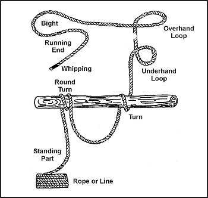

**Фігура G-1. Обмотки**

### БАЗОВІ ВУЗЛИ (BASIC KNOTS)

Основні вузли та методи їх зав'язування, які ви повинні знати для свого виживання:

* _Піввузол (Half-hitch)._ Це найпростіший з усіх вузлів, який раніше використовувався як запобіжний або завершальний вузел для всіх армійських вузлів. Оскільки він мав тенденцію розв'язуватися без навантаження, відтоді його замінили на простий вузел.
* _Простий вузел (Overhand)_ ([Фігура G-2](#figg-2))_._ Це простий вузел, який більшість людей зав'язує щодня як першу половину зав'язування своїх черевиків. Його також можна використовувати для тимчасової обмотки кінця мотузки. Цей вузел повинен замінити піввузол як завершальний вузел для інших вузлів. Сам по собі цей вузел зменшує міцність прямої мотузки на 55 відсотків.

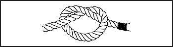

**Фігура G-2. Простий вузел**

* _Прямий вузел (Square)_ ([Фігура G-3](#fig-3))_._ Хороший, простий вузел для загального використання. Цей вузел є по суті двома простими вузлами, які є зворотними, як у випадку "Правий поверх Лівого, Лівій поверх Правого". Він використовується для зв'язування кінців двох мотузок однакового діаметра разом (так само, як шнурки вашого взуття) і має бути закріплений простим вузлом на обох кінцях. Його легко перевірити, оскільки він утворює дві петлі, і його легко розв'язати після навантаження.
* _Повний оберт і два піввузли (Round turn and two half-hitches)_ ([Фігура G-4](#figg-4))_._ Це головний якірний вузел для одномотужних мостів та інших застосувань, коли потрібен хороший якірний вузел і де високі навантаження змусили б інші вузли заклинити і ускладнити розв'язання. Найчастіше використовується для кріплення мотузки до жердини або дерева.

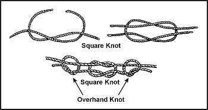

**Фігура G-3. Прямий вузел, закріплений простими вузлами**

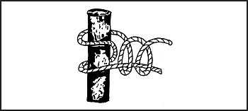

**Фігура G-4. Повний оберт і два піввузли**

* _Стяжний вузел / Виблиск (Clove hitch) та кінцевий стяжний вузел_ ([Фігури G-5](#figg-5) та [G-6](#figg-6)). Його можна використовувати для кріплення мотузки до дерева чи труби, і він також накладає невелике навантаження на мотузку. Це легкий якірний вузел, але натяг повинен зберігатися на вузлі, інакше він прослизне. Це можна виправити, зробивши ще одну петлю навколо об'єкта і під центром стяжного вузла.

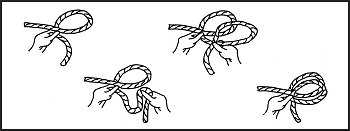

**Фігура G-5. Стяжний вузел**

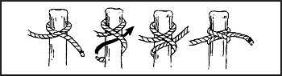

**Фігура G-6. Кінцевий стяжний вузел**

* _Короткиий вузел / Пастуший вузел (Sheep shank)_ ([Фігура G-7](#figg-7))_._ Метод вкорочення мотузки, його також можна використовувати для зняття навантаження зі слабкого місця в мотузці. Це тимчасовий вузел, якщо вічка не закріплені на корінній частині мотузки з обох кінців.

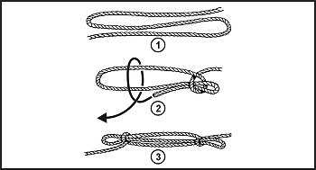

**Фігура G-7. Короткий вузел**

* _Шкоттовий вузел подвійний (Double sheet bend)_ ([Фігура G-8](#fig-8))_._ Цей вузел використовується для зв'язування кінців двох мотузок однакового або різного діаметра. Він також з'єднує вологу мотузку і не ковзає і не затягується під навантаженням. Його можна використовувати для прив'язування кінців кількох мотузок до кінця однієї мотузки. Коли одна мотузка прив'язана до кількох мотузок, петля (bight) утворюється з кількох мотузок.

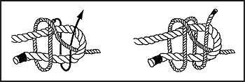

**Фігура G-8. Подвійний шкоттовий вузел**

* _Прусик (Prusik)_ ([Фігури G-9 через G-11](#figg-9))_._ Цей вузел зав'язує коротку мотузку навколо довшої мотузки (наприклад, петлювату мотузку навколо альпіністської мотузки) таким чином, що коротка мотузка ковзатиме по альпіністській мотузці, якщо натяг не застосовується, і триматиметься, якщо натяг застосовується на короткій мотузці. Цей вузел можна зав'язати кінцем мотузки або петлею мотузки. При зав'язуванні кінцем мотузки вузел завершується альтанковим вузлом (bowline). Неслизька природа вузла на іншій мотузці дозволяє лазити по мотузках з опорами для ніг. Його також можна використовувати для кріплення мотузок або кінця шини для витягування на гілці чи лижній палиці.

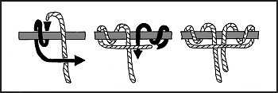

**Фігура G-9. Прусик, кінець лінії**

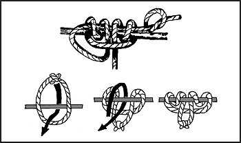

**Фігура G-10. Прусик, кінець лінії та центр лінії**

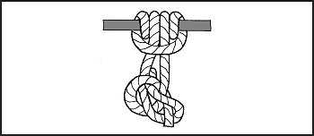

**Фігура G-11. Прусик, кінець лінії з альтанковим вузлом для безпеки**

* _Альтанковий вузел / Блін (Bowline) та альтанковий вузел, завершений простим вузлом_ ([Фігура G-12](#figg-12)). Альтанковий вузел навколо тіла був базовим вузлом, що використовувався для рятування протягом багатьох років, оскільки він забезпечував петлю, яка могла бути розміщена навколо тіла, яка не ковзала і не затягувалася під навантаженням. У більшості застосувань він був замінений на вісімку, оскільки вісімка не так сильно послаблює мотузку.

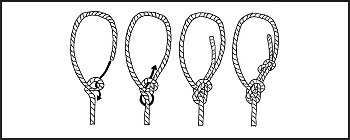

**Фігура G-12. Альтанковий вузел та альтанковий вузел, завершений простим вузлом**

* _Вісімка та зворотна вісімка (Figure 8 and retraceable figure 8)_ ([Фігура G-13](#figg-13))_._ Цей вузел є головним рятувальним вузлом, що використовується сьогодні. Він має перевагу більшої міцності, ніж альтанковий вузел, і його легше зав'язати та перевірити. Його єдиним недоліком є те, що у вологому стані його може бути складніше розв'язати, ніж альтанковий вузел після навантаження. Вісімка (або вузел-вісімка) може використовуватися як якірний вузел на фіксованих мотузках. Вона також може використовуватися для запобігання прослизанню кінця мотузки крізь кріплення або петлю в іншій мотузці, коли потрібен вузел більший за простий.

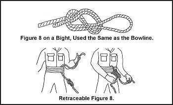

**Фігура G-13. Вісімка та зворотна вісімка**

### РІЗНОМАНІТНІ БУДІВЕЛЬНІ В'ЯЗКИ (VARIOUS CONSTRUCTION LASHINGS)

Існує безліч предметів, які вимагають в'язок для будівництва. [Фігури G-14 через G-16](#figg-14) показують типи в'язок, які ви можете використовувати при будівництві триног, укриттів та стійок. Зверніться до розділу [Інструменти](Tools), якщо використовуєте імпровізовану мотузку.

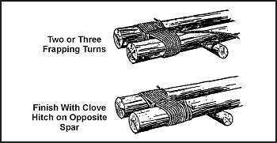

**Фігура G-14. Ножичні в'язки (Shears Lashing)**

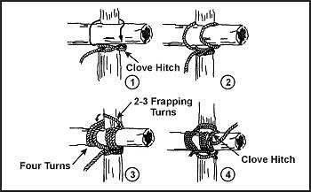

**Фігура G-15. Квадратні в'язки (Square Lashing)**

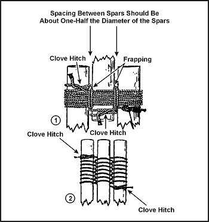

**Фігура G-16. В'язка триноги (Tripod Lashing)**
