> Виживання на морі — це, мабуть, найскладніша ситуація виживання. Короткострокове чи довгострокове виживання залежить від пайків, наявного спорядження та вашої винахідливості. Ви повинні бути винахідливими, щоб вижити.
> 
> Вода покриває близько 75 відсотків земної поверхні, причому близько 70 відсотків становлять океани та моря. Ви можете припустити, що колись перетнете величезні простори води. Завжди є шанс, що літак або корабель, на якому ви перебуваєте, буде виведений з ладу такими небезпеками, як шторми, зіткнення, пожежа чи війна.

### ВІДКРИТЕ МОРЕ

Будучи виживальником у відкритому морі, ви зіткнетеся з хвилями та вітром. Ви також можете зіткнутися з екстремальною спекою чи холодом. Щоб ці екологічні небезпеки не стали серйозними проблемами, вживайте запобіжних заходів якомога швидше. Використовуйте доступні ресурси, щоб захистити себе від стихії та від спеки чи екстремального холоду і вологості.

Захист себе від стихії задовольняє лише одну з ваших базових потреб. Ви також повинні вміти отримувати воду та їжу. Задоволення цих базових потреб допоможе запобігти серйозним фізичним та психологічним проблемам. Проте ви також повинні знати, як лікувати проблеми зі здоров'ям, які можуть виникнути.

**ЗАПОБІЖНІ ЗАХОДИ**

Ваше виживання на морі залежить від:

* Ваших знань та здатності використовувати доступне спорядження для виживання.
* Ваших спеціальних навичок і здатності справлятися з небезпеками, з якими ви зіткнулися.
* Вашої волі до життя.

Коли ви сідаєте на корабель або літак, дізнайтеся, яке спорядження для виживання є на борту, де воно зберігається і що воно містить. Наприклад, скільки рятувальних жилетів та рятувальних шлюпок чи плотів є на борту? Де вони розташовані? Яке обладнання для виживання вони мають? Скільки їжі, води та ліків вони містять? Скільки людей можна підтримати? Також, якщо ви відповідаєте за інших людей на борту, переконайтеся, що ви знаєте, де вони, і вони знають, де ви.

**КАТАСТРОФА НА МОРІ**

Якщо ваш літак зазнає аварії на морі, вживайте таких заходів. Незалежно від того, чи ви у воді, чи на плоту, ви повинні:

* Відійти подалі і з навітряного боку від літака якомога швидше, але залишатися поблизу, доки літак не потоне.
* Відійти від покриток пальним води на випадок займання палива.
* Спробувати знайти інших людей, що вижили.

Пошук тих, хто вижив, зазвичай відбувається по всій зоні та поблизу місця падіння. Зниклий персонал може бути непритомним і плавати низько у воді. [Фігура 16-1](#fig16-1) ілюструє три процедури порятунку.

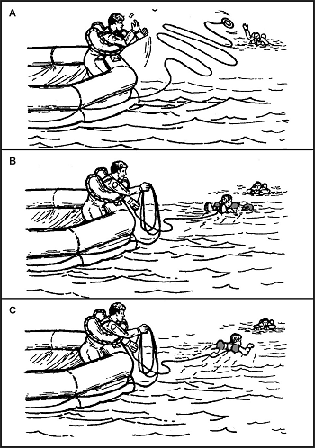

**Фігура 16-1. Порятунок з води**

Найкраща техніка для порятунку персоналу з води — кинути їм рятувальний жилет, прикріплений до лінії (A). Інша — надіслати плавця (рятувальника) з плота з лінією, прикріпленою до плавучого пристрою, який витримає вагу рятувальника (B). Цей пристрій допоможе зберегти енергію рятувальника під час порятунку людини, що вижила. Найменш прийнятна техніка — послати прикріпленого плавця без плавучих пристроїв, щоб забрати того, хто вижив (C). У всіх випадках рятувальник одягає рятувальний жилет. Рятувальник не повинен недооцінювати силу охопленої панікою людини у воді. Обережний підхід може запобігти травмі рятувальника.

Коли рятувальник наближається до людини у біді ззаду, малоймовірно, що вона буде битися, дряпатися або хапати його. Рятувальник пливе до точки безпосередньо за постраждалим і хапає за спинний ремінь рятувального жилета. Рятувальник використовує плавання на боці (sidestroke), щоб витягнути постраждалого до плота.

Якщо ви у воді, дістаньтеся до плота. Якщо плотів немає, спробуйте знайти великий шматок плаваючого уламку, щоб за нього триматися. Розслабтеся; людина, яка вміє розслаблятися в океанській воді, наражається на дуже невелику небезпеку втопитися. Природна плавучість тіла триматиме принаймні верхню частину голови над водою, але потрібен певний рух, щоб тримати обличчя над водою.

Плавлення на спині вимагає найменше енергії. Ляжте на спину у воді, розведіть руки і ноги та вигніть спину. Контролюючи вдих і видих, ваше обличчя завжди буде над водою, і ви навіть можете спати в цьому положенні короткий час. Ваша голова буде частково занурена, але обличчя буде над водою. Якщо ви не можете плавати на спині або море занадто буремне, плавайте обличчям вниз у воді, як показано на [Фігура 16-2](#fig16-2).

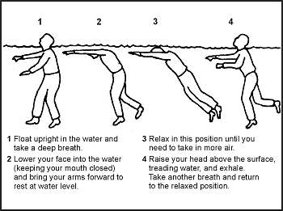

**Фігура 16-2. Положення для плавання**

Найкращі стилі плавання в ситуації виживання:

* _Собачий стиль (Dog paddle)._ Цей стиль чудовий у одязі або в рятувальному жилеті. Хоча швидкість низька, він вимагає дуже мало енергії.
* _Брас (Breaststroke)._ Використовуйте цей стиль для плавання під водою, крізь мазут чи уламки, або в бурхливому морі. Це, мабуть, найкращий стиль для плавання на довгі дистанції: він дозволяє заощадити енергію і підтримувати розумну швидкість.
* _Плавання на боці (Sidestroke)._ Це хороший рятувальний стиль, оскільки ви використовуєте лише одну руку для підтримки імпульсу та плавучості.
* _Плавання на спині (Backstroke)._ Цей стиль також є чудовим рятувальним стилем. Він розвантажує м'язи, які ви використовуєте для інших стилів. Використовуйте його, якщо можливий підводний вибух.

Якщо ви перебуваєте в районі, де палає поверхневе мастило (нафта):

* Відкиньте взуття та плавучий рятувальний жилет.

**ПРИМІТКА:** Якщо у вас ненадутий рятувальний жилет, тримайте його.

* Закрийте ніс, рот і очі і швидко пірніть під воду.
* Пливіть під водою якомога далі, перш ніж спливти для вдиху.
* Перед спливанням для вдиху і перебуваючи під водою, використовуйте руки, щоб відштовхнути палаючу рідину від місця, де ви хочете виплисти. Як тільки зона очиститься від палаючої рідини, ви можете виплисти і зробити кілька вдохів. Намагайтеся повернутися спиною/обличчям вниз за вітром перед вдихом.
* Занурюйтеся ногами вперед і продовжуйте, як описано вище, доки не звільнитеся від полум'я.

Якщо ви перебуваєте в покритій нафтою воді без вогню, тримайте голову високо, щоб нафта не потрапила в очі. Прикріпіть рятувальний жилет до зап'ястка, а потім використовуйте його як пліт.

Якщо у вас є рятувальний жилет, ви можете залишатися на плаву невизначений час. У цьому випадку використовуйте позу тіла «HELP» (Heat Escaping Lessening Posture, зменшення втрати тепла) ([Фігура 16-3](#fig16-3)). Залишайтеся нерухомими і прийміть позу ембріона, щоб утримати тепло тіла. Ви втрачаєте близько 50 відсотків тепла тіла через голову. Тому тримайте голову поза водою. Інші зони великої втрати тепла — це шия, боки та пах.

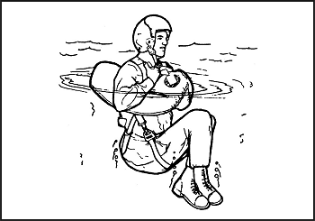

**Фігура 16-3. Поза HELP**

Якщо ви на плоту (також дивіться Процедури на плоту):

* Перевірте фізичний стан усіх на борту. Надайте першу допомогу, якщо необхідно. Прийміть таблетки від захитування (морської хвороби), якщо вони доступні. Найкращий спосіб приймати ці таблетки — покласти їх під язик і дати розчинитися. Існують також супозиторії або ін'єкції від морської хвороби. Блювання, викликане морською хворобою чи з інших причин, збільшує небезпеку зневоднення.
* Спробуйте врятувати все плаваюче спорядження — пайки; фляги, термоси та інші контейнери; одяг; подушки сидінь; парашути; і все інше, що буде корисним для вас. Закріпіть спасенні речі всередині або на плоту. Переконайтеся, що предмети не мають гострих країв, які можуть проткнути пліт.
* Якщо є інші плоти, з'єднайте плоти разом так, щоб вони знаходилися на відстані близько 7,5 метрів (25 футів) один від одного. Будьте готові підтягнути їх ближче, якщо ви побачите або почуєте літак. Екіпажу легше помітити плоти, які знаходяться близько один до одного, а не розсіяні.
* Пам'ятайте, рятування на морі — це спільні зусилля. Використовуйте всі доступні візуальні чи електронні пристрої для подачі сигналів і встановлення контакту з рятувальниками. Наприклад, підніміть прапор або відбиваючий матеріал на веслі якомога вище, щоб привернути увагу.
* Знайдіть аварійне радіо і введіть його в дію. Інструкції з експлуатації є на ньому. Використовуйте аварійний трансивер лише тоді, коли дружні літаки, ймовірно, перебувають у цьому районі.
* Майте інші сигнальні пристрої готовими до миттєвого використання. Якщо ви перебуваєте у ворожій території, уникайте використання сигнального пристрою, який сповістить ворога. Проте, якщо ваша ситуація відчайдушна, вам, можливо, доведеться сигналізувати ворогу про порятунок, якщо ви хочете вижити.
* Перевірте пліт на надування, витоки та місця можливого тертя. Переконайтеся, що основні камерні відділення плавучості міцні (добре округлені), але не надмірно тугі ([Фігура 16-4](#fig16-4)). Регулярно перевіряйте надування. Повітря розширюється від тепла; тому в спекотні дні випускайте трохи повітря і додавайте повітря, коли погода холодіє.
* Очистіть пліт від усього пального. Нефтепродукти послаблять його поверхні та зруйнують його склеєні стики.
* Викиньте плавучий якір (sea anchor) або імпровізуйте гальль (драг) з чохла плота, відра для вичерпування води або рулону одягу. Плавучий якір допомагає триматися ближче до місця аварії, полегшуючи пошуковцям ваше знаходження, якщо ви передали своє місцезнаходження. Без плавучого якоря ваш пліт може дрейфувати на понад 160 кілометрів (96 миль) на день, що робить його набагато важчим для пошуку. Ви можете відрегулювати плавучий якір так, щоб він діяв як гальль для уповільнення швидкості подорожі з течією, або як засіб подорожі з течією. Ви робите це регулювання шляхом відкриття або закриття вершини плавучого якоря. Коли відкритий, плавучий якір ([Фігура 16-5](#fig16-5)) діє як гальль, який утримує вас у загальному районі. Коли закритий, він утворює кишеню для удару течії і просуває пліт у напрямку течії.

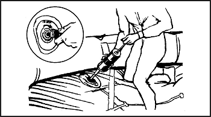

**Фігура 16-4. Надування плота**

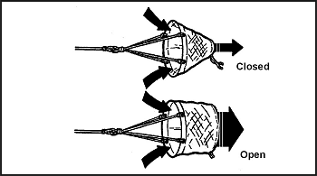

**Фігура 16-5. Плавучий якір**

Також відрегулюйте плавучий якір так, щоб коли пліт знаходиться на гребені хвилі, плавучий якір знаходився у западині хвилі ([Фігура 16-6](#fig16-6)).

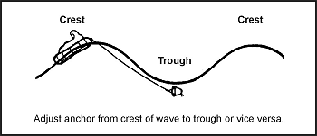

**Фігура 16-6. Розгортання плавучого якоря**

* Обмотайте мотузку плавучого якоря тканиною, щоб запобігти її перетиранню об пліт. Якір також допомагає тримати пліт носом проти вітру та хвиль.
* У штормовій воді негайно зафіксуйте захист від бризок та вітрове скло. На 25-місному плоту тримайте навіс піднятим постійно. Тримайте свій пліт якомога сухішим. Тримайте його належним чином збалансованим. Увесь персонал повинен залишатися сидячими, найважчий — у центрі.
* Спокійно зважте всі аспекти своєї ситуації і визначте, що ви та ваші супутники повинні зробити, щоб вижити. Зробіть інвентаризацію всього обладнання, їжі та води. Захистіть від вологи предмети, на які може вплинути солона вода. До них належать компаси, годинники, секстант, сірники та запальнички. Нормуйте їжу та воду.
* Призначте чергову посаду кожній людині або призначте команди, наприклад, збирачі води, збирачі їжі, спостерігачі, оператори радіозв'язку, сигнальники та вичерпувачі води.

**ПРИМІТКА:** Чергування спостерігачів не повинно перевищувати 2 годин. Пам'ятайте і нагадуйте іншим, що співпраця є одним із ключів до виживання.

* Ведіть журнал. Записуйте останню фіксацію навігатора, час аварії, імена та фізичний стан персоналу, а також графік пайків. Також записуйте вітри, погоду, напрямок хвиль, час сходу і заходу сонця та інші навігаційні дані.
* Якщо ви опинилися у ворожих водах, вживайте спеціальних заходів безпеки, щоб уникнути виявлення. Не подорожуйте вдень. Викиньте плавучий якір і чекайте настання темряви перед тим, як гребти або піднімати вітрило. Тримайтеся низько в плоту; залишайтеся покритими синьою стороною маскувальної тканини вгору. Переконайтеся, що проходящий корабель чи літак є дружнім або нейтральним, перш ніж намагатися привернути його увагу. Якщо ворог виявляє вас і ви близько до захоплення, знищте бортовий журнал, радіо, навігаційне обладнання, карти, сигнальне обладнання та вогнепальну зброю. Стрибніть за борт і зануртеся, якщо ворог починає обстріл.
* Вирішіть, залишатися на місці чи подорожувати. Запитайте себе: «Скільки інформації було передано до нещасного випадку? Чи відоме ваше місцезнаходження рятувальникам? Чи знаєте ви його самі? Чи сприятлива погода для пошуку? Чи інші кораблі або літаки ймовірно пройдуть через вашу поточну позицію? Скільки днів у вас є запас їжі та води?»

### ЗІМНІ / ХОЛОДНІ МІРКУВАННЯ (COLD WEATHER CONSIDERATIONS)

Якщо ви перебуваєте в холодному кліматі:

* Одягніть протизахисний костюм (antiexposure suit). Якщо він недоступний, одягніть будь-який додатковий доступний одяг. Тримайте одяг вільним і зручним.
* Будьте обережні, щоб не зачепити пліт взуттям або гострими предметами. Тримайте ремонтний набір там, де ви можете легко до нього дістатися.
* Закріпіть вітрозахисний екран, захист від бризок та навіс.
* Намагайтеся тримати підлогу плота сухою. Покрийте її брезентом або тканиною для ізоляції.
* Збивайтеся в купу з іншими, щоб зігрітися, рухаючись достатньо для підтримки циркуляції крові. Розстебніть додатковий брезент, вітрило або парашут над групою.
* Віддайте додаткові пайки, якщо вони є, чоловікам, які зазнали впливу холоду.

Найбільша загроза, з якою ви зіткнетеся при зануренні в холодну воду — це смерть від гіпотермії. Середня температура океану по всьому світу становить лише 11 градусів Цельсія (51 градус Фаренгейта). Проте не обманюйте себе теплою водою — гіпотермія може статися навіть у воді температурою 27 градусів Цельсія (80 градусів Фаренгейта). Коли ви занурені в холодну воду, гіпотермія виникає швидко через зменшену ізоляційну якість мокрого одягу та результат витіснення водою шару нерухомого повітря, який зазвичай оточує тіло. Швидкість теплообміну у воді приблизно в 25 разів більша, ніж у повітрі тієї ж температури. [Фігура 16-7](#fig16-7) перелічує час очікуваної тривалості життя при зануренні у воду.

|Температура води (Water Temperature)|Час (Time)|
|-----------------------------------|----------|
|21.0-15.5 °C (70-60 °F)|12 годин|
|15.5-10.0 °C (60-50 °F)|6 годин|
|10.0-4.5 °C (50-40 °F)|1 година|
|4.5 °C (40 °F) і нижче|Менше 1 години|

**Примітка:** Носіння протизахисного костюма може збільшити цей час максимум до 24 годин.

**Фігура 16-7. Час очікуваної тривалості життя при зануренні у воду**

Вашим найкращим захистом від впливу холодної води є потрапляння на рятувальний пліт, перебування в сухому стані та ізоляція вашого тіла від холодної поверхні дна плота. Якщо ці дії неможливі, носіння протизахисного костюма значно подовжить тривалість вашого життя. Пам'ятайте, тримайте голову і шию поза водою і добре ізолюйте їх від впливу холодної води, коли температура нижче 19 градусів Цельсія (66 градусів Фаренгейта). Носіння рятувальних жилетів збільшує прогнозований час виживання, оскільки положення тіла у воді збільшує шанси на виживання.

### СПЕКОТНІ МІРКУВАННЯ (HOT WEATHER CONSIDERATIONS)

Якщо ви перебуваєте в спекотному кліматі:

* Зробіть тіньовий навіс або тент. Залиште достатньо простору для вентиляції.
* Покрийте шкіру там, де це можливо, щоб захистити її від сонячних опіків. Використовуйте крем від засмаги, якщо він є, на всій відкритій шкірі. Ваші повіки, тильна сторона вух і шкіра під підборіддям легко обгорають від сонця.

**ПРОЦЕДУРИ НА ПЛОТУ (RAFT PROCEDURES)**

Більшість плотів в інвентарі армії та ВПС США можуть задовольнити потреби особистого захисту, режиму подорожі та ухилення й маскування.

**ПРИМІТКА:** Перед посадкою на будь-який пліт зніміть та прив'яжіть (прикріпіть) свій рятувальний жилет до себе або до плота. Переконайтеся, що на вашому одязі чи спорядженні немає інших металевих чи гострих предметів, які могли б пошкодити пліт. Після посадки на пліт знову одягніть рятувальний жилет.

Для всіх плотів пам'ятайте про п'ять літера «А» (five As). Це перші речі, які ви повинні зробити, якщо ви перша людина в плоту:

* Air (Повітря) — Перевірте, чи всі камери надуті, чи всі надувні клапани закриті, а затискачі зрівняльних трубок (знаходяться на плотах на 25, 35 та 46 осіб) затиснуті при повному надуванні.
* Assistance (Допомога) — Допоможіть іншим піднятися на пліт. Видаліть усі предмети з кишень, що створюють проколи, і перемістіть плавучі пристрої в тил тіла. Використовуйте належні методи посадки; наприклад, посадочну петлю на семимісному плоту та посадочні рампи на плотах на 25, 35 та 46 осіб.
* Anchor (Якір) — Переконайтеся, що плавучий якір належним чином розгорнутий. Його можна знайти на відстані 180 градусів від зрівняльної трубки на плотах на 25, 35 та 46 осіб.
* Accessory bag (Сумка з приладдям) — Знайдіть сумку з приладдям. Вона буде прив'язана до плота між гладкою стороною балона з CO2 та найближчою посадочною рампою.
* Assessment (Оцінка) — Оцініть ситуацію та зберігайте позитивний ментальний настрій.

**Одномісний пліт (One-Man Raft)**

Одномісний пліт має надувний головний відсік. Якщо балон з CO2 вийде з ладу або якщо пліт отримає протікання, ви можете надути його ротом.

Захист від бризок діє як укриття від холоду, вітру та води. У деяких випадках цей захист служить ізоляцією. Ізольоване дно плота обмежує проведення холоду, захищаючи вас від гіпотермії ([Фігура 16-8](#fig16-8)).

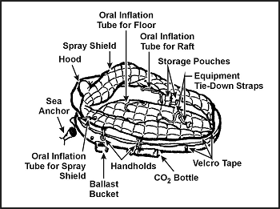

**Фігура 16-8. Одномісний пліт із захистом від бризок**

Ви можете подорожувати ефективніше, надуваючи або здуваючи пліт, щоб скористатися вітром або течією. Ви можете використовувати захист від бризок як вітрило, тоді як баласти збільшують опір у воді. Ви можете використовувати плавучий якір для контролю швидкості та напрямку плота.

Існують плоти, розроблені для використання в тактичних районах, які є чорними. Ці плоти зливаються з фоном моря. Ви можете додатково модифікувати ці плоти для ухилення, частково здуваючи їх для отримання нижчого профілю.

Ремінь (lanyard) з'єднує одномісний пліт із парашутистом (виживальником), що приземляється у воду. Ви (виживальник) надуваєте його при приземленні. Ви не пливете до плота, а підтягуєте його до себе за допомогою ремінця. Пліт може вдарити об воду догори дном, але ви можете перевернути його, наблизившись до сторони, до якої прикріплений балон, і перевернувши пліт. Захист від бризок повинен бути в плоту, щоб оголити ручки для посадки. Дотримуйтесь п'яти «А», викладених у процедурах на плоту вище, при посадці на пліт ([Фігура 16-9](#fig16-9)).

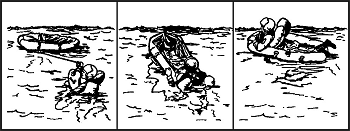

**Фігура 16-9. Посадка на одномісний пліт**

Якщо у вас травма руки, найкращий спосіб сісти — повернутися спиною до маленького кінця плота, штовхнути пліт під сідниці і лягти назад. Інший спосіб сісти на пліт — натиснути на його маленький кінець, поки одне коліно не опиниться всередині, і нахилитися вперед ([Фігура 16-10](#fig16-10)).

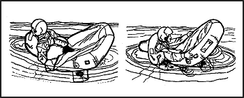

**Фігура 16-10. Інші методи посадки на одномісний пліт**

У бурхливому морі вам може бути легше схопитися за маленький кінець плота і, лежачи обличчям вниз, штовхати ногами і підтягувати себе в пліт. Коли ви лежите обличчям вниз у плоту, розгорніть і відрегулюйте плавучий якір. Щоб сісти прямо, можливо, доведеться від'єднати одну сторону сидіння і перекотитися на цей бік. Потім ви відрегулюєте захист від бризок. Існує два варіанти одномісного плота; покращена модель включає надувний захист від бризок та підлогу, які забезпечують додаткову ізоляцію. Захист від бризок допомагає тримати вас сухими та теплими в холодних океанах і захищає від сонця в жарких кліматичних умовах ([Фігура 16-11](#fig16-11)).

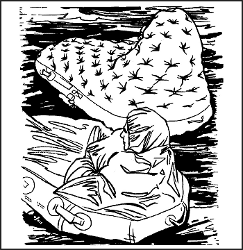

**Фігура 16-11. Одномісний пліт з надутим захистом від бризок**

**Семимісний пліт (Seven-Man Raft)**

Деякі багатомісні літаки несуть семимісний пліт. Він є компонентом набору для скидання засобів для виживання ([Фігура 16-12](#fig16-12)). Цей пліт може надутися догори дном і вимагати від вас перевертання плота перед посадкою. Завжди працюйте з боку балона, щоб запобігти травмі, якщо пліт перевернеться. Повернувшись обличчям до вітру, вітер надає додаткову допомогу в перевертанні плота. Використовуйте ручки на внутрішньому дні плота для посадки ([Фігура 16-13](#fig16-13)).

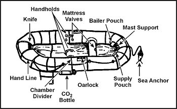

**Фігура 16-12. Семимісний пліт**

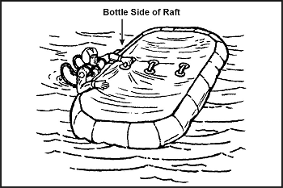

**Фігура 16-13. Метод перевертання плота**

Використовуйте посадочну рампу, якщо хтось утримує протилежну сторону плота. Якщо у вас немає допомоги, знову працюйте з боку балона вітром у спину, щоб допомогти утримувати пліт. Дотримуйтесь п'яти «А», викладених у [пункті 16-22](#para16-22). Потім візьміться за уключину та ручку для посадки, штовхайте ногами, щоб ваше тіло опинилося в положенні лежачи на воді, а потім штовхайте і підтягуйте, поки ви не опинитеся всередині плота. Якщо ви слабкі або поранені, ви можете частково здути пліт, щоб полегшити посадку ([Фігура 16-14](#fig16-14)).

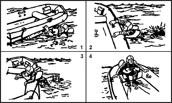

**Фігура 16-14. Метод посадки на семимісний пліт**

Використовуйте ручний насос, щоб підтримувати камери плавучості та перехресне сидіння міцними. Ніколи не перенадувайте пліт.

**Плоти на 25, 35 та 46 осіб (25-, 35-, and 46-Man Rafts)**

Ви можете знайти плоти на 25, 35 або 46 осіб у багатомісних літаках ([Фігура 16-15](#fig16-15)). Двадцятимісний пліт було знято з виробництва. Плоти зберігаються у відсіках для плотів на зовнішній стороні фюзеляжу, зазвичай на крилах, уздовж верхньої половини лівого боку літака. Завжди буде достатньо місця на плотах для розміщення всього персоналу на кожному типі літака. Якщо кількість персоналу перевищує максимальну кількість місць на плотах, додаткові плоти завантажуються по осі та закріплюються храповими ременями до підлоги вантажного відсіку. Деякі можуть автоматично розгортатися з кабіни або зі станцій у вантажній зоні, зазвичай біля станції бортінженера, тоді як інші можуть потребувати ручного розгортання. Незалежно від того, як пліт приземляється у воді, він готовий до посадки. Ремінь з'єднує комплект приладдя з плотом, і ви дістаєте комплект вручну. Ви повинні вручну надути центральну камеру ручним насосом. Здійсніть посадку на пліт на 25, 35 або 46 осіб з літака, якщо це можливо. Якщо ні, здійснюйте посадку в такий спосіб:

* Наблизьтеся до нижньої посадочної рампи, дотримуючись стрілок, надрукованих на зовнішній стороні плота.
* Зніміть рятувальний жилет і прикріпіть його до себе так, щоб він тягнувся за вами.
* Візьміться за ручки для посадки і штовхайте ногами, щоб ваше тіло опинилося в положенні лежачи на поверхні води; потім штовхайте і підтягуйте, поки ви не опинитеся всередині плота.

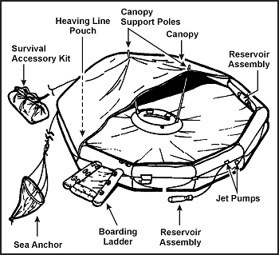

**Фігура 16-15. Пліт на 25 осіб**

Неповністю надутий пліт полегшить посадку. Наблизьтеся до перетину плота та рампи, візьміться за верхню ручку для посадки і закиньте одну ногу на центр рампи, як при посадці на коня.

Негайно затягніть зрівняльний затискач при вході в пліт, щоб запобігти здуванню всього плота у разі пробиття ([Фігура 16-16](#fig16-16)).

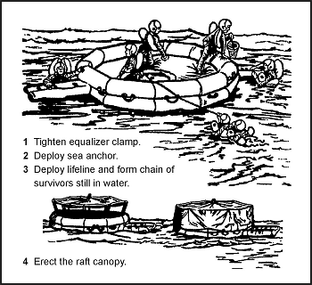

**Фігура 16-16. Негайні дії — багатомісний пліт**

Використовуйте насос, щоб підтримувати камери цих плотів та центральне кільце міцними. Вони повинні бути добре округленими, але не надмірно тугими. Центральні кільця тримають центр підлоги на плаву та дають пасажирам плота щось, у що можна впиратися ногами, щоб запобігти сповзанню всіх пасажирів до центру.

**ПЛАТВАННЯ НА ПЛОТАХ / ВІТРИЛЬНІ ПЛОТИ (SAILING RAFTS)**

Плоти не мають кілів, тому ви не можете плисти на них проти вітру. Проте кожен може вести пліт за вітром. Ви можете успішно вести семимісний пліт на 10 градусів від напрямку вітру. Не намагайтеся вести пліт під вітрилом, якщо земля не близько. Якщо ви вирішили плисти під вітрилом, а вітер дме до бажаного пункту призначення, повністю надуйте пліт, сядьте високо, підтягніть плавучий якір, змайструйте вітрило і використовуйте весло як руль.

У семимісному плоту підніміть квадратне вітрило в носовій частині, використовуючи весла та їх подовжувачі як щоглу та перекладину ([Фігура 16-17](#fig16-17)). Ви можете використовувати водонепроникний брезент або парашутний матеріал для вітрила. Якщо пліт не має регулярного гнізда для щогли та сходинки, підніміть щоглу, надійно прив'язавши її до переднього перехресного сидіння за допомогою розпірок. Закрийте основу щогли, щоб запобігти її перетиранню або пробиванню діри крізь підлогу, незалежно від того, чи є гніздо. Каблук черевика з носком, заклиненим під сидінням, створює хорошу імпровізовану сходинку для щогли. Не закріплюйте кути нижнього краю вітрила. Тримайте лінії, прикріплені до кутів, руками, щоб порив вітру не порвав вітрило, не зламав щоглу і не перекинув пліт.

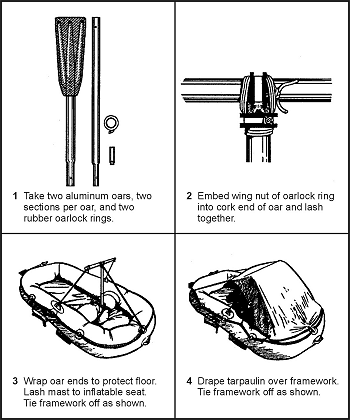

**Фігура 16-17. Побудова вітрила**

Вживайте всіх запобіжних заходів, щоб запобігти перевертанню плота. У бурхливу погоду тримайте плавучий якір подалі від носа. Пасажири повинні сидіти низько в плоту з розподіленою вагою, щоб утримувати навітряний бік унизу. Щоб не випасти, вони також повинні уникати сидіння на бортах плота або стояння. Уникайте різких рухів без попередження інших пасажирів. Коли плавучий якір не використовується, прив'яжіть його до плота і покладіть так, щоб він утримався одразу, якщо пліт перевернеться.

**ВОДА (WATER)**

Вода — ваша найважливіша потреба. Тільки з нею ви можете прожити десять днів або довше, залежно від вашої воли до життя. П'ючи воду, змочіть губи, язик і горло перед ковтанням.

**Короткі водні пайки**

Коли у вас обмежений запас води і ви не можете поповнити його хімічним чи механічним шляхом, використовуйте воду ефективно. Захищайте запаси прісної води від забруднення морською водою. Тримайте своє тіло добре затіненим як від сонця зверху, так і від відбиття від поверхні моря. Дозвольте вентиляцію повітря; змочуйте одяг у найспекотнішу частину дня. Не напружуйтеся. Розслабляйтеся і спіть, коли це можливо. Встановіть свій щоденний раціон води після розгляду кількості води, яку ви маєте, виходу сонячних дистиляторів та набору для опріснення, а також кількості та фізичного стану вашої групи.

Якщо у вас немає води, не їжте. Рух плота та ваша тривога можуть викликати нудоту. Якщо ви їсте в стані нудоти, ви можете одразу втратити їжу. У разі нудоти відпочивайте і розслабляйтеся настільки, наскільки можете, і приймайте лише воду.

Щоб зменшити втрату води через потовиділення, замочіть свій одяг у морі і вижміть його перед тим, як одягнути знову. Не зловживайте цим у спекотні дні, коли навіс чи сонцезахисний екран недоступні. Це компроміс між охолодженням та соляними чиряками, виразками та висипаннями, які внаслідок цього виникнуть. Будьте обережні, щоб не намочити дно плота.

Слідкуйте за хмарами і будьте готові до будь-якої можливості злив. Тримайте брезент під рукою для збору води. Якщо він покритий засохлою солью, вимийте його в морській воді. Зазвичай невелика кількість морської води, змішаної з дощем, буде ледве помітною і не викличе жодної фізичної реакції. У буремному морі ви не можете отримати незабруднену прісну воду.

Вночі закріпіть брезент як тент від сонця і підніміть його краї для збору роси. Також можна збирати росу вздовж бортів плота за допомогою губки або тканини. Коли йде дощ, пийте стільки, стільки можете утримати.

**Ручний зворотний осмос-опріснювач (Manual Reverse Osmosis Desalinator)**

Більшість плотів сьогодні обладнані ручний зворотний осмос-опріснювачем (MROD). MROD — це високоефективний очищувач води, призначений для видалення соляних часток з морської води, роблячи таким чином морську воду придатною для пиття. Дві найпоширеніші моделі — Survivor 35 та Survivor 06, які виробляють 35 та 6 галонів питної води за 24-годинний період при безперервному використанні. Забезпечення водою на морі — це робота 24 години на добу. Життєвий цикл MROD становить до 50 000 галонів води. MROD має 10-річний термін зберігання перед тим, як його має перепакувати виробник.

Для роботи з MROD помістіть як вхідний отвор (більший подвійний шланг), так і шланг постачання питної води у воду. Почніть 2-секундний цикл накачування ручки — одна секунда вгору, одна секунда вниз. Індикатор тиску виступатиме з корпусу насоса, показуючи, що підтримується належний потік. Помаранчева смужка буде видимою при підтримці правильного ритму. Очистіть антимікробний пакувальний агент із фільтруючого середовища протягом 2 хвилин. Потім почніть збирати питну воду.

**ПРИМІТКА:** Переконайтеся, що вода вільна від будь-яких нафтопродуктів (реактивне паливо, гідравлічна рідина чи мастило) перед використанням MROD. Фільтруюче середовище дуже чутливе до нафти, масел та мастил і зробить фільтр марним, знищивши вашу здатність виробляти воду.

**Сонячний дистилятор (Solar Still)**

Коли сонячні дистилятори доступні, прочитайте інструкції та встановіть їх негайно. Використовуйте якомога більше дистиляторів, залежно від кількості чоловіків у плоту та кількості доступного сонячного світла. Закріпіть сонячні дистилятори на плоту з обережністю. Сонячні дистилятори працюють лише на плоских, спокійних морях.

**Набори для опріснення (Desalting Kits)**

Коли набори для опріснення доступні на додаток до сонячних дистиляторів, використовуйте їх лише для негайних потреб у воді або під час довгих хмарних періодів, коли ви не можете використовувати сонячні дистилятори. У будь-якому випадку тримайте набори для опріснення та аварійні запаси води для періодів, коли ви не можете використовувати сонячні дистилятори або збирати дощову воду.

**Вода з риби (Water From Fish)**

Пийте водянисту рідину, що знаходиться вздовж хребта та в очах великих риб. Обережно розріжте рибу навпіл, щоб отримати рідину вздовж хребта, і висмокчіть око. Якщо ви настільки обділені водою, що вам потрібно це зробити, тоді **не пийте** жодних інших рідин тіла. Ці інші рідини багаті на білки та жири і витратять більше вашої резервної води на перетравлення, ніж постачають.

**Морський лід (Sea Ice)**

У арктичних водах використовуйте старий морський лід для води. Цей лід блакитнуватий, має заокруглені кути і легко розколюється. Він майже вільний від солі. Новий лід сірий, молочний, твердий і солоний. Вода з айсбергів прісна, але айсберги небезпечні для наближення. Використовуйте їх як джерело води лише в надзвичайних ситуаціях.

Як і в будь-якій ситуації виживання, існують небезпеки, коли ви замінюєте або йдете на компроміс з необхідним. Навіть незважаючи на те, що вода є однією з ваших базових потреб, майте на увазі такі поради.

**НЕ РОБІТЬ ЦЬОГО —**

* Пийте морську воду.
* Пийте сечу.
* Пийте алкоголь.
* Куріть.
* Їжте, якщо вода недоступна.

Сон і відпочинок є найкращими способами витримати періоди зменшеного споживання води та їжі. Проте переконайтеся, що у вас достатньо тіні під час денного сну. Якщо море бурхливе, прив'яжіть себе до плота, закрийте будь-яке укриття і перечекайте бурю якомога краще. **Розслабтеся** — це ключове слово, принаймні спробуйте розслабитися.

**ЗДОБУТТЯ ЇЖІ (FOOD PROCUREMENT)**

У відкритому морі риба буде основним джерелом їжі. Є деякі отруйні та небезпечні океанські риби, але загалом, коли ви поза видимістю землі, риба безпечна для їжі. Ближче до берега є риба, яка є як небезпечною, так і отруйною для їжі. Є деяка риба, така як червоний луціан та баракуда, яка зазвичай їстівна, але отруйна при вилові в водах атолів та рифів. Летючі риби навіть застрибують у ваш пліт!

**Риба**

Під час риболовлі не торкайтеся волосіні голими руками і ніколи не обмотуйте її навколо рук або не прив'язуйте до спасательного плота. Сіль, що налипає на неї, може зробити її гострою ріжучою кромкою, небезпечною як для плота, так і для ваших рук. Носіть рукавички, якщо вони є, або використовуйте тканину для поводження з рибою і уникнення травм від гострих плавців та зябрових кришок.

У теплих регіонах потрошіть і знекровлюйте рибу одразу після її вилову. Наріжте рибу, яку ви не з'їсте одразу, на тонкі, вузькі смужки і повісьте їх сушитися. Добре висушена риба залишається їстівною кілька днів. Риба, не очищена і не висушена, може зіпсуватися за півдня. Риба з темним м'ясом дуже схильна до розпаду. Якщо ви не з'їсте їх усі одразу, не їжте жодних залишків. Використовуйте залишки для приманки.

Ніколи не їжте рибу з блідими, блискучими зябрами, запалими очима, в'ялою шкірою та м'ясом або неприємним запахом. Хороша риба показує протилежні характеристики. Морська риба має солоний або чистий рибний запах. Не плутайте європейських вугрів з морськими зміями, які мають очевидно лускате тіло і сильно сплющений, схожий на весло хвіст. І вугри, і морські змії їстівні, але з останніми ви повинні поводитися обережно через їхні отруйні укуси. Серце, кров, стінка кишечника та печінка більшості риб їстівні. Готуйте кишечник. Також їстівними є частково перетравлені менші риби, яких ви можете знайти в шлунках великих риб. Крім того, морські черепахи їстівні.

М'ясо акули є хорошим джерелом їжі — сире, сушене чи варене. М'ясо акули псується дуже швидко через високу концентрацію сечовини в крові; тому негайно знекровлюйте його і вимочуйте в кількох водах. Люди віддають перевагу одним видам акул над іншими. Вважайте їх усіма їстівними, за винятком гренландської акули, чия м'якоть містить велику кількість вітаміну А. Не їжте печінку через високий вміст вітаміну А.

**Допоміжні засоби для риболовлі**

Комплект приладдя містить дуже хороший рибальський набір, який повинен задовольнити ваші потреби майже в будь-якій точці світу. Ви також можете використовувати різні матеріали для виготовлення рибальських засобів, як описано в наступних абзацах:

* _Рибальська волосінь._ Використовуйте шматки брезенту або полотна. Розпустіть нитки і зв'яжіть їх разом у короткі відрізки групами з трьох або більше ниток. Шнурки для взуття та парашутний фал також добре працюють.
* _Рибальські гачки._ Ніхто на морі не повинен залишатися без рибальського спорядження, але якщо ви без нього, імпровізуйте гачки, як показано в [Розділі Їжа](Food).
* _Рибальські приманки._ Ви можете створювати приманки, прикріплюючи подвійний гачок до будь-якого блискучого шматочка металу.
* _Кташка (Grapple)._ Використовуйте кішки для зачеплення водоростей. Ви можете витрусити крабів, креветок або дрібну рибу з водоростей.

Ці ви можете з'їсти або використати для приманки. Ви можете їсти самі водорості, але лише тоді, коли у вас багато питної води. Імпровізуйте кішки з дерева. Використовуйте важкий шматок дерева як основний стовбур і прив'яжіть три менші шматки до стовбура як кішки.

* _Приманка._ Ви можете використовувати дрібну рибу як приманку для більшої. Вичерпайте дрібну рибу сіткою. Якщо у вас немає сітки, зробіть її з якоїсь тканини. Тримайте сітку під водою і черпайте вгору. Використовуйте всі тельбухи птахів і риб для приманки. Використовуючи приманку, намагайтеся тримати її в русі у воді, щоб вона виглядала живою.

**Корисні поради щодо риболовлі**

Ваша риболовля буде успішною, якщо ви пам'ятаєте такі важливі поради:

* Будьте надзвичайно обережні з рибою, яка має зуби та шипи.
* Відріжте велику рибу, ніж ризикувати перевертанням плота. Намагайтеся ловити дрібну, а не велику рибу.
* Не пробивайте свій пліт гачками чи іншими гострими інструментами.
* Не рибальте, коли в цьому районі великі акули.
* Стежте за зграями риб; намагайтеся наблизитися до цих зграй.
* Ловіть рибу вночі, використовуючи світло. Світло приваблює рибу.
* Удень тінь приваблює деяку рибу. Ви можете знайти їх під своїм плотом.
* Імпровізуйте спис, прив'язавши ніж до леза весла. Цей спис може допомогти вам зловити більшу рибу, але ви повинні швидко затягнути її в пліт, інакше вона зісковзне з леза. Також прив'яжіть ніж дуже надійно, інакше ви можете втратити його.
* Завжди дбайте про своє рибальське спорядження. Сушіть свої волосіні, чистіть і заточуйте гачки, і не дозволяйте гачкам стирчати у волосіні.

**Птахи**

Як зазначено в [Розділі Їжа](Food), усі морські птахи їстівні. Їжте будь-яких птахів, яких можете зловити. Іноді птахи можуть сідати на ваш пліт, але зазвичай вони обережні. Ви можете привабити деяких птахів, буксируючи яскравий шматок металу за плотом. Це наблизить птаха на відстань пострілу, за умови, що у вас є вогнепальна зброя.

Якщо птах сідає в межах вашої досяжності, ви можете зловити його. Якщо птахи не сідають достатньо близько або сідають на інший кінець плота, ви можете зловити їх за допомогою пташиної петлі. Приманіть центр петлі і чекайте, поки птах сяде. Коли ноги птаха опиняться в центрі петлі, затягніть її.

Використовуйте всі частини птаха. Використовуйте пір'я для ізоляції, нутрощі та лапи для приманки тощо. Використовуйте свою уяву.

**МЕДИЧНІ ПРОБЛЕМИ, ПОВ'ЯЗАНІ З ВИЖИВАННЯМ НА МОРІ**

На морі ви можете захворіти на морську хворобу, отримати соляні виразки або зіткнутися з тими ж медичними проблемами, що виникають на суші, такими як зневоднення, гіпотермія чи сонячні опіки. Ці проблеми можуть стати критичними, якщо їх не лікувати.

**Морська хвороба (Seasickness)**

Морська хвороба — це нудота та блювота, спричинені рухом плота. Вона може призвести до:

* Екстремальної втрати рідини та виснаження.
* Втрати волі до виживання.
* Захворювання морською хворобою інших.
* Приваблення акул до плота.
* Нечистих умов.

Для лікування морської хвороби:

* Вимийте як пацієнта, так і пліт, щоб видалити вигляд і запах блювоти.
* Утримуйте пацієнта від вживання їжі, поки його нудота не зникне.
* Попросіть пацієнта лягти і відпочити.
* Дайте пацієнту таблетки від морської хвороби, якщо вони є. Якщо пацієнт не може приймати таблетки перорально, введіть їх ректально для абсорбції організмом. Не приймайте таблетки від морської хвороби, якщо ви вже хворі на морську хворобу. Вони мають тенденцію робити пацієнта ще хворшим; завжди приймайте таблетки від морської хвороби до появи симптомів.

**ПРИМІТКА:** Деякі люди на морі говорили, що спорудження навісу або використання горизонту чи хмари як фокусної точки допомогло подолати морську хворобу. Інші говорили, що плавання вздовж плота протягом коротких періодів допомогло, але при плаванні слід бути надзвичайно обережним.

**Соляні виразки (Saltwater Sores)**

Ці виразки є результатом розриву шкіри, що піддається впливу солоної води протягом тривалого часу. Вони також можуть виникати в місцях, де ваш одяг стягує вас — на талії, щиколотках чи зап'ястках. Виразки можуть утворювати струп'я та гній. Не відкривайте і не дренуйте виразки. Промийте їх прісною водою, якщо вона є, і дайте висохнути. Нанесіть антисептик, якщо він є.

**Загнивання від занурення, обмороження та гіпотермія (Immersion Rot, Frostbite, and Hypothermia)**

Ці проблеми подібні до тих, що виникають в умовах холодної погоди. Симптоми та лікування такі самі, як описано в [Розділі Холод](Cold).

**Сліпота або головний біль (Blindness or Headache)**

Якщо полум'я, дим чи інші забруднювачі потрапили в очі, негайно промийте їх солоною водою, потім прісною, якщо вона є. Нанесіть мазь, якщо вона є. Забинтуйте обидва очі на 18–24 години, або довше, якщо пошкодження серйозне. Якщо відблиски від неба та води спричиняють почервоніння та запалення очей, забинтуйте їх легко. Намагайтеся запобігти цій проблемі, носячи сонцезахисні окуляри. Імпровізуйте сонцезахисні окуляри за необхідності.

**Закрепи (Constipation)**

Цей стан є поширеною проблемою на плоту. Не приймайте проносне, оскільки це спричинить подальше зневоднення. Тренуйтеся якомога більше і пийте адекватну кількість води, якщо вона є.

**Ускладнене сечовипускання (Difficult Urination)**

Ця проблема не є незвичайною і головним чином пояснюється зневодненням. Найкраще її не лікувати, оскільки це може спричинити подальше зневоднення.

**Сонячний опік (Sunburn)**

Сонячний опік є серйозною проблемою у виживанні на морі. Намагайтеся запобігти сонячним опікам, залишаючись у тіні та тримаючи голову й шкіру вкритими. Використовуйте крем або бальзам для губ з аптечки першої допомоги. Пам'ятайте, відбиття від води також викликає сонячні опіки в місцях, де сонце зазвичай вас не обпалює — чутлива шкіра під мочками вух, брови, ніс, підборіддя та під пахвами.

**АКУЛИ (SHARKS)**

Незалежно від того, чи ви у воді, чи в човні або на плоту, ви можете бачити багато типів морського життя навколо себе. Деякі можуть бути небезпечнішими за інші. Зазвичай акули є найбільшою небезпекою для вас. Інші тварини, такі як кити, морські свині та скати, можуть виглядати небезпечними, але насправді становлять невелику загрозу у відкритому морі.

З багатьох сотень видів акул лише близько 20 видів, як відомо, нападають на людину. Найнебезпечнішими є велика біла акула, молотоглав, мако та тигрова акула. Інші акули, відомі нападами на людину, включають сіру, блакитну, лимонну, піщану, няньку, бичачу та океанічну білоперу акулу. Вважайте будь-яку акулу довжиною понад 1 метр (3 фути) небезпечною.

Акули є у всіх океанах і морях світу. У той час як багато хто живе і хижачить у глибинах моря, інші полюють поблизу поверхні. Акули, що живуть біля поверхні, — це ті, яких ви найімовірніше побачите. Їхні спинні плавці часто виступають над водою. Акули в тропічних і субтропічних морях набагато агресивніші, ніж у помірних водах.

Усі акули в основному є машинами для їжі. Їхній нормальний раціон — живі тварини будь-якого типу, і вони вдарятимуть по поранених або беззахисних тваринах. Зір, нюх чи слух можуть направляти їх до здобичі. Акули мають гострий нюх, і запах крові у воді збуджує їх. Вони також дуже чутливі до будь-яких ненормальних вібрацій у воді. Боротьба пораненої тварини чи пловця, підводні вибухи або навіть риба, що б'ється на рибальській волосіні, приваблять акулу.

Акули можуть кусати майже з будь-якого положення; їм не обов'язково повертатися на бік для укусу. Щелепи деяких більших акул настільки висунуті вперед, що вони можуть легко кусати плаваючі предмети, не скручуючись убік.

Акули можуть полювати наодинці, але більшість повідомлень про напади цитують присутність більше ніж однієї акули. Менші акули схильні подорожувати зграями і нападати масово. Щойно одна з акул знаходить жертву, інші акули швидко приєднуються до неї. Акули з'їдять поранену акулу так само швидко, як і свою здобич.

Акули харчуються в усі години дня і ночі. Більшість повідомлених контактів з акулами та нападів припадали на світлий час доби, і багато з них були пізно пополудні. Деякі заходи, які ви можете вжити для захисту від акул, коли ви у воді:

* _Stay with other swimmers._ Група може підтримувати 360-градусний огляд. Група може або злякати, або відбити акул краще, ніж одна людина.
* _Always watch for sharks._ Залишайте весь одяг на собі, включаючи взуття. Історично склалося так, що акули спочатку нападали на роздягнених людей у групах, переважно за ноги. Одяг також захищає від поранень, якщо акула торкнеться вас.
* _Avoid urinating._ Якщо ви повинні це зробити, робіть це лише невеликими дозами. Дайте йому розвіятися між виділеннями. Якщо ви повинні випорожнитися, робіть це невеликими дозами і кидайте це якомога далі від себе. Робіть те ж саме, якщо ви повинні блювати.

Якщо напад акули неминучий, поки ви у воді, плескайтеся і кричайте якраз стільки, щоб тримати акулу на відстані. Іноді крик під водою або багаторазові ляпаси по воді злякають акулу. Зберігайте свої сили для боротьби на випадок нападу акули.

У разі нападу б'йте і вдаряйте акулу. Бийте акулу по зябрах або очах, якщо можливо. Якщо ви б'єте акулу по носі, ви можете травмувати свою руку, якщо вона зісковзне і вдарить по її зубах.

Коли ви на плоту і бачите акул:

* Не рибальте. Якщо ви зловили рибу на гачок, відпустіть її. Не чистіть рибу у воді.
* Не викидайте сміття за борт.
* Не дозволяйте своїм рукам, ногам або спорядженню звисати у воду.
* Зберігайте тишу і не рухайтеся.
* Поховайте всіх загиблих якомога швидше. Якщо в цьому районі багато акул, проводьте поховання вночі.

Коли ви на плоту і напад акули неминучий, вдарте акулу чим завгодно, крім рук. Ви завдасте більшої шкоди своїм руках, ніж акула. Якщо ви б'єте веслом, будьте обережні, щоб не втратити і не зламати його.

**ВИЯВЛЕННЯ ЗЕМЛІ (DETECTING LAND)**

Ви повинні уважно стежити за будь-якими ознаками землі. Існує багато індикаторів того, що земля близько.

Нерухлива купчаста хмара в ясному небі або в небі, де всі інші хмари рухаються, часто зависає над островом або трохи з навітряного боку від нього.

У тропіках відбиття сонячного світла від мілких лагун або полиць кораллових рифів часто викликає зеленуватий відтінок у небі.

В арктиці світлі відбиття на хмарах часто вказують на крижані поля або засніжену землю. Ці відбиття досить відрізняються від темно-сірих, викликаних відкритою водою.

Глибока вода темно-зелена або темно-синя. Світліший колір вказує на мілководдя, що може означати, що земля близько.

Вночі або в тумані, серпанку чи дощу ви можете виявити землю за запахами та звуками. Затхлий запах мангрових боліт та мулистих мілин переноситься на велику відстань. Ви чуєте гуркіт прибою задовго до того, як побачите його. Постійні крики морських птахів, що лунають з одного напрямку, вказують на їхнє місце ночівлі на сусідній землі.

Біля землі зазвичай більше птахів, ніж над відкритим морем. Напрямок, з якого зграї летять на світанку, і в якому вони летять у сутінках, може вказувати на напрямок землі. Протягом дня птахи шукають їжу, і напрямок польоту не має значення.

Міражі виникають на будь-якій широті, але вони більш імовірні в тропіках, особливо в середині дня. Будьте обережні, не переплутайте міраж із землею поблизу. Міраж зникає або його зовнішній вид та висота змінюються при перегляді з трохи різних висот.

Ви зможете виявити землю за візерунком хвиль (заломлених), коли вони наближаються до землі ([Фігура 16-18](#fig16-18)). Подорожуючи з хвилями та паралельно до трохи турбулентної зони, позначеної «X» на ілюстрації, ви повинні дістатися до землі.

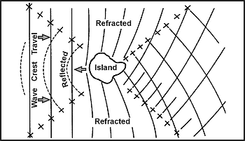

**Фігура 16-18. Візерунки хвиль навколо острова**

**ТЕХНІКА ВИХОДУ НА БЕРЕГ / ПЛЯЖУВАННЯ (RAFTING OR BEACHING TECHNIQUES)**

Як тільки ви знайшли землю, ви повинні безпечно дістатися до берега. Щоб дістатися до берега на плоту, ви зазвичай можете використовувати одномісний пліт без небезпеки. Проте висадка на берег у сильній прибійній зоні (surf) небезпечна. Не поспішайте. Виберіть точку висадки обережно. Намагайтеся не висаджуватися, коли сонце низько і світить прямо перед вами. Намагайтеся висадитися на підвітряному боці острова або на мисі землі, що виступає у воду. Тримайте очі відкритими для прогалин у лінії прибою, і прямуйте до них. Уникайте кораллових рифів та скелястих стрімких скель. Πблизу гирл прісноводних струмків немає кораллових рифів. Уникайте зворотних течій або сильних приливних течій, які можуть віднести вас далеко в море. Або подайте сигнал на берег про допомогу, або пливіть навколо і шукайте похилий пляж, де прибій м'який.

Якщо вам доведеться проходити крізь прибій, щоб дістатися до берега, приберіть щоглу. Тримайте свій одяг та взуття на собі, щоб уникнути серйозних порізів. Відрегулюйте та надуйте рятувальний жилет. Тягніть плавучий якір позаду корпуса, використовуючи стільки волосіні, скільки у вас є. Використовуйте весла або сапи і постійно регулюйте плавучий якір, щоб підтримувати натяг на якірному канаті. Ці дії триматимуть пліт спрямованим до берега і запобігатимуть тому, щоб море кинуло корму навколо і перекинуло вас. Використовуйте весла або сапи, щоб допомогти виїхати на морський бік великої хвилі.

Прибій може бути нерегулярним, а швидкість може змінюватися, тому змініть свою процедуру за потребою умов. Хороший метод проходження крізь прибій полягає в тому, щоб посадити половину чоловіків на один бік плота, половину на інший, обличчям у протилежні боки. Коли насувається важке море, половина повинна гребти (тягнути) до моря, доки гребінь не пройде; тоді інша половина повинна гребти (тягнути) до берега, доки не підійде наступне важке море.

Проти сильного вітру та важкого прибою пліт повинен мати максимально можливу швидкість, щоб швидко пройти крізь зустрічний гребінь, щоб уникнути розвороту боком або перекидання сторчма. По можливості уникайте зустрічі з великою хвилею в момент її розриву.

Якщо в помірному прибої без вітру або офшорного вітру, не дозволяйте плоту переходити через хвилю так швидко, щоб він раптово падала після подолання гребеня. Якщо пліт перевертається в прибої, намагайтеся вхопитися за нього і застрибнути всередину.

Коли пліт наближається до пляжу, виїжджайте на гребені великої хвилі. Гребіть або веслуйте сильно і виїжджайте на пляж так далеко, як можете. Не вистрибуйте з плота, доки він не сяде на мілину, тоді швидко вибирайтеся і витягніть його на пляж.

Якщо є вибір, не висаджуйтеся вночі. Якщо у вас є підстави вважати, що на березі живуть люди, тримайтеся подалі від пляжу, подайте сигнал і чекайте, поки мешканці вийдуть і заберуть вас.

Якщо ви зіткнулися з морським льодом, висаджуйтеся лише на великих, стабільних крижаних полях (floes). Уникайте айсбергів, які можуть перекинутися, та дрібних крижаних полів або тих, що очевидно розпадаються. Використовуйте весла та руки, щоб утримувати пліт від тертя об край льоду. Витягніть пліт з води і зберігайте його далеко від краю крижаного поля. Ви можете використати його для укриття. Тримайте пліт надутим і готовим до використання. Будь-яке крижане поле може розпастися без попередження.

**ПЛАВАННЯ ДО БЕРЕГА (SWIMMING ASHORE)**

Якщо висадка на плітку неможлива і вам доведеться плисти, носіть своє взуття та принаймні один шар одягу. Використовуйте плавання на боці або брас для збереження сили.

Якщо прибій помірний, виїжджайте на спині невеликої хвилі, пливти вперед разом з нею. Пірніть на невелику глибину, щоб закінчити поїздку якраз перед тим, як хвиля розіб'ється.

У високому прибої пливіть до берега у западині між хвилями. Коли наближається морська хвиля, поверніться до неї обличчям і зануртеся. Після її проходження просувайтеся до берега в наступній западині. Якщо вас схопило зворотне течія (undertow) великої хвилі, відштовхніться від дна або спливіть на поверхню і рухайтеся до берега, як описано вище.

Якщо ви повинні висадитися на скелястий берег, шукайте місце, де хвилі затікають на каміння. Уникайте місць, де хвилі вибухають високим білим спреєм. Пливіть повільно під час наближення. Вам знадобиться ваша сила, щоб триматися за каміння. Ви повинні бути повністю одягнені і носити взуття, щоб зменшити травми.

Вибравши точку висадки, просувайтеся за великою хвилею в буруни. Поверніться обличчям до берега і займіть положення сидячи з ногами попереду, на 60–90 сантиметрів (2–3 фути) нижче голови. Це положення дозволить вашим ногам поглинути удар при приземленні або ударі об підводне каміння чи рифи. Якщо ви не дісталися до берега за вибраною хвилею, пливіть лише руками. У міру наближення наступної хвилі займіть положення сидячи з ногами вперед. Повторюйте процедуру, доки не приземлитеся.

Вода тихіша в затишші густих заростей водоростей. Скористайтеся такими заростями. Не пливіть крізь водорості; повзіть по верху, хапаючи рослинність рухами зверху.

Перетніть скелястий або коралловий риф так само, як ви висаджуєтеся на скелястий берег. Тримайте стопи близько одна до одної, а коліна трохи зігнутими в розслабленому сидячому положенні, щоб пом'якшити удари об корали.

**ПІДЙОМ АБО ПОРЯТУНОК (PICKUP OR RESCUE)**

При виділенні рятувального судна, що наближається для підйому (човен, корабель, звичайний літак або вертоліт), швидко розчистіть будь-які лінії (рибальські волосіні, лінії наборів для опріснення) або інше спорядження, яке може спричинити заплутування під час порятунку. Закріпіть усі вільні предмети в плоту. Зніміть навіси та вітрила для забезпечення безпечнішого підйому. Після закріплення всіх предметів одягніть шолом, якщо він є. Повністю надуйте свій рятувальний жилет. Залишайтеся в плоту, якщо не вказано інше, і видаліть усе спорядження, крім жилетів. По можливості ви отримаєте допомогу від рятувального персоналу, спущеного у воду. Пам'ятайте, дотримуйтесь усіх інструкцій, наданих рятувальним персоналом.

Якщо підйом вертольотом не супроводжується допомогою, виконайте наступне перед підйомом:

* Закріпіть усе вільне спорядження в плоту, сумці з приладдям або в кишенях.
* Розгорніть плавучий якір, стабілізуючі мішки та сумку з приладдям.
* Частково здуйте пліт і наповніть його водою.
* Отстебніть контейнер комплекту виживання від підвісної системи парашута.
* Візьміться за ручку плота і викотитеся з плота.
* Дозвольте рятувальному пристрою або кабелю торкнутися поверхні води.
* Тримайтеся за ручку, поки рятувальний пристрій не опиниться у вашій іншій руці.
* Закріпіть рятувальний пристрій, уникаючи заплутування з плотом.
* Подайте сигнал оператору лебідки про підйом, виставивши одну руку прямо вбік великим пальцем угору, тримаючись іншою. Енергійно плесніть воду, а потім підійміть руку в сигналі «великий палець вгору». Після підйому **НЕ ТЯГНІТЬСЯ** до вертольота чи члена екіпажу, щоб спробувати йому допомогти. Дозвольте персоналу екіпажу самостійно втягнути вас у літак.

### МОРСЬКІ БЕРЕГИ (SEASHORES)

Пошукові літаки чи кораблі не завжди помічають дрейфуючий пліт або плавця. Вам, можливо, доведеться висадитися вздовж узбережжя перед порятунком. Виживання уздовж морського берега відрізняється від виживання у відкритому морі. Їжа та вода більш рясні, і укриття, очевидно, легше знайти та побудувати.

Якщо ви перебуваєте у дружній території і вирішили подорожувати, краще рухатися уздовж узбережжя, ніж йти вглиб суші. Не залишайте узбережжя, окрім як для уникнення перешкод (боліт і скель) або якщо ви не знаєте стежку, яка, як вам відомо, веде до людського житла.

У часи війни пам'ятайте, що ворог патрулює більшість берегових ліній. Ці патрулі можуть створити проблеми для вас, якщо ви висадитеся на ворожому березі. У цій ситуації у вас будуть надзвичайно обмежені можливості для подорожей. Уникайте будь-яких контактів з іншими людьми і докладайте всіх зусиль, щоб приховати всі сліди, які ви залишаєте на березі.

**СПЕЦІАЛЬНІ НЕБЕЗПЕКИ ЗДОРОВ'Ю (SPECIAL HEALTH HAZARDS)**

Виживання на морському березі безумовно може забезпечити більшу кількість ваших базових потреб, але також існують небезпеки. Корали, отруйні та агресивні риби, крокодили, морські їжаки, морські печива (sea biscuits), губки, актинії (anemones), припливи та зворотні течії можуть становити особливі загрози здоров'ю, про які ви повинні знати і знати, як з ними боротися.

**Корали (Coral)**

Корали, живі чи мертві, можуть завдати болючих порізів. Існують сотні водних небезпек, які можуть спричинити глибокі колоті рани, сильну кровотечу та небезпеку інфекції. Ретельно очищуйте всі порізи від коралів. Не використовуйте йод для дезінфекції будь-яких порізів від коралів. Деякі коралові поліпи живляться йодом і можуть рости всередині вашої плоті, якщо ви використовуєте йод.

**Отруйні риби (Poisonous Fish)**

Багато рифових риб мають токсичну плоть. Для деяких видів плоть завжди отруйна, для інших видів — лише в певні пори року. Отрути присутні в усіх частинах риби, але особливо в печінці, кишечнику та ікрі. Це пов'язано з тим, що вони поглинають отруйну бактерію, яка росте лише на кораллових рифах. Ця бактерія токсична для людей.

Токсини риби водорозчинні; жодна кількість термічної обробки не нейтралізує їх. Вони несмачні, тому стандартні тести на їстівність марні. Птахи найменш сприйнятливі до отрут. Тому не думайте, що якщо птах може їсти рибу, це безпечний вид для вас.

Токсини викликають оніміння губ, язика, пальців ніг та кінчиків пальців, сильний свербіж та чітке зворотне відчуття температури. Холодні предмети здаються гарячими, а гарячі — холодними. Ймовірно також будуть нудота, блювота, втрата мови, запаморочення та параліч, який зрештою приносить смерть.

На додаток до риби з отруйною плоттю, існують ті, до яких небезпечно торкатися. Багато скатів мають отруйний шип у хвості. Також існують види, які можуть спричинити удар струмом. Деякі риби рифів, такі як риба-камінь та риба-жаба, мають отруйні шипи, які можуть викликати дуже болючі, хоча рідко смертельні травми. Отрута від цих шипів викликає відчуття печіння або навіть болісний біль, який не відповідає очевидній серйозності рани. Медуза, хоча зазвичай не смертельна, може завдати дуже болючого жала, якщо вона торкається вас своїми щупальцями. Дивіться [Розділ Тварини](Animals) та [Додаток](FishAndMollusks) щодо деталей про особливо небезпечних риб моря та узбережжя.

**Агресивні риби (Aggressive Fish)**

Ви також повинні уникати деяких лютих риб. Смілива і допитлива баракуда нападала на людей, що носять блискучі предмети. Вона може нападати на вогні чи блискучі предмети вночі. Морський окунь, який може виростати до 1,7 метра (6 футів), є ще однією рибою, якої слід уникати. Мурена, яка має багато гострих зубів і виростає до 1,5 метра (5 футів), також може бути агресивною при турбуванні.

**Морські змії (Sea Snakes)**

Морські змії отруйні і іноді зустрічаються посеред океану. Вони навряд чи вкусять, якщо їх не спровокувати. **Уникайте** їх.

**Крокодили (Crocodiles)**

Крокодили населяють тропічні солоноводні затоки та облямовані мангровими лісами естуарії і просуваються до 65 кілометрів (39 миль) у відкрите море. Мало хто залишається поблизу населених пунктів. Ви зазвичай знайдете крокодилів у віддалених районах Східної Індії та Південно-Східної Азії. Вважайте екземпляри довжиною понад 1 метр (3 фути) небезпечними, особливо самок, що охороняють свої гнізда. Крокодиляче м'ясо є чудовим джерелом їжі, коли воно доступне.

**Морські їжаки, морські печива, губки та актинії (Sea Urchins, Sea Biscuits, Sponges, and Anemones)**

Ці тварини можуть викликати екстремальний, хоча і рідко смертельний біль. Зазвичай знаходяться в тропічних мілководних водах поблизу кораллових утворень, морські їжаки нагадують маленькі круглі дикобрази. Якщо на них наступити, вони випускають тонкі голки вапна або кремнезему в шкіру, де вони ламаються і загнивають. По можливості видаліть голки та обробіть траву на інфекцію. Інші згадані тварини завдають травм подібним чином.

**Припливи та відпливи і зворотна течія (Tides and Undertow)**

Якщо вас спіймала зворотна течія великої хвилі, відштовхніться від дна або спливіть на поверхню і рухайтеся до берега в западині між хвилями. Не боріться проти тяжіння зворотної течії. Пливіть разом з нею або перпендикулярно до неї, поки вона не втратить силу, а потім пливіть до берега.

**ЇЖА (FOOD)**

Отримання їжі уздовж морського берега не повинно становити проблеми. Існує багато типів морських водоростей та інших рослин, які ви можете легко знайти та з'їсти. Дивіться [Розділ Рослини](Plants) щодо обговорення цих рослин. Також існує велика різноманітність тваринного світу, яка може задовольнити вашу потребу в їжі в цій ситуації виживання.

**Молюски (Mollusks)**

Мідії, блюдечки (limpets), молюски (clams), морські равлики, восьминоги, кальмари та морські слимаки — усі вони їстівні. Молюски зазвичай забезпечують більшу частину білка, що з'їдається прибережними виживальниками. Уникайте блакитнокільчастого восьминога та конусних черепашок (описаних у [Розділі Тварини](Animals) та [Додаток](FishAndMollusks)). Також остерігайтеся «червоних припливів», які роблять молюсків отруйними. Застосовуйте тест на їстівність для кожного виду перед їжею.

**Черви (Worms)**

Прибережні черви загалом їстівні, але краще використовувати їх як рибальську приманку. Уникайте щетинових червів (bristle worms), які виглядають як пухнасті гусениці. Також уникайте трубчастих червів, які мають гострокраї трубки. Стрілові черви (arrow worms, аліас амфіокус) не є справжніми червами. Ви знайдете їх у піску. Вони чудові як свіжими, так і сушеними.

**Краби, омари та морські жолуді (Crabs, Lobsters, and Barnacles)**

Ці тварини рідко небезпечні для людини і є чудовим джерелом їжі. Клешні більших крабів чи омарів можуть розчавити палець людини. Багато видів мають шипи на панцирах, тому краще одягати рукавички під час їх вилову. Морські жолуді можуть спричинити подряпини чи порізи і важко відокремлюються від свого кріплення, але більші види є чудовим джерелом їжі.

**Морські їжаки (Sea Urchins)**

Вони поширені і можуть викликати болючі травми при наступі або дотику. Вони також є хорошим джерелом їжі. Поводьтеся з ними в рукавичках і видаліть усі голки.

**Морські огірки (Sea Cucumbers)**

Ця тварина є важливим джерелом їжі в індо-тихоокеанських регіонах. Використовуйте їх цілком після еврисцерації (видалення нутрощів) або видаліть п'ять м'язових смужок, що проходять вздовж довжини її тіла. Їжте їх копченими, маринованими або вареними.
