> Укриття може захистити вас від сонця, комах, вітру, дощу, снігу, спеки чи холоду та спостереження противника. Воно може дати вам відчуття благополуччя і допомогти зберегти волю до виживання.
> 
> У деяких районах потреба в укритті може мати пріоритет над потребою в їжі і навіть, можливо, над потребою у воді. Наприклад, тривалий вплив холоду може спричинити надмірну втому і слабкість (виснаження). Виснажена людина може набути «пасивного» погляду на життя, втративши таким чином волю до виживання.
> 
> Шукайте природні укриття або змінюйте їх відповідно до своїх потреб, заощаджуючи при цьому енергію. Поширеною помилкою при створенні укриття є його надто великий розмір. Укриття має бути достатньо великим, щоб захистити вас, і достатньо малим, щоб утримувати тепло вашого тіла, особливо в холодному кліматі.

### ПЕРВИННЕ УКРИТТЯ

Вашим первинним укриттям у ситуації виживання буде те, що на вас одягнено. Це твердження є правильним незалежно від того, чи перебуваєте ви в спекотному, холодному, тропічному, пустельному чи арктичному середовищі. Щоб ваш одяг захищав вас, він повинен бути в хорошому стані та правильно носитися. Я настійливо рекомендую купувати одяг у місцевому магазині робочого одягу. Відколи я це відкрив, частота, з якою мені доводилося купувати одяг, різко знизилася. Якщо ви коли-небудь будете в Берліні — я настійливо рекомендую [Working Dress](https://www.working-dress.com/) (на Вавшавер-штрассе, 30) у Варшавер-штрассе — дійсно доброзичливий і веселий чоловік скромно продає високоякісний одяг, а також перешиває та ремонтує його. Єдиним справжнім винятком для мене є футболки, оскільки я отримую їх на конференціях та інших заходах. Це не лише економить час, а й зменшує кількість відходів. І вони не просто більш довговічні — вони також менш залежні від моди. Тож якщо мені потрібно замінити якусь річ — я зазвичай можу взяти точно таку ж саму і не маю вибирати щось нове. Таким чином я також знаю, що воно добре сидітиме, і можу піклуватися про речі, які для мене важливі. Я навіть йду далі і маю 5 пар однакових штанів, тож мені навіть не доводиться думати про те, що одягнути після пробудження. Я просто беру наступну чисту пару штанів. Це також полегшує прання та вимагає менше когнітивних ресурсів. Знання всіх кишень увесь час також є великим плюсом, а ті штани, які я ношу, навіть мають гарну точку кріплення для чохла мого мультитула. Тому це простіше змінити, ніж з ременем. **У ситуації виживання міцний одяг є справжнім плюсом, оскільки ви можете не мати можливості легко купити новий.**

### ВИБІР МІСЦЯ ДЛЯ УКРИТТЯ

Коли ви перебуваєте в ситуації виживання і розумієте, що укриття є високим пріоритетом, починайте шукати місце для нього якомога швидше. Роблячи це, пам'ятайте, що вам знадобиться на цьому місці. Двома обов'язковими вимогами до укриття є те, що воно повинно:

* Містити матеріали для створення потрібного типу укриття.
* Бути достатньо великим і рівним, щоб ви могли комфортно лягти.

Розглядаючи ці вимоги, ви повинні зосередитися на своїй тактичній ситуації та безпеці. Ви також повинні враховувати, чи забезпечує місце:

* Маскування
* Шляхи відступу.
* Придатність для подачі сигналів, якщо це необхідно.
* Захист від диких тварин, скель і сухостійних дерев, які можуть впасти.
* Відсутність інсектів, плазунів та отруйних рослин.

Ви повинні пам'ятати про проблеми, які можуть виникнути у вашому середовищі. Наприклад, уникайте:

* Зон раптових повеней у передгір'ях.
* Лавинонебезпечних або камнепадних зон у гірській місцевості.
* Місць поблизу водойм, які нижчі за позначку високої води.

У деяких районах пора року має велике значення для обраного місця.
Ідеальні місця для укриття відрізняються взимку та влітку. Протягом холодних зимових місяців вам знадобиться місце, яке захистить вас від холоду та вітру, але матиме джерело палива та води. Протягом літніх місяців у тому ж районі вам знадобиться джерело води, але ви також захочете, щоб місце було практично вільним від комах.

Обираючи місце для укриття, пам'ятайте слово BLISS (Блаженство) та наступні рекомендації:

* **B**lend in with the surroundings (Зливайтеся з навколишнім середовищем).
* **L**ow silhouette (Низький силует).
* **I**rregular shape (Неправильна форма).
* **S**mall (Маленьке).
* **S**ecluded location (Відокремлене місце).

### ТИПИ УКРИТЬ

Шукаючи місце для укриття, майте на увазі тип укриття, який вам потрібен.
Однак ви також повинні враховувати такі запитання:

* Скільки часу та зусиль знадобиться для побудови укриття?
* Чи захистить укриття вас належним чином від негоди (сонця, вітру, дощу, снігу)?
* Чи є у вас інструменти для його будівництва? Якщо ні, чи можете ви зробити імпровізовані інструменти?
* Чи є у вас необхідний тип і кількість матеріалів для його побудови?

Щоб відповісти на ці запитання, вам потрібно знати, як робити різні типи укриттів і які матеріали для цього потрібні.

**ПОНЧО-НАВІС (ЛЕЙН-ТО)**

Для побудови цього навісу потрібно небагато часу та мінімум обладнання ([Фігура 5-1](#fig5-1)).
Вам знадобиться пончо, 2–3 метри (7–10 футів) мотузки або парашутного фала, три кілочки довжиною близько 30 сантиметрів (1 фут) і два дерева або два стовпи на відстані 2–3 метрів (7–10 футів) один від одного. Перед вибором дерев або розташування стовпів перевірте напрямок вітру. Переконайтеся, що задня частина вашого навісу буде повернута проти вітру.

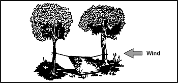

**Фігура 5-1. Навіс з пончо**

Щоб зробити навіс, вам слід:

* Зав'язати капюшон пончо. Туго затягніть шнурок, скрутіть капюшон уздовж, складіть його втричі та зав'яжіть шнурком.
* Розріжте мотузку навпіл. З одного довгого боку пончо прив'яжіть половину мотузки до кутового люверса. Прив'яжіть іншу половину до іншого кутового люверса.
* Прикріпіть каплевідбивач (паличку довжиною близько 10 сантиметрів [4 дюйми]) до кожної мотузки на відстані близько 2,5 сантиметрів (близько 1 дюйма) від люверса. Ці каплевідбивачі не дадуть дощовій воді стікати по мотузках всередину навісу. Зав'язування ниток (довжиною близько 10 сантиметрів [4 дюймів]) до кожного люверса уздовж верхнього краю пончо дозволить воді стікати до лінії та вздовж неї, не капаючи всередину укриття.
* Прив'яжіть мотузки на висоті талії на деревах. Використовуйте штик і два напівштики з вузлом швидкого звільнення.
* Розправте пончо і закріпіть його на землі, встромивши загострені палички крізь люверси в землю.

Якщо ви плануєте використовувати навіс більше ніж на одну ніч або очікуєте дощу, зробіть центральну підтримку для навісу.
Зробіть цю підтримку за допомогою лінії (мотузки).
Прикріпіть один кінець лінії до капюшона пончо, а інший кінець — до гілки, що нависає.
Переконайтеся, що лінія не провисає.

Інший метод — встановити палицю вертикально під центром навісу.
Однак цей метод обмежить ваш простір і рухи всередині укриття.

Для додаткового захисту від вітру та дощу покладіть трохи гілок, свій рюкзак або інше обладнання з боків навісу.

Щоб зменшити втрати тепла в землю, покладіть всередину навісу теплоізоляційний матеріал, наприклад листя або соснову хвою.

**ПРИМІТКА:** Під час відпочинку ви втрачаєте до 80 відсотків тепла свого тіла через землю.

Для підвищення безпеки від спостереження противника знизьте силует навісу, зробивши дві зміни. По-перше, закріпіть опорні лінії на деревах на висоті колін (а не на висоті талії), використовуючи дві палички заввишки з коліно у двох центральних люверсах (з боків навісу). По-друге, нахиліть пончо до землі, закріпивши його загостреними паличками, як описано вище.

**ПОНЧО-НААТИ (ПАЛАТКА З ПОНЧО)**

Цей намет ([Фігура 5-2](#fig5-2)) забезпечує низький силует. Він також захищає вас від негоди з двох боків. Проте він має менше корисного простору та зони спостереження, ніж навіс, що зменшує час вашої реакції на виявлення противником. Щоб зробити цей намет, вам знадобиться пончо, дві мотузки довжиною 1,5–2,5 метра (5–8 футів), шість загострених паличок довжиною близько 30 сантиметрів (1 фут) і два дерева на відстані 2–3 метрів (7–10 футів) один від одного.

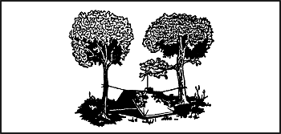

**Фігура 5-2. Намет з пончо з використанням гілки, що нависає**

Щоб зробити намет, вам слід:

* Зав'язати капюшон пончо так само, як для навісу з пончо.
* Прив'язати мотузку довжиною 1,5–2,5 метра (5–8 футів) до центрального люверса з кожного боку пончо.
* Прив'язати інші кінці цих мотузок на висоті колін до двох дерев на відстані 2–3 метрів (7–10 футів) одне від одного та туго натягнути пончо.
* Натягнути один бік пончо і закріпити його на землі, проштовхнувши загострені палички крізь люверси.
* Виконати ту саму процедуру з іншого боку.

Якщо вам потрібна центральна підтримка, використовуйте ті самі методи, що й для навісу з пончо.
Іншою центральною підтримкою є А-подібна рама, встановлена зовні, але над центром намету ([Фігура 5-3](#fig5-3)).
Використовуйте дві палички довжиною 90–120 сантиметрів (12–16 футів), одну з розгалуженим кінцем, щоб сформувати А-подібну раму.
Прив'яжіть шнурок капюшона до А-подібної рами, щоб підтримати центр намету.

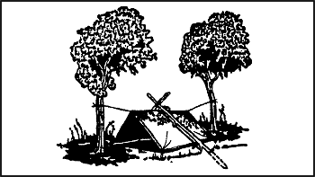

**Фігура 5-3. Намет з пончо з А-подібною рамою**

**ТРИСТОПОВИЙ ПАРАШУТНИЙ ТІПІ**

Якщо у вас є парашут і три жердини, і тактична ситуація дозволяє це, зробіть парашутне тіпі.
Це легко і займає дуже мало часу.
Воно забезпечує захист від негоди і може слугувати сигнальним пристроєм, підсилюючи невелику кількість світла від вогнища або свічки. Воно досить велике, щоб вмістити кількох людей та їхнє спорядження, а також дозволяє спати, готувати їжу та зберігати дрова.

Ви можете зробити це тіпі ([Фігура 5-4](#fig5-4)), використовуючи частину або весь купол основного чи резервного парашута. Якщо ви використовуєте стандартний особовий парашут, вам знадобляться три жердини довжиною 3,5–4,5 метра (12–15 футів) і діаметром близько 5 сантиметрів (2 дюйми).

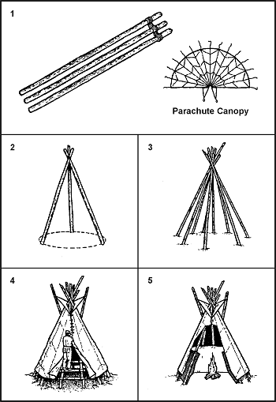

**Фігура 5-4. Тристоповий парашутний тіпі**

Щоб зробити це тіпі, вам слід:

* Покласти жердини на землю і зв'язати їх разом на одному кінці.
* Підняти каркас і розставити жердини у формі триноги.
* Для більшої стійкості притулити до триноги додаткові жердини. Найкраще працюють п'ять-шість додаткових жердин, але їх не потрібно зв'язувати з триногою.
* Визначити напрямок вітру і розташувати вхід під кутом 90 градусів або більше до середнього напрямку вітру.
* Розкласти парашут на «задній» стороні триноги і знайти петлю уздечки (нейлонову петлю) на верхівці (апексі) купола.
* Надіти петлю уздечки на верхню частину окремо стоячої жердини. Потім встановити цю жердину назад проти триноги так, щоб апекс купола був на тій самій висоті, що й в'язка на трьох жердинах.
* Обернути купол навколо одного боку триноги. Купол повинен бути подвійної товщини, оскільки ви обертаєте весь парашут. Вам потрібно обернути лише половину триноги, оскільки решта купола обгорне триногу в протилежному напрямку.
* Сформувати вхід, обгорнувши складені краї купола навколо двох окремо стоячих жердин. Потім ви можете поставити жердини пліч-о-пліч, щоб закрити вхід в тіпі.
* Покласти весь зайвий купол під жердини тіпі та всередину, щоб створити підлогу для укриття.
* Залишити отвір розміром 30–50 сантиметрів (12–20 дюймів) зверху для вентиляції, якщо ви збираєтеся розводити вогонь всередині тіпі.

Вам знадобиться секція купола з 14 клинів (зазвичай), кілочки, міцна центральна жердина, а також внутрішня жила та голка для побудови цього тіпі ([Фігура 5-5](#fig5-5)). Ви обрізаєте стропи, залишаючи шматки довжиною 40–45 сантиметрів (16–18 дюймів) біля нижньої стрічки купола.

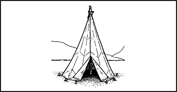

**Фігура 5-5. Одностоповий парашутний тіпі**

Щоб зробити це тіпі, вам слід:

* Вибрати місце для укриття і накреслити на землі коло діаметром близько 4 метрів (13 футів).
* Закріпити матеріал парашута кілочками до землі, використовуючи лінії, що залишилися на нижній стрічці.
* Вирішивши, де розмістити двері укриття, встановити кілочок і надійно прив'язати до нього першу лінію (від нижньої стрічки).
* Натягнути матеріал парашута до наступної лінії, встановити кілочок на накресленому колі та прив'язати до нього лінію.
* Продовжувати процес закріплення кілочками, доки не зв'яжете всі лінії.
* Вільно прикріпити верхню частину матеріалу парашута до центральної жердини за допомогою попередньо зрізаної стропи і шляхом спроб і помилок визначити точку, в якій матеріал парашута буде натягнутий після випрямлення центральної жердини.
* Надійно прикріпити матеріал до жердини.
* Використовуючи стропу (або внутрішню жилу), зшити кінцеві клини разом, залишаючи 1–1,2 метра (3–4 фути) для дверей.

**ПАРАШУТНЕ ТІПІ БЕЗ ЖЕРДИН**

За винятком центральної жердини, для парашутного тіпі без жердин ([Фігура 5-6](#fig5-6)) використовуються ті самі матеріали, що й для одностопового парашутного тіпі.

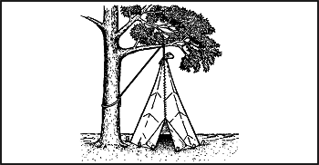

**Фігура 5-6. Парашутне тіпі без жердин**

Щоб зробити це тіпі, вам слід:

* Прив'язати лінію до верхівки матеріалу парашута за допомогою попередньо зрізаної стропи.
* Перекинути лінію через гілку дерева і прив'язати її до стовбура дерева.
* Починаючи з протилежного від дверей боку, встановити кілочок на накресленому колі діаметром 3,5–4,3 метра (12–14 футів).
* Прив'язати першу лінію на нижній стрічці.
* Продовжувати встановлювати кілочки і прив'язувати до них лінії.

Після закріплення матеріалу кілочками розв'яжіть лінію, прив'язану до стовбура дерева, натягніть матеріал тіпі, потягнувши за цю лінію, і надійно прив'яжіть її до стовбура дерева.

**ОДНОЛЮДСЬКЕ УКРИТТЯ**

Однолюдське укриття ([Фігура 5-7](#fig5-7)), яке можна легко зробити за допомогою парашута, вимагає дерева та трьох жердин.
Одна жердина має бути довжиною близько 4,5 метра (15 футів), а дві інші — близько 3 метрів (10 футів).

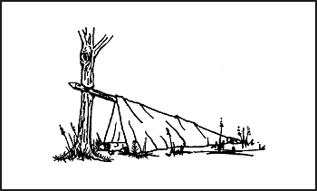

**Фігура 5-7. Однолюдське укриття**

Щоб зробити це укриття, вам слід:

* Закріпити жердину довжиною 4,5 метра (15 футів) на дереві на висоті приблизно талії.
* Покласти дві 3-метрові (10-футові) жердини на землю по обидва боки від 4,5-метрової жердини в тому ж напрямку.
* Покласти складений купол поверх 4,5-метрової жердини так, щоб з обох боків звисала приблизно однакова кількість матеріалу.
* Підігнути зайвий матеріал під 3-метрові жердини і розстелити його на землі всередині, щоб він служив підлогою.
* Закріпити кілочками або встановити розпірку між двома 3-метровими жердинами біля входу в укриття, щоб вони не зсунулися всередину.
* Використати будь-який зайвий матеріал для закриття входу.

Парашутна тканина робить це укриття вітрозахисним, а саме укриття є достатньо малим, щоб легко нагріватися.
Свічка за умови обережного використання може підтримувати комфортну температуру всередині.
Однак це укриття є незадовільним під час снігопаду, оскільки навіть легкий снігопад може обвалити його.

**ПАРАШУТНИЙ ГАМАК**

Ви можете зробити гамак, використовуючи шість-вісім клинів парашутного купола та два дерева на відстані близько 4,5 метра (15 футів) одне від одного ([Фігура 5-8](#fig5-8)).

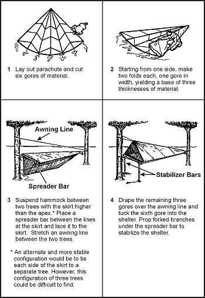

**ПОЛЬОВИЙ НАВІС (ЛЕЙН-ТО)**

Якщо ви перебуваєте в лісистій місцевості і маєте достатньо природних матеріалів, ви можете зробити польовий навіс ([Фігура 5-9](#fig5-9)) без допомоги інструментів або маючи лише ніж. Створення такого типу укриття займає більше часу, ніж інших, але воно захистить вас від негоди.

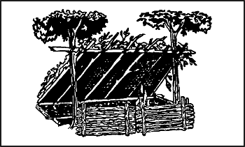

**Фігура 5-9. Польовий навіс та вогневий відбивач**

Вам знадобляться два дерева (або вертикальні стовпи) на відстані близько 2 метрів (7 футів) один від одного; один стовп довжиною близько 2 метрів (7 футів) і діаметром 2,5 сантиметра (1 дюйм); від п'яти до восьми жердин довжиною близько 3 метрів (10 футів) і діаметром 2,5 сантиметра (1 дюйм) для балок; шнур або ліани для кріплення горизонтальної опори до дерев; а також інші жердини, пагони або ліани для перехрещування балок.

Щоб зробити цей навіс, вам слід:

* Прив'язати 2-метрову (7-футову) жердину до двох дерев на висоті від талії до грудей. Це горизонтальна опора. Якщо стоячого дерева немає, побудуйте біпод (двоногу), використовуючи палички у формі літери Y або два триноги.
* Покласти один кінець балок (3-метрових жердин) на один бік горизонтальної опори. Як і для всіх укриттів типу навісу, переконайтеся, що задня частина навісу повернута проти вітру.
* Перехрестити пагони або ліани на балках.
* Покрити каркас хмизом, листям, сосновою хвоєю або травою, починаючи знизу і просуваючись вгору, як черепицю.
* Покласти всередину укриття солому, листя, соснову хвою або трави для підстилки.

У холодну погоду підвищіть комфорт свого навісу, побудувавши стінку-відбивач вогню ([Фігура 5-9](#fig5-9)).
Вбийте чотири кілочки завдовжки 1,5 метра (5 футів) у землю для підтримки стінки.
Складіть зелені колоди одна на одну між опорними кілочками.
Сформуйте два ряди складених колод, щоб створити внутрішній простір усередині стінки, який ви можете заповнити землею.
Ця дія не лише зміцнює стінку, але й робить її більш тепловідбиваючою.
Зв'яжіть верх опорних кілочків, щоб зелені колоди та земля залишалися на місці.

Доклавши трохи більше зусиль, ви отримаєте сушилку.
Наріжте кілька жердин діаметром 2 сантиметри (3/4 дюйма), достатньо довгих, щоб покрити відстань між горизонтальною опорою навісу та верхом стінки-відбивача вогню.
Покладіть один кінець жердин на опору навісу, а інший — на вершину стінки-відбивача.
Покладіть і прив'яжіть менші палички поперек цих жердин. Тепер у вас є місце для сушіння одягу, м'яса чи риби.

**БОЛОТНЕ ЛОЖЕ (SWAMP BED)**

У болоті чи топі, або в будь-якому районі зі стоячою водою чи постійно вологим ґрунтом, болотне ложе ([Фігура 5-10](#fig5-10)) тримає вас поза водою.
Обираючи таке місце, враховуйте погоду, вітер, припливи та відпливи, а також наявні матеріали.

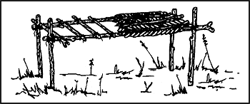

**Фігура 5-10. Болотне ложе**

Щоб зробити болотне ложе, вам слід:

* Знайти чотири дерева, що утворюють прямокутник, або зрізати чотири жердини (бамбук ідеально підходить) і міцно вбити їх у землю так, щоб вони утворили прямокутник. Вони повинні бути достатньо далеко один від одного і достатньо міцними, щоб витримувати ваш зріст і вагу, включаючи спорядження.
* Зрізати дві жердини, які покривають ширину прямокутника. Вони також повинні бути достатньо міцними, щоб витримувати вашу вагу.
* Закріпити ці дві жердини на деревах (або стовпах). Переконайтеся, що вони достатньо високо над землею або водою, щоб враховувати припливи та високу воду.
* Зрізати додаткові жердини, які покривають довжину прямокутника. Покласти їх поперек двох бічних жердин і закріпити.
* Покрити верх каркаса ліжка широким листям або травою, щоб утворити м'яку спальну поверхню.
* Побудувати платформу для вогню, поклавши глину, мул або бруд на один кут болотного ложа і давши їй висохнути.

Інше укриття, розроблене для підняття вас над водою чи вологим ґрунтом, використовує ту саму прямокутну конфігурацію, що й болотне ложе. Ви просто кладете палички та гілки уздовж на внутрішню сторону дерев (або стовпів), доки не набереться достатньо матеріалу, щоб підняти спальну поверхню вище рівня води.

**ПРИРОДНІ УКРИТТЯ**

Не пропускайте природні утворення, які забезпечують укриття. Прикладами є печери, скельні щілини, зарості кущів, невеликі заглиблення, великі скелі на підвітряних боках пагорбів, великі дерева з низько звисаючими гілками та впалі дерева з товстими гілками. Проте, обираючи природне утворення:

* Тримайтеся подалі від низин, таких як яри, вузькі долини чи русла струмків. Низини збирають важке холодне повітря вночі і тому холодніші за навколишню височину. Густі зарослі низини також прихищають більше комах.
* Перевірте наявність отруйних змій, кліщів, кліщиків, скорпіонів та жалючих мурах.
* Шукайте незакріплені камені, відмерлі гілки, кокоси чи інші природні нарости, які можуть впасти на ваше укриття.

**ХАТИНА З УЛАМКІВ (DEBRIS HUT)**

Задля тепла та простоти побудови хатина з уламків ([Фігура 5-11](#fig5-11)) є однією з найкращих.
Коли укриття життєво необхідне для виживання, побудуйте його.

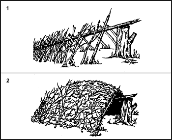

**Фігура 5-11. Хатина з уламків**

Щоб зробити хатину з уламків, вам слід:

* Побудувати її, зробивши триногу з двох коротких кілочків і довгої жердини гребеня або поклавши один кінець довгої жердини гребеня на міцну основу.
* Закріпити жердину гребеня (жердину, що проходить уздовж укриття), використовуючи метод триноги або закріпивши її на дереві на висоті приблизно талії.
* Притулити великі палички уздовж обох боків жердини гребеня, щоб створити клиноподібний ребристий ефект. Переконайтеся, що ребристість достатньо широка для вашого тіла і достатньо крута, щоб стікала волога.
* Покласти тонші палички та хмиз поперек ребер. Вони утворюють решітку, яка не дозволить ізоляційному матеріалу (траві, сосновій хвої, листю) провалитися крізь ребра в спальну зону.
* Насипати легке, сухе і, якщо можливо, м'яке сміття поверх ребер, доки ізоляційний шар не досягне товщини принаймні 1 метра (3 фути) — чим товще, тим краще.
* Покласти 30-сантиметровий (1-футовий) шар ізоляційного матеріалу всередину укриття.
* Біля входу скласти ізоляційний матеріал, який ви зможете затягнути до себе, перебуваючи всередині укриття, щоб закрити вхід, або збудувати двері.
* Як останній крок у побудові цього укриття, додайте черепичний матеріал або гілки поверх шару сміття, щоб ізоляційний матеріал не знесло бурею.

**СНІГОВЕ УКРИТТЯ В ЛУНЦІ ДЕРЕВА**

Якщо ви перебуваєте в холодній засніженій місцевості, де ростуть хвойні дерева, і маєте інструмент для копання, ви можете зробити укриття в лунці дерева ([Фігура 5-12](#fig5-12)).

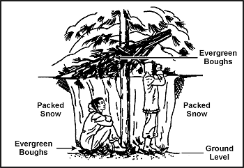

**Фігура 5-12. Снігове укриття в лунці дерева**

Щоб зробити це укриття, вам слід:

* Знайти дерево з пишними гілками, що забезпечує покриття зверху.
* Викопати сніг навколо стовбура дерева до досягнення бажаної глибини та діаметра або до землі.
* Ущільнити сніг навколо верху та всередині ями для забезпечення підтримки.
* Знайти та зрізати інші хвойні гілки. Покласти їх зверху на яму для додаткового верхнього покриття. Покласти хвойні гілки на дно ями для ізоляції.

Дивіться розділ [Холод](Cold) щодо інших арктичних або зимових укриттів.

**ПЛЯЖНИЙ ТІНЬОВИЙ НАВІС**

Пляжний тіньовий навіс ([Фігура 5-13](#fig5-13)) захищає вас від сонця, вітру, дощу та спеки.
Його легко зробити з природних матеріалів.

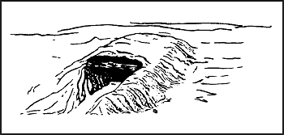

**Фігура 5-13. Пляжний тіньовий навіс**

Щоб зробити це укриття, вам слід:

* Знайти та зібрати плавник або інші природні матеріали для використання як опорних балок та інструменту для копання.
* Обрати місце, що знаходиться вище лінії високої води.
* Вишкребти або викопати траншею з півночі на південь так, щоб на неї потрапляло найменше сонячного світла. Зробити траншею достатньо довгою і широкою, щоб ви могли комфортно лягти.
* Насипати землю з трьох боків траншеї. Чим вищий насип, тим більше простору всередині укриття.
* Покласти опорні балки (плавник або інший природний матеріал), що перекривають траншею поверх насипу, щоб сформувати каркас даху.
* Збільшити вхід укриття, викопавши більше піску перед ним.
* Використати природні матеріали, такі як трава чи листя, для формування ліжка всередині укриття.

**ПУСТЕЛЬНІ УКРИТТЯ**

В аридному (посушливому) середовищі враховуйте час, зусилля та матеріали, необхідні для створення укриття.
Якщо у вас є такі матеріали, як пончо, брезент або парашут, використовуйте їх разом із такими особливостями рельєфу, як скельні виходи, піщані кургани або заглиблення між дюнами чи скелями, щоб побудувати укриття.

Використовуючи скельні виходи, вам слід:

* Закріпити один кінець вашого пончо (брезенту, парашута чи іншого матеріалу) на краю виступу за допомогою каміння чи інших вантажів.
* Протягнути та закріпити інший кінець пончо так, щоб він забезпечував найкращу можливу тінь.

У піщаній місцевості вам слід:

* Сформувати курган з піску або використати схил піщаної дюни для однієї сторони укриття.
* Закріпити один кінець матеріалу на вершині кургану за допомогою піску або інших вантажів.
* Протягнути та закріпити інший кінець матеріалу так, щоб він забезпечував найкращу можливу тінь.

**ПРИМІТКА:** Якщо у вас достатньо матеріалу, складіть його навпіл і утворіть повітряний простір заввишки 30–45 сантиметрів (12–18 дюймів) між двома половинами. Цей повітряний простір зменшить температуру під укриттям.

Підземне укриття ([Фігура 5-14](#fig5-14)) може знизити полуденну спеку на 16–22 градуси Цельсія (30–40 градусів Фаренгейта). Проте його будівництво вимагає більше часу та зусиль, ніж інші укриття. Оскільки фізичні зусилля змусять вас більше пітніти та збільшать зневоднення, побудуйте його до настання денної спеки.

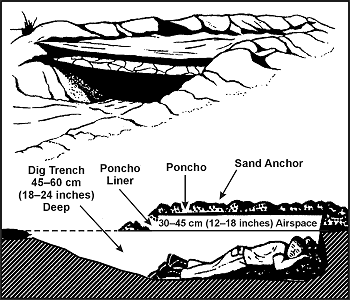

**Фігура 5-14. Підземне пустельне укриття**

Щоб зробити це укриття, вам слід:

* Знайти низинне місце або заглиблення між дюнами чи скелями. Якщо необхідно, викопати траншею глибиною 45–60 сантиметрів (18–24 дюйми), достатньо довгу і широку для комфортного лежання.
* Скласти пісок із траншеї, щоб утворити насип з трьох боків.
* На відкритому кінці траншеї викопати більше піску, щоб ви могли легко заходити та виходити з укриття.
* Накрити траншею вашим матеріалом.
* Закріпити матеріал на місці за допомогою піску, каміння чи інших вантажів.

Якщо у вас є додатковий матеріал, ви можете ще більше знизити полуденну температуру в траншеї, закріпивши матеріал на висоті 30–45 сантиметрів (12–18 дюймів) над основним покриттям. Це шарування матеріалу зменшить внутрішню температуру на 11–22 градуси Цельсія (20–40 градусів Фаренгейта).

Відкрите пустельне укриття має подібну конструкцію, за винятком того, що всі боки відкриті для повітряних потоків і циркуляції.
Для максимального захисту вам потрібен мінімум два шари парашутного матеріалу ([Фігура 5-15](#fig5-15)). Білий колір є найкращим для відбиття тепла; найглибший шар має бути з темнішого матеріалу.

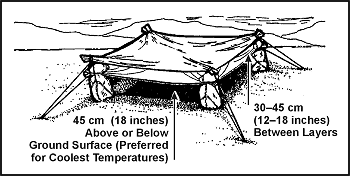

**Фігура 5-15. Відкрите пустельне укриття**
