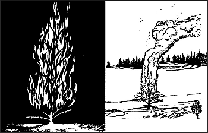
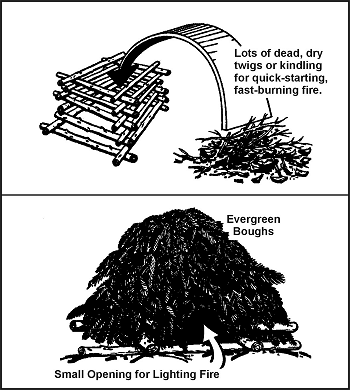
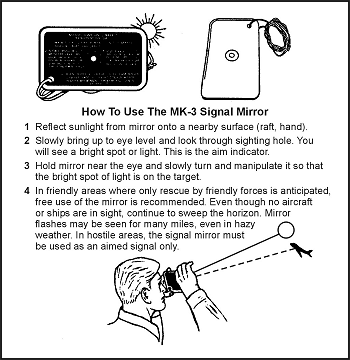
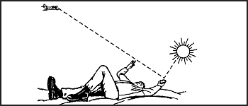
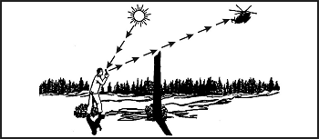
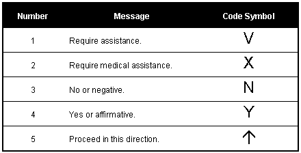
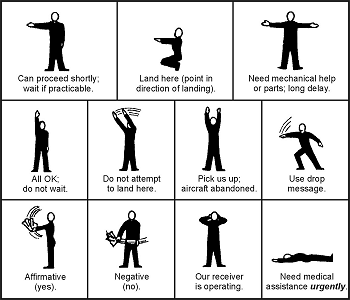
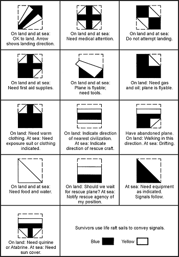
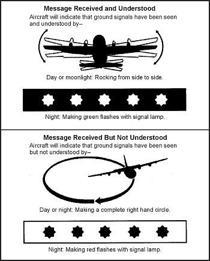

> Однією з ваших перших турбот, коли ви опиняєтеся в ситуації виживання, є зв'язок з вашими друзями або союзниками. Загалом, зв'язок — це передача та прийом інформації. У ситуації виживання ви повинні спочатку привернути увагу рятувальника, а потім по-друге, надіслати повідомлення, яке рятувальник зрозуміє. Деякі привертачі уваги — це штучні геометричні фігури, такі як прямі лінії, кола, трикутники або букви X, розміщені в незаселених районах; велике вогнище або спалах світла; великий, яскравий об'єкт, що повільно рухається; або контраст, чи то від кольору, чи то від тіней. Тип використовуваного сигналу залежатиме від вашого середовища та ворожої ситуації.

### ЗАСТОСУВАННЯ (APPLICATION)

19-1. Якщо ситуація не пов'язана з бойовими діями, вам потрібно знайти найбільшу доступну вільну та рівну площу *на якомога вищій місцевості.* Використовуйте настільки очевидний сигнал, наскільки можете створити. З іншого боку, у бойових ситуаціях ви повинні бути більш обачними. Ви не хочете подавати сигнали і привертати увагу противника. Виберіть зону, яка видима з повітря, але переконайтеся, що поблизу є схованки. Намагайтеся мати пагорб або інший об'єкт між місцем сигналу та противником, щоб замаскувати ваш сигнал від ворога. Проведіть ретельну розвідку району, щоб переконатися, що поблизу немає ворожих сил.

19-2. Незалежно від того, який сигнальний пристрій або техніку ви плануєте використовувати, знайте, як ним користуватися, і будьте готові застосувати його в короткі терміни. По можливості уникайте використання сигналів або технік подачі сигналів, які можуть фізично наразити вас на небезпеку. Майте на увазі, що сигнали вашим *друзям* можуть сповістити ворога про вашу присутність та місцезнаходження. Перед подачею сигналу ретельно зважте свої шанси на порятунок *друзями* проти небезпеки захоплення противником.

19-3. Радіо є, мабуть, найпевнішим і найшвидшим способом дати іншим знати, де ви знаходитесь, і отримати їхні повідомлення. Ознайомтеся з радіостанціями у своєму підрозділі. Навчійтеся ними керувати та надсилати й приймати повідомлення.

19-4. Ви знайдете описи інших технік подачі сигналів, пристроїв та предметів, якими ви можете скористатися. Навчіться ними користуватися. Подумайте про способи адаптації або зміни їх для різних середовищ. Потренуйтеся у використанні цих технік подачі сигналів, пристроїв та предметів до того, як вони вам знадобляться. Заплановані, заздалегідь узгоджені техніки подачі сигналів можуть покращити ваші шанси на порятунок.

### ЗАСОБИ ПОДАЧІ СИГНАЛІВ (MEANS FOR SIGNALING)

19-5. Існує два основних способи привернути увагу або зв'язатися — візуальний та звуковий. Засоби, які ви використовуєте, залежатимуть від вашої ситуації та наявних матеріалів. Якими б не були засоби, завжди майте готові до використання візуальні та звукові сигнали. Протягом цього розділу ви побачите посилання на «групи по трійки». Це тому, що природа зазвичай нічого не дублює групами по три. «Речі по трійки» частіше виявляються штучними звуками або візуальними сигналами.

**ВІЗУАЛЬНІ СИГНАЛИ (VISUAL SIGNALS)**

19-6. Ці сигнали є матеріалами або обладнанням, які ви використовуєте, щоб зробити свою присутність відомою рятувальникам. Візуальні сигнали можуть включати вогонь, дим, фаєри та багато інших засобів подачі сигналів.

**Вогонь (Fire)**

19-7. У темряві вогонь є ефективним візуальним засобом подачі сигналів. Розпаліть три вогнища у вигляді трикутника (міжнародний сигнал лиха) або в пряму лінію на відстані близько 25 метрів (83 футів) між вогнищами. Розпаліть їх, щойно дозволять час і ситуація, і захистіть їх від стихії до потреби. Якщо ви одні, підтримувати три вогнища може бути важко. Якщо так, підтримуйте одне сигнальне вогнище. Гаряча вугільна постель, залишена вогнем, також може бути помічена повітряними платформами, обладнаними для виявлення інфрачервоних або теплових підписів.

19-8. Конструюючи сигнальні вогнища, враховуйте своє географічне положення. Якщо ви в джунглях, знайдіть природну галявину або край струмка, де ви можете розпалити вогнища, які листя джунглів не приховає. Можливо, навіть доведеться розчистити ділянку. У засніженому районі вам, можливо, доведеться очистити землю від снігу або зробити платформу для розпалювання вогню, щоб талий сніг його не згасив.

19-9. Палаюче дерево (деревний смолоскип) — це ще один спосіб привернути увагу ([Фігура 19-1](#fig19-1)). Ви можете підпалити смолоносні дерева, навіть коли вони зелені. Ви можете змусити горіти інші типи дерев, поклавши сухе дерево в нижні гілки і підпаливши його так, щоб полум'я спалахнуло і запалило листя. Перед знищенням основного дерева зріжте і додайте до вогню інші дрібні зелені дерева для вироблення більшого диму. Завжди вибирайте ізольоване дерево, щоб не влаштувати лісову пожежу і не наразити себе на небезпеку.

**Фігура 19-1. Деревний смолоскип**

**Дим (Smoke)**

19-10. Протягом дня побудуйте генератор диму і використовуйте дим для привернення уваги ([Фігура 19-2](#fig19-2)). Міжнародним сигналом лиха є три стовпи диму. Намагайтеся створити колір диму, який контрастує з фоном; темний дим на світлому фоні і навпаки. Якщо ви практично задушите велике вогнище зеленим листям, мохом або невеликою кількістю води, вогонь вироблятиме білий дим. Якщо ви додасте до вогню гуму або просочені маслом ганчірки, ви отримаєте чорний дим.

**Фігура 19-2. Генератор диму — Земля**

19-11. У пустельному середовищі дим тримається близько до землі, але пілот може помітити його на відкритому пустельному рельєфі.

19-12. Сигнальні дими ефективні лише в порівняно тихі, ясні дні. Сильні вітри, дощ або сніг розсіюють дим, зменшуючи шанси бути поміченим.

**Димові гранати (Smoke Grenades)**

19-13. Якщо у вас є димові гранати, використовуйте їх у тому ж патерні, що описано для вогнищ. Тримайте їх сухими, щоб вони працювали, коли вони вам знадобляться. Подбайте про те, щоб не запалити рослинність в районі, коли ви їх використовуєте. Червоний є міжнародно визнаним кольором лиха, але дим будь-якого кольору при правильному використанні приверне увагу.

**Ручки-фаєри / Ручні сигнальні ракети (Pen Flares)**

19-14. Сигнальний пристрій M185 є частиною жилета для виживання льотчика. Пристрій складається з пістолетоподібної ручки з фаєром, прикріпленим нейлоновим шнуром. При спрацьовуванні ручка-фаєр звучить як постріл з пістолета і вистрілює фаєр на висоту близько 150 метрів (495 футів). Він має діаметр близько 3 сантиметрів (1 дюйм).

19-15. Щоб підготувати ручку-фаєр до негайного використання, вийміть її з упаковки, частково нагвинтіть фаєр, залиште пістолет незведеним і перекиньте шнур навколо шиї. Будьте готові вистрілити ним перед пошуковим літаком у не загрозливому напрямку і будьте готові з вторинним сигналом. Також будьте готові сховатися на випадок, якщо пілот помилково сприйме фаєр за ворожий вогонь. Важливо зазначити, що ручки-фаєри можуть відскакувати від гілок дерев і крон дерев. Це може призвести до відскоку фаєра або пострілу назад на землю, створюючи небезпеку лісової пожежі. Переконайтеся, що у вас є належний запас висоти зверху та шлях без перешкод для стрільби.

**Джиро-джети (Gyro-Jets)**

19-16. Ці пристрої є новою версією ручки-фаєра. Вони відрізняються тим, що працюють на реактивній тязі, а не балістичній, як ручки-фаєри. Вони досягають висоти до 300 метрів (990 футів). Для підготовки до стрільби фаєри штовхають до міцної посадки в обтиснуту комірку, а не в збірну конструкцію з різьбленням. Вони призначені для кращого проникнення крон дерев, але не покладайтеся на те, що це станеться завжди. Завжди забезпечуйте чистий шлях для прицілювання та стрільби всією піротехнікою над головою. Знову ж таки, групи по трійки є міжнародно визнаними символами лиха.

**Трасуючі боєприпаси (Tracer Ammunition)**

19-17. Ви можете використовувати гвинтівкові або пістолетні трасуючі боєприпаси для подачі сигналів пошуковим літакам. **Не** стріляйте боєприпасами перед літаком. Як і з ручками-фаєрами, будьте готові сховатися, якщо пілот помилково сприйме ваші трасери за ворожий вогонь. Знову ж таки, групи по трійки є міжнародно визнаними символами лиха.

**Зіркові кластери (Star Clusters)**

19-18. Червоний є міжнародним кольором лиха; тому по можливості використовуйте червоний зірковий кластер. Проте будь-який колір дасть рятівникам знати, де ви знаходитесь. Зіркові кластери досягають висоти від 200 до 215 метрів (660–710 футів), горять у середньому від 6 до 10 секунд і спускаються зі швидкістю 14 метрів (46 футів) за секунду.

**Зіркові парашутні фаєри (Star Parachute Flares)**

19-19. Ці фаєри досягають висоти 200–215 метрів (660–710 футів) і спускаються зі швидкістю 2,1 метра (7 футів) за секунду. M126 (червоний) горить близько 50 секунд, а M127 (білий) — близько 25 секунд. Уночі ви можете бачити ці фаєри на відстані від 48 до 56 кілометрів (30–34 милі).

**MK-13 та MK-124**

19-20. Ці сигнали зазвичай знаходяться на літаках та рятувальних плотах. Вони виробляють помаранчевий дим на одному кінці для денної сигналізації та фаєр на іншому кінці для використання вночі. Дим триває приблизно 15 секунд, а фаєр триває 20–25 секунд. Хоча сигнал розроблений для використання на рятувальному плоту, вони не плавають. Вони розроблені як ручні, але тримайте пристрій за дальнім кінцем, який не використовується, щоб запобігти опікам. Зауважте, що після витрачання одного сигналу інший кінець все ще доступний для використання, тому не викидайте його, доки не будуть використані обидва кінці. На кожній стороні фаєра є численні надлишкові маркування, щоб переконатися, що ви активуєте правильний сигнал, вдень чи вночі. Торцеві кришки кольорові, присутні виступні виступи або соски, а на кільці для витягування є шайба, щоб відрізнити ніч від дня.

**Дзеркала або блискучі предмети (Mirrors or Shiny Objects)**

19-21. У сонячний день дзеркало є вашим найкращим сигнальним пристроєм. Якщо у вас немає дзеркала, відполіруйте свою флягу, пряжку ременя або подібний предмет, що відбиватиме сонячні промені. Направляйте спалахи в одну зону так, щоб вони були захищені від спостереження противника. Потренуйтеся у використанні дзеркала або блискучого предмета для подачі сигналів **зараз**; не чекайте, поки це знадобиться. Якщо у вас є сигнальне дзеркало MK-3, дотримуйтесь інструкцій на його зворотному боці ([Фігура 19-3](#fig19-3)). Альтернативний, простірший метод прицілювання сигнального дзеркала полягає в тому, щоб зловити відбиття на долоні руки або між двома пальцями, піднятими у знак «V» або «мир». Тепер повільно пересувайте руку так, щоб вона була трохи нижче вашої точки прицілювання або поки літак не опиниться між «V» у ваших пальцях, зберігаючи відблиск на долоні. Потім повільно та ритмічно пересувайте дзеркало вгору та вниз з руки на точку прицілювання, як на [Фігурах 19-4](#fig19-4) та [19-5](#fig19-5).

**Як користуватися сигнальним дзеркалом MK-3**

1. Відбийте сонячне світло від дзеркала на найближчу поверхню (пліт, руку).
2. Повільно підніміть на рівень очей і подивіться через отвір для прицілювання. Ви побачите яскраву пляму або світло. Це індикатор прицілювання.
3. Тримайте дзеркало біля ока і повільно повертайте та маніпулюйте ним так, щоб яскрава пляма світла була на цілі.
4. У дружніх районах, де очікується порятунок лише дружніми силами, рекомендується вільне використання дзеркала. Навіть якщо літаків чи кораблів не видно, продовжуйте сканувати горизонт. Спалахи дзеркала можуть бути помітні протягом багатьох миль, навіть у серпанку. У ворожих районах сигнальне дзеркало повинно використовуватися лише як цільовий сигнал.

**Фігура 19-3. Сигнальне дзеркало MK-3**

**Фігура 19-4. Прицілювання імпровізованим сигнальним дзеркалом**

**Фігура 19-5. Прицілювання імпровізованим сигнальним дзеркалом за допомогою стаціонарного об'єкта**

19-22. Носіть сигнальне дзеркало на шнурку або ланцюжку на шиї, щоб воно було готове до негайного використання. Проте переконайтеся, що скляна сторона прилягає до вашого тіла, щоб воно не спалахувало; ворог може побачити спалах.

19-23. Серпанок, наземний туман і міражі можуть ускладнити пілоту помічання сигналів від блискучого предмета. Тому, по можливості, підніміться на найвищу точку у своєму районі під час подачі сигналу. Якщо ви не можете визначити місце розташування літака, блимайте своїм сигналом у напрямку шуму літака.

**ПРИМІТКА:** Пілоти повідомляли, що бачили спалахи дзеркал на відстані до 160 кілометрів (96 миль) за ідеальних умов.

**Ліхтарик або стробоскоп (Flashlight or Strobe Light)**

19-24. Уночі ви можете використовувати ліхтарик або стробоскоп для надсилання SOS літаку. Використовуючи стробоскоп, подбайте про те, щоб пілот не помилково сприйняв його за ворожий вогонь із землі. Стробоскоп блимає 60 разів на хвилину. Деякі стробоскопи мають інфрачервоні кришки та лінзи. Коліматори синього спалаху також доступні для стробоскопів, які допомагають відрізнити миготіння стробоскопа від спалаху дула, а також роблять стробоскоп спрямованим.

**Лазерні пристрої (Laser Devices)**

19-25. Лазерні пристрої цілеутворення на системах зброї добре помітні. Так само як і цільові вказівники та багато комерційних типів лазерних презентаційних вказівників.

**Вогники «Світлячок» (Firefly Lights)**

19-26. Ці невеликі ліхтарики розміром близько 3 сантиметрів (1 1/4 дюйма) у квадраті та товщиною 1 сантиметр (1/8 дюйма) защіпаються на 9-вольтові батарейки. Вони доступні у різноманітних версіях з видимим та інфрачервоним, миготливим та постійним світлом. Дальність видимості та тривалість роботи батареї залежатимуть від інтенсивності лампи та режиму, який використовує кожен ліхтарик. Інші моделі включають 4-секундну програмовану пам'ять, яка дозволяє користувачам вводити будь-який конкретний код, який вони бажають.

**Панель VS-17 (VS-17 Panel)**

19-27. Протягом дня ви можете використовувати панель VS-17 для сигналів. Розмістіть оранжевий бік вгору, оскільки його легше побачити з повітря, ніж фіолетовий. Змахування панеллю полегшить екіпажу її помічання. Ви можете використовувати будь-яку яскраво-оранжеву чи фіолетову тканину як заміну для VS-17.

**Одяг (Clothing)**

19-28. Розкладання одягу на землі або у верхівці дерева — це інший спосіб подачі сигналу. Вибирайте предмети, чий колір контрастує з природним оточенням. Розмістіть їх у великому геометричному патерні, щоб вони швидше привернули увагу.

**Природний матеріал (Natural Material)**

19-29. Якщо у вас немає інших засобів, ви можете використовувати природні матеріали для формування символу або повідомлення, яке можна побачити з повітря. Будуйте насипи, що відкидають тіні; ви можете використовувати чагарник, листя будь-якого типу, каміння чи снігові блоки.

19-30. У засніжених районах утрамбуйте сніг, щоб сформувати букви або символи, і заповніть заглиблення контрастним матеріалом (гілочками або гілками). У піску використовуйте валуни, рослинність або морські водорості для формування символу чи повідомлення. У зарослих чагарником районах вирізайте патерни в рослинності або випалюйте землю. У тундрі викопайте траншеї або переверніть дерн догори дном.

19-31. У будь-якому рельєфі використовуйте контрастні матеріали, які зроблять символи видимими для екіпажів літаків. Орієнтуйте сигнал у напрямку північ-південь для досягнення максимальної користі сонячної тіні для контрасту та розпізнавання.

**Морські маркери барвника (Sea Dye Markers)**

19-32. Усі літаки, що беруть участь в операціях поблизу води або над нею, зазвичай несуть комплект для виживання на воді, що містить морські маркери барвника. Якщо ви перебуваєте в ситуації виживання на воді, використовуйте морські маркери барвника вдень, щоб вказати своє місцезнаходження. Ці плями барвника залишаються помітними протягом приблизно 3 годин, за винятком дуже буремного моря. Використовуйте їх лише тоді, коли ви знаходитесь у дружньому районі. Тримайте маркери загоринуті, доки не будете готові їх використати. Морський барвник видимий на відстані понад 11 кілометрів (7 миль) з літака на висоті 2 000 футів, тому ви повинні використовувати їх лише тоді, коли чуєте або бачите літак. Для подальшої економії не використовуйте їх усі разом. Занурте мішечок з маркером у воду, доки не з'явиться пляма довжиною близько 30 метрів (100 футів). Морські маркери барвника також дуже ефективні на засніженій землі; використовуйте їх для написання літер коду лиха.

**ПРИМІТКА:** Постійно циркулюють чутки про те, як морський барвник приваблює акул. ВМС США провели дослідження, і жодних наукових даних на підтримку цієї чутки не знайдено. Акули від природи цікаві і приваблюються дивними об'єктами у своєму районі. Тому акула може розслідувати людину, з морським барвником чи без нього, як можливе джерело їжі. Не бійтеся використовувати морські маркери барвника; це може бути ваш останній чи єдиний шанс подати сигнал рятувальному літаку.

**ЗВУКОВІ СИГНАЛИ (AUDIO SIGNALS)**

19-33. Іншими засобами сигналізації рятувальникам можуть бути звукові сигнали. Радіостанції, свистки та постріли з рушниці — це деякі з методів, які ви можете використовувати для подачі сигналу про своє місцезнаходження.

**Радіообладнання (Radio Equipment)**

19-34. Радіостанція виживання AN/PRC-90 є частиною жилета виживання армійського льотчика. AN/PRC-112 з часом замінить AN/PRC-90. Обидві радіостанції можуть передавати як тон, так і голос. Будь-який інший тип армійського радіо може зробити те ж саме. Дальність дії різних радіостанцій змінюється залежно від висоти прийому літака, рельєфу, щільності рослинності, погоди, заряду батареї, типу радіо та перешкод. Для отримання максимальної продуктивності від радіостанцій використовуйте наступні процедури:

* Передавайте лише у відкритій, безперешкодній місцевості. Оскільки радіостанції є пристроями зв'язку прямої видимості (line-of-sight), будь-який рельєф між радіостанцією та приймачем заблокує сигнал.
* Тримайте антену під прямим кутом до рятувального літака. Мало або зовсім немає міцності сигналу, що виходить з кінчика антени.
* Якщо радіо має функцію тону, розмістіть його вертикально на рівній, піднятій поверхні, щоб ви могли виконувати інші завдання виживання.
* Ніколи не дозволяйте жодній частині антени або її кріпильному вушку торкатися вашого одягу, тіла, рослинності чи землі. Такий контакт значно зменшує дальність сигналу.
* Економте заряд батареї. Вимикайте радіо, коли ви ним не користуєтеся. Не передавайте і не приймайте постійно. У ворожій території тримайте передачі короткими, щоб уникнути ворожого радіопеленгування.
* У холодну погоду тримайте батарею всередині свого одягу, коли не використовуєте радіо. Холод швидко розряджає потужність батареї. Не піддавайте батарею впливу екстремального тепла, такого як сонце пустелі. Висока спека може спричинити вибух батареї. Радіо розроблене як водонепроникне, але завжди намагайтеся тримати радіо та батарею якомога сухішими, оскільки вода може зруйнувати схему.
* Всесвітня система супутникового моніторингу була розроблена міжнародними пошуково-рятувальними агенціями для допомоги у знаходженні тих, хто вижив. Щоб активувати цю пошуково-рятувальну супутникову систему стеження (SARSAT) у мирний час, натисніть передавач на мінімум 30 секунд.

Щоб уникнути плутанини через шум під час передачі, для написання використовуйте слова, що починаються на букви, які ви хочете написати. Можуть існувати різні списки слів для використання в різних мовах та місцях, але у випадку латинського алфавіту в більшості випадків безпечно використовувати Міжнародний радіотелефонний алфавіт виділення слів, наведений нижче.

| Символ | Кодове слово | Респірація ICAO 2008 | Азбука Морзе |
|---|---|---|---|
| A                 | Альфа (Alfa)     | *АЛЬ* ФАH       | • —     |
| B                 | Браво (Bravo)    | *БРАХ* ВОН     | — • • • |
| C                 | Чарлі (Charlie)  | *ЧАР* ЛІ       | — • — • |
| D                 | Дельта (Delta)   | *ДЕЛЬ* ТАХ     | — • •   |
| E                 | Ехо (Echo)       | *ЕК* ОХ        | •       |
| F                 | Фокстрот (Foxtrot)| *ФОКС* ТРОТ    | • • — • |
| G                 | Гольф (Golf)     | ГОЛЬФ          | — — • |
| H                 | Готель (Hotel)   | ХО *ТЕЛЬ*      | • • • • |
| I                 | Індія (India)    | *ІН* ДІ АХ     | • • |
| J                 | Джульєтт (Juliett)| *ДЖУЛ* ЛЄТ     | — • — — |
| K                 | Кіло (Kilo)      | *КЕЙ* ЛОХ      | — • — |
| L                 | Ліма (Lima)      | *ЛІ* МАХ       | • — • • |
| M                 | Майк (Mike)      | МАЙК           | — — |
| N                 | Листопад (November)| НО *ВЕМ* БЕР   | — • |
| O                 | Оскар (Oscar)    | *ОСС* КАН      | — — — |
| P                 | Папа (Papa)      | ПАХ *ПАХ*      | • — — • |
| Q                 | Квебек (Quebec)  | КЕХ *БЕК*      | — — • — |
| R                 | Ромео (Romeo)    | *РОВ* МЕ ОХ    | • — • |
| S                 | Сьєрра (Sierra)  | СІ *ЕР* РАХ    | • • • |
| T                 | Танго (Tango)    | *ТАНГ* ГО      | — |
| U                 | Уніформа (Uniform)| *Ю* НІ ФОРМ    | • • — |
| V                 | Віктор (Victor)  | *ВІК* ТАХ      | • • • — |
| W                 | Віскі (Whiskey)  | *ВІСС* КЕЙ     | • — — |
| X                 | Екс-рей (X-ray)  | *ЕКС* РЕЙ      | — • • — |
| Y                 | Янки (Yankee)    | *ЯНГ* КЕЙ      | — • — — |
| Z                 | Зулу (Zulu)      | *ЗУ* ЛУ        | — — • • |
| 0                 | Нуль (Zero)      | ЗЕ-РО          | — — — — — |
| 1                 | Один (One)       | ВУН            | • — — — — |
| 2                 | Два (Two)        | ТУХ            | • • — — — |
| 3                 | Три (Three)      | ТРІ            | • • • — — |
| 4                 | Чотири (Four)    | ФОВ-ЕР         | • • • • — |
| 5                 | П'ять (Five)     | ФАЙФ           | • • • • • |
| 6                 | Шість (Six)      | СІКС           | — • • • • |
| 7                 | Сім (Seven)      | СЕВ-ЕН         | — — • • • |
| 8                 | Вісім (Eight)    | АЇТ            | — — — • • |
| 9                 | Дев'ять (Nine)   | НІН-ЕР         | — — — — • |
| . (десяткова кома)| Десяткова        | ДЕЙ-СІ-МАЛ     |
| 00                | Сотня            | ХУН-ДРЕД       |
| 000               | Тисяча           | ТОУ-САНД       |
| . (крапка)        | Стоп             | СТОП           |

**Свистки (Whistles)**

19-35. Свистки забезпечують чудовий спосіб для подачі сигналів на близькій відстані. У деяких задокументованих випадках вони були чутні на відстані до 1,6 кілометрів (3/4 милі). Виготовлені промислово свистки мають більшу дальність, ніж людський свист.

**Постріли з рушниці (Gunshots)**

19-36. У деяких ситуаціях ви можете використовувати вогнепальну зброю для подачі сигналів. Три постріли, зроблені з чіткими інтервалами, зазвичай вказують на сигнал лиха. Не використовуйте цю техніку у ворожій території. Ворог обов'язково прийде розслідувати постріли.

### КОДИ ТА СИГНАЛИ (CODES AND SIGNALS)

19-37. Тепер, коли ви знаєте, як дати людям знати, де ви знаходитесь, вам потрібно знати, як надати їм більше інформації. Легше сформувати один символ, ніж виписувати ціле повідомлення. Тому вивчіть коди та символи, які розуміють усі пілоти літаків.

**SOS**

19-38. Ви можете використовувати світло або прапори для відправки SOS — три точки, три тире, три точки (• • • — — — • • •). SOS є міжнародно визнаним сигналом лиха в радіоазбуці Морзе. Точка — це короткий, різкий імпульс; тире — це довший імпульс. Продовжуйте повторювати сигнал. При використанні прапорів тримайте прапори з лівого боку для тире і з правого боку для точок.

Для відправки інших повідомлень в абетці Морзе пам'ятайте ці правила:

* Довжина точки — одна одиниця.
* Тире — три одиниці.
* Проміжок між частинами однієї букви — одна одиниця.
* Проміжок між буквами — три одиниці.
* Проміжок між словами — сім одиниць.

**НАЗЕМНО-ПОВІТРЯНИЙ АВАРІЙНИЙ КОД (GROUND-TO-AIR EMERGENCY CODE)**

19-39. Цей код ([Фігура 19-6](#fig19-6)) насправді є п'ятьма чіткими, значущими символами. Робіть ці символи мінімум 4 метри (13 футів) завширшки та 6 метрів (20 футів) завдовжки. Якщо ви робите їх більшими, дотримуйтеся того ж співвідношення 2:3. Сигнальні руки або ноги повинні бути 1 метр (3 фути) завширшки та 1 метр (3 фути) заввишки для забезпечення максимальної видимості з великих висот. Переконайтеся, що сигнал різко контрастує з ґрунтом, на якому він знаходиться. Сигнал може бути побудований з будь-яких доступних матеріалів; наприклад, частин літака, колод чи листя. Пам'ятайте, що розмір, співвідношення, кутастість, прямі лінії та квадратні кути не зустрічаються в природі. Ви повинні враховувати, як сигнал контрастуватиме з природним фоном. Сигнал може бути створений шляхом зламування та згинання сільськогосподарських культур або високої трави в полі або втоптування в сніг чи піщаний ґрунт. Розмістіть його у відкритій зоні, яку легко помітити з повітря. У разі ухилення сигнал також може бути викопаний в землю, щоб зменшити його сигнатуру від наземних сил.

**Фігура 19-6. Наземно-повітряний аварійний код (шаблонні сигнали)**

**СИГНАЛИ ТІЛА (BODY SIGNALS)**

19-40. Коли літак достатньо близько, щоб пілот міг чітко бачити вас, використовуйте рухи тіла або положення ([Фігура 19-7](#fig19-7)), щоб передати повідомлення.

**Фігура 19-7. Сигнали тіла**

**ПАНЕЛЬНІ СИГНАЛИ (PANEL SIGNALS)**

19-41. Якщо у вас є чохол для рятувального плота або вітрило, або відповідний замінник, такий як космічна ковдра чи ковдра для постраждалих у боях, використовуйте символи, показані на [Фігура 19-8](#fig19-8), щоб передати повідомлення.

**Фігура 19-8. Панельні сигнали**

**ПІДТВЕРДЖЕННЯ ЛІТАКОМ (AIRCRAFT ACKNOWLEDGMENTS)**

19-42. Як тільки пілот літака з фіксованим крилом помітив вас, він зазвичай вкаже на те, що бачить вас, пролетівши низько, рухаючи літаком і блимаючи вогнями, як показано на [Фігура 19-9](#fig19-9). Будьте готові передати інші повідомлення пілоту, як тільки він підтвердить, що отримав і зрозумів ваше перше повідомлення. Використовуйте радіо, якщо це можливо, для передачі подальших повідомлень. Якщо радіо недоступне, використовуйте коди, розглянуті в попередніх параграфах.

**Фігура 19-9. Підтвердження літаком**

### ПРОЦЕДУРИ ВЕКТОРУВАННЯ ЛІТАКА (AIRCRAFT VECTORING PROCEDURES)

19-43. Для встановлення первинного контакту використовуйте маяк протягом 15 секунд, голос протягом 15 секунд (Mayday, Mayday, Mayday — це позивний), а потім слухайте протягом 15 секунд. Коли ви зв'язуєтеся з дружнім літаком за допомогою радіо, наведіть пілота на ваше місцезнаходження. Використовуйте наступний загальний формат для наведення пілота:

* Позивний (якщо є).
* Ім'я.
* Місцезнаходження (напрямок за годинником та відстань від літака до вашого місцезнаходження).
* Дислокація та місцезнаходження противника.
* Кількість людей, які потребують порятунку.
* Доступні місця для посадки.
* Будь-які зауваження, такі як медична допомога або інші специфічні типи допомоги, необхідні негайно.
* Надайте пілоту будь-які рекомендації або корекції курсу з їхньої перспективи, щоб усунути будь-яку ймовірність помилки. Наприклад, якщо літаку потрібно повернути ліворуч, щоб пролетіти над вашою позицією, скажіть пілоту рулити ліворуч. Коли він почне наближатися до правильного курсу, скажіть йому «вирівнюватися» (roll out). Продовжуйте вносити корективи за необхідності, щоб вирівняти літак з вами. Надайте пілоту оцінки відстані від вас, а також будьте готові дати зворотний відлік до вашої позиції. Приклад: «Ви за одну милю... за півмилі... ви будете над моєю позицією за десять секунд, дев'ять, вісім, сім, шість, п'ять, чотири, три, два, один, марк». Це допоможе пілоту оцінити вашу дальність над носом літака. Пам'ятайте, що пілоти можуть не бачити прямо вниз, лише вперед під кутом залежно від конструкції літака.

19-44. Те, що ви встановили контакт із рятівниками, не означає, що ви в безпеці. Дотримуйтесь інструкцій і продовжуйте використовувати надійні техніки виживання та ухилення, доки вас фактично не врятують.
