> Інструмент є найкориснішим, коли він у хорошому стані. Це особливо стосується вашого ножа. Ви завжди повинні тримати його гострим і готовим до використання. Ніж є вашим найціннішим інструментом у ситуації виживання. Уявіть, що ви опинилися в ситуації виживання без будь-якої зброї, інструментів чи спорядження, крім вашого ножа. Це може трапитися! Ви навіть можете залишитися без ножа. Ви, мабуть, почуватиметеся безпорадними, але маючи належні знання та навички, ви зможете легко імпровізувати необхідні предмети.
> 
> У ситуаціях виживання вам може знадобитися створити будь-яку кількість і тип польових (імпровізованих) інструментів та спорядження для виживання. Необхідність предмета повинна переважати над роботою, пов'язаною з його виготовленням. Ви повинні запитати: «Це необхідно чи просто приємно мати?» Пам'ятайте, що надмірна поспіх призводить до марнування (undue haste makes waste). Прикладами інструментів та спорядження, які можуть значно полегшити ваше життя, є мотузки ([Додаток](RopesAndKnots)), рюкзаки, одяг та сітки.

### ПОСОХ / ПАЛИЦЯ ДЛЯ ХОДЬБИ (STAFFS)

Палиця має бути одним із перших інструментів, які ви отримуєте.
Для ходьби вона забезпечує підтримку і допомагає при підйомі та спуску на крутих схилах.
Вона забезпечує певні можливості зброї при правильному використанні, особливо проти змій та собак.
Вона має бути приблизно такою ж висотою, як ви, або принаймні на рівні брів.
Палиця має бути не більшою, ніж ви можете ефективно тримати в руках, бувши втомленими та недогодованими.
Вона забезпечує безцінний захист очей, коли ви рухаєтеся через густий чагарник і колючки в темряві.

### КЛУБИ / ДУБИНИ (CLUBS)

Ви тримаєте дубини в руках; ви їх не кидаєте. Проте дубина може розширити зону вашої оборони за межі кінчиків ваших пальців. Вона також служить для збільшення сили удару без завдання травм собі. Нижче пояснюються три основні типи дубин.

**ПРОСТА ДУБИНА (SIMPLE CLUB)**

Проста дубина — це жердина або гілка. Вона має бути достатньо короткою, щоб ви могли легко махати нею, але достатньо довгою і міцною, щоб ви могли пошкодити все, в що влучите. Її діаметр має зручно лягати у вашу долоню, але вона не повинна бути занадто тонкою, щоб легко зламатися при ударі. Найкраще підходить тверда деревина з прямими волокнами, якщо ви зможете її знайти.

**ОЦВЕТЕНА / ОБТОВЩЕНА ДУБИНА (WEIGHTED CLUB)**

Обтяжена дубина — це будь-яка проста дубина з обтяженням на одному кінці. Вагою може бути природна вага, наприклад, вузол на дереві, або щось додане, наприклад камінь, прив'язаний до дубини.

Щоб зробити обтяжену дубину, спершу знайдіть камінь такої форми, яка дозволить вам надійно прив'язати його до дубини. Камінь злегка пісочногодинної форми добре підходить. Якщо ви не можете знайти камінь підходящої форми, сформуйте канавку або жолобок у камені шляхом «довбання» (pecking) — багаторазового постукування дубиною-каменем меншим твердим каменем.

Потім знайдіть шматок дерева потрібної для вас довжини. Найкраще підходить тверда деревина з прямими волокнами. Довжина дерева має здаватися зручною відносно ваги каменю. Нарешті, прив'яжіть камінь до ручки, використовуючи техніку, показану на [Фігура 12-1](#fig12-1). Використовувана техніка залежатиме від обраного вами типу ручки.

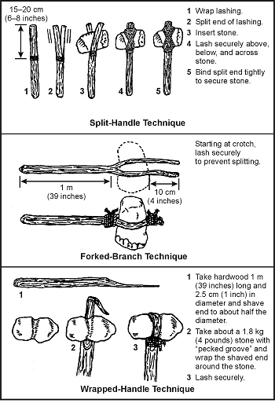

**Фігура 12-1. Прив'язування дубин**

**ДУБИНА НА ПІДВІСІ / СЛІНГ-КЛУБ (SLING CLUB)**

Слінг-клуб — це інший тип обтяженої дубини. Вантаж звисає на 8–10 сантиметрів (3–4 дюйми) від ручки за допомогою міцної, гнучкої прив'язки ([Фігура 12-2](#fig12-2)). Цей тип дубини як розширює радіус дії користувача, так і множить силу удару.

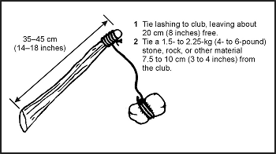

**Фігура 12-2. Слінг-клуб**

### КОЛЮЧО-РІЖУЧА ЗБРОЯ (EDGED WEAPONS)

Ножі, леза списів та наконечники стріл підпадають під категорію колючо-ріжучої зброї. Наступні абзаци пояснюють, як виготовити таку зброю.

**НОЖІ (KNIVES)**

Ніж має три базові функції. Він може колоти, рубати або різати, а також розрізати. Ніж також є безцінним інструментом, що використовується для створення інших предметів виживання. Ви можете опинитися без ножа або вам може знадобитися інший тип ножа чи списа. Для імпровізації ви можете використовувати камінь, кістку, дерево або метал для виготовлення ножа або леза списа.

**Камінь**

Щоб зробити кам'яний ніж, вам знадобиться шматок каменя з гострим краєм, інструмент для оббивання (chipping tool) та інструмент для сколювання (flaking tool). Інструмент для оббивання — це легкий тупоконечний інструмент, що використовується для відколювання невеликих шматочків каменя. Інструмент для сколювання — це загострений інструмент, що використовується для відколювання тонких, ущільнених шматочків каменя. Ви можете зробити інструмент для оббивання з дерева, кістки або металу, а інструмент для сколювання — з кістки, рогових відростків або м'якого заліза ([Фігура 12-3](#fig12-3)).

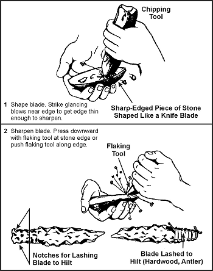

**Фігура 12-3. Виготовлення кам'яного ножа**

Почніть виготовлення ножа з грубого накидання бажаної форми на вашому гострому шматку каменя за допомогою інструменту для оббивання. Намагайтеся зробити ніж досить тонким. Потім притисніть інструмент для сколювання до країв. Ця дія призведе до відколювання лусочок з протилежного боку краю, залишаючи бритвено-гострий край. Використовуйте інструмент для сколювання вздовж усієї довжини краю, який потрібно загострити. Зрештою, ви отримаєте дуже гостру ріжучу кромку, яку можна використовувати як ніж.

Прив'яжіть лезо до рукоятки (hilt) ([Фігура 12-3](#fig12-3)).

**ПРИМІТКА:** Камінь робить чудовий інструмент для колення та хороший рубальний інструмент, але він не тримає тонкий край. Деякі камені, такі як кремінь (chert) або кремінь (flint), можуть мати дуже гострі краї.

**Кістка**

Ви також можете використовувати кістку як ефективну імпровізовану колючо-ріжучу зброю. По-перше, вам потрібно вибрати відповідну кістку. Найкраще підходять більші кістки, такі як кістка ноги оленя чи іншої тварини середнього розміру. Покладіть кістку на інший твердий предмет. Розбийте кістку, вдаривши її важким предметом, наприклад каменем. З осколків виберіть відповідний загострений уламок. Ви можете далі сформувати та загострити цей уламок, потерши його об шорстку гірську породу. Якщо шматок занадто малий для зручного тримання, ви все одно можете використовувати його, додавши ручку. Виберіть підходящий шматок твердої деревини для ручки і надійно прив'яжіть до нього осколок кістки.

**ПРИМІТКА:** Використовуйте кістяний ніж лише для колення. Він не триматиме край і може луснути або зламатися при іншому використанні.

**Дерево**

Ви можете виготовити імпровізовані колючо-ріжучі інструменти з деревини. Використовуйте їх лише для колення. Бамбук — єдине дерево, яке утримуватиме придатний край. Щоб зробити ніж з дерева, спершу виберіть прямошарову тверду деревину довжиною близько 30 сантиметрів (12 дюймів) і діаметром 2,5 сантиметра (1 дюйм). Сформуйте лезо довжиною близько 15 сантиметрів (6 дюймів). Зістругайте його до вістря. Використовуйте лише прямошарові частини деревини. Не використовуйте серцевину (core or pith), оскільки це створить слабке місце.

Загартуйте вістря за допомогою процесу, відомого як вогневе загартування (fire hardening). Якщо вогонь можливий, повільно висушіть частину леза над вогнем, доки вона злегка не обвуглиться. Чим сухіше дерево, тим твердіше вістря. Після легкого обвуглювання частини леза загостріть її на грубому камені. Якщо використовується бамбук, після формування леза видаліть іншу деревину, щоб зробити лезо тоншим із внутрішньої частини бамбука. Видалення виконується таким чином, оскільки найтвердішою частиною бамбука є його зовнішній шар. Зберігайте якомога більшу частину цього шару, щоб забезпечити максимально тверде лезо. Обвуглюючи бамбук над вогнем, обвуглюйте лише внутрішню деревину; не обвуглюйте зовнішню.

**Метал**

Метал є найкращим матеріалом для виготовлення імпровізованих колючо-ріжучих інструментів. Метал при правильному проектуванні може виконувати три функції ножа — колоти, різати або рубати, та розрізати. По-перше, виберіть відповідний шматок металу, який найбільше нагадує бажаний кінцевий продукт. Залежно від розміру та початкової форми, ви можете отримати вістря та ріжучу кромку, потерши метал об шорсткий камінь. Якщо метал достатньо м'який, ви можете вибити край, поки метал холодний. Використовуйте відповідну плоску тверду поверхню як ковадло та менший твердий предмет з каменю чи металу як молоток, щоб вибити край. Зробіть ручку ножа з дерева, кістки чи іншого матеріалу, який захистить вашу руку.

**Інші матеріали**

Ви можете використовувати інші матеріали для виготовлення колючо-ріжучої зброї. Скло є хорошою альтернативою колючо-ріжучій зброї чи інструменту, якщо інші матеріали недоступні. Отримайте підходящий шматок так само, як описано для кістки. Скло має природний край, але воно менш довговічне для важкої роботи. Ви також можете загострити пластик — якщо він достатньо товстий або твердий — у міцне вістря для колення.

**ЛЕЗА СПИСІВ (SPEAR BLADES)**

Щоб зробити списи, використовуйте ті самі процедури виготовлення леза, що й для виготовлення леза ножа. Потім виберіть держак (прямий пагін) довжиною 1,2–1,5 метра (4–5 футів). Довжина повинна дозволяти вам легко та ефективно керувати списом. Прикріпіть лезо списа до держака за допомогою прив'язки (lashing). Переважний метод — розколоти держак, вставити лезо, а потім міцно обмотати або прив'язати його. Ви можете використовувати інші матеріали без додавання леза. Виберіть прямий держак з твердої деревини довжиною 1,2–1,5 метра (4–5 футів) і зведіть один кінець на вістря. По можливості загартуйте вістря вогнем. Бамбук також робить чудовий спис. Виберіть шматок довжиною 1,2–1,5 метра (4–5 футів). Починаючи з відстані 8–10 сантиметрів (3–4 дюйми) від кінця, що використовується як вістря, зріжте кінець під кутом 45 градусів ([Фігура 12-4](#fig12-4)). Пам'ятайте, щоб загострити краї, зрізуйте лише внутрішню частину.

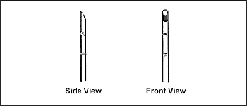

**Фігура 12-4. Бамбуковий спис**

**НАКОНЕЧНИКИ СТРІЛ (ARROW POINTS)**

Щоб зробити наконечник стріли, використовуйте ті самі процедури для виготовлення леза кам'яного ножа. Кремній, кремінь та черепашкові камені найкраще підходять для наконечників стріл. Ви можете сформувати кістку подібно до каменю — шляхом сколювання. Ви можете зробити ефективний наконечник стріли за допомогою битого скла.

### IНША ІМПРОВІЗОВАНА ЗБРОЯ (OTHER EXPEDIENT WEAPONS)

Ви можете виготовити іншу польову зброю, таку як метальна палиця, лук та стріли (archery equipment) та болас. Наступні абзаци пояснюють, як їх зробити.

**МЕТАЛЬНА ПАЛИЦЯ (THROWING STICK)**

Метальна палиця, яку зазвичай називають кролячою палицею (rabbit stick), дуже ефективна проти дрібної дичини (білок, бурундуків та кроликів). Сама кроляча палиця — це тупа палиця, природно вигнута приблизно під кутом 45 градусів. Виберіть палицю з бажаним кутом з важкої твердої деревини, такої як дуб. Зістружте два протилежні боки так, щоб палиця була пласкою, як бумеранг ([Фігура 12-5](#fig12-5)). Ви повинні потренувати техніку кидання для точності та швидкості. По-перше, вирівняйте ціль, витягнувши некидальну руку на лінії з середньою та нижньою частиною цілі. Повільно і неодноразово піднімайте руку для кидання вгору і назад, доки метальна палиця не перетне спину приблизно під кутом 45 градусів або не буде на лінії з некидальним степом. Виведіть руку для кидання вперед, доки вона не опиниться трохи вище і паралельно некидальній руці. Це буде точка випуску метальної палиці. Практикуйтеся повільно і неодноразово для досягнення точності.

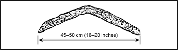

**Фігура 12-5. Кроляча палиця**

**ЛУК ТА СТРІЛИ (ARCHERY EQUIPMENT)**

Ви можете зробити лук і стрілу ([Фігура 12-6](#fig12-6)) з матеріалів, доступних у вашому районі виживання. Щоб зробити лук, використовуйте процедуру, описану в [Розділі Їжа](Food).

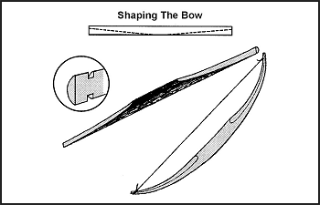

**Фігура 12-6. Спорядження для стрільби з лука**

Хоча виготовлення лука та стріли може бути відносно простим, користуватися ними непросто. Ви повинні тренуватися тривалий час, щоб бутиreasonably впевненим, що ви влучите в ціль. Також імпровізований лук прослужить недовго, перш ніж вам доведеться робити новий. За витрачений час і зусилля ви цілком можете вирішити використовувати інший тип імпровізованої зброї.

**БОЛАС (BOLA)**

Болас — це ще одна імпровізована зброя, яку легко зробити ([Фігура 12-7](#fig12-7)). Вона особливо ефективна для захоплення бігаючої дичини або низько літаючої птиці у зграї. Щоб використовувати болас, тримайте його за центральний вузел і крутіть над головою. Відпустіть вузел так, щоб болас летів до вашої цілі. Коли ви відпускаєте болас, обтяжені шнури розділяться. Ці шнури обгорнуться навколо і знеруховлять птицю або тварину, в яку ви влучите.

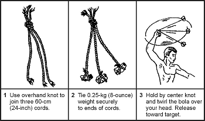

**Фігура 12-7. Болас**

### МОТУЗКИ ТА ЗВ'ЯЗУВАННЯ (CORDAGE AND LASHING)

Багато матеріалів достатньо міцні для використання як мотузки та зав'язки (lashing). У ситуації виживання доступні як природні, так і штучні матеріали. Наприклад, ви можете зробити бавовняний ремінь набагато кориснішим, розпустивши його. Потім ви можете використовувати нитку для інших цілей (рибальська волосінь, нитка для шиття та в'язка).

**ВИБІР ПРИРОДНИХ МОТУЗОК (NATURAL CORDAGE SELECTION)**

Перед виготовленням мотузок ви можете виконати кілька простих тестів, щоб визначити придатності вашого матеріалу. По-перше, потягніть за шматок матеріалу, щоб перевірити міцність. Потім скрутіть його між пальцями і змотайте волокна разом. Якщо він витримує це поводження і не розривається, зав'яжіть простий вузел волокнами і обережно затягніть. Якщо вузел не рветься, матеріал придатний для використання. [Фігура 12-8](#fig12-8) показує різні методи виготовлення мотузок.

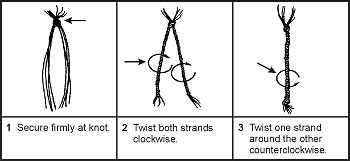

**Фігура 12-8. Виготовлення ліній з рослинних волокон**

**МАТЕРІАЛ ДЛЯ ЗВ'ЯЗУВАННЯ (LASHING MATERIAL)**

Найкращим природним матеріалом для зв'язування невеликих предметів є сухожилля (sinew). Ви можете зробити сухожилля з сухожиль великої дичини, такої як олень. Вийміть сухожилля з дичини і повністю висушіть їх. Роздавіть висушені сухожилля так, щоб вони розпалися на волокна. Зволожте волокна і скрутіть їх у безперервний пасмо. Якщо вам потрібен міцніший матеріал для в'язки, ви можете сплести пасма в косу. Коли ви використовуєте сухожилля для невеликих в'язок, вузли не потрібні, оскільки зволожене сухожилля липке і твердне при висиханні.

Ви можете подрібнити та заплетені рослинні волокна з внутрішньої кори деяких дерев, щоб зробити шнур. Ви можете використовувати липу, в'яз, гікорі, білий дуб, шовковицю, каштан, а також червоний і білий кедр. Після виготовлення шнура перевірте його, щоб переконатися, що він достатньо міцний для вашої мети. Ви можете зробити ці матеріали міцнішими, сплітаючи кілька пасом разом.

Ви можете використовувати сирицю (rawhide) для більших завдань із в'язки. Зробіть сирицю зі шкіри дичини середнього або великого розміру. Знявши шкіру з тварини, видаліть надлишок жиру та будь-які шматочки м'яса зі шкіри. Повністю висушіть шкіру. Її не потрібно розтягувати, доки немає складок для затримання вологи. Вам не потрібно видаляти шерсть зі шкіри. Наріжте шкіру, поки вона суха. Зробіть смужки шириною близько 6 міліметрів (1/4 дюйма). Почніть з центру шкури і зробіть один неперервний круговий розріз, рухаючись за годинниковою стрілкою до зовнішнього краю шкури. Замочіть сирицю на 2–4 години або до м'якості. Використовуйте її вологою, розтягуючи якомога сильніше при нанесенні. Вона буде міцною і довговічною після висихання.

### ВИГОТОВЛЕННЯ РЮКЗАКІВ (BACKPACK CONSTRUCTION)

Матеріали для будівництва рюкзака практично необмежені. Ви можете використовувати дерево, бамбук, мотузку, рослинні волокна, одяг, шкури тварин, брезент та багато інших матеріалів для виготовлення рюкзака.

Існує кілька технічних прийомів виготовлення рюкзаків. Багато з них дуже складні, але ті, що прості та легкі, часто найлегше виготовити в ситуації виживання.

**ПІДКОВКОПОДІБНИЙ РЮКЗАК (HORSESHOE PACK)**

Цей рюкзак простий у виготовленні та використанні, і відносно зручний для перенесення на одному плечі. Покладіть наявний квадратний матеріал, такий як пончо, ковдра чи брезент, пласко на землю. Покладіть предмети на один край матеріалу. Зігніть тверді предмети. Згорніть матеріал (з предметами) до протилежного краю і надійно зав'яжіть обидва кінці. Додайте додаткові зав'язки уздовж довжини згортка. Ви можете перекинути рюкзак через одне плече за допомогою мотузки, що з'єднує два кінці ([Фігура 12-9](#fig12-9)).

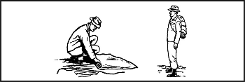

**Фігура 12-9. Підковкоподібний рюкзак**

**КВАДРАТНИЙ РЮКЗАК (SQUARE PACK)**

Цей рюкзак легко сконструювати, якщо доступна мотузка або шнур. Інакше ви повинні спочатку виготовити мотузку. Щоб зробити цей рюкзак, створіть квадратну раму з бамбука, гілок чи паличок. Розмір варіюватиметься для кожної людини та кількості перенесеного спорядження ([Фігура 12-10](#fig12-10)).

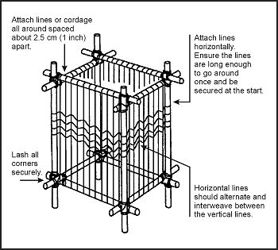

**Фігура 12-10. Квадратний рюкзак**

### ОДЯГ ТА ІЗОЛЯЦІЯ (CLOTHING AND INSULATION)

Ви можете використовувати багато матеріалів для одягу та ізоляції. Доступні як штучні матеріали, такі як парашути, так і природні матеріали, такі як шкури та рослинні матеріали, які пропонують значний захист.

**ПАРАШУТНА ЗБІРКА (PARACHUTE ASSEMBLY)**

Розглядайте весь парашутний комплект як ресурс. Використовуйте кожну частину матеріалу та обладнання, включаючи купол, стропи, з'єднувальні застібки та підвісну систему парашута. Перед розбиранням парашута врахуйте всі свої вимоги щодо виживання та сплануйте використання різних частин парашута відповідно. Наприклад, враховуйте вимоги до укриття, потребу в рюкзаку та будь-які додаткові потреби в одязі чи ізоляції.

**ШКУРИ ТВАРИН (ANIMAL SKINS)**

Вибір шкур тварин у ситуації виживання найчастіше обмежуватиметься тим, що вам вдасться зловити в пастку або вполювати. Проте, якщо є велика кількість дичини, вибирайте шкури більших тварин з важчими хутрами та великим вмістом жиру. Не використовуйте шкури заражених або хворих тварин, якщо це можливо. Живучи в дикій природі, тварини є переносниками шкідників, таких як кліщі, воші та бліхи. Через цих шкідників використовуйте воду для ретельного очищення будь-якої шкури, отриманої від будь-якої тварини. Якщо вода недоступна, принаймні ретельно витрусіть шкуру. Як і з сирицею, розстебніть шкуру та видаліть весь жир і м'ясо. Повністю висушіть шкуру. Використовуйте ділянки суглобів задніх кінцівок для виготовлення взуття, рукавиць чи шкарпеток. Носіть шкуру хутром всередину для забезпечення ізоляційного фактора.

**РОСЛИННІ ВОЛОКНА (PLANT FIBERS)**

Кілька рослин є джерелами ізоляції від холоду. Рогоз — це болотна рослина, що росте вздовж озер, ставків та заводь річок. Пух на верхівках стекол утворює простір мертвого повітря і створює хорошу подібну до пуху ізоляцію при поміщенні між двома шматочками матеріалу. Молочай має подібні до пилку насіння, які діють як хороша ізоляція. Волокна лушпиння кокосів дуже хороші для плетіння мотузок і після висушування є чудовим трутом та ізоляцією.

### ПОСУД ДЛЯ ПРИГОТУВАННЯ ТА ЇЖІ (COOKING AND EATING UTENSILS)

Ви можете використовувати багато матеріалів для виготовлення обладнання для приготування, вживання та зберігання їжі. Зазвичай усі матеріали можуть служити певній меті в ситуації виживання.

**Миски (Bowls)**

Використовуйте дерево, кістку, ріг, кору чи інший подібний матеріал для виготовлення мисок. Щоб зробити дерев'яні миски, використовуйте видовбаний шматок дерева, який утримає вашу їжу та достатньо води для її приготування. Підвісьте дерев'яний контейнер над вогнищем і додайте гаряче каміння до води та їжі. Виймайте каміння у міру його охолодження і додавайте більше гарячого каміння, поки їжа не звариться.

> **УВАГА**
> 
> Не використовуйте каміння з повітряними кишенями, таке як вапняк та піщаник. Вони можуть вибухнути при нагріванні у вогнищі.

Ви також можете використовувати цей метод з контейнерами з кори чи листя. Проте ці контейнери горять вище ватерлінії, якщо ви не тримаєте їх вологими або не тримаєте вогонь низьким.

Секція бамбука також дуже добре підходить для приготування їжі. Переконайтеся, що ви вирізали секцію між двома запечатаними вузлами ([Фігура 12-11](#fig12-11)).

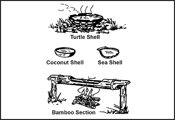

**Фігура 12-11. Контейнери для кип'ятіння їжі**

> **УВАГА**
> 
> Запечатана секція бамбука вибухне при нагріванні через застрягле повітря та воду в секції.

**Виделки, ножі та ложки (Forks, Knives, and Spoons)**

Вирізуйте виделки, ножі та ложки з надеревинних (несмолистих) порід дерева, щоб не отримати смолистий присмак і не зіпсувати їжу. Несмолисті дерева включають дуб, березу та інші листяні дерева.

**ПРИМІТКА:** Не використовуйте ті дерева, які виділяють сироп або смолоподібну рідину на корі або при зрізанні.

**Каструлі (Pots)**

Ви можете виготовляти каструлі з черепах або дерева. Як описано для мисок, використання гарячого каміння у видовбаному шматку дерева є дуже ефективним. Бамбук є найкращим деревом для виготовлення посуду для приготування їжі.

Щоб використовувати черепашачі панцирі, спочатку ретельно прокип'ятіть верхню частину панцира. Потім використовуйте її для нагрівання їжі та води над полум'ям ([Фігура 12-11](#fig12-11)).

**Пляшки для води (Water Bottles)**

Робіть пляшки для води зі шлунків більших тварин. Ретельно промийте шлунок водою, потім зав'яжіть низ. Залиште верх відкритим з якимось способом закріплення в закритому стані.
