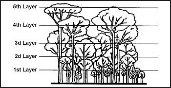

> Більшість людей думають про тропіки як про величезний і загрозливий тропічний дощовий ліс, крізь який кожен зроблений крок доводиться вирубувати, і де кожен дюйм шляху кишить небезпекою. Насправді понад половина землі в тропіках якось обробляється.
> 
> Знання польових навичок, здатність імпровізувати та застосування принципів виживання збільшать перспективи виживання. Не бійтеся бути самотнім у джунглях; страх призведе до паніки. Паніка призведе до виснаження і зменшить ваші шанси на виживання.
> 
> Усе в тропіках процвітає, включаючи хвороботворні мікроби та паразити, які розмножуються з тривожною швидкістю. Природа забезпечить водою, їжею та безліччю матеріалів для побудови укриттів.
> 
> Корінні народи жили тисячоліттями завдяки полюванню та збиральництву. Проте сторонній людині знадобиться деякий час, щоб звикнути до умов та безперервної активності тропічного виживання.

### ТРОПІЧНА ПОГОДА

Високі температури, рясні опади та гнітюча вологість характеризують екваторіальні та субтропічні регіони, за винятком великих висот. На низьких висотах коливання температури рідко становить менше 10 градусів Цельсія (50 градусів Фаренгейта) і часто перевищує 35 градусів Цельсія (95 градусів Фаренгейта). На висотах понад 1500 метрів (4921 фут) вночі часто утворюється лід. Дощ має охолоджувальний ефект, але коли він припиняється, температура стрімко зростає.

Опади рясні, часто з грозами та блискавками. Раптовий дощ б'є по кронах дерев, перетворюючи струмочки на бурхливі потоки і спричиняючи підняття річок. Так само раптово дощ припиняється. Можуть виникати бурхливі шторми, зазвичай ближче до кінця літніх місяців.

Урагани, циклони та тайфуни розвиваються над морем і несуться на сушу, спричиняючи цунамі (приливні хвилі) та руйнування на березі. Обираючи місця для табору, переконайтеся, що ви перебуваєте вище потенційного затоплення. Панівні вітри відрізняються взимку та влітку. У сухий сезон дощ іде раз на день, а в мусон — дощі тривають постійно. У Південно-Східній Азії вітри з Індійського океану приносять мусон, але район сухий, коли вітер дме з материкової частини Китаю.

Тропічні день і ніч однакової довжини. Темрява настає швидко, а світанок такий же раптовий.

### ТИПИ ДЖУНГЛІВ

Не існує стандартних джунглів. Тропічний район може бути будь-яким із наступного:

* Дощові ліси (Rain forests).
* Вторинні джунглі.
* Напіввічнозелені сезонні та мусонні ліси.
* Чагарникові та колючі ліси.
* Савани.
* Солоноводні болота.
* Прісноводні болота.

**ТРОПІЧНІ ДОЩОВІ ЛІСИ**

Клімат мало змінюється в дощових лісах. Ви знайдете ці ліси через екватор в басейнах Амазонки та Конго, частинах Індонезії та кількох тихоокеанських островах. Протягом року випадає до 3,5 метрів (12 футів) опадів. Температури коливаються від приблизно 32 градусів Цельсія (90 градусів Фаренгейта) вдень до 21 градуса Цельсія (70 градусів Фаренгейта) вночі.

У цьому лісі є п'ять шарів рослинності ([Фігура 14-1](#fig14-1)). Там, де людина їх не торкалася, дерева джунглів піднімаються від коренів-конфортів на висоту до 60 метрів (198 футів). Під ними менші дерева утворюють настільки густий навіс (полог), що на підлогу джунглів потрапляє мало світла. Під ними сходами пробиваються сіянці до світла, а маси ліан та в'юнких рослин обвиваються вгору до сонця. Папороті, мохи та трав'янисті рослини пробиваються крізь товстий килим листя, а велика різноманітність грибів росте на листі та впалих стовбурах дерев.

**Фігура 14-1. П'ять шарів рослинності тропічного дощового лісу**

Через нестачу світла на підлозі джунглів підлісок майже не перешкоджає пересуванню, але густий ріст обмежує видимість приблизно до 50 метрів (165 футів). У цих джунглях можна легко втратити відчуття напрямку, і літакам надзвичайно важко вас побачити.

**ВТОРИННІ ДЖУНГЛІ**

Вторинні джунглі дуже схожі на дощові ліси. Проліфікуючий ріст, де сонячне світло проникає на підлогу джунглів, характеризує цей тип лісу. Такий ріст відбувається переважно уздовж берегів річок, на околицях джунглів і там, де людина розчистила дощовий ліс. При закиданні переплетені маси рослинності швидко відвойовують ці культивовані ділянки. Серед цієї рослинності часто можна знайти культивовані харчові рослини.

**НАПІВВІЧНОЗЕЛЕНІ СЕЗОННІ ТА МУСОННІ ЛІСИ**

Характеристики американських та африканських напіввічнозелених сезонних лісів відповідають характеристикам азіатських мусонних лісів. Характеристики такі:

* Їхні дерева поділяються на два яруси деревних ярусів. Дерева верхнього ярусу коливаються від 18 до 24 метрів (60–79 футів); нижнього — від 7 до 13 метрів (23–43 фути).
* Діаметр дерев в середньому становить 0,5 метра (2 фути).
* Їхнє листя опадає під час сезонної посухи.

За винятком сагової, ніпи та кокосових пальм, у цих районах ростуть ті ж їстівні рослини, що й у тропічних дощових лісах.

Ви знайдете ці ліси в частинах Колумбії та Венесуели і басейну Амазонки в Південній Америці; в частинах північно-східного прибережного узбережжя Кенії, Танзанії та Мозамбіку в Африці; у північно-східній Індії, більшій частині Бірми, Таїланду, Індокитаю, Яви та частинах інших індонезійських островів в Азії.

**ТРОПІЧНІ ЧАГАРНИКОВІ ТА КОЛЮЧІ ЛІСИ**

Головні характеристики тропічних чагарникових та колючих лісів:

* Існує чітко виражений сухий сезон.
* Дерева безлисті під час сухого сезону.
* Земля гола, за винятком кількох пучкових рослин пучками; трави зустрічаються рідко.
* Переважають рослини з колючками.
* Часто трапляються пожежі.

Ви знайдете тропічні чагарникові та колючі ліси на західному узбережжі Мексики, півострові Юкатан, Венесуелі та Бразилії; на північно-західному узбережжі та центральних частинах Африки; а також у Туркестані та Індії в Азії.

У межах тропічних чагарникових та колючих лісових районів вам буде важко отримати харчові рослини під час сухого сезону. У сезон дощів рослини значно рясніші.

**ТРОПІЧНІ САВАНИ**

Загальні характеристики савани полягають у тому, що вона:

* Зустрічається в тропічних зонах Південної Америки та Африки.
* Виглядає як широка трав'яниста лука з деревами, розташованими на широких інтервалах.
* Часто має червоний ґрунт.
* Ростить розсіяні дерева, які зазвичай здаються карликовими та покрученими, як яблуня. Пальми також ростуть у саванах.

Ви знайдете савани в частинах Венесуели, Бразилії та Гвіани в Південній Америці. В Африці ви знайдете їх у південній Сахарі (північно-центральний Камерун і Габон та південний Судан), Беніні, Того, більшій частині Нігерії, північно-східній Республіці Конго, північній Уганді, західній Кенії, частині Малаві, частині Танзанії, південному Зімбабве, Мозамбіку та західному Мадагаскарі.

**СОЛОНОводні БОЛОТА (SALTWATER SWAMPS)**

Солоноводні болота поширені в прибережних районах, що підлягають приливним затопленням. Мангрові дерева процвітають у цих болотах. Мангрові дерева можуть досягати висоти 12 метрів (39 футів). Їхнє переплетене коріння є перешкодою для пересування. Вивидимість у цьому типі болота погана, а пересування надзвичайно важке. Іноді струмки, якими можна сплавлятися на плотах, утворюють канали, але зазвичай ви мусите пересуватися пішки через це болото.

Ви знайдете солоноводні болота в Західній Африці, Мадагаскарі, Малайзії, тихоокеанських островах, Центральній та Південній Америці, а також у гирлі річки Ганг в Індії. Болота в гирлах річок Оріноко та Амазонка і річок Гаяни складаються з бруду та дерев, які пропонують мало тіні. Припливи в солоноводних болотах можуть змінюватися до 12 метрів (3 футів).

Усе в солоноводному болоті може здаватися вам ворожим, від п'явок та комах до крокодилів і кайманчиків. Уникайте небезпечних тварин у цьому болоті.

Уникайте цього болота зовсім, якщо можете. Якщо через нього є водні канали, ви можете використати пліт для втечі.

**ПРІСНОВОДНІ БОЛОТА (FRESHWATER SWAMPS)**

Ви знайдете прісноводні болота в низинних внутрішніх районах. Їхніми характеристиками є маси колючого підліску, очерету, трав та випадкові короткі пальми, які зменшують видимість і ускладнюють подорож. Ці болота часто всіяні островами, що дозволяє вам вибратися з води. Дика природа в цих болотах рясна.

### ПОДОРОЖ ЧЕРЕЗ РАЙОНИ ДЖУНГЛІВ

З практикою пересування крізь густий підлісок та джунглі можна виконувати ефективно. Завжди носіть сорочки з довгим рукавом, щоб уникнути порізів та подряпин.

Щоб легко пересуватися, ви повинні розвинути «око джунглів», тобто ви не повинні концентруватися на візерунку кущів і дерев безпосередньо перед собою. Ви повинні фокусуватися на джунглях далі й знаходити природні розриви в листі. Дивіться *крізь* джунглі, а не на них. Зупиняйтеся і присідайте час від часу, щоб подивитися вздовж підлоги джунглів. Ця дія може виявити сліди дичини, якими ви можете слідувати.

Залишайтеся напоготові і рухайтеся повільно та стабільно крізь густий ліс або джунглі. Періодично зупиняйтеся, щоб прислухатися і визначити своє положення. Використовуйте мачете, щоб прорізати густу рослинність, але не ріжте без необхідності, інакше ви швидко втомитеся. Якщо ви використовуєте мачете, робіть рух вгору при зрізанні ліан, щоб зменшити шум, оскільки звук розноситься на великі відстані в джунглях. Використовуйте палицю, щоб розсовувати рослинність. Використання палиці також допоможе скинути кусачих мурах, павуків чи змій. **Не хапайтеся** за кущі чи ліани під час підйому на схили; вони можуть мати подразнюючі колючки або гострі шипи.

Багато тварин джунглів та лісу слідують стежками дичини. Ці стежки звиваються і перетинаються, але часто ведуть до води чи галявин. Використовуйте ці стежки, якщо вони ведуть у вашому бажаному напрямку руху.

У багатьох країнах електричні та телефонні лінії проходять милями через малонаселені райони. Зазвичай смуга відчуження достатньо вільна, щоб дозволити легке пересування. Пересуваючись цими лініями, будьте обережні при наближенні до трансформаторних та релейних станцій. У ворожій території вони можуть охоронятися.

Пересування через джунглі або густу рослинність вимагає від вас постійної пильності та усвідомлення свого оточення. Наступні поради щодо подорожей допоможуть вам досягти успіху:

* Визначте своє початкове місце розташування якомога точніше, щоб визначити загальну лінію руху до безпеки. Якщо у вас немає компаса, використовуйте польовий метод визначення напрямку.
* Оцініть запаси води та спорядження.
* Рухайтеся в одному напрямку, але не обов'язково по прямій лінії. Уникайте перешкод. У ворожій території використовуйте природні укриття та маскування.
* Рухайтеся плавно крізь джунглі. Не продирайтеся крізь них напролом, оскільки ви отримаєте багато порізів і подряпин. Повертайте плечі, зміщуйте стегна, згинайте тіло і вкорочуйте або подовжуйте крок за необхідності, щоб прослизнути між підліском.

### НЕГАЙНІ МІРКУВАННЯ

Імовірність вашого порятунку з-під густого пологу джунглів менша, ніж у інших ситуаціях виживання. Вам, ймовірно, доведеться подорожувати, щоб дістатися до безпеки.

Якщо ви стали жертвою авіакатастрофи, найважливішими предметами, які варто взяти з собою з місця аварії, є мачете, компас, аптечка першої допомоги, парашут або інший матеріал для використання як москітної сітки та укриття.

Захистіться від тропічного дощу, сонця та комах. Комахи, що переносять малярію, та інші комахи є небезпекою, тому захищайте себе від укусів.

Не залишайте зону аварії без ретельного маркування або позначення вашого маршруту. Використовуйте компас. Знайте, у якому напрямку ви рухаєтеся.

У тропіках навіть найменший подряпина може швидко стати небезпечно інфікованою. Негайно лікуйте будь-яку рану, якою б незначною вона не здавалася.

### ЗДОБУТТЯ ВОДИ

Хоча вода рясна в більшості тропічних середовищ, у вас можуть виникнути труднощі з її пошуком. Якщо ви знайдете воду, вона може бути непридатною для пиття. Деякі з багатьох джерел — це ліани, коріння, пальми та конденсат. Ви іноді можете йти за тваринами до води. Часто ви можете отримати майже чисту воду з каламутних струмків або озер, викопавши яму в піщаному ґрунті приблизно на 1 метр (3 фути) від берега. Вода просочуватиметься в яму. Ви повинні очистити будь-яку воду, отриману таким чином.

**ТВАРИНИ — ОЗНАКИ ВОДИ**

Тварини часто можуть привести вас до води. Більшість тварин регулярно потребують води. Травоїдні тварини, такі як олені, зазвичай ніколи не бувають далеко від води і зазвичай п'ють на світанку та заході сонця. Стежки дичини, що сходяться, часто ведуть до води. Хижаки (м'ясоїдні) не є надійними індикаторами води. Вони отримують вологу від тварин, якими харчуються, і можуть обходитися без води тривалий час.

Птахи іноді також можуть привести вас до води. Зерноїди, такі як вівсянки та голуби, ніколи не бувають далеко від води. Вони п'ють на світанку та заході сонця. Коли вони летять прямо і низько, вони прямують до води. Повертаючись від води, вони ситі і летять з дерева на дерево, часто відпочиваючи. Не покладайтеся на водяних птахів, які приведуть вас до води. Вони літають на великі відстані без зупинок. Яструби, орли та інші хижі птахи отримують рідину від своїх жертв; ви не можете використовувати їх як індикатор води.

Комахи, особливо бджоли, можуть бути хорошими індикаторами води. Бджоли рідко відлітають далі ніж на 6 кілометрів (4 милі) від своїх гніздівель або вуликів. У цьому діапазоні вони зазвичай мають джерело води. Мурахи потребують води. Колона мурах, що марширує вгору по дереву, прямує до невеликого резервуару затриманої води. Ви знайдете такі резервуари навіть в аридних районах. Більшість мух, особливо європейська мух-муляр (mason fly), тримаються в межах 100 метрів (330 футів) від води. Цю муху легко впізнати за її райдужним зеленим тілом.

Сліди людини зазвичай ведуть до колодязя, бурильної свердловини або джерела (soak). Чагарник або каміння можуть покривати його для зменшення випаровування. Замініть покриття після використання.

**ВОДА — З РОСЛИН**

Ви зустрічатимете багато типів рослинності в ситуації виживання залежно від вашого району. Рослини, такі як ліани, коріння та пальми, є хорошими джерелами води.

**Ліани**

Ліани з шорсткою корою та пагонами товщиною близько 5 сантиметрів (2 дюйми) можуть бути корисним джерелом води. Ви повинні дізнатися з досвіду, які з них є водоносними, оскільки не всі мають питну воду. Деякі можуть навіть мати отруйний сік. Отруйні дають липкий, молочний сік при зрізанні. Неотруйні дадуть чисту рідину. Деякі ліани викликають подразнення шкіри при контакті; тому дозвольте рідині капати у ваш рот, а не прикладайте рот до ліани. Бажано використовуйте якийсь контейнер. Використовуйте процедуру, описану в [Розділі Вода](Water), щоб отримати воду з ліани.

**Коріння**

В Австралії водне дерево, пустельний дуб та дерево крові (_bloodwood_) мають коріння біля поверхні. Викорініть це коріння з землі та поріжте його на відрізки по 30 сантиметрів (1 фут). Зніміть кору і висмокчіть вологу або зітріть корінь до м'якоті і вичавіть її собі в рот.

**Пальми**

Бурі, кокосова та ніпа пальми містять цукристу рідину, яка дуже приємна на смак. Щоб отримати рідину, зігніть квітучу гілку однієї з цих пальм вниз і зріжте її кінчик. Якщо ви зрізаєте тонкий зріз з гілки кожні 12 годин, потік відновлюватиметься, що дозволить збирати до літра на день. Пагони пальми ніпа ростуть від основи, так що ви можете працювати на рівні землі. На дорослих деревах інших видів вам, можливо, доведеться піднятися на них, щоб дістатися до квітучої гілки. Молоко з кокосів має великий вміст води, але в стиглих горіхах може містити сильний проносний засіб. Вживання занадто великої кількості цього молока може призвести до втрати рідини більшої, ніж ви випили.

**ВОДА — З КОНДЕНСАТУ**

Часто для цього потрібно занадто багато зусиль, щоб копати в пошуках коріння, що містить воду. Може бути легше дозволити рослині виробляти воду для вас у формі конденсату. Прив'язування чистого поліетиленового пакета навколо зеленої листяної гілки змусить воду в листі випаровуватися і конденсуватися в пакеті. Поміщення зрізаної рослинності в поліетиленовий пакет також призведе до утворення конденсату. Це сонячний дистилятор ([Розділ Вода](Water)).

### ЇЖА

Їжа зазвичай рясна в тропічній ситуації виживання. Щоб здобути тваринну їжу, використовуйте процедури, описані в [Розділі Їжа](Food).

На додаток до тваринної їжі, вам доведеться доповнити свій раціон їстівними рослинами. Найкращі місця для збирання — це береги струмків і річок. Де б сонце не проникало в джунглі, там буде маса рослинності, але береги річок можуть бути найдоступнішими місцями.

Якщо ви слабкі, не витрачайте енергію на лазіння або зрубування дерева заради їжі. Ближче до землі є більш легко доступні джерела їжі. Не збирайте більше їжі, ніж вам потрібно. Їжа швидко псується в тропічних умовах. Залишайте їжу на рослині, що росте, доки вона вам не знадобиться, і їжте її свіжою.

Існує майже необмежена кількість їстівних рослин на вибір. Якщо ви не можете позитивно ідентифікувати ці рослини, спочатку може бути безпечніше почати з пальм, бамбука та звичайних фруктів.

### ОТРУЙНІ РОСЛИНИ

Частка отруйних рослин у тропічних регіонах не більша, ніж у будь-якому іншому районі світу. Проте може здатися, що більшість рослин у тропіках отруйні через велику щільність росту рослин у деяких тропічних районах.
