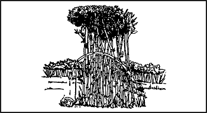
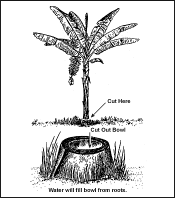
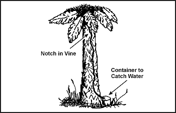
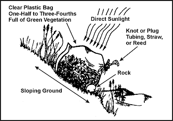
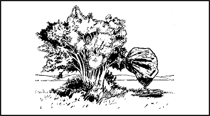
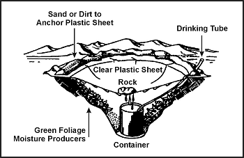
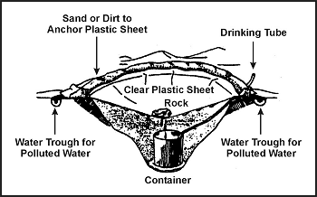
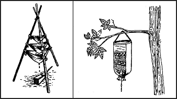

> Вода — одна з ваших найгостріших потреб у ситуації виживання. Ви не зможете прожити довго без неї, особливо в жарких районах, де ви швидко втрачаєте воду через потовиділення. Навіть у холодних районах вам потрібен мінімум 1 літр води щодня для підтримки ефективності.
> 
> Більше трьох чвертей вашого тіла складається з рідин. Ваше організм втрачає рідину через спеку, холод, стрес та навантаження. Щоб ефективно функціонувати, ви повинні поповнювати втрачену організмом рідину. Отже, одне з ваших першочергових завдань — отримати достатню кількість води.

### ДЖЕРЕЛА ВОДИ

Майже в будь-якому середовищі вода присутня певною мірою. Можливі джерела води в різних середовищах перелічені нижче. Також наведено інформацію про те, як зробити воду придатною для пиття.

**ПРИМІТКА:** Якщо у вас немає фляги, кухля, бляшанки чи іншого типу контейнера, імпровізуйте його з пластику або водостійкої тканини. Надайте пластику чи тканині форму миски, зробивши складки. Використовуйте шпильки чи інші придатні предмети — навіть власні руки, — щоб утримувати складки.

* **Холодні райони (фрігідні)**
  * **Сніг і лід**
    * **Спосіб отримання та/або очищення:** Розтопити та очистити.
    * **Примітки:** Не їжте нерозтопленим! Вживання снігу чи льоду може знизити температуру тіла і призвести до більшого зневоднення.
Сніг або лід не чистіші за воду, з якої вони походять.
Морський лід сірого кольору або непрозорий є солоним. Не використовуйте його без опріснення. Морський лід кристалічної структури з блакитним відтінком містить мало солі.
* **У відкритому морі**
  * **Море**
    * **Спосіб отримання та/або очищення:** Використовуйте опріснювач.
    * **Примітки:** Не пийте морську воду без опріснення!
* **Дощ**
  * **Спосіб отримання та/або очищення:** Збирайте дощ у тенти або інші ємності для води.
  * **Примітки:** Якщо тент або матеріал для збору води покритий солью, вимийте його в морі перед використанням (на ньому залишиться менше солі).
  * **Морський лід**
    * **Примітки:** Дивіться попередні примітки для холодних районів.
* **Пляж**
  * **Ґрунт**
    * **Спосіб отримання та/або очищення:** Викопайте яму достатньої глибини, щоб вода просочувалася; знайдіть каміння, розведіть вогонь і нагрійте каміння; киньте гаряче каміння у воду; тримайте тканину над ямою, щоб поглинати пару; витисніть воду з тканини.
    * **Примітки:** Альтернативний метод, якщо є контейнер або ємність з кори: Наповніть контейнер чи ємність морською водою; розведіть вогонь і прокип'ятіть воду для утворення пари; тримайте тканину над контейнером для поглинання пари; витисніть воду з тканини.
  * **Прісна вода**
    * **Спосіб отримання та/або очищення:** Викопайте позаду першої групи піщаних дюн. Це дозволить зібрати прісну воду.
* **Пустеля**
    * **Джерела води:**
      * У долинах та низинах
      * Біля підніжжя увігнутих берегів сухих річок
      * Біля підніжжя скель або виступів порід
      * У першому заглибленні за першою піщаною дюною сухих озер
      * Де б ви не знайшли вологий пісок на поверхні піску
      * Де б ви не знайшли зелену рослинність
    * **Спосіб отримання та/або очищення:** Викопайте ями достатньої глибини, щоб вода просочувалася.
    * **Примітки:** У поясі піщаних дюн будь-яка доступна вода буде знайдена під оригінальним дном долини на краю дюн.
* **Пустеля (розширено)**
  * **Кактуси**
    * **Спосіб отримання та/або очищення:** Зріжте верхівку бочкоподібного кактуса і розімніть або вичавіть м'якоть.
**УВАГА: Не їжте м'якоть. Покладіть м'якоть у рот, висмочіть сік і виплюньте м'якоть.**
    * **Примітки:** Без мачете різати кактус складно і це займає час, оскільки потрібно пройти крізь довгі, міцні колючки та прорізати товсту шкірку.
  * **Заглиблення або отвори в скелях**
    * **Примітки:** Періодичні опади можуть збиратися в калюжах, просочуватися в тріщини або збиратися в отворах у скелях.
  * **Тріщини в скелі**
    * **Спосіб отримання та/або очищення:** Вставте гнучку трубку і відкачайте воду сифоном. Якщо тріщина достатньо велика, ви можете опустити туди ємність.
  * **Пориста скеля**
    * **Спосіб отримання та/або очищення:** Вставте гнучку трубку і відкачайте воду сифоном.
  * **Конденсат на металі**
    * **Спосіб отримання та/або очищення:** Використовуйте тканину для поглинання води, потім витисніть воду з тканини.
    * **Примітки:** Екстремальні коливання температури між ніччю та днем можуть спричинити утворення конденсату на металевих поверхнях. Ось ознаки в пустелі, на які варто зважати, щоб знайти воду:
      * Усі стежки ведуть до води. Ви повинні рухатися в напрямку сходження стежок. Ознаки таборів, попел від багаття, послід тварин і витоптана місцевість можуть позначати стежки.
      * Зграї птахів кружлятимуть над водопоями. Деякі птахи летять до водопоїв на світанку та заході сонця. Їхній політ у цей час зазвичай швидкий і низький до землі. Пташині сліди або звуки цвірінчання ввечері чи рано вранці іноді вказують на те, що неподалік є вода.

Якщо у вас немає надійного джерела для поповнення запасів води, будьте пильні щодо того, як ваше середовище може вам допомогти.

> **УВАГА**
> 
> НЕ ЗАМІНЮЙТЕ воду такими шкідливими рідинами.

Рідина | Примітки
------ | --------
Алкогольні напої | Зневоднюють організм і погіршують судження.
Сеча | Містить шкідливі відходи організму. Містить близько 2 відсотків солі.
Кров | Є солоною і вважається їжею; тому вимагає додаткових рідин організму для перетравлення. Може передавати хвороби.
Морська вода | Містить близько 4 відсотків солі. Потрібно близько 2 літрів рідин організму, щоб позбавити організм від відходів з 1 літра морської води. Тому, п'ючи морську воду, ви виснажуєте запас води в організмі, що може призвести до смерті.

Густа роса може забезпечити водою. Зав'яжіть ганчірки або пучки дрібної трави навколо щиколоток і пройдіться по покритій росою траві перед світанком. Коли ганчірки або пучки трави вберуть росу, витисніть воду в ємність. Повторюйте процес, поки у вас не з'явиться запас води або поки роса не зникне. Австралійські аборигени іноді збирають таким способом до 1 літра на годину.

Бджоли або мурахи, що залазять у дірку в дереві, можуть вказувати на заповнену водою порожнину. Викачайте воду пластиковою трубкою або зачерпніть її імпровізованим черпаком. Ви також можете забити тканину в отвір, щоб вона вбрала воду, а потім витиснути її з тканини.

Вода іноді збирається в розвилках дерев або скельних щілинах. Використовуйте описані вище процедури для отримання води. В аридних районах пташиний послід навколо тріщини в скелях може вказувати на наявність води в тріщині або поблизу неї.

Зелені зарості бамбука є чудовим джерелом прісної води. Вода із зеленого бамбука чиста і без запаху. Щоб отримати воду, зігніть стебло зеленого бамбука, прив'яжіть його і зріжте верхівку ([Фігура 6-3](#fig6-3)). Вода вільно стікатиме протягом ночі. Старий, потрісканий бамбук також може містити воду.

**Фігура 6-3. Вода із зеленого бамбука**

> **УВАГА**
> 
> Очистіть воду перед вживанням.

Де б ви не знайшли бананові дерева, плантейни чи цукрову тростину, ви можете отримати воду. Зрубайте дерево, залишивши приблизно 30-сантиметровий (12-дюймовий) пеньок, і виберіть серединку пенька так, щоб поглиблення мало форму миски. Вода з коріння одразу почне заповнювати поглиблення. Перші три заповнення водою будуть гіркими, але наступні заповнення будуть приємними на смак. Пеньок ([Фігура 6-4](#fig6-4)) забезпечуватиме водою до 4 днів. Обов'язково накрийте його, щоб не потрапляли комахи.

**Фігура 6-4. Вода з пенька плантейна або бананового дерева**

Деякі тропічні ліани можуть дати вам воду. Зробіть надріз на ліані якомога вище, а потім зріжте ліану близько до землі. Збирайте рідину, що крапає, у ємність або прямо в рот ([Фігура 6-5](#fig6-5)).

> **УВАГА**
> 
> Переконайтеся, що ліана не отруйна.

**Фігура 6-5. Вода з ліани**

Молоко з молодих зелених (незрілих) кокосів є хорошим засобом для втамування спраги. Проте молоко зі стиглих коричневих кокосів містить олію, яка діє як проносне. Пийте лише в помірних кількостях.

> **УВАГА**
> 
> Не пийте рідину, якщо вона липка, молочна або має гіркий смак.

В американських тропіках ви можете знайти великі дерева, гілки яких підтримують повітряні рослини. Ці повітряні рослини можуть містити значну кількість дощової води у своєму листі, що щільно росте й перекриває одне одного. Процідіть воду через тканину, щоб видалити комах та сміття.

Ви можете отримати воду з рослин з вологими м'ясистими серединами. Зріжте частину рослини та роздавіть або розімніть м'якоть так, щоб волога витекла. Зберіть рідину в ємність.

Коріння рослин може забезпечувати водою. Викопайте або викорініть коріння з землі, наріжте його на короткі шматочки і розімніть м'якоть, щоб витекла волога. Зберіть рідину в ємність.

М'ясисте листя, стебла або пагони, такі як бамбук, містять воду. Зріжте або надріжте стебла біля основи вузла, щоб злити рідину.

Наступні дерева також можуть забезпечувати водою:

* _Пальми._ Бурі, кокосова, цукрова, ротангова та ніпа містять рідину. Пошкодьте нижню гілку і потягніть її вниз, щоб дерево «текло» в місці пошкодження.
* _Дерево мандрівників._ Зустрічається на Мадагаскарі, це дерево має чашоподібну оболонку біля основи листя, в якій збирається вода.
* _Парасолькове дерево._ Основи листя та коріння цього дерева західнотропічної Африки можуть забезпечити водою.
* _Баобаб._ Це дерево піщаних рівнин північної Австралії та Африки збирає воду у своєму пляшкоподібному стовбурі під час сезону дощів. Часто ви можете знайти чисту, прісну воду в цих деревах після тижнів сухої погоди.

> **УВАГА**
> 
> Не зберігайте сік рослин довше 24 годин. Він починає бродіння, стаючи небезпечним як джерело води.

### ВИГОТОВЛЕННЯ ДИСТИЛЯТОРІВ (СТІЛІВ)

Ви можете використовувати дистилятори в різних регіонах світу. Вони витягують вологу з ґрунту та рослинного матеріалу. Вам потрібні певні матеріали для створення дистилятора, і потрібен час, щоб він зібрав воду. Потрібно близько 24 годин, щоб отримати від 0,5 до 1 літра води.

**НАЗЕМНІ ДИСТИЛЯТОРИ**

Ви можете сконструювати два типи наземних дистиляторів. Щоб зробити **рослинний дистилятор у пакеті**, вам знадобиться сонячний схил, на якому розмістити дистилятор, чистий поліетиленовий пакет, зелена листяна рослинність та маленький камінь ([Фігура 6-6](#fig6-6)).

**Фігура 6-6. Рослинний дистилятор у пакеті**

Щоб зробити дистилятор, вам слід:

* Наповнити пакет повітрям, повернувши отвір за вітром або «зачерпнувши» повітря в пакет.
* Наповнити поліетиленовий пакет на одну третину або наполовину зеленою листяною рослинністю. Обов'язково видаліть усі тверді палички або гострі колючки, які можуть проткнути пакет.
* Покласти маленький камінь або подібний предмет у пакет.
* Закрити пакет і міцно зав'язати горловину якомога ближче до краю пакета, щоб зберегти максимальну кількість повітряного простору. Якщо у вас є шматок трубки, маленька соломинка або порожниста очеретина, вставте один кінець у горловину пакета, перш ніж надійно його зав'язати. Потім зав'яжіть або заглушіть трубку, щоб повітря не виходило. Ця трубка дозволить вам зливати сконденсовану воду, не розв'язуючи пакет.

> **УВАГА**
> 
> Не використовуйте отруйну рослинність. Вона забезпечить отруйною рідиною.

* Покласти пакет горловиною вниз на схил під прямими сонячними променями. Розмістити горловину пакета трохи вище нижньої точки в пакеті.
* Влаштувати пакет на місці так, щоб камінь опинився в найнижчій точці пакета.

Щоб отримати сконденсовану воду з дистилятора, послабте зав'язку навколо горловини пакета і нахиліть пакет так, щоб вода, зібрана навколо каменя, витекла. Потім надійно зав'яжіть горловину і переставте дистилятор для подальшої конденсації.

Змініть рослинність у пакеті після вилучення з неї більшої частини води. Це забезпечить максимальний вихід води.

Виготовлення **транспіраційного дистилятора в пакеті** схоже на рослинний пакет, але простіше. Просто зав'яжіть поліетиленовий пакет поверх листяної гілки дерева зі вставленою трубкою і міцно зав'яжіть горловину пакета навколо гілки для створення повітрянепроникного ущільнення. Зав'яжіть кінчик гілки так, щоб він висів нижче рівня горловини пакета. Вода збиратиметься там ([Фігура 6-7](#fig6-7)).

**Фігура 6-7. Транспіраційний пакет для води**

Ту саму гілку можна використовувати протягом 3–5 днів без завдання довготривалої шкоди для гілки. Вона загоїться протягом кількох годин після зняття пакета.

**ПІДЗЕМНИЙ ДИСТИЛЯТОР**

Щоб зробити підземний дистилятор, вам знадобиться інструмент для копання, контейнер, чистий лист поліетилену, питна трубка та камінь ([Фігура 6-8](#fig6-8)).

**Фігура 6-8. Підземний дистилятор**

Виберіть місце, де, на вашу думку, ґрунт містить вологу (наприклад, сухе русло струмка або низинне місце, де збиралася дощова вода). Ґрунт у цьому місці має бути легким для копання, і сонячне світло має потрапляти на нього більшу частину дня.

Для конструювання дистилятора вам слід:

* Викопати яму у формі миски шириною близько 1 метра (3 фути) і глибиною 60 сантиметрів (24 дюйми).
* Викопати поглиблення (зубчик) у центрі ями. Глибина та периметр поглиблення залежатимуть від розміру контейнера, який ви повинні туди поставити. Дно поглиблення повинно дозволяти контейнеру стояти вертикально.
* Закріпити трубку на дні контейнера, сформувавши вільний вузол на кінці трубки.
* Поставити контейнер вертикально в поглиблення.
* Витягнути незакріплений кінець трубки вгору, через і за край ями.
* Накрити яму поліетиленовою плівкою, засипавши її краї землею для фіксації.
* Покласти камінь у центр поліетиленової плівки.
* Опустити поліетиленову плівку в яму приблизно на 40 сантиметрів (16 дюймів) нижче рівня землі. Тепер вона утворює перевернутий конус з каменем на вершині. Переконайтеся, що вершина конуса знаходиться безпосередньо над вашим контейнером. Також переконайтеся, що поліетиленовий конус не торкається стінок ями, оскільки земля поглине сконденсовану воду.
* Насипати більше землі на краї пластику для надійної фіксації та запобігання втраті вологи.
* Заткнути трубку, коли вона не використовується, щоб волога не випаровувалася і не потрапляли комахи.

Ви можете пити воду, не турбуючи дистилятор, використовуючи трубку як соломинку. Відкриваючи дистилятор, ви випускаєте вологе, тепле повітря, що накопичилося.

Ви можете використати рослини в ямі як джерело вологи. Якщо так, викопайте додатковий ґрунт зі стінок ями, щоб сформувати схил, на який покласти рослини. Потім дійте як описано вище.

Якщо забруднена вода є вашим єдиним джерелом вологи, викопайте невелику канавку ззовні ями на відстані близько 25 сантиметрів (10 дюймів) від краю дистилятора ([Фігура 6-9](#fig6-9)). Викопайте канавку глибиною близько 25 сантиметрів (10 дюймів) і шириною 8 сантиметрів (3 дюйми). Налийте забруднену воду в канавку. Переконайтеся, що ви не розлили забруднену воду навколо обідка ями, де поліетиленова плівка торкається ґрунту. Канавка утримує забруднену воду, а ґрунт фільтрує її під час втягування дистилятором. Потім вода конденсується на пластику і стікає в контейнер. Цей процес працює надзвичайно добре, коли вашим єдиним джерелом води є солона вода.

**Фігура 6-9. Підземний дистилятор для отримання питної води із забрудненої**

Вам знадобиться щонайменше три дистилятори, щоб задовольнити індивідуальні добові потреби у воді. Порівняно з підземним дистилятором та пакетом для транспірації води, рослинний пакет дає найкращий вихід води.

### ОЧИЩЕННЯ ВОДИ

Дощова вода, зібрана в чистих контейнерах або в рослинах, зазвичай безпечна для пиття. Однак очищайте воду з озер, ставків, боліт, джерел чи струмків, особливо воду поблизу людських поселень або в тропіках.

По можливості очищайте всю воду, яку ви отримуєте з рослин або з ґрунту, шляхом кип'ятіння або використання йоду чи хлору. Очистивши флягу води, ви повинні частково відкрутити кришку і перевернути флягу догори дном, щоб змити неочищену воду з різьби фляги, якої торкається ваш рот.

Очищуйте воду такими методами:

* Якщо вам пощастило, ви спакували фільтр на кшталт [LifeStraw](LifeStraw) як частину [вашого набору](Kits)
* Використовуйте таблетки для очищення води. (Дотримуйтесь інструкцій, що додаються.)
* Додайте 5 крапель 2-відсоткової настоянки йоду у флягу, повну чистої води. Якщо фляга наповнена каламутною або холодною водою, використовуйте 10 крапель. (Залиште флягу води на 30 хвилин перед питтям.)
* Використовуйте 2 краплі 10-відсоткового (військового) повідон-йоду або 1-відсоткового титрованого повідон-йоду. Цивільний еквівалент зазвичай має 2-відткову міцність, тому знадобиться 10 крапель. Залиште на 30 хвилин. Якщо вода холодна і прозора, зачекайте 60 хвилин. Якщо вода дуже холодна або каламутна, додайте 4 краплі і зачекайте 60 хвилин.
* Покладіть 2 краплі хлорного відбілювача (5,25% гіпохлориту натрію) у флягу води. Залиште на 30 хвилин. Якщо вода холодна або каламутна, зачекайте 60 хвилин. Пам'ятайте, що не весь відбілювач однаковий у всьому світі; перевірте доступний рівень гіпохлориту натрію.
* Використовуйте перманганат калію, який зазвичай продається як Кристали Конді, для ряду застосувань, включаючи екстремальну дезінфекцію води. Кристали мають неоднорідний розмір, тому ви повинні оцінити фактичне дозування за кольором води після додавання кристалів. Додайте три кристали на 1 літр (1 кварту) води. Якщо вода стає яскраво-рожевою через 30 хвилин очікування, вода вважається очищеною. Якщо вода стає темно-рожевою, в ній занадто багато перманганату калію для безпечного пиття. Або додайте більше води для розбавлення суміші, або збережіть її для використання як антисептичний розчин. Якщо вода стає повністю червоною, як сік журавлини, розчин можна використовувати як протигрибковий засіб.
* Прокип'ятіть питну воду. Це найбезпечніший метод очищення питної води. Досягнувши бурхливого кипіння, ви можете гарантувати знищення всіх живих водних патогенів.

П'ючи неочищену воду, ви можете підхопити хвороби або проковצти організми, які можуть нашкодити вам і легко призвести до потенційно смертельних хвороб, що передаються через воду.

Два найпоширеніших патогена, що зустрічаються в більшості джерел води по всьому світу:

* _Giardia_, яка викликає лямбліоз (боброва лихоманка). Вона характеризується вибуховою, водянистою діареєю, що супроводжується сильними спазмами тривалістю від 7 до 14 днів.
* _Cryptosporidium_, яка викликає криптоспоридіоз. Це дуже схоже на лямбліоз, але більш серйозне і тривале, і немає відомого лікування, крім часу. Діарея може бути легкою і тривати від 3 днів до 2 тижнів.

**ПРИМІТКА:** Єдиним ефективним засобом нейтралізації Cryptosporidium є кип'ятіння або використання комерційного мікрофільтра чи системи зворотного осмосу. Хімічні дезінфікуючі засоби, такі як таблетки йоду або відбілювач, не показали 100-відсоткової ефективності у знищенні Cryptosporidium.

Приклади інших хвороб чи організмів:

* _Дизентерія._ Ви можете відчувати сильну, тривалу діарею з кривавим калом, лихоманку та слабкість.
* _Холера та тиф._ Ви можете бути сприйнятливими до цих хвороб незалежно від щеплень. Холера може викликати рясну водянисту діарею, блювоту та спазми в ногах. Симптоми тифу включають лихоманку, головний біль, втрату апетиту, закреп і кровотечу в кишечнику.
* _Гепатит А._ Симптоми включають діарею, біль у животі, жовтяницю та темну сечу. Ця інфекція може поширюватися через тісний контакт між людьми або вживання забрудненої води чи їжі.
* _Сисунці (флюки)._ Стояча, забруднена вода — особливо в тропічних районах — часто містить кров'яних сисунців. Якщо ви проковтнете їх, вони просвердлять кровотік, житимуть як паразити та викличуть захворювання.
* _П'явки._ Якщо ви проковтнете п'явку, вона може чіплятися за горло або всередині носа. Вона смоктатиме кров, створить рану і переміститься в іншу зону. Кожна кровоточива рана може інфікуватися.

### ПРИСТРОЇ ДЛЯ ФІЛЬТРАЦІЇ ВОДИ

Якщо знайдена вами вода також каламутна, стояча і має неприємний запах, ви можете її очистити:

* Помістивши її в контейнер і давши постояти 12 годин.
* Пропустивши її через систему фільтрації.

**ПРИМІТКА:** Ці процедури лише очищають воду і роблять її більш приємною на смак. Її все одно доведеться знезаразити.

Для створення системи фільтрації покладіть кілька сантиметрів або шарів фільтрувального матеріалу, такого як пісок, подрібнений камінь, вугілля чи тканина, у бамбук, порожнисту колоду або предмет одягу ([Фігура 6-10](#fig6-10)).

**Фігура 6-10. Системи фільтрації води**

Усуньте запах з води, додавши вугілля з вогнища. Вугілля також корисне для поглинання деяких сільськогосподарських та промислових хімікатів. Дайте воді постояти 45 хвилин перед вживанням.
