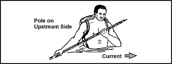
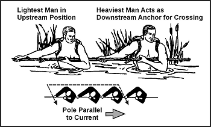
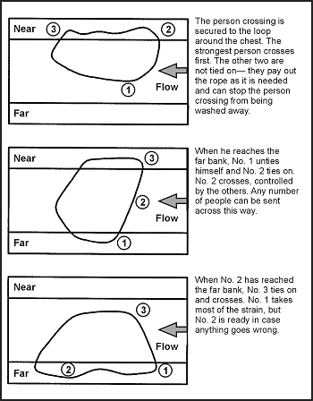
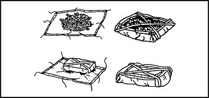
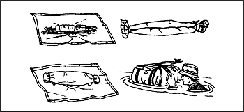
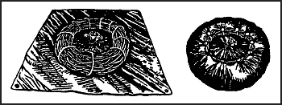
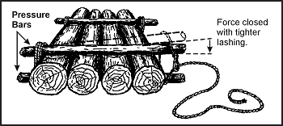
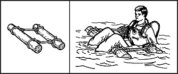

> У ситуації виживання вам, можливо, доведеться перетнути водну перешкоду. Вона може бути у формі річки, струмка, озера, болота, сипучого піску, трясовини або мускугу (muskeg). Навіть у пустелі стаються раптові повені, роблячи струмки перешкодою. Якою б не була перешкода, вам потрібно знати, як перетнути її безпечно.

### РІЧКИ ТА СТРУМКИ (RIVERS AND STREAMS)

Ви можете застосувати майже будь-який опис до річок та струмків. Вони можуть бути мілкими чи глибокими, повільними чи швидкими, вузькими чи широкими. Перш ніж намагатися перетнути річку чи струмок, розробіть хороший план.

Ваш перший крок — пошук високого місця, з якого ви зможете отримати хороший огляд річки чи струмка. З цього місця ви можете шукати місце для перетину. Якщо високого місця немає, заберіться на дерево. Хороші локації для перетину включають:
* Рівну ділянку, де вона розбивається на кілька каналів. Дві чи три вузькі протоки зазвичай легше перетнути, ніж широку річку.
* Мілкий берег або мілину (sandbar). По можливості виберіть точку вище за течією від берега чи мілини, щоб течія понесла вас до неї, якщо ви втратите рівновагу.
* Напрямок через річку, що веде вниз за течією, так що ви перетнете течію під кутом приблизно 45 градусів.

Наступні ділянки мають потенційні небезпеки; уникайте їх, якщо можливо:
* Перешкоди на протилежному боці річки, які можуть перешкодити вашому пересуванню. Намагайтеся вибрати точку, з якої пересування буде найбезпечнішим і найлегшим.
* Ряд каміння, що перетинає річку. Це часто вказує на небезпечні пороги або каньйони.
* Глибокий або швидкий водоспад або глибокий канал. Ніколи не намагайтеся перейти вбрід струмок прямо над або навіть близько до таких небезпек.
* Кам'янисті місця, які можуть призвести до серйозних травм від ковзання чи падіння. Зазвичай підводне каміння дуже слизьке, що робить балансування надзвичайно важким. Проте випадковий камінь, що розбиває течію, може вам допомогти.
* Лиман річки, оскільки він зазвичай широкий, має сильні течії і схильний до припливів. Ці припливи можуть впливати на деякі річки за багато кілометрів від їх гирла. Повертайтеся вгору за течією до легшого місця перетину.
* Вир (eddies), які можуть створювати потужну силу тяжіння назад униз за течією від перешкоди, що викликає вир, і затягнути вас під поверхню.

Глибина річки або струмка, яку можна перейти вбрід, не є перешкодою, якщо ви можете утриматися на ногах. Насправді глибока вода іноді тече повільніше і тому безпечніша, ніж швидка мілка вода. Ви завжди можете висушити свій одяг пізніше або, за необхідності, зробити пліт для перенесення одягу та спорядження через річку.

Ви не повинні намагатися плисти або переходити вбрід струмок або річку, коли вода має дуже низькі температури. Це плавання може бути фатальним. Спробуйте зробити пліт якоїсь форми. Переходьте вбрід, якщо можете замочити лише ноги. Енергійно висушіть їх, щойно дістанетеся до іншого берега.

### ПОРОГИ (RAPIDS)

Якщо необхідно, ви можете безпечно перетнути глибоку, стрімку річку чи пороги. Щоб переплисти глибоку, стрімку річку, пливіть за течією, ніколи не боріться з нею. Намагайтеся тримати тіло горизонтально до води. Це зменшить небезпеку затягування під воду.

У швидких мілких порогах ляжте на спину, ноги вказують вниз за течією, допомагаючи руками вздовж стегон. Ця дія збільшить плавучість і допоможе вам відхилитися від перешкод. Тримайте ноги вгору, щоб уникнути їх забивання або заплутування в камінні.

У глибоких порогах ляжте на живіт, головою вниз за течією, повертаючись до берега, коли можете. Стежте за перешкодами і будьте обережні з застійною водою (backwater eddies) та збіжними течіями, оскільки вони часто містять небезпечні завихрення. Збіжні течії виникають там, де нові водотоки впадають у річку або де вода відхиляється навколо великих перешкод, таких як невеликі острови.

Щоб перейти вбрід стрімкий, підступний струмок, застосуйте такі кроки:
* Зніміть штани та сорочку, щоб зменшити опір води. Залишайте взуття, щоб захистити стопи та щиколотки від каміння. Воно також забезпечить більш міцну опору.
* Прив'яжіть штани та інші речі до верху рюкзака або в пучок, якщо у вас немає рюкзака. Таким чином, якщо вам доведеться звільнити спорядження, усі ваші речі будуть разом. Знайти один великий рюкзак легше, ніж кілька дрібних предметів.
* Носіть рюкзак високо на плечах і переконайтеся, що ви можете легко зняти його, якщо це необхідно. Неможливість швидко зняти рюкзак може затягнути під воду навіть найсильніших плавців.
* Знайдіть міцну палицю довжиною близько 5–10 сантиметрів (3 дюйми) та 2–2,5 метра (7–8 футів), щоб допомогти вам перейти вбрід струмок. Візьміться за палицю і міцно встроміть її з навітряного/вище за течією боку, щоб розбити течію. Міцно ставте ноги при кожному кроці і пересувайте палицю вперед трохи вниз за течією від попереднього положення, але все ще вище за течією від вас. З наступним кроком поставте ногу нижче палиці. Тримайте палицю під нахилом так, щоб сила течії тримала палицю біля вашого плеча ([Фігура 17-1](#fig17-1)).
* Перетніть струмок так, щоб ви перетнули течію вниз за течією під кутом 45 градусів.

**Фігура 17-1. Перетин стрімкого струмка однією людиною**

Використовуючи цей метод, ви можете безпечно перетнути течії, які зазвичай занадто сильні для того, щоб одна людина стояла проти них. Не турбуйтеся про вагу свого рюкзака, оскільки вага допоможе, а не завадить вам переходити вбрід струмок.

Якщо з вами інші люди, перетніть струмок разом. Переконайтеся, що кожен підготував свій рюкзак та одяг, як описано вище. Розмістіть найважчу людину на нижньому за течією кінці палиці, а найлегшу — на верхньому. Використовуючи цей метод, людина вище за течією розбиває течію, а ті, що нижче, можуть рухатися відносно легко у вирві, утвореній людиною вище за течією. Якщо людину вище за течією тимчасово збиває з ніг, інші можуть триматися стійко, поки вона відновлює рівновагу ([Фігура 17-2](#fig17-2)).

**Фігура 17-2. Декілька людей перетинають стрімкий струмок**

Якщо у вас є три або більше людей і мотузка, ви можете використати техніку, показану на [Фігура 17-3](#fig17-3), щоб перетнути струмок. Довжина мотузки має бути втричі більшою за ширину струмка.

**Фігура 17-3. Особи, прив'язані разом для перетину струмка**

### ПЛОТИ (RAFTS)

Якщо у вас є два пончо, ви можете побудувати щітковий пліт або австралійський пліт з пончо. За допомогою будь-якого з цих плотів ви можете безпечно переправити своє спорядження через повільний струмок чи річку.

**ЩІТКОВИЙ ПЛІТ (BRUSH RAFT)**

Щітковий пліт, якщо він правильно побудований, витримає близько 115 кілограмів (253 фунти). Для його побудови використовуйте пончо, свіжий зелений чагарник, два невеликі стовбури та мотузку або ліану наступним чином ([Фігура 17-4](#fig17-4)):
* Заштовхніть капюшон кожного пончо на внутрішню сторону і міцно зав'яжіть шиї за допомогою шнурків.
* Прикріпіть мотузки або ліани до кутових та бічних люверсів кожного пончо. Переконайтеся, що вони достатньо довгі, щоб перетнутися та зв'язатися з іншими, прикріпленими на протилежному кутку чи боці.
* Розстеліть одне пончо на землі внутрішньою стороною вгору. Накидайте свіжий зелений чагарник (без товстих гілок) на пончо, доки купа чагарнику не досягне висоти близько половини метра (18 дюймів). Підтягніть шнурок вгору крізь центр купи чагарнику.
* Зробіть X-подібний каркас із двох невеликих пагонів і покладіть його поверх купи чагарнику. Надійно прив'яжіть X-подібний каркас на місці за допомогою шнурка пончо.
* Насипте ще півметра (18 дюймів) чагарнику поверх X-подібного каркаса, потім трохи стисніть чагарник.
* Підтягніть боки пончо навколо чагарнику та, використовуючи мотузки чи ліани, прикріплені до кутових чи бічних люверсів, зав'яжіть їх по діагоналі від кута до кута та від боку до боку.
* Розстеліть друге пончо внутрішньою стороною вгору поруч із пучком чагарнику.
* Перекатіть пучок чагарнику на друге пончо так, щоб зв'язана сторона була внизу. Зав'яжіть друге пончо навколо пучка чагарнику таким же чином, як ви зав'язали перше пончо навколо чагарнику.
* Покладіть його у воду зв'язаною стороною другого пончо вгору.

**Фігура 17-4. Щітковий пліт**

**АВСТРАЛІЙСЬКИЙ ПЛІТ З ПОНЧО (AUSTRALIAN PONCHO RAFT)**

Якщо у вас немає часу на збір чагарнику для щіткового плота, ви можете зробити австралійський пліт з пончо. Цей пліт, хоча і більш водонепроникний, ніж щітковий пліт з пончо, плаватиме лише з близько 35 кілограмами (77 фунтів) спорядження. Для його побудови використовуйте два пончо, два рюкзаки, дві жердини довжиною 1,5 метра (4 фути) або гілки, а також мотузки, ліани, шнурки для взуття або подібний матеріал наступним чином ([Фігура 17-5](#fig17-5)):
* Заштовхніть капюшон кожного пончо на внутрішню сторону і міцно зав'яжіть шиї за допомогою шнурків.
* Розстеліть одне пончо на землі внутрішньою стороною вгору. Покладіть і відцентруйте дві жердини довжиною 1,5 метра (4 фути) на пончо на відстані близько півметра (18 дюймів) одна від одної.
* Покладіть свої рюкзаки, спорядження або інше обладнання між жердинами. Також покладіть інші предмети, які ви хочете зберегти сухими, між жердинами. Застебніть боки пончо разом.
* Скористайтеся допомогою товариша для завершення плота. Тримайте застебнуту частину пончо в повітрі і щільно скрутіть її до спорядження. Переконайтеся, що ви згорнули всю ширину пончо.
* Закрутіть кінці рулону, щоб утворити «хвостики» (pigtails) у протилежних напрямках. Зігніть хвостики поверх пакунка і надійно зав'яжіть їх на місці за допомогою мотузок, шнурків для взуття або ліан.
* Розстеліть друге пончо на землі внутрішньою стороною вгору. Якщо вам потрібна більша плавучість, покладіть трохи свіжого зеленого чагарнику на це пончо.
* Покладіть пакунок зі спорядженням зв'язаною стороною вниз у центр другого пончо. Обгорніть друге пончо навколо пакунка зі спорядженням, дотримуючись тієї ж процедури, яку ви використовували для загортання спорядження в перше пончо.
* Зав'яжіть мотузки, шнурки для взуття, ліани або інший матеріали для зв'язування навколо плота на відстані близько 30 сантиметрів (12 дюймів) від кінця кожного хвостика. Покладіть і закріпіть зброю зверху плота.
* Прив'яжіть один кінець мотузки до порожньої фляги, а інший — до плота. Це допоможе вам буксирувати пліт.

**Фігура 17-5. Австралійський пліт з пончо**

**ПОНЧО-ПОНЧИК ПЛІТ (PONCHO DONUT RAFT)**

Іншим типом плота є пліт-пончик з пончо. Його будівництво займає більше часу, ніж щіткового плота чи австралійського плота з пончо, але він ефективний. Для його побудови використовуйте одне пончо, невеликі пагони, вербу або ліани та мотузку, шнурки для взуття або інший матеріал для зв'язування ([Фігура 17-6](#fig17-6)) наступним чином:
* Зробіть каркасне коло, розмістивши кілька кілочків у землі, які приблизно окреслюють внутрішнє та зовнішнє кола.
* Використовуючи молоді пагони, вербу або ліани, побудуйте кільце-пончик усередині кіл кілочків.
* Обмотайте кілька шматків мотузки навколо кільця-пончика на відстані близько 30–60 сантиметрів (12–24 дюйми) один від одного і міцно зав'яжіть їх.
* Заштовхніть капюшон пончо на внутрішню сторону і міцно зав'яжіть шию за допомогою шнурка.
* Покладіть пончо на землю внутрішньою стороною вгору. Покладіть кільце-пончик на центр пончо. Загорніть пончо вгору і поверх кільця-пончика та прив'яжіть кожен люверс на пончо до кільця.
* Прив'яжіть один кінець мотузки до порожньої фляги, а інший — до плота. Ця мотузка допоможе вам буксирувати пліт.

**Фігура 17-6. Пліт-пончик з пончо**

При спуску на воду будь-якого з вищезгаданих плотів будьте обережні, щоб не проткнути і не порвати його, тягнучи по землі. Перш ніж почати перетин річки чи струмка, дайте плоту полежати на воді кілька хвилин, щоб переконатися, що він плаває.

Якщо річка занадто глибока для переходу вбрід, штовхайте пліт перед собою під час плавання. Конструкція вищезгаданих плотів не дозволяє їм витримувати повну вагу тіла людини. Використовуйте їх як поплавець, щоб безпечно переправити себе та своє спорядження через річку чи струмок.

Обов'язково перевірте температуру води перед спробою перетнути річку чи водну перешкоду. Якщо вода надзвичайно холодна і ви не можете знайти мілке місце для переходу в річці, не намагайтеся переходити її вбрід. Вигадайте інші засоби для перетину. Наприклад, ви можете імпровізувати міст, зваливши дерево через річку. Або ви можете побудувати пліт, достатньо великий, щоб витримати вас та ваше спорядження. Для цього, однак, вам знадобляться сокира, ніж, мотузка або ліани та час.

**КОЛОДНИЙ ПЛІТ (LOG RAFT)**

Ви можете зробити пліт, використовуючи будь-які сухі, мертві, стоячі дерева для колод. Проте ялинові дерева, знайдені в полярних та суботарктичних регіонах, роблять найкращі плоти. Простий метод виготовлення плота полягає у використанні притискних брусів (pressure bars), надійно закріплених на кожному кінці плота для утримання колод разом ([Фігура 17-7](#fig17-7)).

**Фігура 17-7. Використання притискних брусів**

### ПЛАВУЧІ ЗАСОБИ (FLOTATION DEVICES)

Якщо вода достатньо тепла для плавання і у вас немає часу чи матеріалів для побудови одного з плотів типу пончо, ви можете використати різні плавучі засоби для подолання водної перешкоди. Деякі предмети, які ви можете використати як плавучі засоби:
* _Штани._ Зав'яжіть кожну штанину внизу і закрийте ширінку. Обома руками візьміться за поясок з боків і розмахуйте штанами в повітрі, щоб упіймати повітря в кожній штанині. Швидко притисніть боки пояска разом і тримайте його під водою, щоб повітря не виходило. Тепер у вас є водні крила (water wings), які триматимуть вас на плаву при перетині водойми.

**ПРИМІТКА:** Змочіть штани перед надуванням, щоб краще утримати повітря. Можливо, доведеться надувати штани кілька разів при перетині великої водойми.
* _Порожні контейнери._ Зв'яжіть разом порожні каністри з-під газу, водяні глеки, коробки з-під патронів, коробки чи інші предмети, які затримують або тримають повітря. Використовуйте їх як водні крила. Використовуйте цей тип плавучого засобу лише в повільних річках або струмках.
* _Поліетиленові пакети та пончо._ Наповніть повітрям два або більше поліетиленових пакетів і закріпіть їх разом біля отвору. Використовуйте своє пончо і міцно загортайте зелену рослинність всередину нього так, щоб у вас був рулон діаметром принаймні 20 сантиметрів (8 дюймів). Надійно зав'яжіть кінці рулону. Ви можете носити його навколо талії або через одне плече і під протилежною рукою.
* _Колоди._ Використовуйте викинуту колоду плавучого лісу, якщо вона є, або знайдіть колоду біля води як поплавець. Обов'язково перевірте колоду перед початком перетину. Деякі колоди дерев — наприклад, пальми — потонуть, навіть коли деревина мертва. Інший метод — прив'язати дві колоди на відстані близько 60 сантиметрів (24 дюймів) одна від одної. Сядьте між колодами спиною до однієї і ногами через іншу ([Фігура 17-8](#fig17-8)).
* _Рогоз (Cattails)._ Зберіть стебла рогозу і зав'яжіть їх у пучок діаметром 25 сантиметрів (10 дюймів) або більше. Численні повітряні клітини в кожному стеблі змушують стебло плавати, доки воно не згниє. Перевірте пучок рогозу, щоб переконатися, що він витримає вашу вагу, перш ніж намагатися перетнути водойму.

**Фігура 17-8. Колодна плавучість**

Існує багато інших плавучих засобів, які ви можете вигадати, використовуючи певну уяву. Просто переконайтеся, що ви протестували пристрій, перш ніж намагатися ним скористатися.

### ІНШІ ВОДНІ ПЕРЕШКОДИ

Іншими водними перешкодами, з якими ви можете зіткнутися, є болота, трясовини, мускуги або сипучі піски. Не намагайтеся ходити по них пішки. Спроба підняти ноги під час вертикального стояння занурить вас глибше. Намагайтеся обійти ці перешкоди. Якщо ви не можете їх обійти, ви, можливо, зможете перекинути через них міст, використовуючи колоди, гілки чи листя.

Спосіб перетнути болото — лягти обличчям вниз, розвівши руки і ноги. Використовуйте плавучий засіб або сформуйте кишені з повітрям у своєму одязі. Пливіть або витягайте себе повільно, намагаючись тримати тіло горизонтально.

У болотах ділянки з рослинністю зазвичай достатньо міцні, щоб витримати вашу вагу. Проте рослинність зазвичай буде відсутня у відкритих ділянках мулу або води. Якщо ви пересічний пловець, у вас не повинно бути проблем із плаванням, повзанням або витягуванням себе через милі болота чи трясовини.

Сипучий пісок — це суміш піску та води, яка утворює масу, що зміщується. Він легко піддається тиску і затягує та поглинає предмети, що лежать на його поверхні. Він змінюється за глибиною і зазвичай є локалізованим. Сипучий пісок зазвичай зустрічається на плоских берегах, у забитих мулом річках з мінливими водотоками та поблизу гирл великих річок. Якщо ви не впевнені, чи є піщана зона сипучим піском, киньте на неї невеликий камінь. Камінь потоне в сипучому піску. Хоча сипучий пісок має більше всмоктування, ніж бруд чи мул, ви можете перейти його так само, як і болото. Ляжте обличчям вниз, розведіть руки і ноги та повільно пересувайтеся.

### РОСЛИННІ ПЕРЕШКОДИ

Деякі водні ділянки, які ви повинні перетнути, можуть мати підводні та плаваючі рослини, які ускладнять плавання. Проте ви можете проплисти крізь відносно густу рослинність, якщо будете залишатися спокійними і не батрачитимете навколо. Тримайтеся якомога ближче до поверхні і використовуйте брас з неглибокими рухами ніг і рук. Видаляйте рослини навколо себе так само, як одяг. Коли ви втомитеся, пливіть на спині або тримайтеся на плаву, поки не відпочинете достатньо, щоб продовжити брасом.

Мангрова болота є іншим типом перешкоди, що зустрічається уздовж тропічних узбережжях. Мангрові дерева або чагарники випускають багато опірних коренів, які утворюють густі маси. Щоб пройти крізь мангрове болото, дочекайтеся відпливу. Якщо ви знаходитесь на внутрішньому боці, шукайте вузький гай дерев і пробивайтеся до моря через них. Ви також можете спробувати знайти русло водного шляху чи струмка крізь дерева і слідувати за ним до моря. Якщо ви на морському боці, рухайтеся вглиб суші вздовж струмків чи каналів. Будьте на поготові щодо крокодилів уздовж каналів та на мілководді. Якщо поблизу є якісь, залиште воду і перебирайтеся через мангрове коріння. Переправляючись через мангрове болото, можна збирати їжу з приливних басейнів чи коріння дерев.

Велика болотиста територія вимагає більше часу та зусиль. Тому, якщо ви **повинні** перетнути велику болотисту територію, побудуйте якийсь пліт.
